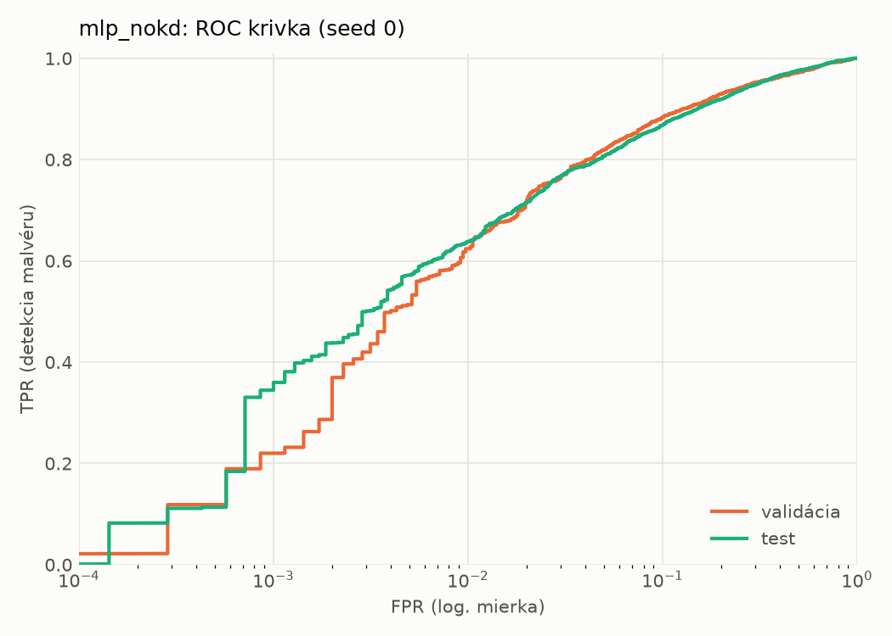
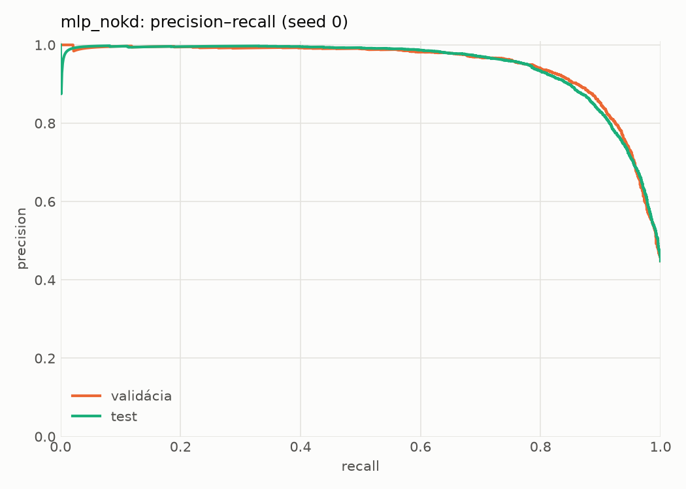
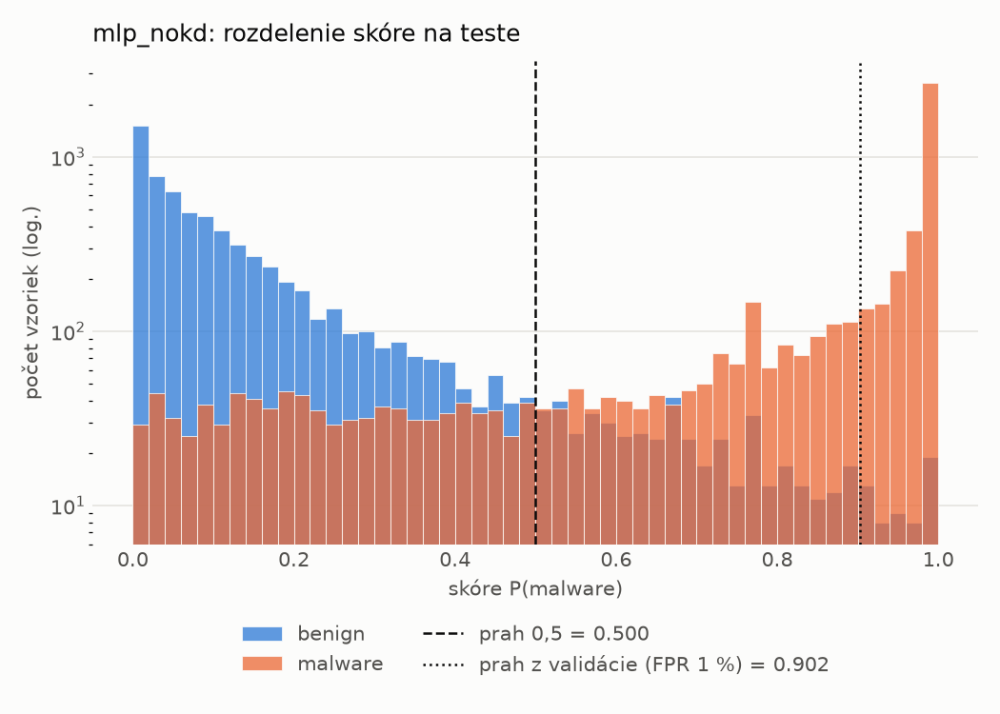
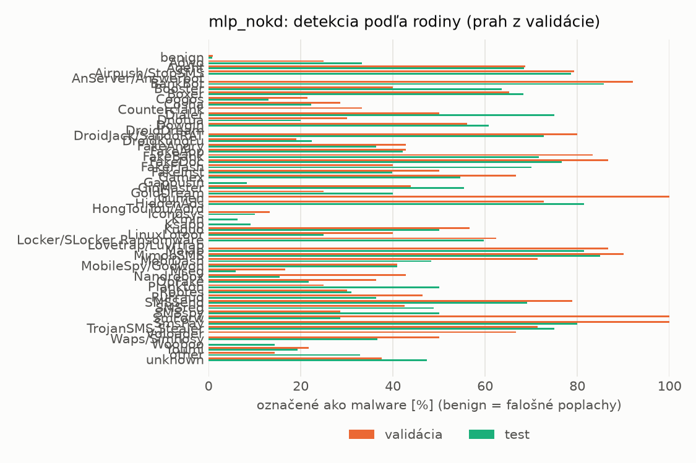
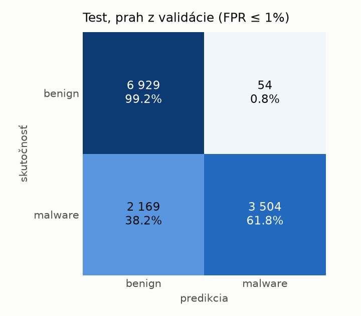
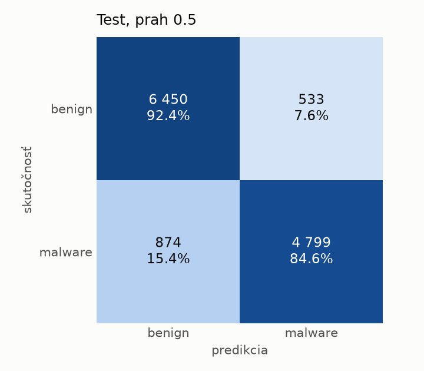
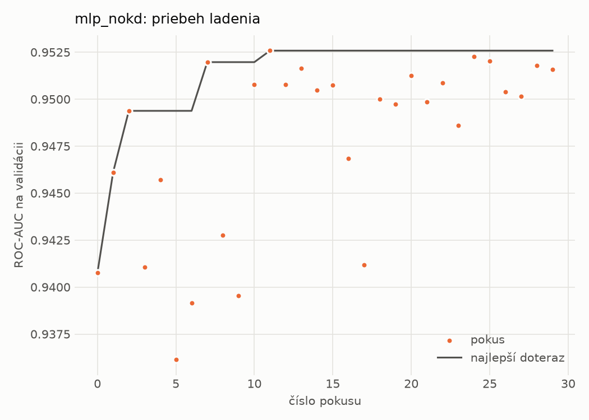
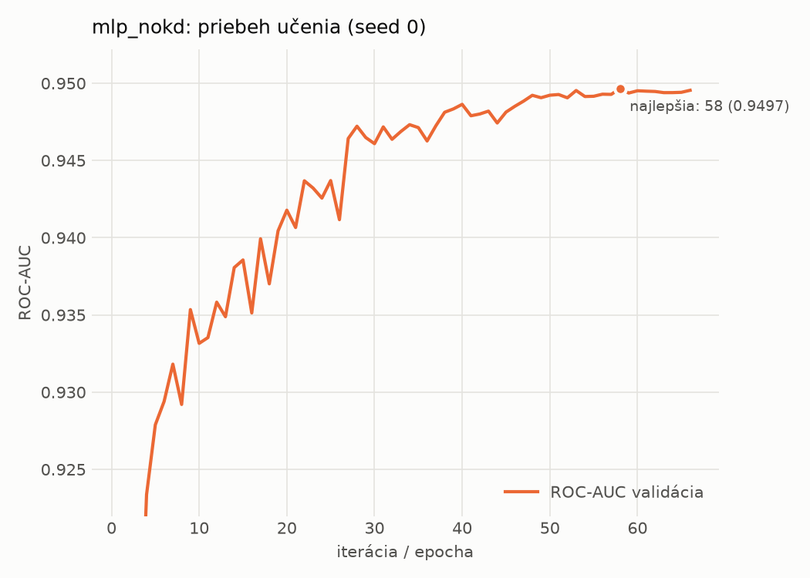

# dynamic/mlp_nokd – beh `20261123-205230`

> Automaticky generované (`src/training/run_tabular.py`). Konfigurácia: `config.yaml`, protokol: `protocol.yaml`.

- **Model:** `mlp` – kontrola – rovnaké malé MLP bez destilácie (iba skutočné označenia)
- **Ladenie:** 30 dokončených pokusov (Optuna TPE), cieľ ROC-AUC na validácii, 6.8 min
- **Finálne modely:** seedy [0, 1, 2]; hodnoty sú priemer ± smerodajná odchýlka cez seedy
- **Najlepšie hyperparametre:** `{"hidden_layers": 1, "max_epochs": 100, "patience": 8, "hidden_width": 64, "dropout": 0.039782849658421375, "lr": 0.0018574312606020214, "weight_decay": 6.674701047165933e-06, "batch_size": 256}`

## Detekčná kvalita (bez prahu)
| metrika | train (podvzorka) | validácia | test |
|---|---|---|---|
| ROC-AUC | 0.9644 ± 0.0012 | 0.9501 ± 0.0007 | 0.9488 ± 0.0007 |
| PR-AUC | 0.9626 ± 0.0011 | 0.9493 ± 0.0003 | 0.9483 ± 0.0010 |
| TPR pri FPR 1 % | 0.7165 ± 0.0017 | 0.6350 ± 0.0111 | 0.6422 ± 0.0096 |
| TPR pri FPR 0,1 % | 0.5009 ± 0.0222 | 0.1974 ± 0.0197 | 0.2999 ± 0.0419 |
| log loss | 0.2348 ± 0.0045 | 0.2786 ± 0.0011 | 0.2797 ± 0.0033 |
| Brier skóre | 0.0698 ± 0.0015 | 0.0805 ± 0.0009 | 0.0830 ± 0.0010 |

Rozdiel ROC-AUC train − validácia: **0.0142** (veľký rozdiel = preučenie).

## Pri prahu z validácie (FPR ≤ 1% na validácii)
| metrika | train (podvzorka) | validácia | test |
|---|---|---|---|
| accuracy | 0.8441 ± 0.0023 | 0.8310 ± 0.0050 | 0.8262 ± 0.0020 |
| balanced accuracy | 0.8219 ± 0.0027 | 0.8126 ± 0.0056 | 0.8070 ± 0.0024 |
| precision | 0.9892 ± 0.0001 | 0.9815 ± 0.0003 | 0.9843 ± 0.0031 |
| recall (TPR) | 0.6493 ± 0.0053 | 0.6350 ± 0.0111 | 0.6221 ± 0.0061 |
| FPR | 0.0055 ± 0.0000 | 0.0097 ± 0.0000 | 0.0081 ± 0.0017 |
| F1 | 0.7840 ± 0.0039 | 0.7711 ± 0.0083 | 0.7624 ± 0.0038 |
| MCC | 0.7065 ± 0.0041 | 0.6853 ± 0.0087 | 0.6777 ± 0.0029 |

## Pri pevnom prahu 0.5
| metrika | train (podvzorka) | validácia | test |
|---|---|---|---|
| accuracy | 0.9087 ± 0.0024 | 0.8963 ± 0.0021 | 0.8908 ± 0.0024 |
| balanced accuracy | 0.9048 ± 0.0027 | 0.8939 ± 0.0024 | 0.8872 ± 0.0026 |
| precision | 0.9126 ± 0.0055 | 0.8957 ± 0.0025 | 0.8985 ± 0.0033 |
| recall (TPR) | 0.8743 ± 0.0069 | 0.8701 ± 0.0057 | 0.8527 ± 0.0059 |
| FPR | 0.0647 ± 0.0048 | 0.0824 ± 0.0024 | 0.0782 ± 0.0031 |
| F1 | 0.8930 ± 0.0030 | 0.8827 ± 0.0027 | 0.8750 ± 0.0030 |
| MCC | 0.8141 ± 0.0050 | 0.7901 ± 0.0044 | 0.7790 ± 0.0048 |

## Výpočtové nároky (seed 0, testovacia množina)
| meranie | hodnota |
|---|---|
| tréning finálneho modelu | 14.4 s (priemer cez seedy) |
| ladenie spolu | 409 s |
| počet parametrov / uzlov | 8 129 |
| veľkosť modelu na disku | 0.04 MB |
| transformácia vstupu – latencia (1 vlákno) | 0.015 ms |
| transformácia vstupu – priepustnosť | 785 858 vzoriek/s |
| CPU latencia modelu (batch 1, 1 vlákno) | 0.056 ms (p95 0.160) |
| CPU priepustnosť (24 vlákien) | 7 408 535 vzoriek/s |
| GPU latencia (batch 1) | 0.285 ms (p95 0.319) |
| GPU priepustnosť | 3 183 419 vzoriek/s |
| GPU špičková pamäť | 78 MB |

## Grafy
| | |
|---|---|
|  |  |
|  |  |
|  |  |
|  |  |

## Súbory
`metrics.json` (všetky metriky po seedoch vrátane rodín), `timing.json`, `hpo_trials.csv`,
`predictions/<časť>_seed<N>.parquet` (sha256, family, label, score), `model/seed_<N>/`, `log.txt`.
