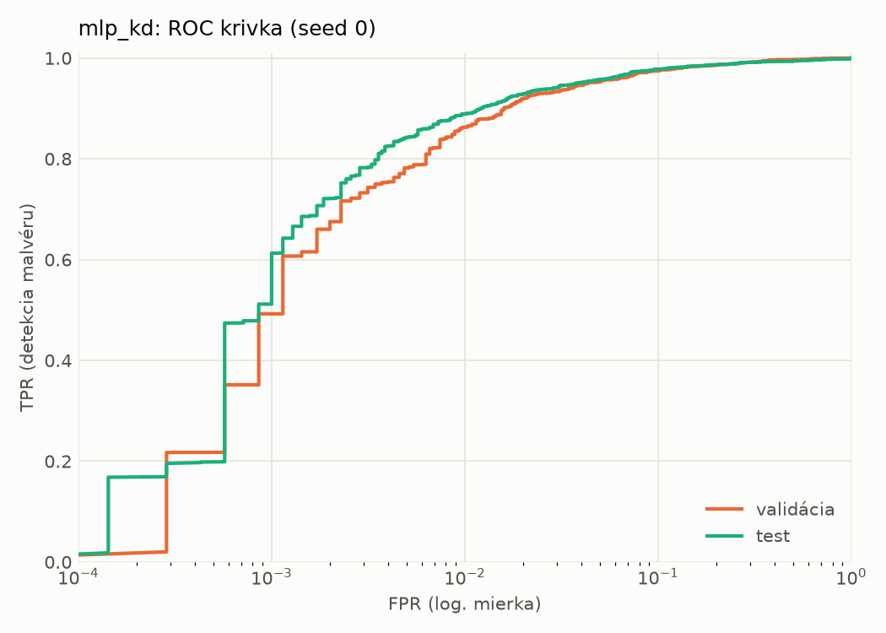
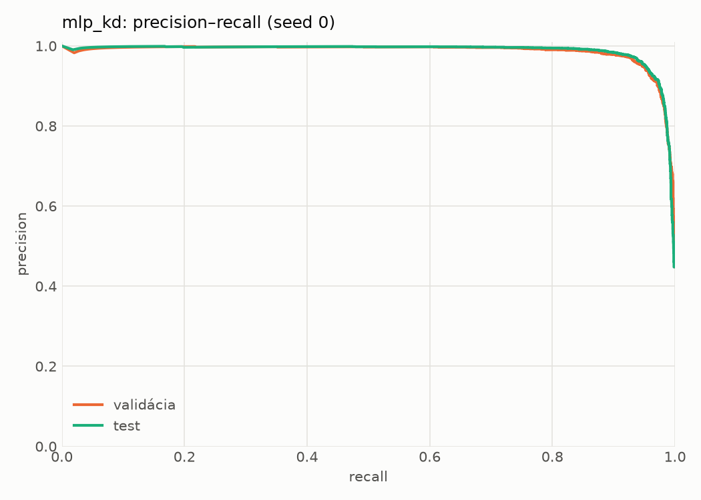
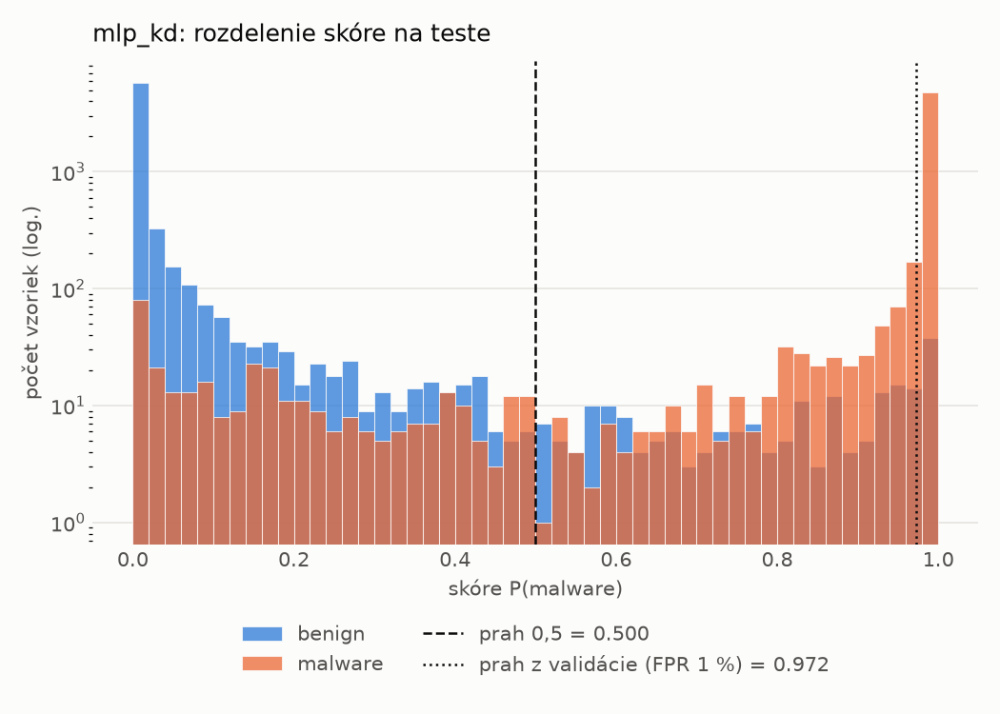
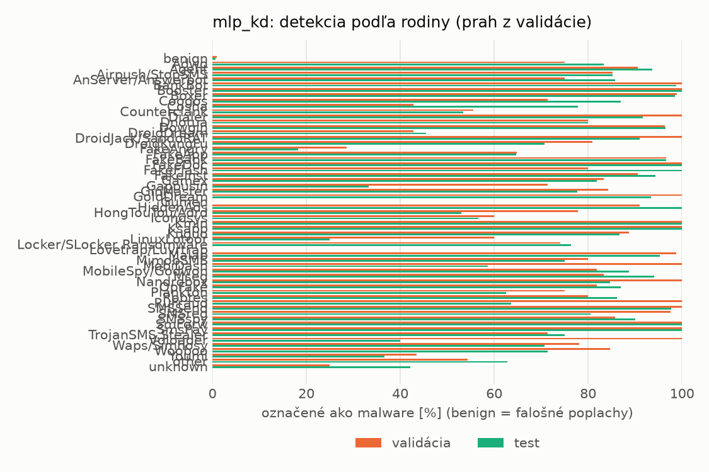
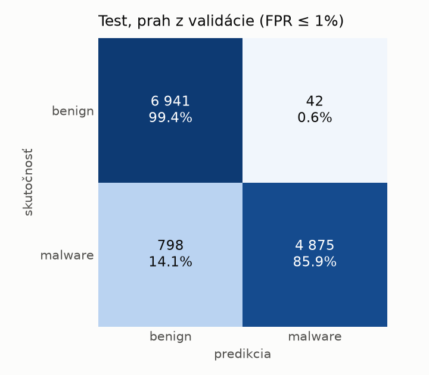
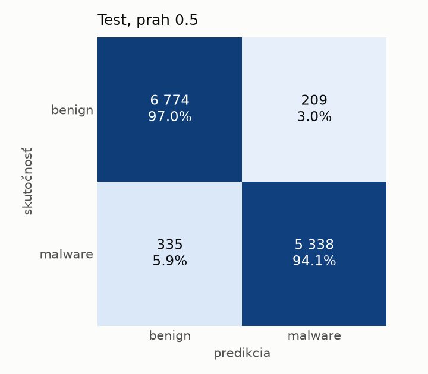
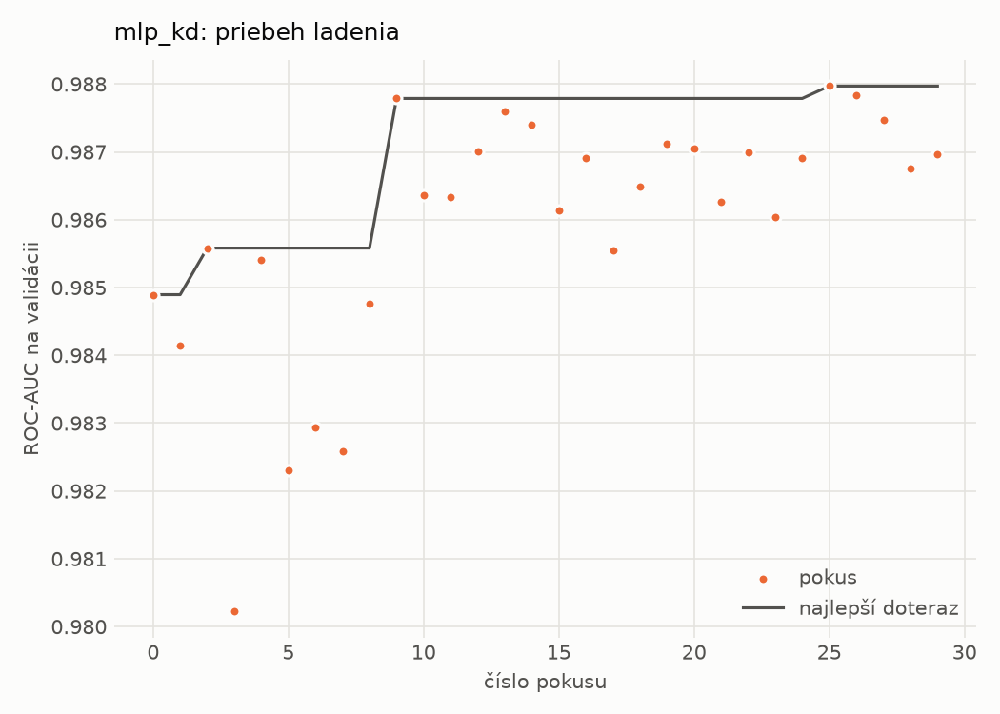
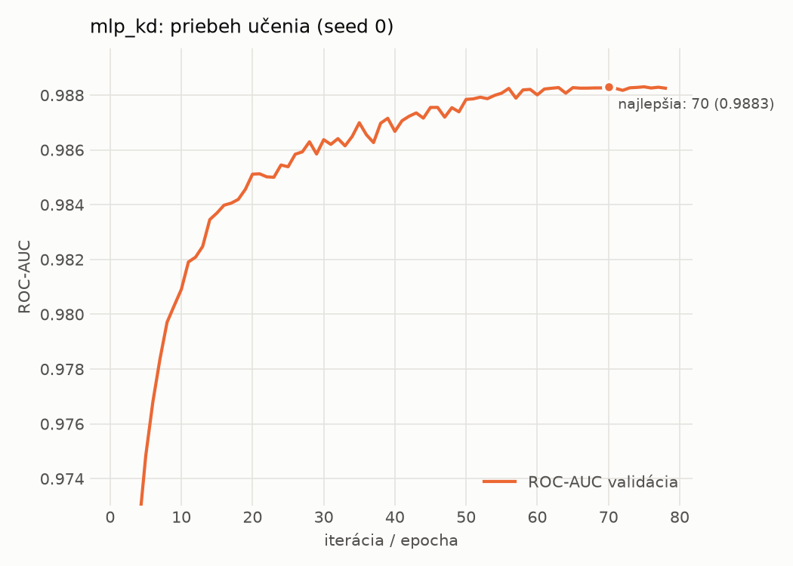

# static/mlp_kd – beh `20261123-203204`

> Automaticky generované (`src/training/run_tabular.py`). Konfigurácia: `config.yaml`, protokol: `protocol.yaml`.

- **Model:** `mlp` – študent – malé MLP učené destiláciou z hybridného učiteľa
- **Ladenie:** 30 dokončených pokusov (Optuna TPE), cieľ ROC-AUC na validácii, 3.5 min
- **Finálne modely:** seedy [0, 1, 2]; hodnoty sú priemer ± smerodajná odchýlka cez seedy
- **Najlepšie hyperparametre:** `{"hidden_layers": 1, "max_epochs": 100, "patience": 8, "hidden_width": 64, "dropout": 0.0038513032258879476, "lr": 0.0011339137585789736, "weight_decay": 0.00026533084929296607, "batch_size": 1024, "kd_alpha": 0.3835611341536954, "kd_temperature": 1.7047486853284286}`

## Detekčná kvalita (bez prahu)
| metrika | train (podvzorka) | validácia | test |
|---|---|---|---|
| ROC-AUC | 0.9928 ± 0.0006 | 0.9876 ± 0.0007 | 0.9887 ± 0.0006 |
| PR-AUC | 0.9928 ± 0.0006 | 0.9854 ± 0.0009 | 0.9881 ± 0.0005 |
| TPR pri FPR 1 % | 0.9317 ± 0.0053 | 0.8511 ± 0.0102 | 0.8812 ± 0.0078 |
| TPR pri FPR 0,1 % | 0.8004 ± 0.0229 | 0.5124 ± 0.0187 | 0.5674 ± 0.0630 |
| log loss | 0.0995 ± 0.0053 | 0.1528 ± 0.0037 | 0.1380 ± 0.0053 |
| Brier skóre | 0.0259 ± 0.0016 | 0.0375 ± 0.0009 | 0.0334 ± 0.0002 |

Rozdiel ROC-AUC train − validácia: **0.0052** (veľký rozdiel = preučenie).

## Pri prahu z validácie (FPR ≤ 1% na validácii)
| metrika | train (podvzorka) | validácia | test |
|---|---|---|---|
| accuracy | 0.9425 ± 0.0038 | 0.9279 ± 0.0046 | 0.9312 ± 0.0031 |
| balanced accuracy | 0.9345 ± 0.0043 | 0.9207 ± 0.0051 | 0.9240 ± 0.0034 |
| precision | 0.9952 ± 0.0007 | 0.9861 ± 0.0002 | 0.9908 ± 0.0011 |
| recall (TPR) | 0.8722 ± 0.0084 | 0.8511 ± 0.0102 | 0.8544 ± 0.0060 |
| FPR | 0.0032 ± 0.0004 | 0.0097 ± 0.0000 | 0.0064 ± 0.0007 |
| F1 | 0.9296 ± 0.0049 | 0.9136 ± 0.0059 | 0.9176 ± 0.0039 |
| MCC | 0.8869 ± 0.0072 | 0.8592 ± 0.0086 | 0.8660 ± 0.0059 |

## Pri pevnom prahu 0.5
| metrika | train (podvzorka) | validácia | test |
|---|---|---|---|
| accuracy | 0.9655 ± 0.0013 | 0.9533 ± 0.0002 | 0.9586 ± 0.0014 |
| balanced accuracy | 0.9635 ± 0.0014 | 0.9521 ± 0.0003 | 0.9572 ± 0.0015 |
| precision | 0.9719 ± 0.0016 | 0.9549 ± 0.0003 | 0.9630 ± 0.0006 |
| recall (TPR) | 0.9481 ± 0.0017 | 0.9403 ± 0.0008 | 0.9439 ± 0.0027 |
| FPR | 0.0211 ± 0.0012 | 0.0361 ± 0.0003 | 0.0295 ± 0.0004 |
| F1 | 0.9599 ± 0.0016 | 0.9475 ± 0.0003 | 0.9534 ± 0.0017 |
| MCC | 0.9298 ± 0.0027 | 0.9055 ± 0.0005 | 0.9163 ± 0.0029 |

## Výpočtové nároky (seed 0, testovacia množina)
| meranie | hodnota |
|---|---|
| tréning finálneho modelu | 4.3 s (priemer cez seedy) |
| ladenie spolu | 209 s |
| počet parametrov / uzlov | 10 689 |
| veľkosť modelu na disku | 0.05 MB |
| transformácia vstupu – latencia (1 vlákno) | 0.006 ms |
| transformácia vstupu – priepustnosť | 1 138 867 vzoriek/s |
| CPU latencia modelu (batch 1, 1 vlákno) | 0.056 ms (p95 0.063) |
| CPU priepustnosť (24 vlákien) | 3 317 866 vzoriek/s |
| GPU latencia (batch 1) | 0.265 ms (p95 0.289) |
| GPU priepustnosť | 2 413 517 vzoriek/s |
| GPU špičková pamäť | 63 MB |

## Grafy
| | |
|---|---|
|  |  |
|  |  |
|  |  |
|  |  |

## Súbory
`metrics.json` (všetky metriky po seedoch vrátane rodín), `timing.json`, `hpo_trials.csv`,
`predictions/<časť>_seed<N>.parquet` (sha256, family, label, score), `model/seed_<N>/`, `log.txt`.
