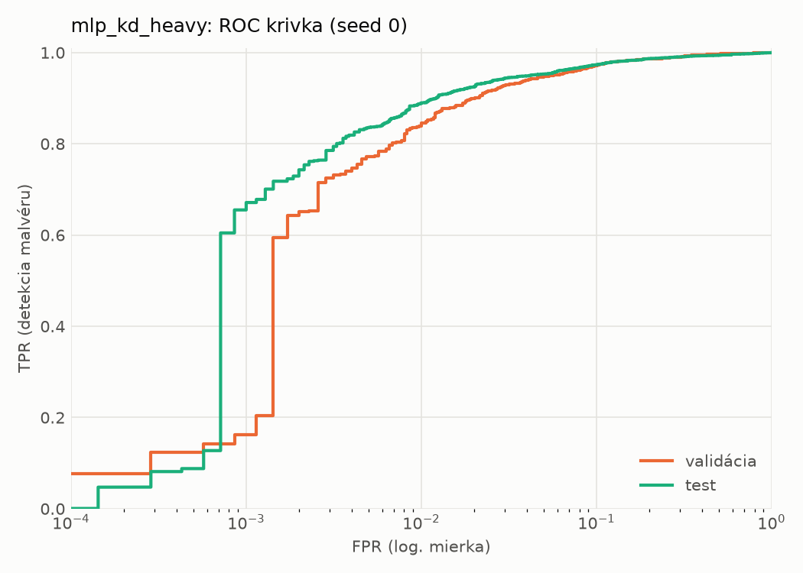
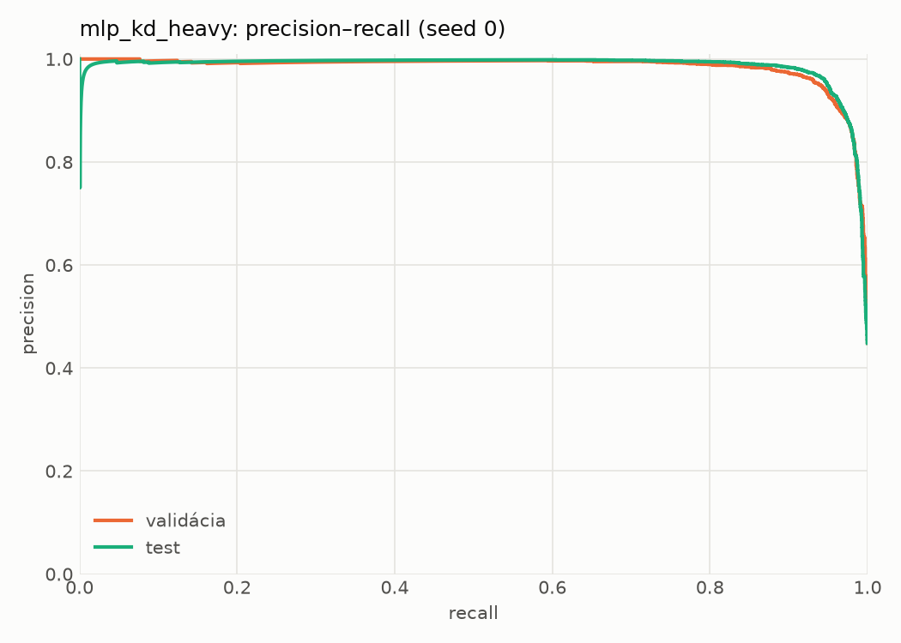
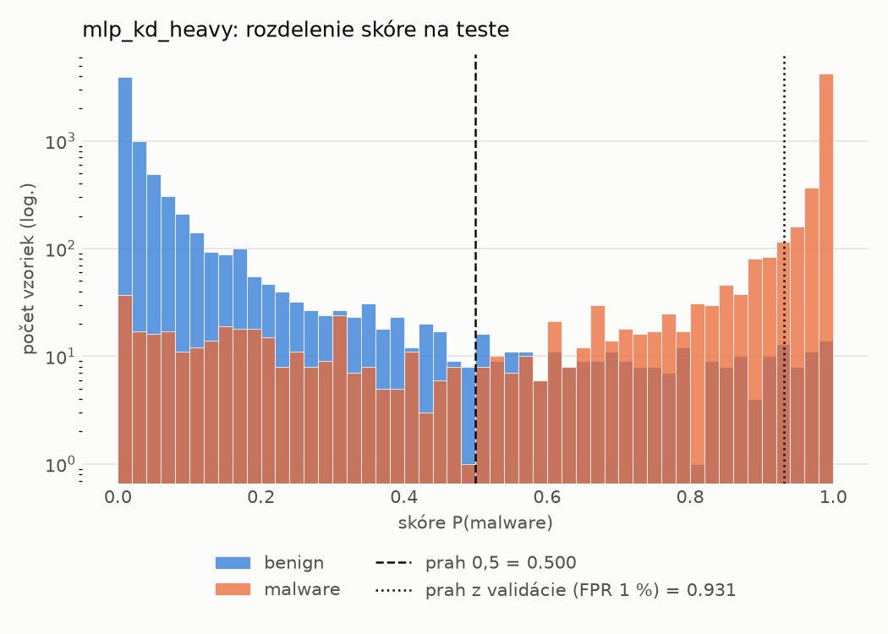
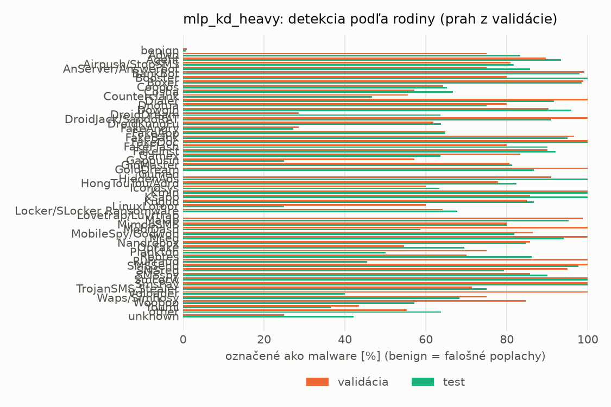
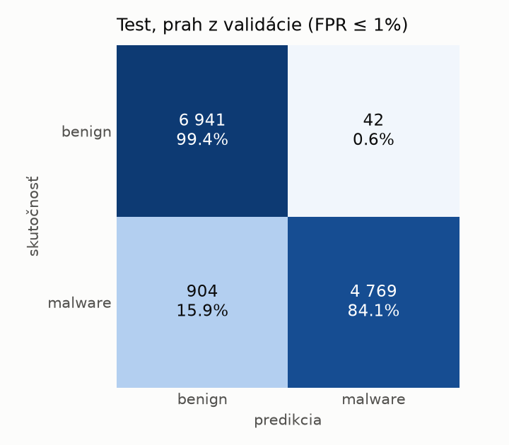
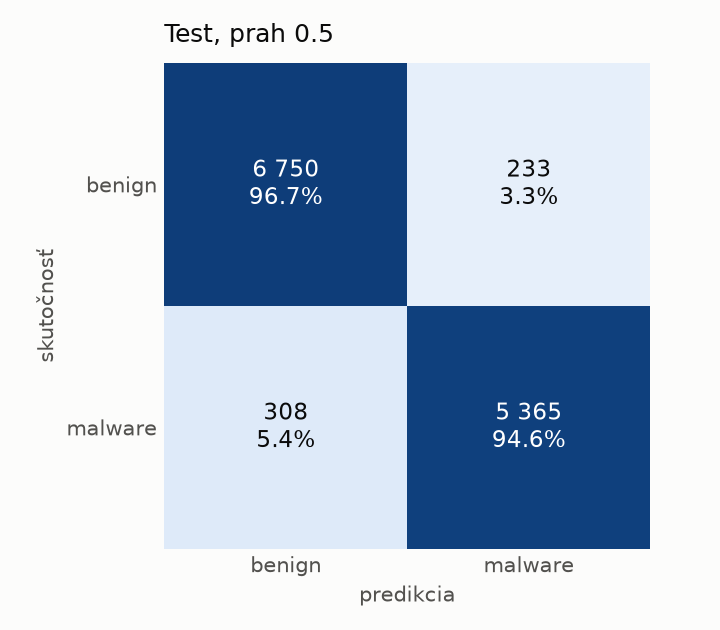
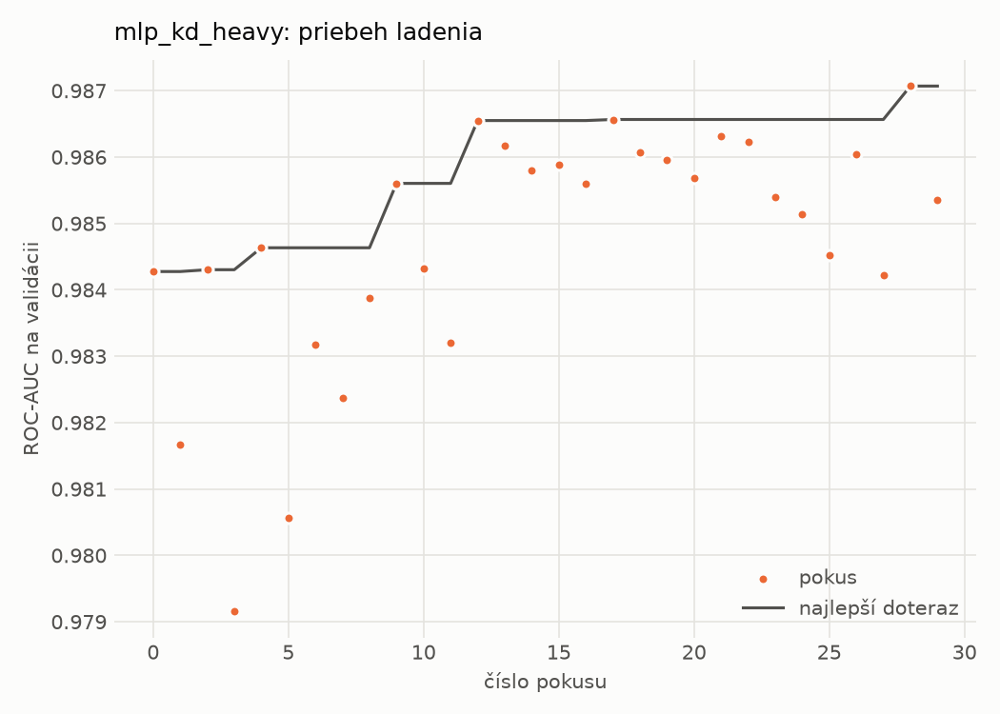
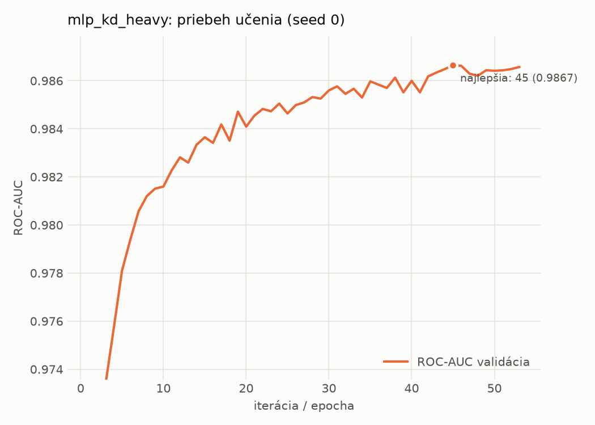

# static/mlp_kd_heavy – beh `20261123-204329`

> Automaticky generované (`src/training/run_tabular.py`). Konfigurácia: `config.yaml`, protokol: `protocol.yaml`.

- **Model:** `mlp` – študent – malé MLP učené destiláciou z mlp_large hybridu (V4)
- **Ladenie:** 30 dokončených pokusov (Optuna TPE), cieľ ROC-AUC na validácii, 2.9 min
- **Finálne modely:** seedy [0, 1, 2]; hodnoty sú priemer ± smerodajná odchýlka cez seedy
- **Najlepšie hyperparametre:** `{"hidden_layers": 1, "max_epochs": 100, "patience": 8, "hidden_width": 64, "dropout": 0.1254973730751401, "lr": 0.0014439667191275393, "weight_decay": 1.2808340108243318e-06, "batch_size": 1024, "kd_alpha": 0.5142654341824873, "kd_temperature": 1.3883261824077338}`

## Detekčná kvalita (bez prahu)
| metrika | train (podvzorka) | validácia | test |
|---|---|---|---|
| ROC-AUC | 0.9920 ± 0.0003 | 0.9862 ± 0.0005 | 0.9881 ± 0.0004 |
| PR-AUC | 0.9918 ± 0.0003 | 0.9825 ± 0.0016 | 0.9870 ± 0.0010 |
| TPR pri FPR 1 % | 0.9203 ± 0.0019 | 0.8384 ± 0.0032 | 0.8821 ± 0.0063 |
| TPR pri FPR 0,1 % | 0.7860 ± 0.0052 | 0.1681 ± 0.0560 | 0.6419 ± 0.0557 |
| log loss | 0.1049 ± 0.0020 | 0.1415 ± 0.0024 | 0.1265 ± 0.0010 |
| Brier skóre | 0.0284 ± 0.0006 | 0.0389 ± 0.0004 | 0.0342 ± 0.0004 |

Rozdiel ROC-AUC train − validácia: **0.0058** (veľký rozdiel = preučenie).

## Pri prahu z validácie (FPR ≤ 1% na validácii)
| metrika | train (podvzorka) | validácia | test |
|---|---|---|---|
| accuracy | 0.9375 ± 0.0009 | 0.9222 ± 0.0014 | 0.9266 ± 0.0019 |
| balanced accuracy | 0.9288 ± 0.0011 | 0.9144 ± 0.0016 | 0.9189 ± 0.0022 |
| precision | 0.9941 ± 0.0005 | 0.9859 ± 0.0001 | 0.9902 ± 0.0010 |
| recall (TPR) | 0.8616 ± 0.0024 | 0.8384 ± 0.0032 | 0.8446 ± 0.0049 |
| FPR | 0.0040 ± 0.0004 | 0.0097 ± 0.0000 | 0.0068 ± 0.0007 |
| F1 | 0.9231 ± 0.0012 | 0.9062 ± 0.0019 | 0.9116 ± 0.0025 |
| MCC | 0.8772 ± 0.0016 | 0.8485 ± 0.0026 | 0.8574 ± 0.0033 |

## Pri pevnom prahu 0.5
| metrika | train (podvzorka) | validácia | test |
|---|---|---|---|
| accuracy | 0.9633 ± 0.0008 | 0.9499 ± 0.0008 | 0.9570 ± 0.0003 |
| balanced accuracy | 0.9618 ± 0.0007 | 0.9490 ± 0.0008 | 0.9559 ± 0.0002 |
| precision | 0.9656 ± 0.0020 | 0.9474 ± 0.0016 | 0.9574 ± 0.0011 |
| recall (TPR) | 0.9496 ± 0.0005 | 0.9405 ± 0.0002 | 0.9461 ± 0.0004 |
| FPR | 0.0261 ± 0.0016 | 0.0424 ± 0.0013 | 0.0342 ± 0.0009 |
| F1 | 0.9576 ± 0.0009 | 0.9439 ± 0.0009 | 0.9517 ± 0.0003 |
| MCC | 0.9254 ± 0.0016 | 0.8987 ± 0.0016 | 0.9130 ± 0.0006 |

## Výpočtové nároky (seed 0, testovacia množina)
| meranie | hodnota |
|---|---|
| tréning finálneho modelu | 4.1 s (priemer cez seedy) |
| ladenie spolu | 176 s |
| počet parametrov / uzlov | 10 689 |
| veľkosť modelu na disku | 0.05 MB |
| transformácia vstupu – latencia (1 vlákno) | 0.015 ms |
| transformácia vstupu – priepustnosť | 739 892 vzoriek/s |
| CPU latencia modelu (batch 1, 1 vlákno) | 0.154 ms (p95 0.163) |
| CPU priepustnosť (24 vlákien) | 4 850 529 vzoriek/s |
| GPU latencia (batch 1) | 0.272 ms (p95 0.290) |
| GPU priepustnosť | 2 339 934 vzoriek/s |
| GPU špičková pamäť | 97 MB |

## Grafy
| | |
|---|---|
|  |  |
|  |  |
|  |  |
|  |  |

## Súbory
`metrics.json` (všetky metriky po seedoch vrátane rodín), `timing.json`, `hpo_trials.csv`,
`predictions/<časť>_seed<N>.parquet` (sha256, family, label, score), `model/seed_<N>/`, `log.txt`.
