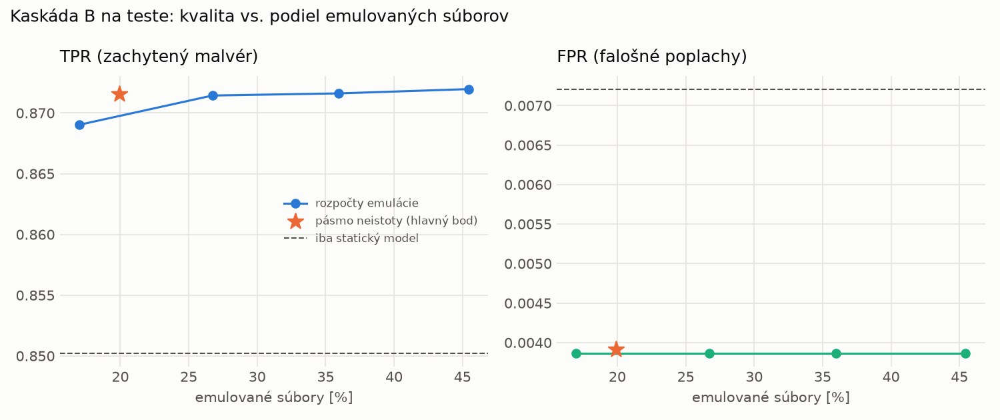

# Kaskáda B `b_baselines` – beh `20261123-212847`

> Generované `src/cascade/evaluate_b.py` (2026-11-23T21:28:48+01:00). Seedy: [0, 1, 2]; hodnoty = priemer ± sm. odchýlka.
> Všetky prahy a pásmo neistoty sú z validácie; test sa na nič nenastavuje. Postup: `docs/09_plan_v2.md`.

| rola | beh |
|---|---|
| static | `runs_v4/emu_p/lofo/Airpush_StopSMS/static/lightgbm/20261123-010336` |
| dynamic | `runs_v4/emu_p/lofo/Airpush_StopSMS/dynamic/lightgbm/20261123-211603` |
| hybrid | `runs_v4/emu_p/lofo/Airpush_StopSMS/hybrid/lightgbm/20261123-211909` |

Druhý stupeň: **dynamic**. Pásmo neistoty statického modelu: FPR ≤ 0.1% nad `hi`,
najviac 1% malvéru validácie pod `lo` (seed 0: lo = 0.0019, hi = 0.9989, seed 1: lo = 0.0011, hi = 0.9990, seed 2: lo = 0.0008, hi = 0.9991).

## Test
| prístup | accuracy | balanced_accuracy | precision | recall_tpr | fpr | f1 | mcc |
|---|---|---|---|---|---|---|---|
| kaskáda B | 0.9403 ± 0.0008 | 0.9338 ± 0.0009 | 0.9945 ± 0.0002 | 0.8716 ± 0.0019 | 0.0039 ± 0.0002 | 0.9290 ± 0.0010 | 0.8835 ± 0.0015 |
| statický | 0.9289 ± 0.0014 | 0.9215 ± 0.0016 | 0.9897 ± 0.0003 | 0.8502 ± 0.0033 | 0.0072 ± 0.0002 | 0.9147 ± 0.0018 | 0.8616 ± 0.0026 |
| dynamický | 0.8909 ± 0.0010 | 0.8791 ± 0.0011 | 0.9890 ± 0.0005 | 0.7652 ± 0.0024 | 0.0069 ± 0.0003 | 0.8628 ± 0.0015 | 0.7923 ± 0.0018 |
| hybrid (každá vzorka) | 0.9437 ± 0.0011 | 0.9380 ± 0.0013 | 0.9905 ± 0.0007 | 0.8829 ± 0.0030 | 0.0069 ± 0.0005 | 0.9336 ± 0.0015 | 0.8895 ± 0.0021 |

- **emulované súbory: 19.91%** (ostatné rozhodne iba statický model); na hybrid ide 5.79% súborov
- chyby pri istom rozhodnutí statického modelu (seed 0): 145
- validácia: emulované 12.95%, na hybrid 2.45%

## Validácia
| prístup | accuracy | balanced_accuracy | precision | recall_tpr | fpr | f1 | mcc |
|---|---|---|---|---|---|---|---|
| kaskáda B | 0.9798 ± 0.0001 | 0.9759 ± 0.0002 | 0.9889 ± 0.0005 | 0.9587 ± 0.0008 | 0.0068 ± 0.0003 | 0.9735 ± 0.0002 | 0.9576 ± 0.0002 |
| statický | 0.9770 ± 0.0006 | 0.9730 ± 0.0008 | 0.9844 ± 0.0005 | 0.9556 ± 0.0013 | 0.0096 ± 0.0003 | 0.9698 ± 0.0008 | 0.9515 ± 0.0013 |
| dynamický | 0.9327 ± 0.0011 | 0.9158 ± 0.0014 | 0.9820 ± 0.0001 | 0.8414 ± 0.0027 | 0.0097 ± 0.0000 | 0.9063 ± 0.0016 | 0.8605 ± 0.0021 |
| hybrid (každá vzorka) | 0.9798 ± 0.0004 | 0.9767 ± 0.0005 | 0.9845 ± 0.0003 | 0.9630 ± 0.0009 | 0.0096 ± 0.0002 | 0.9737 ± 0.0006 | 0.9575 ± 0.0009 |

## Januárové vzorky vynechanej rodiny (iba malvér → TPR)
| prístup | TPR |
|---|---|
| kaskáda B | 0.5766 ± 0.0048 |
| statický | 0.4739 ± 0.0097 |
| dynamický | 0.5480 ± 0.0031 |
| hybrid (každá vzorka) | 0.6160 ± 0.0067 |

Podiel emulovaných: 76.37%

## Krivka rozpočtu emulácie (test, priemer cez seedy)
| budget_val | emulation_rate | hybrid_rate | recall_tpr | fpr | f1 |
|---|---|---|---|---|---|
| 0.1000 | 0.1701 | 0.0600 | 0.8690 | 0.0039 | 0.9276 |
| 0.2000 | 0.2673 | 0.0739 | 0.8714 | 0.0039 | 0.9289 |
| 0.3000 | 0.3597 | 0.0822 | 0.8716 | 0.0039 | 0.9290 |
| 0.4000 | 0.4544 | 0.0885 | 0.8720 | 0.0039 | 0.9292 |

## Výpočtové nároky
Čas dynamickej analýzy (beh v emulátore alebo na zariadení) dataset neuvádza, preto sa neodhaduje. Úspora kaskády B = podiel súborov s dynamickou analýzou: **19.91%** (ostatné prístupy 100 %).

_Chýba benchmark niektorého komponentu (v zero-day behoch sa nemeria)._

