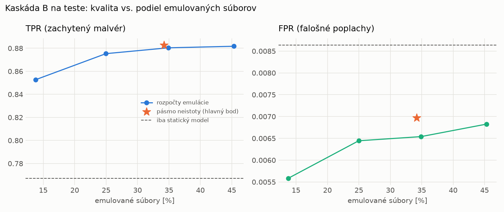

# Kaskáda B `b_direct` – beh `20261123-212844`

> Generované `src/cascade/evaluate_b.py` (2026-11-23T21:28:44+01:00). Seedy: [0, 1, 2]; hodnoty = priemer ± sm. odchýlka.
> Všetky prahy a pásmo neistoty sú z validácie; test sa na nič nenastavuje. Postup: `docs/09_plan_v2.md`.

| rola | beh |
|---|---|
| static | `runs_v4/emu_p/lofo/Airpush_StopSMS/students_static/mlp_kd/20261123-212524` |
| hybrid | `runs_v4/emu_p/lofo/Airpush_StopSMS/hybrid/lightgbm/20261123-211909` |

Druhý stupeň: **hybrid**. Pásmo neistoty statického modelu: FPR ≤ 0.1% nad `hi`,
najviac 1% malvéru validácie pod `lo` (seed 0: lo = 0.0070, hi = 0.9971, seed 1: lo = 0.0073, hi = 0.9990, seed 2: lo = 0.0045, hi = 0.9964).

## Test
| prístup | accuracy | balanced_accuracy | precision | recall_tpr | fpr | f1 | mcc |
|---|---|---|---|---|---|---|---|
| kaskáda B | 0.9436 ± 0.0009 | 0.9379 ± 0.0010 | 0.9904 ± 0.0011 | 0.8828 ± 0.0022 | 0.0070 ± 0.0008 | 0.9335 ± 0.0011 | 0.8893 ± 0.0016 |
| statický | 0.8909 ± 0.0011 | 0.8793 ± 0.0013 | 0.9863 ± 0.0005 | 0.7672 ± 0.0029 | 0.0086 ± 0.0004 | 0.8631 ± 0.0017 | 0.7916 ± 0.0019 |
| hybrid (každá vzorka) | 0.9437 ± 0.0011 | 0.9380 ± 0.0013 | 0.9905 ± 0.0007 | 0.8829 ± 0.0030 | 0.0069 ± 0.0005 | 0.9336 ± 0.0015 | 0.8895 ± 0.0021 |

- **emulované súbory: 34.21%** (ostatné rozhodne iba statický model); na hybrid ide 34.21% súborov
- chyby pri istom rozhodnutí statického modelu (seed 0): 132
- validácia: emulované 28.39%, na hybrid 28.39%

## Validácia
| prístup | accuracy | balanced_accuracy | precision | recall_tpr | fpr | f1 | mcc |
|---|---|---|---|---|---|---|---|
| kaskáda B | 0.9795 ± 0.0004 | 0.9764 ± 0.0005 | 0.9841 ± 0.0003 | 0.9626 ± 0.0009 | 0.0098 ± 0.0002 | 0.9732 ± 0.0006 | 0.9568 ± 0.0009 |
| statický | 0.9539 ± 0.0014 | 0.9432 ± 0.0018 | 0.9835 ± 0.0001 | 0.8958 ± 0.0037 | 0.0095 ± 0.0000 | 0.9376 ± 0.0020 | 0.9037 ± 0.0029 |
| hybrid (každá vzorka) | 0.9798 ± 0.0004 | 0.9767 ± 0.0005 | 0.9845 ± 0.0003 | 0.9630 ± 0.0009 | 0.0096 ± 0.0002 | 0.9737 ± 0.0006 | 0.9575 ± 0.0009 |

## Januárové vzorky vynechanej rodiny (iba malvér → TPR)
| prístup | TPR |
|---|---|
| kaskáda B | 0.6170 ± 0.0058 |
| statický | 0.3439 ± 0.0028 |
| hybrid (každá vzorka) | 0.6160 ± 0.0067 |

Podiel emulovaných: 86.06%

## Krivka rozpočtu emulácie (test, priemer cez seedy)
| budget_val | emulation_rate | hybrid_rate | recall_tpr | fpr | f1 |
|---|---|---|---|---|---|
| 0.1000 | 0.1377 | 0.1377 | 0.8527 | 0.0056 | 0.9171 |
| 0.2000 | 0.2497 | 0.2497 | 0.8753 | 0.0064 | 0.9296 |
| 0.3000 | 0.3489 | 0.3489 | 0.8804 | 0.0065 | 0.9324 |
| 0.4000 | 0.4531 | 0.4531 | 0.8817 | 0.0068 | 0.9330 |

## Výpočtové nároky
Čas dynamickej analýzy (beh v emulátore alebo na zariadení) dataset neuvádza, preto sa neodhaduje. Úspora kaskády B = podiel súborov s dynamickou analýzou: **34.21%** (ostatné prístupy 100 %).

_Chýba benchmark niektorého komponentu (v zero-day behoch sa nemeria)._

