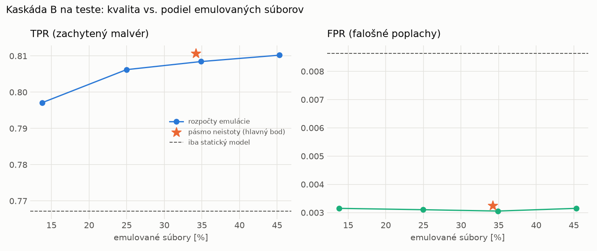

# Kaskáda B `b_heavy` – beh `20261123-212846`

> Generované `src/cascade/evaluate_b.py` (2026-11-23T21:28:46+01:00). Seedy: [0, 1, 2]; hodnoty = priemer ± sm. odchýlka.
> Všetky prahy a pásmo neistoty sú z validácie; test sa na nič nenastavuje. Postup: `docs/09_plan_v2.md`.

| rola | beh |
|---|---|
| static | `runs_v4/emu_p/lofo/Airpush_StopSMS/students_static/mlp_kd/20261123-212524` |
| dynamic | `runs_v4/emu_p/lofo/Airpush_StopSMS/students_dynamic/mlp_kd/20261123-212644` |
| hybrid | `runs_v4/emu_p/lofo/Airpush_StopSMS/hybrid/mlp_large/20261123-212010` |

Druhý stupeň: **dynamic**. Pásmo neistoty statického modelu: FPR ≤ 0.1% nad `hi`,
najviac 1% malvéru validácie pod `lo` (seed 0: lo = 0.0070, hi = 0.9971, seed 1: lo = 0.0073, hi = 0.9990, seed 2: lo = 0.0045, hi = 0.9964).

## Test
| prístup | accuracy | balanced_accuracy | precision | recall_tpr | fpr | f1 | mcc |
|---|---|---|---|---|---|---|---|
| kaskáda B | 0.9134 ± 0.0005 | 0.9037 ± 0.0006 | 0.9951 ± 0.0004 | 0.8107 ± 0.0010 | 0.0032 ± 0.0003 | 0.8935 ± 0.0007 | 0.8340 ± 0.0010 |
| statický | 0.8909 ± 0.0011 | 0.8793 ± 0.0013 | 0.9863 ± 0.0005 | 0.7672 ± 0.0029 | 0.0086 ± 0.0004 | 0.8631 ± 0.0017 | 0.7916 ± 0.0019 |
| dynamický | 0.7891 ± 0.0059 | 0.7657 ± 0.0066 | 0.9825 ± 0.0012 | 0.5392 ± 0.0129 | 0.0078 ± 0.0004 | 0.6962 ± 0.0110 | 0.6136 ± 0.0104 |
| hybrid (každá vzorka) | 0.9408 ± 0.0017 | 0.9347 ± 0.0020 | 0.9904 ± 0.0010 | 0.8764 ± 0.0047 | 0.0069 ± 0.0007 | 0.9299 ± 0.0022 | 0.8839 ± 0.0031 |

- **emulované súbory: 34.21%** (ostatné rozhodne iba statický model); na hybrid ide 8.65% súborov
- chyby pri istom rozhodnutí statického modelu (seed 0): 132
- validácia: emulované 28.39%, na hybrid 5.87%

## Validácia
| prístup | accuracy | balanced_accuracy | precision | recall_tpr | fpr | f1 | mcc |
|---|---|---|---|---|---|---|---|
| kaskáda B | 0.9599 ± 0.0010 | 0.9497 ± 0.0012 | 0.9914 ± 0.0003 | 0.9043 ± 0.0023 | 0.0050 ± 0.0002 | 0.9458 ± 0.0014 | 0.9166 ± 0.0020 |
| statický | 0.9539 ± 0.0014 | 0.9432 ± 0.0018 | 0.9835 ± 0.0001 | 0.8958 ± 0.0037 | 0.0095 ± 0.0000 | 0.9376 ± 0.0020 | 0.9037 ± 0.0029 |
| dynamický | 0.8374 ± 0.0085 | 0.7926 ± 0.0110 | 0.9747 ± 0.0009 | 0.5950 ± 0.0220 | 0.0097 ± 0.0000 | 0.7388 ± 0.0173 | 0.6711 ± 0.0169 |
| hybrid (každá vzorka) | 0.9742 ± 0.0014 | 0.9695 ± 0.0018 | 0.9841 ± 0.0003 | 0.9487 ± 0.0036 | 0.0096 ± 0.0002 | 0.9661 ± 0.0019 | 0.9457 ± 0.0030 |

## Januárové vzorky vynechanej rodiny (iba malvér → TPR)
| prístup | TPR |
|---|---|
| kaskáda B | 0.4990 ± 0.0044 |
| statický | 0.3439 ± 0.0028 |
| dynamický | 0.4046 ± 0.0021 |
| hybrid (každá vzorka) | 0.6361 ± 0.0133 |

Podiel emulovaných: 86.06%

## Krivka rozpočtu emulácie (test, priemer cez seedy)
| budget_val | emulation_rate | hybrid_rate | recall_tpr | fpr | f1 |
|---|---|---|---|---|---|
| 0.1000 | 0.1377 | 0.0614 | 0.7971 | 0.0032 | 0.8852 |
| 0.2000 | 0.2497 | 0.0939 | 0.8062 | 0.0031 | 0.8908 |
| 0.3000 | 0.3489 | 0.1209 | 0.8084 | 0.0031 | 0.8922 |
| 0.4000 | 0.4531 | 0.1398 | 0.8102 | 0.0032 | 0.8932 |

## Výpočtové nároky
Čas dynamickej analýzy (beh v emulátore alebo na zariadení) dataset neuvádza, preto sa neodhaduje. Úspora kaskády B = podiel súborov s dynamickou analýzou: **34.21%** (ostatné prístupy 100 %).

_Chýba benchmark niektorého komponentu (v zero-day behoch sa nemeria)._

