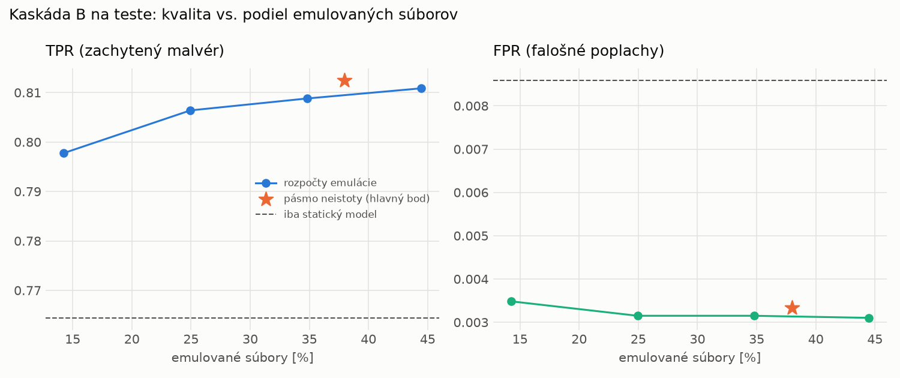

# Kaskáda B `b_heavyteacher` – beh `20261123-212851`

> Generované `src/cascade/evaluate_b.py` (2026-11-23T21:28:51+01:00). Seedy: [0, 1, 2]; hodnoty = priemer ± sm. odchýlka.
> Všetky prahy a pásmo neistoty sú z validácie; test sa na nič nenastavuje. Postup: `docs/09_plan_v2.md`.

| rola | beh |
|---|---|
| static | `runs_v4/emu_p/lofo/Airpush_StopSMS/students_static/mlp_kd_heavy/20261123-212630` |
| dynamic | `runs_v4/emu_p/lofo/Airpush_StopSMS/students_dynamic/mlp_kd_heavy/20261123-212806` |
| hybrid | `runs_v4/emu_p/lofo/Airpush_StopSMS/hybrid/lightgbm/20261123-211909` |

Druhý stupeň: **dynamic**. Pásmo neistoty statického modelu: FPR ≤ 0.1% nad `hi`,
najviac 1% malvéru validácie pod `lo` (seed 0: lo = 0.0369, hi = 0.9901, seed 1: lo = 0.0364, hi = 0.9912, seed 2: lo = 0.0388, hi = 0.9884).

## Test
| prístup | accuracy | balanced_accuracy | precision | recall_tpr | fpr | f1 | mcc |
|---|---|---|---|---|---|---|---|
| kaskáda B | 0.9141 ± 0.0021 | 0.9046 ± 0.0024 | 0.9950 ± 0.0008 | 0.8125 ± 0.0052 | 0.0033 ± 0.0006 | 0.8945 ± 0.0029 | 0.8354 ± 0.0038 |
| statický | 0.8897 ± 0.0043 | 0.8779 ± 0.0049 | 0.9864 ± 0.0005 | 0.7644 ± 0.0101 | 0.0086 ± 0.0004 | 0.8613 ± 0.0063 | 0.7895 ± 0.0077 |
| dynamický | 0.7865 ± 0.0065 | 0.7628 ± 0.0073 | 0.9821 ± 0.0005 | 0.5335 ± 0.0150 | 0.0079 ± 0.0005 | 0.6913 ± 0.0124 | 0.6090 ± 0.0110 |
| hybrid (každá vzorka) | 0.9437 ± 0.0011 | 0.9380 ± 0.0013 | 0.9905 ± 0.0007 | 0.8829 ± 0.0030 | 0.0069 ± 0.0005 | 0.9336 ± 0.0015 | 0.8895 ± 0.0021 |

- **emulované súbory: 37.96%** (ostatné rozhodne iba statický model); na hybrid ide 9.23% súborov
- chyby pri istom rozhodnutí statického modelu (seed 0): 121
- validácia: emulované 32.75%, na hybrid 6.50%

## Validácia
| prístup | accuracy | balanced_accuracy | precision | recall_tpr | fpr | f1 | mcc |
|---|---|---|---|---|---|---|---|
| kaskáda B | 0.9617 ± 0.0017 | 0.9520 ± 0.0020 | 0.9916 ± 0.0013 | 0.9088 ± 0.0038 | 0.0049 ± 0.0008 | 0.9484 ± 0.0023 | 0.9203 ± 0.0034 |
| statický | 0.9520 ± 0.0023 | 0.9408 ± 0.0031 | 0.9833 ± 0.0005 | 0.8911 ± 0.0064 | 0.0096 ± 0.0003 | 0.9349 ± 0.0034 | 0.8998 ± 0.0047 |
| dynamický | 0.8319 ± 0.0074 | 0.7855 ± 0.0096 | 0.9741 ± 0.0008 | 0.5808 ± 0.0192 | 0.0097 ± 0.0000 | 0.7276 ± 0.0152 | 0.6602 ± 0.0147 |
| hybrid (každá vzorka) | 0.9798 ± 0.0004 | 0.9767 ± 0.0005 | 0.9845 ± 0.0003 | 0.9630 ± 0.0009 | 0.0096 ± 0.0002 | 0.9737 ± 0.0006 | 0.9575 ± 0.0009 |

## Januárové vzorky vynechanej rodiny (iba malvér → TPR)
| prístup | TPR |
|---|---|
| kaskáda B | 0.5034 ± 0.0143 |
| statický | 0.3469 ± 0.0349 |
| dynamický | 0.4133 ± 0.0152 |
| hybrid (každá vzorka) | 0.6160 ± 0.0067 |

Podiel emulovaných: 87.81%

## Krivka rozpočtu emulácie (test, priemer cez seedy)
| budget_val | emulation_rate | hybrid_rate | recall_tpr | fpr | f1 |
|---|---|---|---|---|---|
| 0.1000 | 0.1424 | 0.0642 | 0.7978 | 0.0035 | 0.8854 |
| 0.2000 | 0.2494 | 0.0985 | 0.8064 | 0.0032 | 0.8909 |
| 0.3000 | 0.3480 | 0.1199 | 0.8088 | 0.0032 | 0.8924 |
| 0.4000 | 0.4446 | 0.1398 | 0.8109 | 0.0031 | 0.8937 |

## Výpočtové nároky
Čas dynamickej analýzy (beh v emulátore alebo na zariadení) dataset neuvádza, preto sa neodhaduje. Úspora kaskády B = podiel súborov s dynamickou analýzou: **37.96%** (ostatné prístupy 100 %).

_Chýba benchmark niektorého komponentu (v zero-day behoch sa nemeria)._

