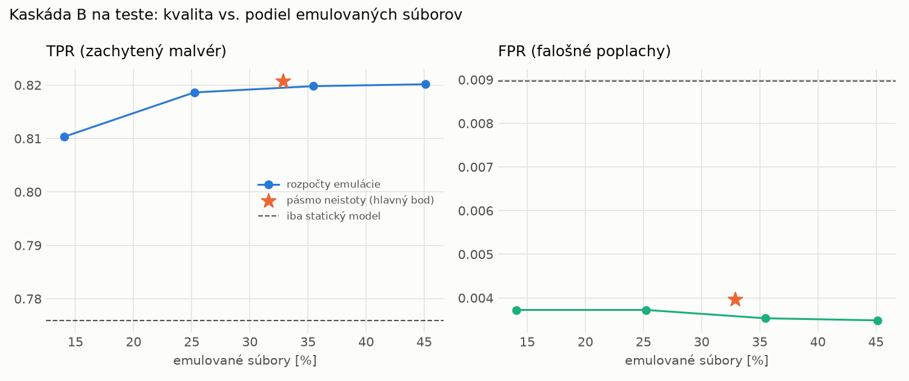

# Kaskáda B `b_nokd` – beh `20261123-212849`

> Generované `src/cascade/evaluate_b.py` (2026-11-23T21:28:50+01:00). Seedy: [0, 1, 2]; hodnoty = priemer ± sm. odchýlka.
> Všetky prahy a pásmo neistoty sú z validácie; test sa na nič nenastavuje. Postup: `docs/09_plan_v2.md`.

| rola | beh |
|---|---|
| static | `runs_v4/emu_p/lofo/Airpush_StopSMS/students_static/mlp_nokd/20261123-212539` |
| dynamic | `runs_v4/emu_p/lofo/Airpush_StopSMS/students_dynamic/mlp_nokd/20261123-212706` |
| hybrid | `runs_v4/emu_p/lofo/Airpush_StopSMS/hybrid/lightgbm/20261123-211909` |

Druhý stupeň: **dynamic**. Pásmo neistoty statického modelu: FPR ≤ 0.1% nad `hi`,
najviac 1% malvéru validácie pod `lo` (seed 0: lo = 0.0281, hi = 0.9970, seed 1: lo = 0.0229, hi = 0.9944, seed 2: lo = 0.0266, hi = 0.9910).

## Test
| prístup | accuracy | balanced_accuracy | precision | recall_tpr | fpr | f1 | mcc |
|---|---|---|---|---|---|---|---|
| kaskáda B | 0.9175 ± 0.0049 | 0.9084 ± 0.0055 | 0.9941 ± 0.0003 | 0.8208 ± 0.0111 | 0.0040 ± 0.0002 | 0.8991 ± 0.0066 | 0.8413 ± 0.0089 |
| statický | 0.8946 ± 0.0105 | 0.8835 ± 0.0117 | 0.9860 ± 0.0012 | 0.7760 ± 0.0237 | 0.0090 ± 0.0008 | 0.8683 ± 0.0147 | 0.7983 ± 0.0188 |
| dynamický | 0.7969 ± 0.0045 | 0.7744 ± 0.0051 | 0.9825 ± 0.0024 | 0.5569 ± 0.0112 | 0.0081 ± 0.0012 | 0.7108 ± 0.0086 | 0.6270 ± 0.0071 |
| hybrid (každá vzorka) | 0.9437 ± 0.0011 | 0.9380 ± 0.0013 | 0.9905 ± 0.0007 | 0.8829 ± 0.0030 | 0.0069 ± 0.0005 | 0.9336 ± 0.0015 | 0.8895 ± 0.0021 |

- **emulované súbory: 32.86%** (ostatné rozhodne iba statický model); na hybrid ide 8.26% súborov
- chyby pri istom rozhodnutí statického modelu (seed 0): 136
- validácia: emulované 27.39%, na hybrid 5.62%

## Validácia
| prístup | accuracy | balanced_accuracy | precision | recall_tpr | fpr | f1 | mcc |
|---|---|---|---|---|---|---|---|
| kaskáda B | 0.9660 ± 0.0009 | 0.9575 ± 0.0012 | 0.9910 ± 0.0010 | 0.9203 ± 0.0029 | 0.0053 ± 0.0006 | 0.9544 ± 0.0012 | 0.9289 ± 0.0017 |
| statický | 0.9570 ± 0.0037 | 0.9473 ± 0.0048 | 0.9832 ± 0.0002 | 0.9043 ± 0.0096 | 0.0097 ± 0.0000 | 0.9421 ± 0.0053 | 0.9100 ± 0.0077 |
| dynamický | 0.8432 ± 0.0061 | 0.8001 ± 0.0079 | 0.9753 ± 0.0006 | 0.6100 ± 0.0159 | 0.0097 ± 0.0000 | 0.7505 ± 0.0121 | 0.6826 ± 0.0121 |
| hybrid (každá vzorka) | 0.9798 ± 0.0004 | 0.9767 ± 0.0005 | 0.9845 ± 0.0003 | 0.9630 ± 0.0009 | 0.0096 ± 0.0002 | 0.9737 ± 0.0006 | 0.9575 ± 0.0009 |

## Januárové vzorky vynechanej rodiny (iba malvér → TPR)
| prístup | TPR |
|---|---|
| kaskáda B | 0.5023 ± 0.0230 |
| statický | 0.3522 ± 0.0670 |
| dynamický | 0.4139 ± 0.0043 |
| hybrid (každá vzorka) | 0.6160 ± 0.0067 |

Podiel emulovaných: 82.05%

## Krivka rozpočtu emulácie (test, priemer cez seedy)
| budget_val | emulation_rate | hybrid_rate | recall_tpr | fpr | f1 |
|---|---|---|---|---|---|
| 0.1000 | 0.1404 | 0.0620 | 0.8103 | 0.0037 | 0.8929 |
| 0.2000 | 0.2522 | 0.0900 | 0.8186 | 0.0037 | 0.8980 |
| 0.3000 | 0.3547 | 0.1031 | 0.8198 | 0.0035 | 0.8988 |
| 0.4000 | 0.4511 | 0.1142 | 0.8201 | 0.0035 | 0.8990 |

## Výpočtové nároky
Čas dynamickej analýzy (beh v emulátore alebo na zariadení) dataset neuvádza, preto sa neodhaduje. Úspora kaskády B = podiel súborov s dynamickou analýzou: **32.86%** (ostatné prístupy 100 %).

_Chýba benchmark niektorého komponentu (v zero-day behoch sa nemeria)._

