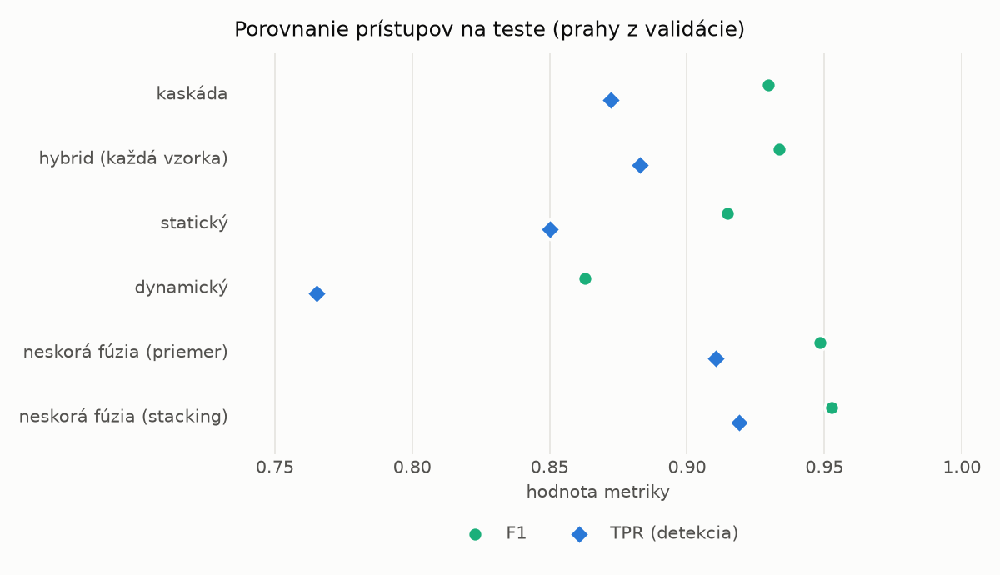
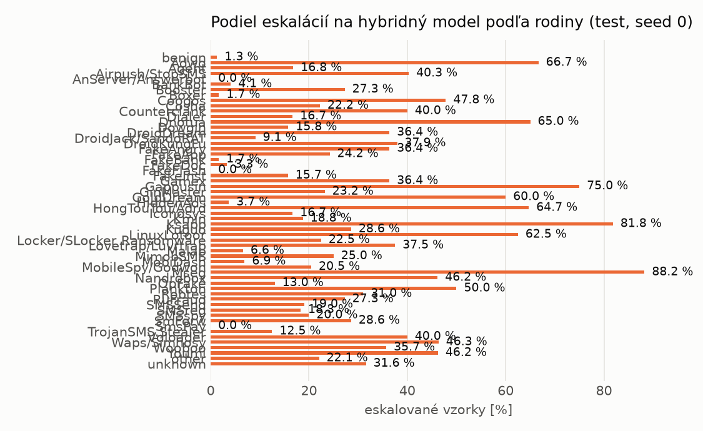

# Kaskáda `baselines` – beh `20261123-212838`

> Generované `src/cascade/evaluate.py` (2026-11-23T21:28:38+01:00). Seedy: [0, 1, 2]; hodnoty = priemer ± sm. odchýlka.
> Všetky prahy sú určené na validácii (FPR ≤ 1 %); test sa na nič nenastavuje.

| rola | beh |
|---|---|
| static | `runs_v4/emu_p/lofo/Airpush_StopSMS/static/lightgbm/20261123-010336` |
| dynamic | `runs_v4/emu_p/lofo/Airpush_StopSMS/dynamic/lightgbm/20261123-211603` |
| hybrid | `runs_v4/emu_p/lofo/Airpush_StopSMS/hybrid/lightgbm/20261123-211909` |

## Test
| prístup | accuracy | balanced_accuracy | precision | recall_tpr | fpr | f1 | mcc |
|---|---|---|---|---|---|---|---|
| kaskáda | 0.9406 ± 0.0009 | 0.9342 ± 0.0010 | 0.9946 ± 0.0003 | 0.8723 ± 0.0022 | 0.0039 ± 0.0002 | 0.9294 ± 0.0011 | 0.8842 ± 0.0016 |
| hybrid (každá vzorka) | 0.9437 ± 0.0011 | 0.9380 ± 0.0013 | 0.9905 ± 0.0007 | 0.8829 ± 0.0030 | 0.0069 ± 0.0005 | 0.9336 ± 0.0015 | 0.8895 ± 0.0021 |
| statický | 0.9289 ± 0.0014 | 0.9215 ± 0.0016 | 0.9897 ± 0.0003 | 0.8502 ± 0.0033 | 0.0072 ± 0.0002 | 0.9147 ± 0.0018 | 0.8616 ± 0.0026 |
| dynamický | 0.8909 ± 0.0010 | 0.8791 ± 0.0011 | 0.9890 ± 0.0005 | 0.7652 ± 0.0024 | 0.0069 ± 0.0003 | 0.8628 ± 0.0015 | 0.7923 ± 0.0018 |
| neskorá fúzia (priemer) | 0.9555 ± 0.0013 | 0.9513 ± 0.0016 | 0.9894 ± 0.0014 | 0.9106 ± 0.0041 | 0.0079 ± 0.0011 | 0.9483 ± 0.0016 | 0.9119 ± 0.0023 |
| neskorá fúzia (stacking) | 0.9590 ± 0.0011 | 0.9553 ± 0.0012 | 0.9887 ± 0.0004 | 0.9190 ± 0.0027 | 0.0085 ± 0.0003 | 0.9526 ± 0.0013 | 0.9185 ± 0.0020 |

## Validácia
| prístup | accuracy | balanced_accuracy | precision | recall_tpr | fpr | f1 | mcc |
|---|---|---|---|---|---|---|---|
| kaskáda | 0.9801 ± 0.0002 | 0.9762 ± 0.0004 | 0.9889 ± 0.0005 | 0.9593 ± 0.0010 | 0.0068 ± 0.0003 | 0.9739 ± 0.0003 | 0.9581 ± 0.0004 |
| hybrid (každá vzorka) | 0.9798 ± 0.0004 | 0.9767 ± 0.0005 | 0.9845 ± 0.0003 | 0.9630 ± 0.0009 | 0.0096 ± 0.0002 | 0.9737 ± 0.0006 | 0.9575 ± 0.0009 |
| statický | 0.9770 ± 0.0006 | 0.9730 ± 0.0008 | 0.9844 ± 0.0005 | 0.9556 ± 0.0013 | 0.0096 ± 0.0003 | 0.9698 ± 0.0008 | 0.9515 ± 0.0013 |
| dynamický | 0.9327 ± 0.0011 | 0.9158 ± 0.0014 | 0.9820 ± 0.0001 | 0.8414 ± 0.0027 | 0.0097 ± 0.0000 | 0.9063 ± 0.0016 | 0.8605 ± 0.0021 |
| neskorá fúzia (priemer) | 0.9843 ± 0.0003 | 0.9824 ± 0.0004 | 0.9851 ± 0.0005 | 0.9741 ± 0.0012 | 0.0093 ± 0.0003 | 0.9796 ± 0.0004 | 0.9669 ± 0.0006 |
| neskorá fúzia (stacking) | 0.9844 ± 0.0005 | 0.9827 ± 0.0007 | 0.9847 ± 0.0005 | 0.9749 ± 0.0014 | 0.0096 ± 0.0003 | 0.9798 ± 0.0007 | 0.9671 ± 0.0011 |

## Správanie kaskády (test, seed 0)
- podiel eskalácií na hybrid: **10.67%** (1350 vzoriek)
- chyby pri zhode študentov (kaskáda ich nemôže opraviť): **467**
  (4.131% zo zhôd; FP 3, FN 464)
- úspešnosť na eskalovaných vzorkách: hybrid 0.7874074074074074, statický 0.6837037037037037,
  dynamický 0.3162962962962963  → prínos hybridu pri nezhode

## Výpočtové nároky (odhad z benchmarkov komponentov)
_Chýba benchmark niektorého komponentu (`python -m src.evaluation.benchmark`)._

