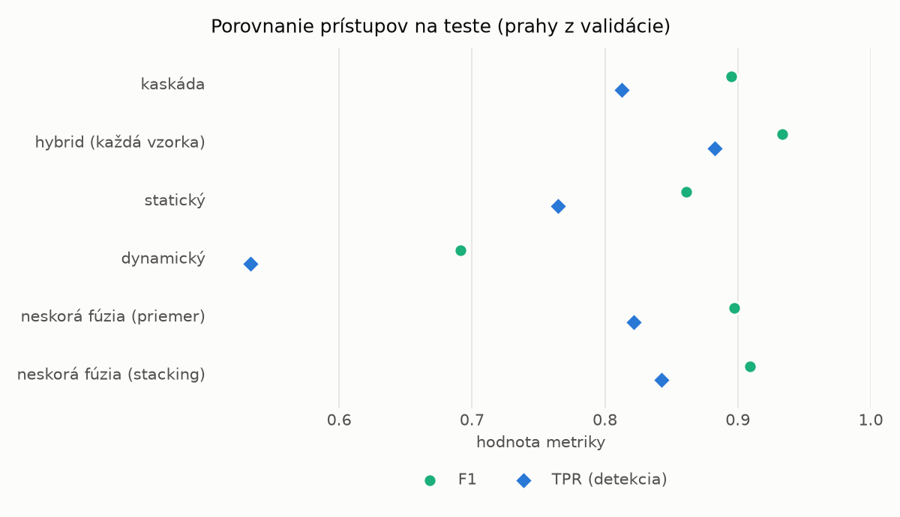
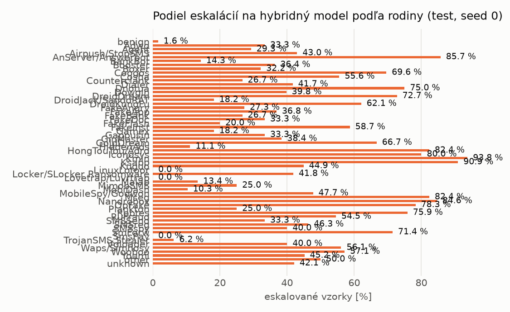

# Kaskáda `heavyteacher` – beh `20261123-212840`

> Generované `src/cascade/evaluate.py` (2026-11-23T21:28:40+01:00). Seedy: [0, 1, 2]; hodnoty = priemer ± sm. odchýlka.
> Všetky prahy sú určené na validácii (FPR ≤ 1 %); test sa na nič nenastavuje.

| rola | beh |
|---|---|
| static | `runs_v4/emu_p/lofo/Airpush_StopSMS/students_static/mlp_kd_heavy/20261123-212630` |
| dynamic | `runs_v4/emu_p/lofo/Airpush_StopSMS/students_dynamic/mlp_kd_heavy/20261123-212806` |
| hybrid | `runs_v4/emu_p/lofo/Airpush_StopSMS/hybrid/lightgbm/20261123-211909` |

## Test
| prístup | accuracy | balanced_accuracy | precision | recall_tpr | fpr | f1 | mcc |
|---|---|---|---|---|---|---|---|
| kaskáda | 0.9144 ± 0.0022 | 0.9048 ± 0.0025 | 0.9955 ± 0.0008 | 0.8127 ± 0.0053 | 0.0030 ± 0.0006 | 0.8948 ± 0.0030 | 0.8359 ± 0.0040 |
| hybrid (každá vzorka) | 0.9437 ± 0.0011 | 0.9380 ± 0.0013 | 0.9905 ± 0.0007 | 0.8829 ± 0.0030 | 0.0069 ± 0.0005 | 0.9336 ± 0.0015 | 0.8895 ± 0.0021 |
| statický | 0.8897 ± 0.0043 | 0.8779 ± 0.0049 | 0.9864 ± 0.0005 | 0.7644 ± 0.0101 | 0.0086 ± 0.0004 | 0.8613 ± 0.0063 | 0.7895 ± 0.0077 |
| dynamický | 0.7865 ± 0.0065 | 0.7628 ± 0.0073 | 0.9821 ± 0.0005 | 0.5335 ± 0.0150 | 0.0079 ± 0.0005 | 0.6913 ± 0.0124 | 0.6090 ± 0.0110 |
| neskorá fúzia (priemer) | 0.9156 ± 0.0020 | 0.9068 ± 0.0023 | 0.9882 ± 0.0009 | 0.8216 ± 0.0052 | 0.0080 ± 0.0007 | 0.8972 ± 0.0028 | 0.8369 ± 0.0035 |
| neskorá fúzia (stacking) | 0.9244 ± 0.0034 | 0.9167 ± 0.0038 | 0.9869 ± 0.0005 | 0.8426 ± 0.0080 | 0.0091 ± 0.0004 | 0.9090 ± 0.0045 | 0.8528 ± 0.0062 |

## Validácia
| prístup | accuracy | balanced_accuracy | precision | recall_tpr | fpr | f1 | mcc |
|---|---|---|---|---|---|---|---|
| kaskáda | 0.9618 ± 0.0016 | 0.9520 ± 0.0020 | 0.9917 ± 0.0010 | 0.9088 ± 0.0038 | 0.0048 ± 0.0006 | 0.9485 ± 0.0022 | 0.9204 ± 0.0033 |
| hybrid (každá vzorka) | 0.9798 ± 0.0004 | 0.9767 ± 0.0005 | 0.9845 ± 0.0003 | 0.9630 ± 0.0009 | 0.0096 ± 0.0002 | 0.9737 ± 0.0006 | 0.9575 ± 0.0009 |
| statický | 0.9520 ± 0.0023 | 0.9408 ± 0.0031 | 0.9833 ± 0.0005 | 0.8911 ± 0.0064 | 0.0096 ± 0.0003 | 0.9349 ± 0.0034 | 0.8998 ± 0.0047 |
| dynamický | 0.8319 ± 0.0074 | 0.7855 ± 0.0096 | 0.9741 ± 0.0008 | 0.5808 ± 0.0192 | 0.0097 ± 0.0000 | 0.7276 ± 0.0152 | 0.6602 ± 0.0147 |
| neskorá fúzia (priemer) | 0.9500 ± 0.0019 | 0.9382 ± 0.0025 | 0.9830 ± 0.0002 | 0.8860 ± 0.0051 | 0.0096 ± 0.0002 | 0.9320 ± 0.0027 | 0.8956 ± 0.0038 |
| neskorá fúzia (stacking) | 0.9619 ± 0.0017 | 0.9536 ± 0.0022 | 0.9834 ± 0.0001 | 0.9169 ± 0.0043 | 0.0097 ± 0.0000 | 0.9490 ± 0.0024 | 0.9200 ± 0.0035 |

## Správanie kaskády (test, seed 0)
- podiel eskalácií na hybrid: **18.18%** (2301 vzoriek)
- chyby pri zhode študentov (kaskáda ich nemôže opraviť): **948**
  (9.155% zo zhôd; FP 0, FN 948)
- úspešnosť na eskalovaných vzorkách: hybrid 0.92916123424598, statický 0.7870491090830074,
  dynamický 0.21295089091699262  → prínos hybridu pri nezhode

## Výpočtové nároky (odhad z benchmarkov komponentov)
_Chýba benchmark niektorého komponentu (`python -m src.evaluation.benchmark`)._

