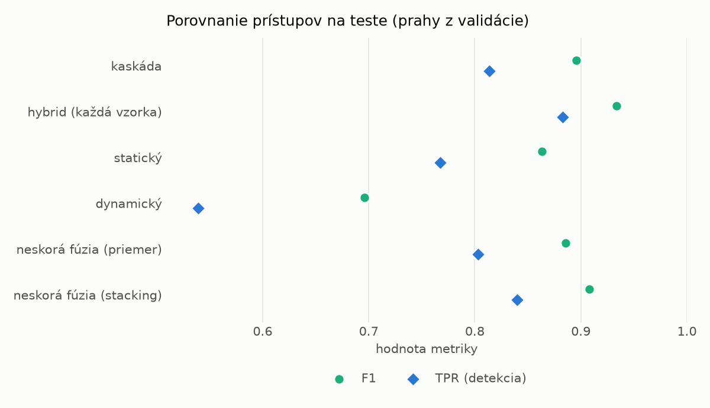
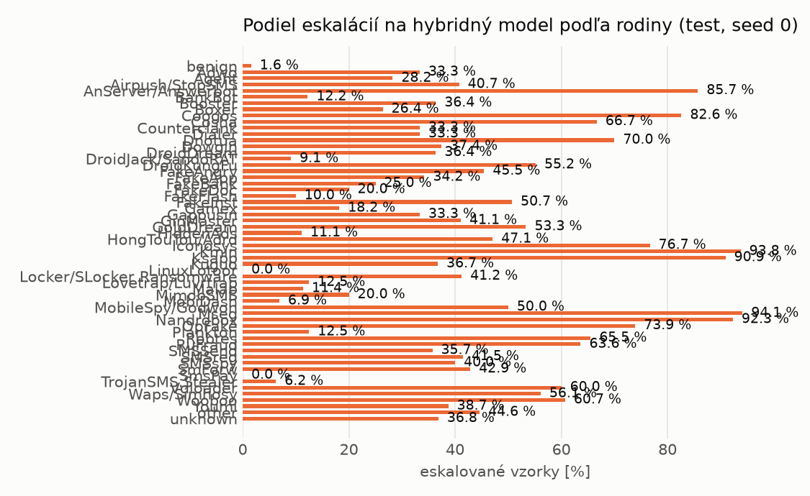

# Kaskáda `main` – beh `20261123-212829`

> Generované `src/cascade/evaluate.py` (2026-11-23T21:28:29+01:00). Seedy: [0, 1, 2]; hodnoty = priemer ± sm. odchýlka.
> Všetky prahy sú určené na validácii (FPR ≤ 1 %); test sa na nič nenastavuje.

| rola | beh |
|---|---|
| static | `runs_v4/emu_p/lofo/Airpush_StopSMS/students_static/mlp_kd/20261123-212524` |
| dynamic | `runs_v4/emu_p/lofo/Airpush_StopSMS/students_dynamic/mlp_kd/20261123-212644` |
| hybrid | `runs_v4/emu_p/lofo/Airpush_StopSMS/hybrid/lightgbm/20261123-211909` |

## Test
| prístup | accuracy | balanced_accuracy | precision | recall_tpr | fpr | f1 | mcc |
|---|---|---|---|---|---|---|---|
| kaskáda | 0.9148 ± 0.0007 | 0.9054 ± 0.0008 | 0.9955 ± 0.0005 | 0.8137 ± 0.0020 | 0.0030 ± 0.0003 | 0.8955 ± 0.0010 | 0.8368 ± 0.0012 |
| hybrid (každá vzorka) | 0.9437 ± 0.0011 | 0.9380 ± 0.0013 | 0.9905 ± 0.0007 | 0.8829 ± 0.0030 | 0.0069 ± 0.0005 | 0.9336 ± 0.0015 | 0.8895 ± 0.0021 |
| statický | 0.8909 ± 0.0011 | 0.8793 ± 0.0013 | 0.9863 ± 0.0005 | 0.7672 ± 0.0029 | 0.0086 ± 0.0004 | 0.8631 ± 0.0017 | 0.7916 ± 0.0019 |
| dynamický | 0.7891 ± 0.0059 | 0.7657 ± 0.0066 | 0.9825 ± 0.0012 | 0.5392 ± 0.0129 | 0.0078 ± 0.0004 | 0.6962 ± 0.0110 | 0.6136 ± 0.0104 |
| neskorá fúzia (priemer) | 0.9069 ± 0.0029 | 0.8972 ± 0.0034 | 0.9871 ± 0.0023 | 0.8029 ± 0.0084 | 0.0085 ± 0.0016 | 0.8855 ± 0.0042 | 0.8208 ± 0.0048 |
| neskorá fúzia (stacking) | 0.9237 ± 0.0004 | 0.9158 ± 0.0005 | 0.9878 ± 0.0012 | 0.8401 ± 0.0013 | 0.0084 ± 0.0008 | 0.9080 ± 0.0005 | 0.8516 ± 0.0008 |

## Validácia
| prístup | accuracy | balanced_accuracy | precision | recall_tpr | fpr | f1 | mcc |
|---|---|---|---|---|---|---|---|
| kaskáda | 0.9616 ± 0.0005 | 0.9518 ± 0.0006 | 0.9911 ± 0.0009 | 0.9088 ± 0.0007 | 0.0052 ± 0.0005 | 0.9482 ± 0.0007 | 0.9199 ± 0.0012 |
| hybrid (každá vzorka) | 0.9798 ± 0.0004 | 0.9767 ± 0.0005 | 0.9845 ± 0.0003 | 0.9630 ± 0.0009 | 0.0096 ± 0.0002 | 0.9737 ± 0.0006 | 0.9575 ± 0.0009 |
| statický | 0.9539 ± 0.0014 | 0.9432 ± 0.0018 | 0.9835 ± 0.0001 | 0.8958 ± 0.0037 | 0.0095 ± 0.0000 | 0.9376 ± 0.0020 | 0.9037 ± 0.0029 |
| dynamický | 0.8374 ± 0.0085 | 0.7926 ± 0.0110 | 0.9747 ± 0.0009 | 0.5950 ± 0.0220 | 0.0097 ± 0.0000 | 0.7388 ± 0.0173 | 0.6711 ± 0.0169 |
| neskorá fúzia (priemer) | 0.9463 ± 0.0040 | 0.9335 ± 0.0051 | 0.9828 ± 0.0004 | 0.8766 ± 0.0101 | 0.0096 ± 0.0002 | 0.9267 ± 0.0058 | 0.8882 ± 0.0081 |
| neskorá fúzia (stacking) | 0.9632 ± 0.0009 | 0.9552 ± 0.0012 | 0.9838 ± 0.0005 | 0.9200 ± 0.0024 | 0.0096 ± 0.0003 | 0.9509 ± 0.0012 | 0.9228 ± 0.0018 |

## Správanie kaskády (test, seed 0)
- podiel eskalácií na hybrid: **16.77%** (2122 vzoriek)
- chyby pri zhode študentov (kaskáda ich nemôže opraviť): **937**
  (8.895% zo zhôd; FP 1, FN 936)
- úspešnosť na eskalovaných vzorkách: hybrid 0.9288407163053722, statický 0.7836946277097078,
  dynamický 0.21630537229029217  → prínos hybridu pri nezhode

## Výpočtové nároky (odhad z benchmarkov komponentov)
_Chýba benchmark niektorého komponentu (`python -m src.evaluation.benchmark`)._

