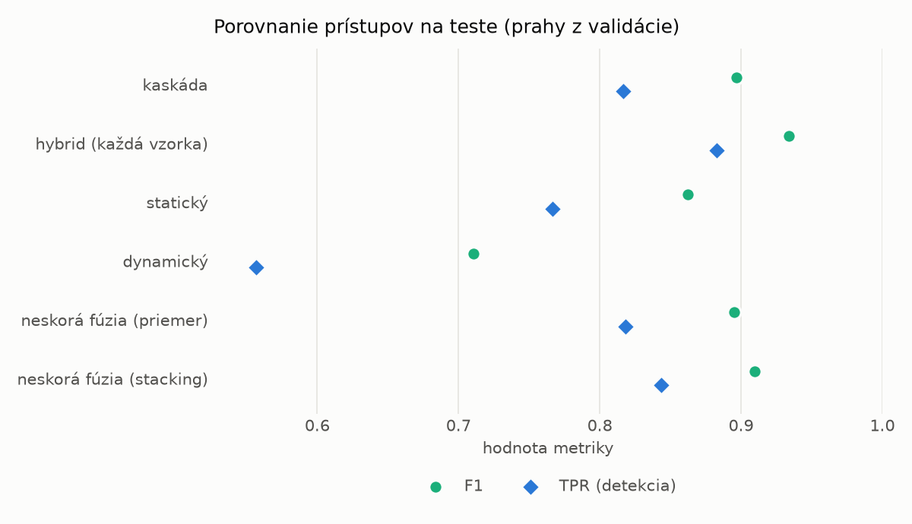
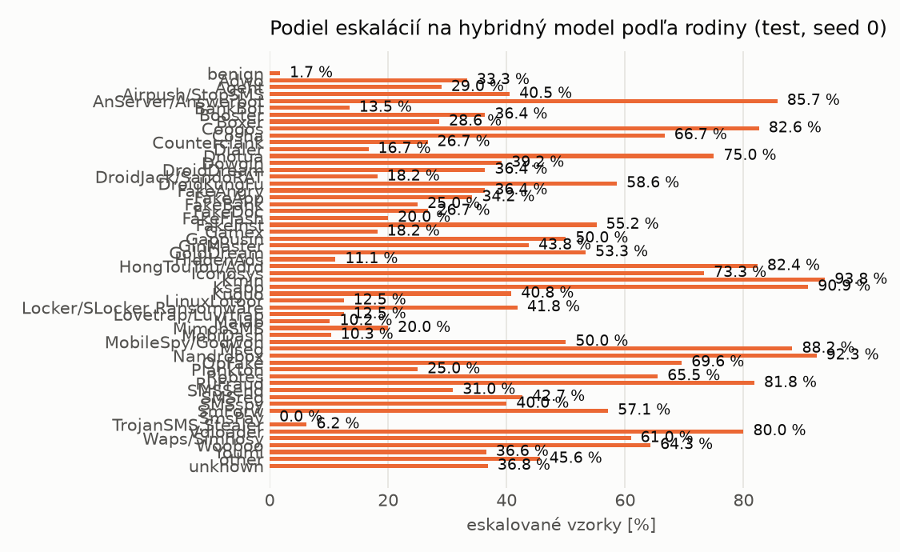

# Kaskáda `modal` – beh `20261123-212833`

> Generované `src/cascade/evaluate.py` (2026-11-23T21:28:34+01:00). Seedy: [0, 1, 2]; hodnoty = priemer ± sm. odchýlka.
> Všetky prahy sú určené na validácii (FPR ≤ 1 %); test sa na nič nenastavuje.

| rola | beh |
|---|---|
| static | `runs_v4/emu_p/lofo/Airpush_StopSMS/students_static/mlp_kd_modal/20261123-212605` |
| dynamic | `runs_v4/emu_p/lofo/Airpush_StopSMS/students_dynamic/mlp_kd_modal/20261123-212749` |
| hybrid | `runs_v4/emu_p/lofo/Airpush_StopSMS/hybrid/lightgbm/20261123-211909` |

## Test
| prístup | accuracy | balanced_accuracy | precision | recall_tpr | fpr | f1 | mcc |
|---|---|---|---|---|---|---|---|
| kaskáda | 0.9159 ± 0.0011 | 0.9065 ± 0.0012 | 0.9950 ± 0.0002 | 0.8164 ± 0.0026 | 0.0033 ± 0.0002 | 0.8969 ± 0.0015 | 0.8385 ± 0.0019 |
| hybrid (každá vzorka) | 0.9437 ± 0.0011 | 0.9380 ± 0.0013 | 0.9905 ± 0.0007 | 0.8829 ± 0.0030 | 0.0069 ± 0.0005 | 0.9336 ± 0.0015 | 0.8895 ± 0.0021 |
| statický | 0.8904 ± 0.0028 | 0.8787 ± 0.0031 | 0.9858 ± 0.0009 | 0.7664 ± 0.0062 | 0.0090 ± 0.0005 | 0.8624 ± 0.0040 | 0.7906 ± 0.0051 |
| dynamický | 0.7969 ± 0.0040 | 0.7744 ± 0.0044 | 0.9829 ± 0.0003 | 0.5566 ± 0.0089 | 0.0079 ± 0.0000 | 0.7107 ± 0.0073 | 0.6270 ± 0.0069 |
| neskorá fúzia (priemer) | 0.9141 ± 0.0040 | 0.9051 ± 0.0045 | 0.9884 ± 0.0009 | 0.8180 ± 0.0098 | 0.0078 ± 0.0007 | 0.8951 ± 0.0055 | 0.8341 ± 0.0071 |
| neskorá fúzia (stacking) | 0.9247 ± 0.0029 | 0.9171 ± 0.0033 | 0.9869 ± 0.0013 | 0.8433 ± 0.0074 | 0.0091 ± 0.0010 | 0.9094 ± 0.0038 | 0.8534 ± 0.0051 |

## Validácia
| prístup | accuracy | balanced_accuracy | precision | recall_tpr | fpr | f1 | mcc |
|---|---|---|---|---|---|---|---|
| kaskáda | 0.9635 ± 0.0007 | 0.9543 ± 0.0006 | 0.9911 ± 0.0018 | 0.9138 ± 0.0007 | 0.0052 ± 0.0010 | 0.9509 ± 0.0009 | 0.9239 ± 0.0016 |
| hybrid (každá vzorka) | 0.9798 ± 0.0004 | 0.9767 ± 0.0005 | 0.9845 ± 0.0003 | 0.9630 ± 0.0009 | 0.0096 ± 0.0002 | 0.9737 ± 0.0006 | 0.9575 ± 0.0009 |
| statický | 0.9550 ± 0.0014 | 0.9446 ± 0.0018 | 0.9833 ± 0.0003 | 0.8988 ± 0.0036 | 0.0096 ± 0.0002 | 0.9392 ± 0.0020 | 0.9058 ± 0.0029 |
| dynamický | 0.8449 ± 0.0046 | 0.8024 ± 0.0060 | 0.9755 ± 0.0005 | 0.6146 ± 0.0120 | 0.0097 ± 0.0000 | 0.7540 ± 0.0091 | 0.6861 ± 0.0091 |
| neskorá fúzia (priemer) | 0.9505 ± 0.0033 | 0.9389 ± 0.0042 | 0.9829 ± 0.0002 | 0.8875 ± 0.0085 | 0.0097 ± 0.0000 | 0.9327 ± 0.0047 | 0.8967 ± 0.0067 |
| neskorá fúzia (stacking) | 0.9629 ± 0.0023 | 0.9548 ± 0.0030 | 0.9839 ± 0.0005 | 0.9191 ± 0.0059 | 0.0095 ± 0.0003 | 0.9504 ± 0.0033 | 0.9222 ± 0.0048 |

## Správanie kaskády (test, seed 0)
- podiel eskalácií na hybrid: **17.34%** (2194 vzoriek)
- chyby pri zhode študentov (kaskáda ich nemôže opraviť): **911**
  (8.708% zo zhôd; FP 0, FN 911)
- úspešnosť na eskalovaných vzorkách: hybrid 0.922971741112124, statický 0.7807657247037375,
  dynamický 0.21923427529626252  → prínos hybridu pri nezhode

## Výpočtové nároky (odhad z benchmarkov komponentov)
_Chýba benchmark niektorého komponentu (`python -m src.evaluation.benchmark`)._

