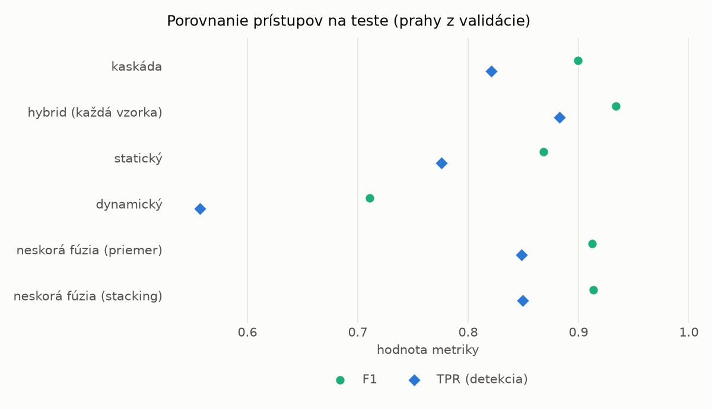
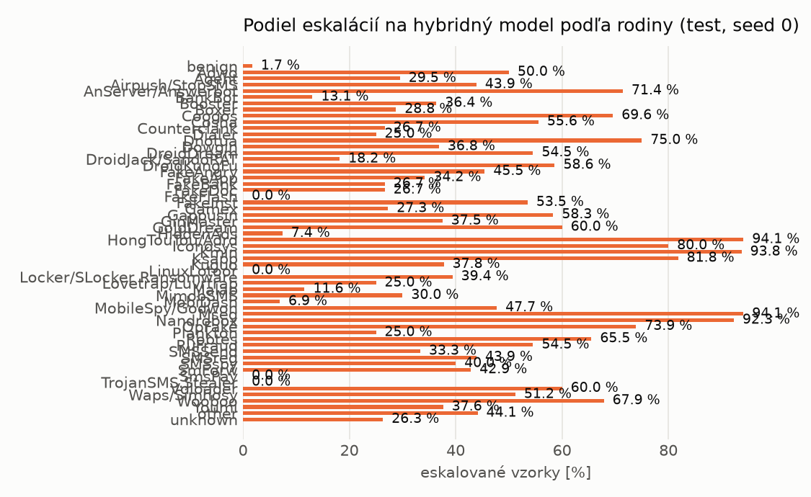

# Kaskáda `nokd` – beh `20261123-212831`

> Generované `src/cascade/evaluate.py` (2026-11-23T21:28:31+01:00). Seedy: [0, 1, 2]; hodnoty = priemer ± sm. odchýlka.
> Všetky prahy sú určené na validácii (FPR ≤ 1 %); test sa na nič nenastavuje.

| rola | beh |
|---|---|
| static | `runs_v4/emu_p/lofo/Airpush_StopSMS/students_static/mlp_nokd/20261123-212539` |
| dynamic | `runs_v4/emu_p/lofo/Airpush_StopSMS/students_dynamic/mlp_nokd/20261123-212706` |
| hybrid | `runs_v4/emu_p/lofo/Airpush_StopSMS/hybrid/lightgbm/20261123-211909` |

## Test
| prístup | accuracy | balanced_accuracy | precision | recall_tpr | fpr | f1 | mcc |
|---|---|---|---|---|---|---|---|
| kaskáda | 0.9179 ± 0.0047 | 0.9088 ± 0.0052 | 0.9953 ± 0.0004 | 0.8207 ± 0.0104 | 0.0032 ± 0.0003 | 0.8996 ± 0.0062 | 0.8423 ± 0.0085 |
| hybrid (každá vzorka) | 0.9437 ± 0.0011 | 0.9380 ± 0.0013 | 0.9905 ± 0.0007 | 0.8829 ± 0.0030 | 0.0069 ± 0.0005 | 0.9336 ± 0.0015 | 0.8895 ± 0.0021 |
| statický | 0.8946 ± 0.0105 | 0.8835 ± 0.0117 | 0.9860 ± 0.0012 | 0.7760 ± 0.0237 | 0.0090 ± 0.0008 | 0.8683 ± 0.0147 | 0.7983 ± 0.0188 |
| dynamický | 0.7969 ± 0.0045 | 0.7744 ± 0.0051 | 0.9825 ± 0.0024 | 0.5569 ± 0.0112 | 0.0081 ± 0.0012 | 0.7108 ± 0.0086 | 0.6270 ± 0.0071 |
| neskorá fúzia (priemer) | 0.9268 ± 0.0039 | 0.9194 ± 0.0045 | 0.9866 ± 0.0006 | 0.8482 ± 0.0094 | 0.0094 ± 0.0005 | 0.9122 ± 0.0052 | 0.8572 ± 0.0072 |
| neskorá fúzia (stacking) | 0.9279 ± 0.0040 | 0.9205 ± 0.0046 | 0.9883 ± 0.0012 | 0.8492 ± 0.0102 | 0.0082 ± 0.0010 | 0.9135 ± 0.0053 | 0.8595 ± 0.0073 |

## Validácia
| prístup | accuracy | balanced_accuracy | precision | recall_tpr | fpr | f1 | mcc |
|---|---|---|---|---|---|---|---|
| kaskáda | 0.9661 ± 0.0009 | 0.9577 ± 0.0013 | 0.9914 ± 0.0007 | 0.9205 ± 0.0030 | 0.0051 ± 0.0004 | 0.9546 ± 0.0013 | 0.9293 ± 0.0018 |
| hybrid (každá vzorka) | 0.9798 ± 0.0004 | 0.9767 ± 0.0005 | 0.9845 ± 0.0003 | 0.9630 ± 0.0009 | 0.0096 ± 0.0002 | 0.9737 ± 0.0006 | 0.9575 ± 0.0009 |
| statický | 0.9570 ± 0.0037 | 0.9473 ± 0.0048 | 0.9832 ± 0.0002 | 0.9043 ± 0.0096 | 0.0097 ± 0.0000 | 0.9421 ± 0.0053 | 0.9100 ± 0.0077 |
| dynamický | 0.8432 ± 0.0061 | 0.8001 ± 0.0079 | 0.9753 ± 0.0006 | 0.6100 ± 0.0159 | 0.0097 ± 0.0000 | 0.7505 ± 0.0121 | 0.6826 ± 0.0121 |
| neskorá fúzia (priemer) | 0.9610 ± 0.0023 | 0.9524 ± 0.0029 | 0.9835 ± 0.0004 | 0.9144 ± 0.0058 | 0.0096 ± 0.0002 | 0.9477 ± 0.0032 | 0.9182 ± 0.0048 |
| neskorá fúzia (stacking) | 0.9665 ± 0.0025 | 0.9595 ± 0.0032 | 0.9836 ± 0.0001 | 0.9288 ± 0.0064 | 0.0097 ± 0.0000 | 0.9554 ± 0.0034 | 0.9296 ± 0.0051 |

## Správanie kaskády (test, seed 0)
- podiel eskalácií na hybrid: **17.48%** (2212 vzoriek)
- chyby pri zhode študentov (kaskáda ich nemôže opraviť): **897**
  (8.589% zo zhôd; FP 2, FN 895)
- úspešnosť na eskalovaných vzorkách: hybrid 0.9190777576853526, statický 0.7698915009041591,
  dynamický 0.23010849909584086  → prínos hybridu pri nezhode

## Výpočtové nároky (odhad z benchmarkov komponentov)
_Chýba benchmark niektorého komponentu (`python -m src.evaluation.benchmark`)._

