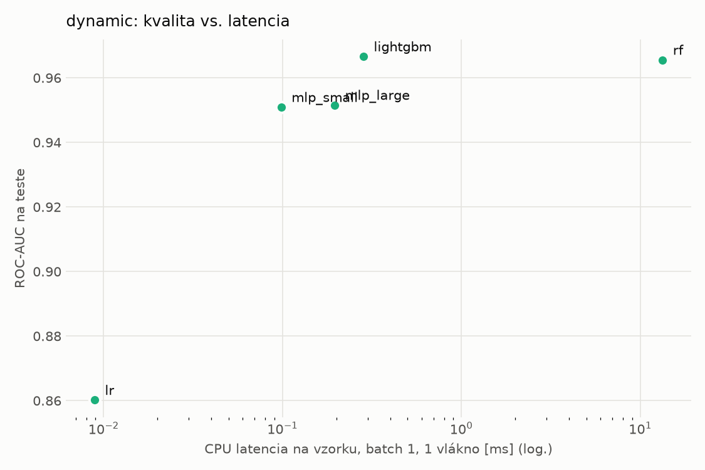
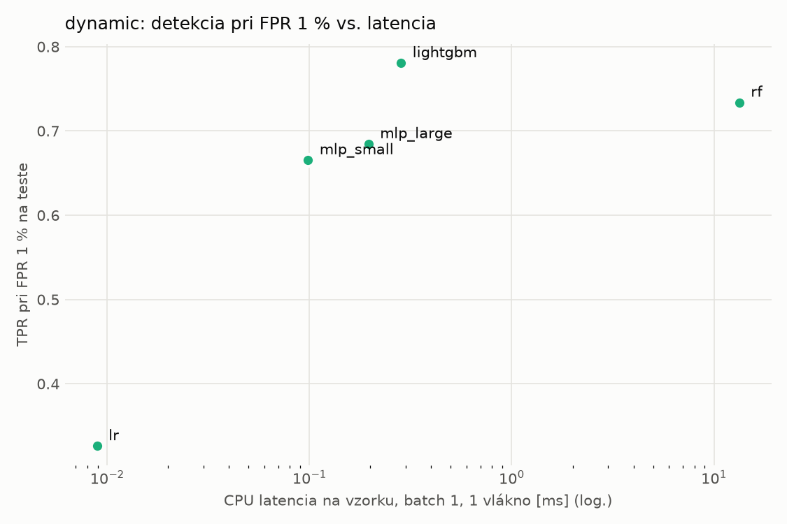
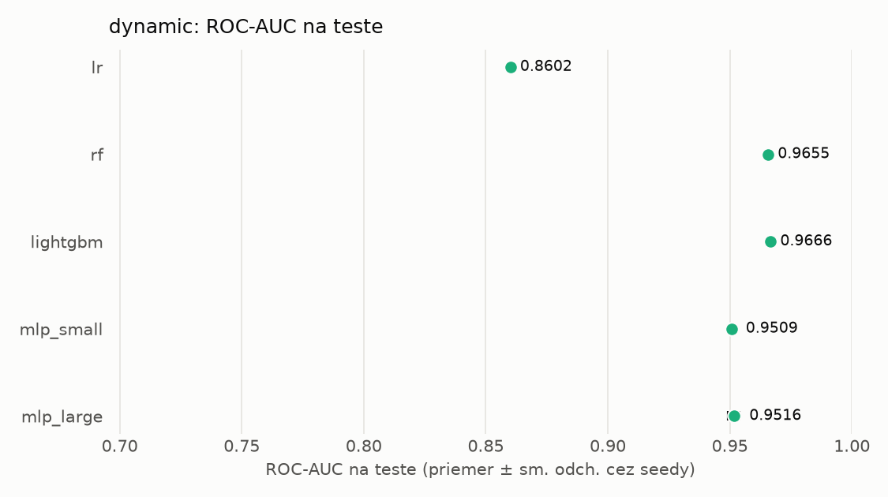
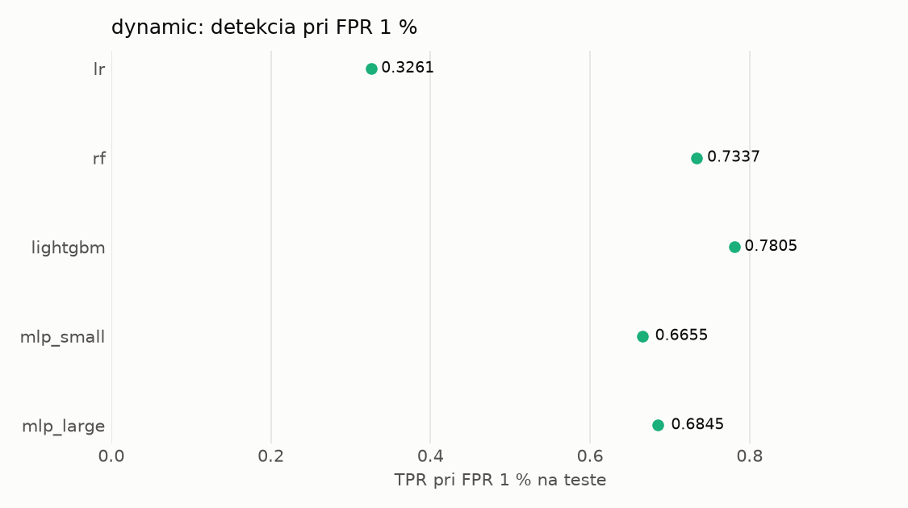

# Porovnanie modelov – dynamic

> Generované `src/evaluation/compare.py` (2026-11-23T21:18:55+01:00); použitý je posledný beh každého modelu.
> Metriky sú priemer cez seedy. \* = pri prahu určenom na validácii (FPR ≤ 1 %).
> CPU ms/vz. = medián latencie jednej vzorky na 1 vlákne vrátane transformácie vstupu (meranie hneď po tréningu,
> orientačné). Oficiálne merania spotreby sú v časti „Spotreba zdrojov pri inferencii“.

## Detekčná kvalita a orientačné časy
| model | ROC-AUC val | ROC-AUC test | TPR@FPR 1 % test | TPR@FPR 0,1 % test | F1 test* | FPR test* | gap train−val | CPU ms/vz. | CPU vz./s | GPU ms/vz. | parametre | MB | tréning s | ladenie min |
|---|---|---|---|---|---|---|---|---|---|---|---|---|---|---|
| [lr](../../dynamic/lr/20261123-211544/README.md) | 0.8715 | 0.8602 ± 0.0000 | 0.3261 | 0.0888 | 0.4936 | 0.0102 | 0.0040 | 0.009 | 4 397 193 | – | 124 | 0.01 | 0.4 | 0.0 |
| [rf](../../dynamic/rf/20261123-211547/README.md) | 0.9753 | 0.9655 ± 0.0002 | 0.7337 | 0.5730 | 0.8102 | 0.0066 | 0.0245 | 13.317 | 108 964 | – | 3 805 038 | 304.74 | 2.2 | 0.0 |
| [lightgbm](../../dynamic/lightgbm/20261123-211603/README.md) | 0.9803 | 0.9666 ± 0.0001 | 0.7805 | 0.6191 | 0.8628 | 0.0069 | 0.0196 | 0.283 | 42 101 | – | 733 516 | 40.70 | 23.4 | 0.0 |
| [mlp_small](../../dynamic/mlp_small/20261123-211736/README.md) | 0.9649 | 0.9509 ± 0.0017 | 0.6655 | 0.3726 | 0.8006 | 0.0117 | 0.0258 | 0.098 | 3 076 400 | 0.380 | 65 537 | 0.27 | 16.4 | 0.0 |
| [mlp_large](../../dynamic/mlp_large/20261123-211827/README.md) | 0.9669 | 0.9516 ± 0.0025 | 0.6845 | 0.4555 | 0.7983 | 0.0085 | 0.0264 | 0.196 | 417 121 | 0.452 | 786 945 | 3.17 | 8.2 | 0.0 |

## Nízka prevalencia malvéru (test, prah z validácie)
| model | TPR | FPR | precision @ 1 % | falošné na 1 skutočný poplach @ 1 % | precision @ 0.1 % | falošné na 1 skutočný poplach @ 0.1 % |
|---|---|---|---|---|---|---|
| lr | 0.3317 | 0.0102 | 0.248 | 3.03 | 0.032 | 30.62 |
| rf | 0.6865 | 0.0066 | 0.513 | 0.95 | 0.094 | 9.59 |
| lightgbm | 0.7652 | 0.0069 | 0.528 | 0.90 | 0.100 | 9.04 |
| mlp_small | 0.6772 | 0.0117 | 0.368 | 1.72 | 0.055 | 17.32 |
| mlp_large | 0.6713 | 0.0085 | 0.444 | 1.25 | 0.073 | 12.64 |

Prepočet: TPR a FPR nezávisia od podielu malvéru, preto sa dajú preniesť na nízku prevalenciu (v reálnej prevádzke je malvéru ~1 % alebo menej; v teste 54 %). „Falošné na 1 skutočný poplach“ = koľko neškodných súborov je označených na každý zachytený malvér.

## Spotreba zdrojov pri inferencii (benchmark, testovacia množina)
_Benchmark zatiaľ nebol spustený (`python -m src.evaluation.benchmark --approach dynamic`)._

## Grafy

