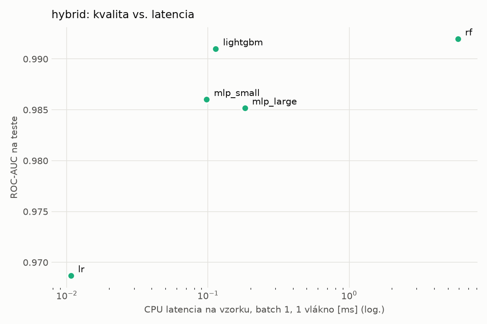
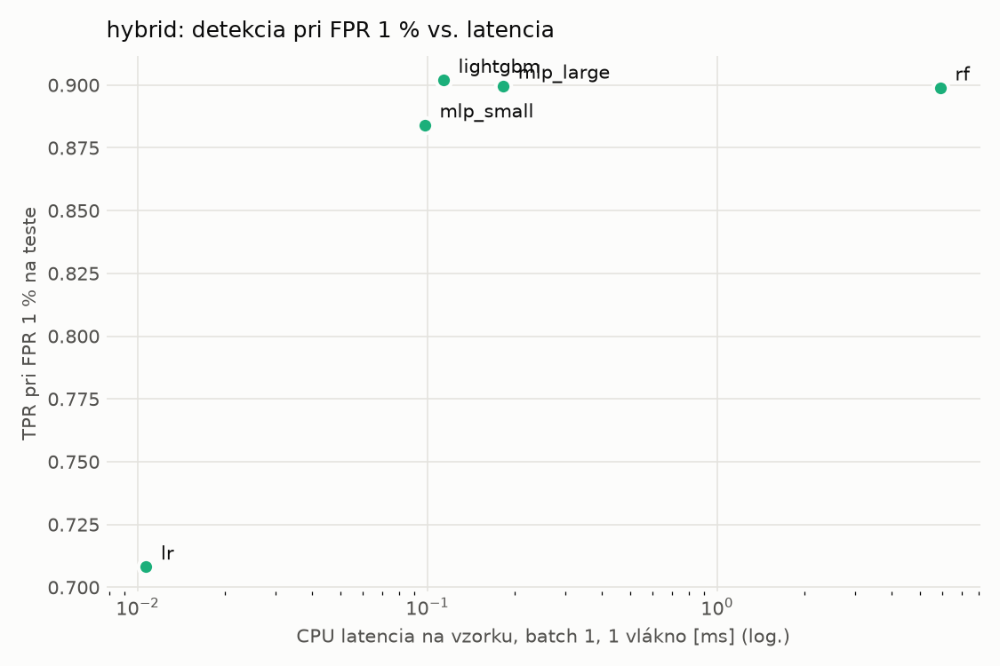
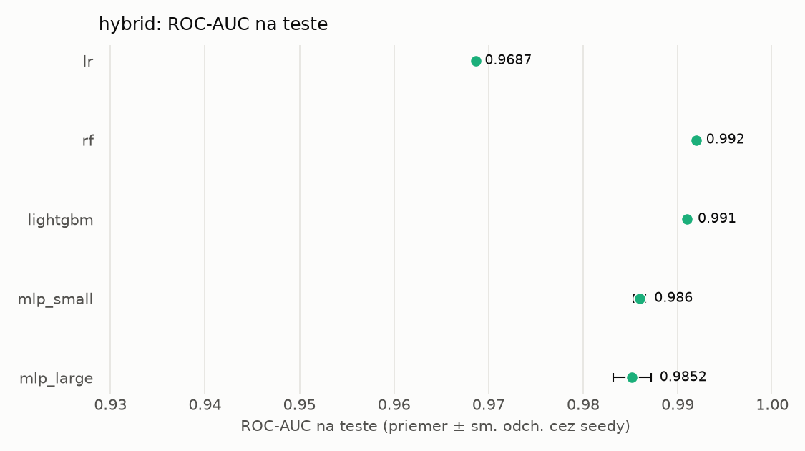
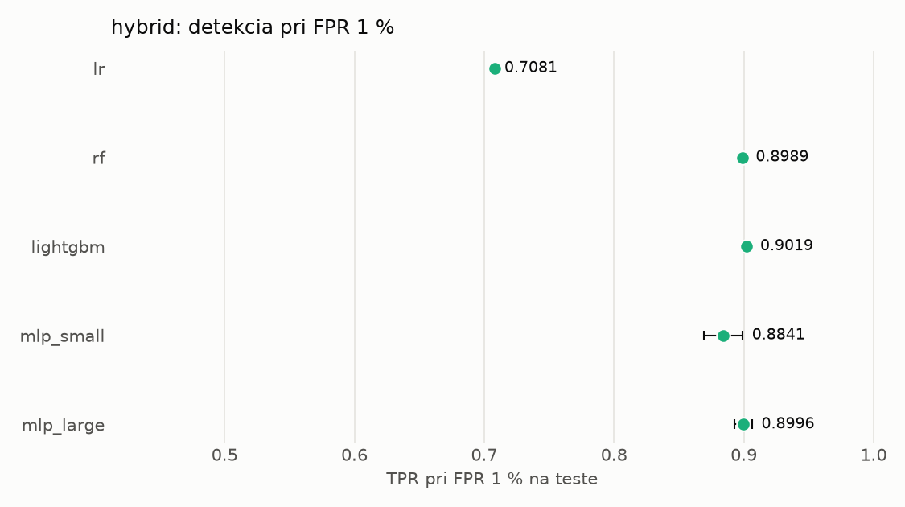

# Porovnanie modelov – hybrid

> Generované `src/evaluation/compare.py` (2026-11-23T21:20:43+01:00); použitý je posledný beh každého modelu.
> Metriky sú priemer cez seedy. \* = pri prahu určenom na validácii (FPR ≤ 1 %).
> CPU ms/vz. = medián latencie jednej vzorky na 1 vlákne vrátane transformácie vstupu (meranie hneď po tréningu,
> orientačné). Oficiálne merania spotreby sú v časti „Spotreba zdrojov pri inferencii“.

## Detekčná kvalita a orientačné časy
| model | ROC-AUC val | ROC-AUC test | TPR@FPR 1 % test | TPR@FPR 0,1 % test | F1 test* | FPR test* | gap train−val | CPU ms/vz. | CPU vz./s | GPU ms/vz. | parametre | MB | tréning s | ladenie min |
|---|---|---|---|---|---|---|---|---|---|---|---|---|---|---|
| [lr](../../hybrid/lr/20261123-211858/README.md) | 0.9810 | 0.9687 ± 0.0000 | 0.7081 | 0.3896 | 0.8052 | 0.0080 | 0.0025 | 0.011 | 2 291 342 | – | 287 | 0.01 | 0.4 | 0.0 |
| [rf](../../hybrid/rf/20261123-211900/README.md) | 0.9956 | 0.9920 ± 0.0001 | 0.8989 | 0.7763 | 0.9283 | 0.0070 | 0.0044 | 5.892 | 202 092 | – | 885 870 | 71.11 | 1.2 | 0.0 |
| [lightgbm](../../hybrid/lightgbm/20261123-211909/README.md) | 0.9967 | 0.9910 ± 0.0002 | 0.9019 | 0.7884 | 0.9336 | 0.0069 | 0.0033 | 0.114 | 121 399 | – | 281 820 | 15.72 | 12.9 | 0.0 |
| [mlp_small](../../hybrid/mlp_small/20261123-211956/README.md) | 0.9945 | 0.9860 ± 0.0006 | 0.8841 | 0.6145 | 0.9230 | 0.0067 | 0.0045 | 0.098 | 1 291 376 | 0.654 | 107 265 | 0.45 | 3.8 | 0.0 |
| [mlp_large](../../hybrid/mlp_large/20261123-212010/README.md) | 0.9947 | 0.9852 ± 0.0020 | 0.8996 | 0.7038 | 0.9299 | 0.0069 | 0.0043 | 0.183 | 728 994 | 0.574 | 323 521 | 1.32 | 10.1 | 0.0 |

## Nízka prevalencia malvéru (test, prah z validácie)
| model | TPR | FPR | precision @ 1 % | falošné na 1 skutočný poplach @ 1 % | precision @ 0.1 % | falošné na 1 skutočný poplach @ 0.1 % |
|---|---|---|---|---|---|---|
| lr | 0.6806 | 0.0080 | 0.462 | 1.17 | 0.078 | 11.77 |
| rf | 0.8737 | 0.0070 | 0.557 | 0.80 | 0.111 | 8.02 |
| lightgbm | 0.8829 | 0.0069 | 0.565 | 0.77 | 0.114 | 7.78 |
| mlp_small | 0.8642 | 0.0067 | 0.566 | 0.77 | 0.115 | 7.73 |
| mlp_large | 0.8764 | 0.0069 | 0.563 | 0.78 | 0.113 | 7.84 |

Prepočet: TPR a FPR nezávisia od podielu malvéru, preto sa dajú preniesť na nízku prevalenciu (v reálnej prevádzke je malvéru ~1 % alebo menej; v teste 54 %). „Falošné na 1 skutočný poplach“ = koľko neškodných súborov je označených na každý zachytený malvér.

## Spotreba zdrojov pri inferencii (benchmark, testovacia množina)
_Benchmark zatiaľ nebol spustený (`python -m src.evaluation.benchmark --approach hybrid`)._

## Grafy

