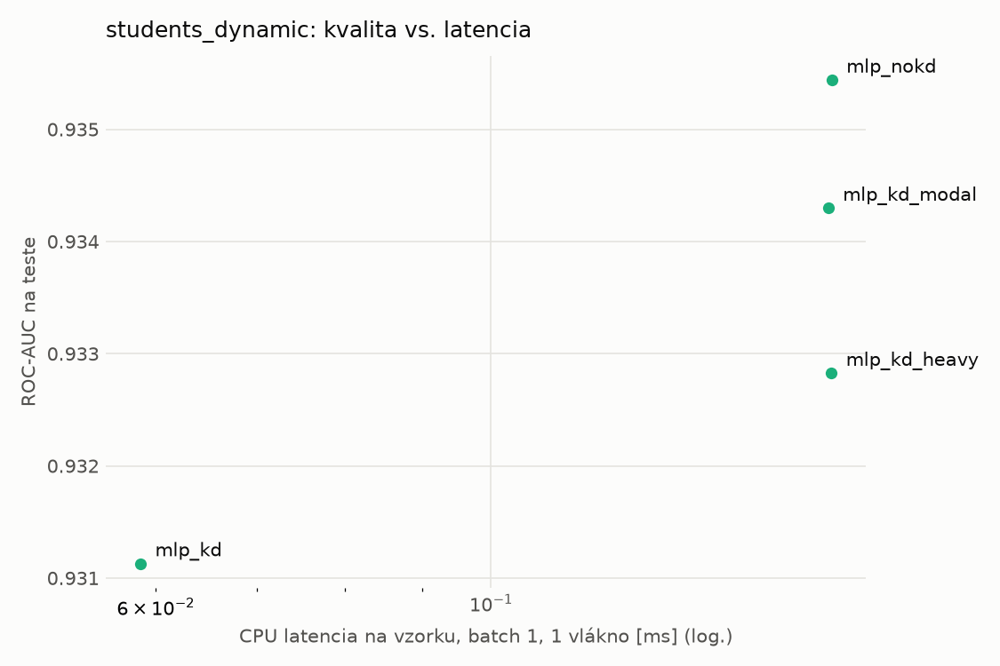
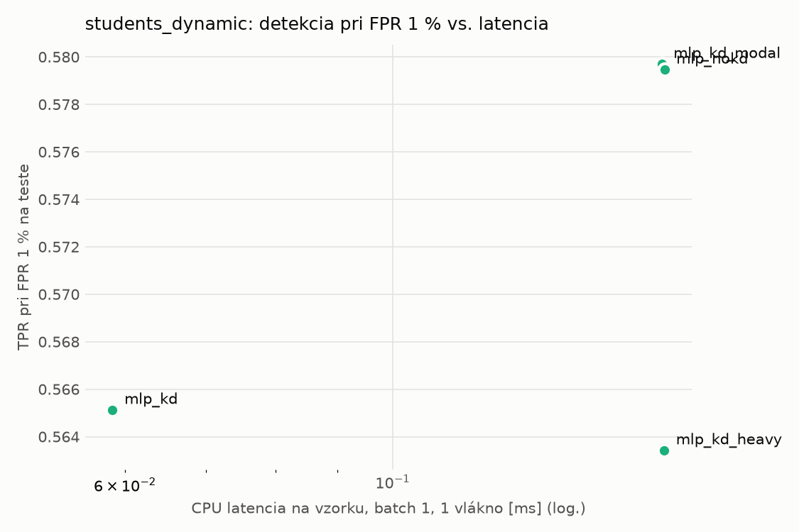
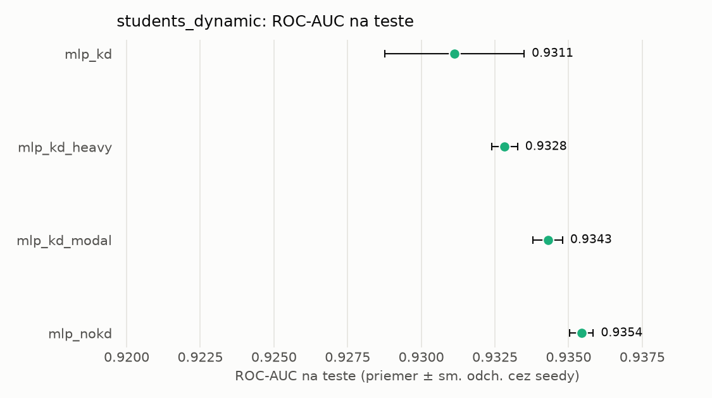
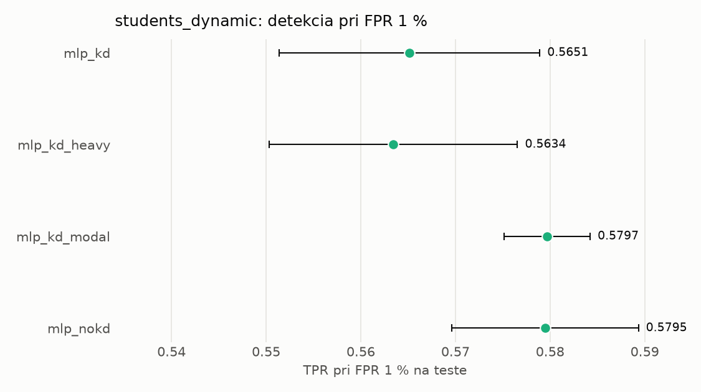

# Porovnanie modelov – students_dynamic

> Generované `src/evaluation/compare.py` (2026-11-23T21:28:26+01:00); použitý je posledný beh každého modelu.
> Metriky sú priemer cez seedy. \* = pri prahu určenom na validácii (FPR ≤ 1 %).
> CPU ms/vz. = medián latencie jednej vzorky na 1 vlákne vrátane transformácie vstupu (meranie hneď po tréningu,
> orientačné). Oficiálne merania spotreby sú v časti „Spotreba zdrojov pri inferencii“.

## Detekčná kvalita a orientačné časy
| model | ROC-AUC val | ROC-AUC test | TPR@FPR 1 % test | TPR@FPR 0,1 % test | F1 test* | FPR test* | gap train−val | CPU ms/vz. | CPU vz./s | GPU ms/vz. | parametre | MB | tréning s | ladenie min |
|---|---|---|---|---|---|---|---|---|---|---|---|---|---|---|
| [mlp_kd](../../students_dynamic/mlp_kd/20261123-212644/README.md) | 0.9443 | 0.9311 ± 0.0024 | 0.5651 | 0.3483 | 0.6962 | 0.0078 | 0.0109 | 0.059 | 5 175 643 | 0.444 | 8 129 | 0.04 | 6.5 | 0.0 |
| [mlp_kd_heavy](../../students_dynamic/mlp_kd_heavy/20261123-212806/README.md) | 0.9442 | 0.9328 ± 0.0004 | 0.5634 | 0.2917 | 0.6913 | 0.0079 | 0.0129 | 0.168 | 6 459 779 | 0.440 | 8 129 | 0.04 | 6.0 | 0.0 |
| [mlp_kd_modal](../../students_dynamic/mlp_kd_modal/20261123-212749/README.md) | 0.9467 | 0.9343 ± 0.0005 | 0.5797 | 0.3448 | 0.7107 | 0.0079 | 0.0111 | 0.167 | 7 514 101 | 0.286 | 8 129 | 0.04 | 5.0 | 0.0 |
| [mlp_nokd](../../students_dynamic/mlp_nokd/20261123-212706/README.md) | 0.9478 | 0.9354 ± 0.0004 | 0.5795 | 0.3099 | 0.7108 | 0.0081 | 0.0166 | 0.168 | 5 898 858 | 0.445 | 8 129 | 0.04 | 14.0 | 0.0 |

## Nízka prevalencia malvéru (test, prah z validácie)
| model | TPR | FPR | precision @ 1 % | falošné na 1 skutočný poplach @ 1 % | precision @ 0.1 % | falošné na 1 skutočný poplach @ 0.1 % |
|---|---|---|---|---|---|---|
| mlp_kd | 0.5392 | 0.0078 | 0.412 | 1.43 | 0.065 | 14.42 |
| mlp_kd_heavy | 0.5335 | 0.0079 | 0.405 | 1.47 | 0.063 | 14.84 |
| mlp_kd_modal | 0.5566 | 0.0079 | 0.417 | 1.40 | 0.066 | 14.14 |
| mlp_nokd | 0.5569 | 0.0081 | 0.411 | 1.43 | 0.065 | 14.47 |

Prepočet: TPR a FPR nezávisia od podielu malvéru, preto sa dajú preniesť na nízku prevalenciu (v reálnej prevádzke je malvéru ~1 % alebo menej; v teste 54 %). „Falošné na 1 skutočný poplach“ = koľko neškodných súborov je označených na každý zachytený malvér.

## Spotreba zdrojov pri inferencii (benchmark, testovacia množina)
_Benchmark zatiaľ nebol spustený (`python -m src.evaluation.benchmark --approach students_dynamic`)._

## Grafy

