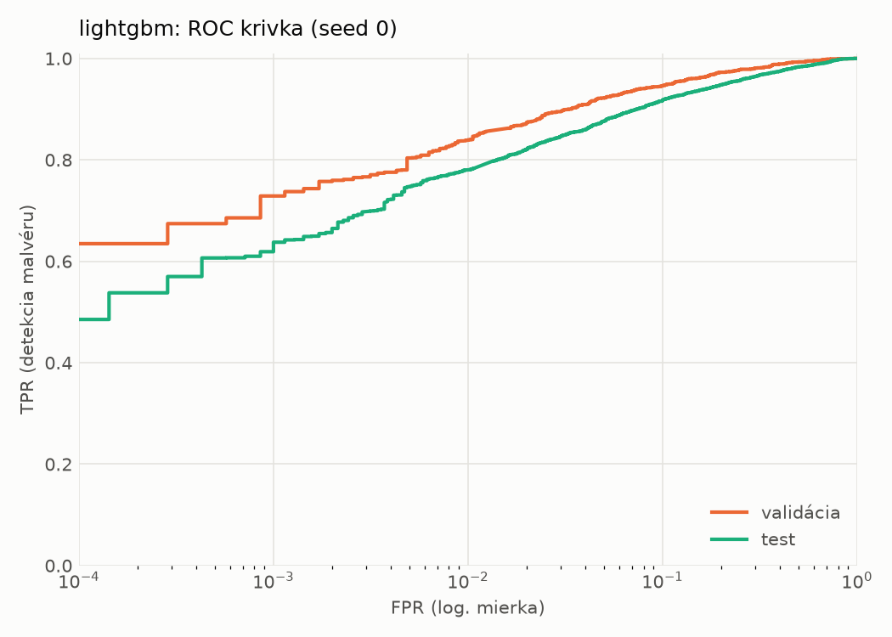
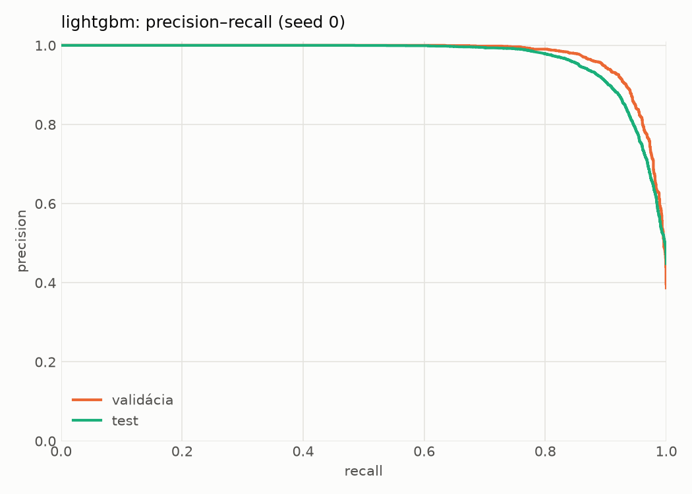
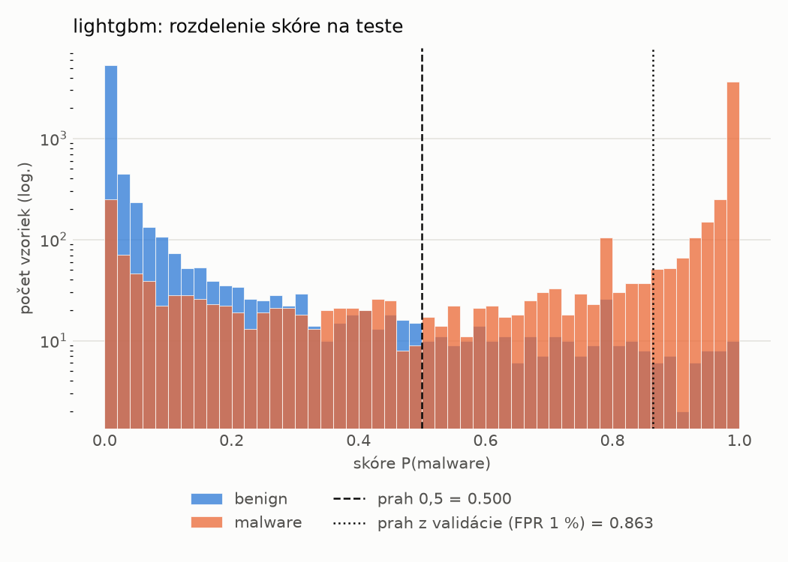
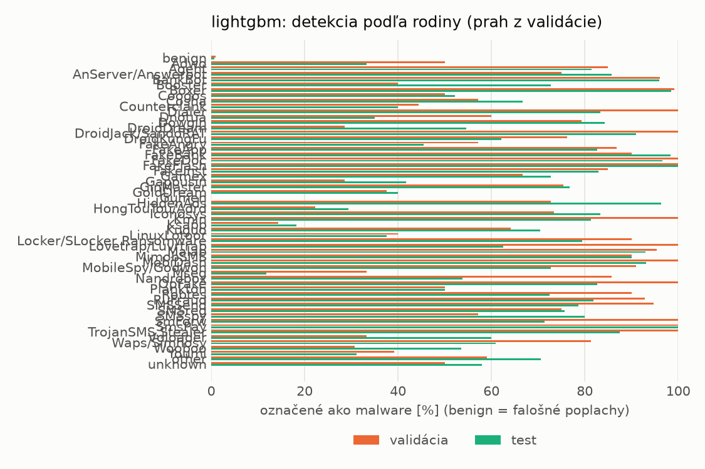
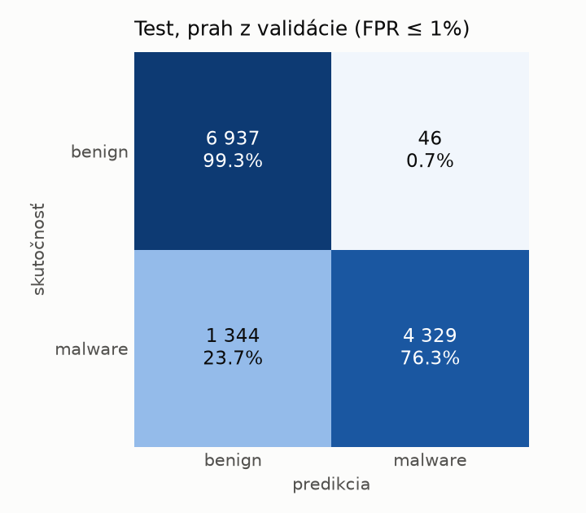
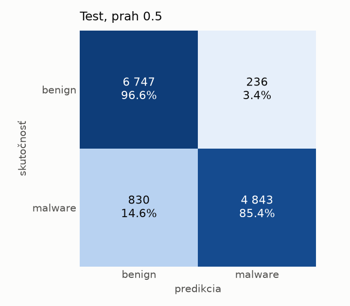
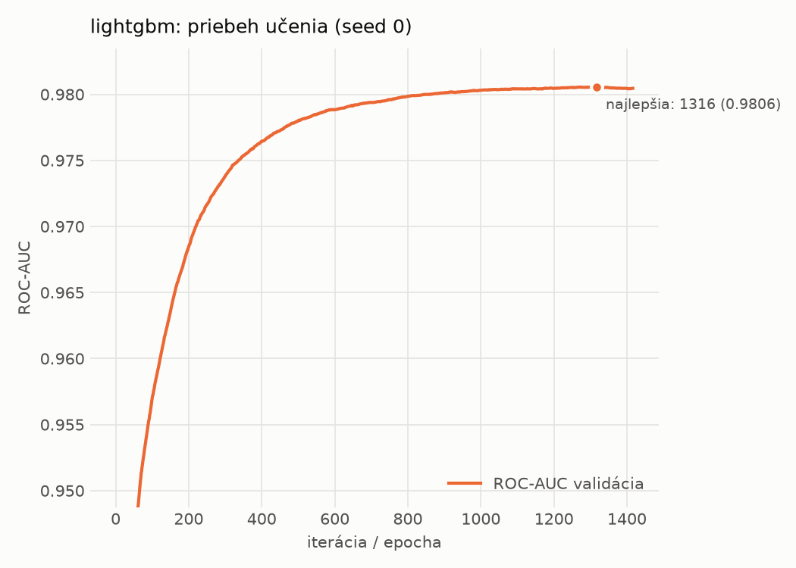

# dynamic/lightgbm – beh `20261123-211603`

> Automaticky generované (`src/training/run_tabular.py`). Konfigurácia: `config.yaml`, protokol: `protocol.yaml`.

- **Model:** `lightgbm` – LightGBM, gradient boosting stromov s early stopping na validácii (pôvodné hodnoty príznakov)
- **Ladenie:** bez ladenia – hyperparametre prevzaté z `runs_v4/emu_p/full/dynamic/lightgbm/20261123-191933`
- **Finálne modely:** seedy [0, 1, 2]; hodnoty sú priemer ± smerodajná odchýlka cez seedy
- **Najlepšie hyperparametre:** `{"num_boost_round": 5000, "early_stopping_rounds": 100, "learning_rate": 0.020757076290036595, "num_leaves": 469, "min_child_samples": 116, "feature_fraction": 0.9578728497385997, "bagging_fraction": 0.9870779948179744, "lambda_l1": 0.002495609179699052, "lambda_l2": 0.0024900497451761272}`

## Detekčná kvalita (bez prahu)
| metrika | train (podvzorka) | validácia | test |
|---|---|---|---|
| ROC-AUC | 0.9999 ± 0.0000 | 0.9803 ± 0.0004 | 0.9666 ± 0.0001 |
| PR-AUC | 0.9999 ± 0.0000 | 0.9770 ± 0.0003 | 0.9691 ± 0.0001 |
| TPR pri FPR 1 % | 1.0000 ± 0.0000 | 0.8414 ± 0.0027 | 0.7805 ± 0.0008 |
| TPR pri FPR 0,1 % | 0.9787 ± 0.0008 | 0.7115 ± 0.0150 | 0.6191 ± 0.0089 |
| log loss | 0.0163 ± 0.0014 | 0.1715 ± 0.0015 | 0.2639 ± 0.0042 |
| Brier skóre | 0.0033 ± 0.0002 | 0.0458 ± 0.0000 | 0.0667 ± 0.0002 |

Rozdiel ROC-AUC train − validácia: **0.0196** (veľký rozdiel = preučenie).

## Pri prahu z validácie (FPR ≤ 1% na validácii)
| metrika | train (podvzorka) | validácia | test |
|---|---|---|---|
| accuracy | 0.9907 ± 0.0001 | 0.9327 ± 0.0011 | 0.8909 ± 0.0010 |
| balanced accuracy | 0.9878 ± 0.0000 | 0.9158 ± 0.0014 | 0.8791 ± 0.0011 |
| precision | 0.9994 ± 0.0002 | 0.9820 ± 0.0001 | 0.9890 ± 0.0005 |
| recall (TPR) | 0.9760 ± 0.0000 | 0.8414 ± 0.0027 | 0.7652 ± 0.0024 |
| FPR | 0.0004 ± 0.0001 | 0.0097 ± 0.0000 | 0.0069 ± 0.0003 |
| F1 | 0.9875 ± 0.0001 | 0.9063 ± 0.0016 | 0.8628 ± 0.0015 |
| MCC | 0.9803 ± 0.0001 | 0.8605 ± 0.0021 | 0.7923 ± 0.0018 |

## Pri pevnom prahu 0.5
| metrika | train (podvzorka) | validácia | test |
|---|---|---|---|
| accuracy | 0.9962 ± 0.0002 | 0.9410 ± 0.0005 | 0.9148 ± 0.0009 |
| balanced accuracy | 0.9966 ± 0.0002 | 0.9342 ± 0.0004 | 0.9091 ± 0.0009 |
| precision | 0.9916 ± 0.0003 | 0.9409 ± 0.0012 | 0.9519 ± 0.0014 |
| recall (TPR) | 0.9984 ± 0.0003 | 0.9043 ± 0.0003 | 0.8531 ± 0.0010 |
| FPR | 0.0052 ± 0.0002 | 0.0358 ± 0.0008 | 0.0350 ± 0.0011 |
| F1 | 0.9950 ± 0.0002 | 0.9222 ± 0.0006 | 0.8998 ± 0.0011 |
| MCC | 0.9920 ± 0.0004 | 0.8752 ± 0.0011 | 0.8299 ± 0.0020 |

## Výpočtové nároky (seed 0, testovacia množina)
| meranie | hodnota |
|---|---|
| tréning finálneho modelu | 23.4 s (priemer cez seedy) |
| ladenie spolu | 0 s |
| počet parametrov / uzlov | 733 516 |
| veľkosť modelu na disku | 40.70 MB |
| CPU latencia modelu (batch 1, 1 vlákno) | 0.283 ms (p95 0.362) |
| CPU priepustnosť (24 vlákien) | 42 101 vzoriek/s |

## Grafy
| | |
|---|---|
|  |  |
|  |  |
|  |  |
|  |  |

## Súbory
`metrics.json` (všetky metriky po seedoch vrátane rodín), `timing.json`, `hpo_trials.csv`,
`predictions/<časť>_seed<N>.parquet` (sha256, family, label, score), `model/seed_<N>/`, `log.txt`.
