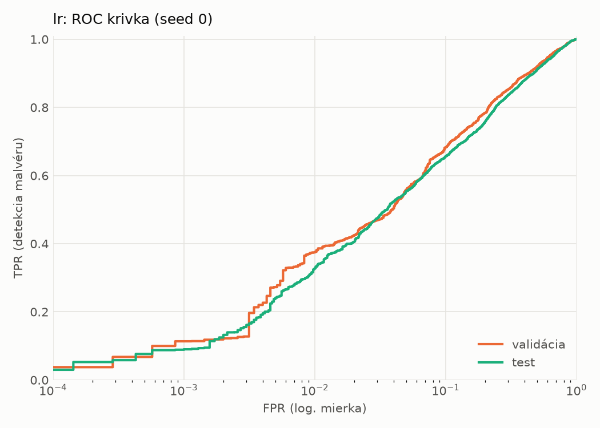
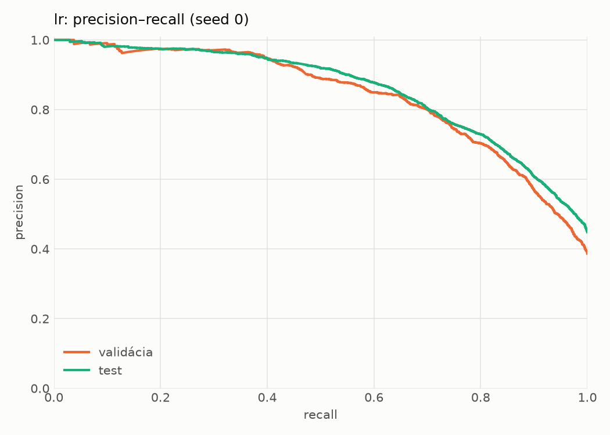
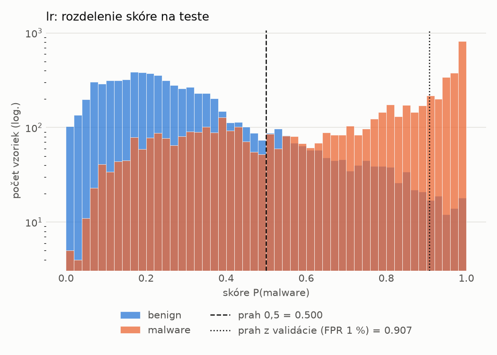
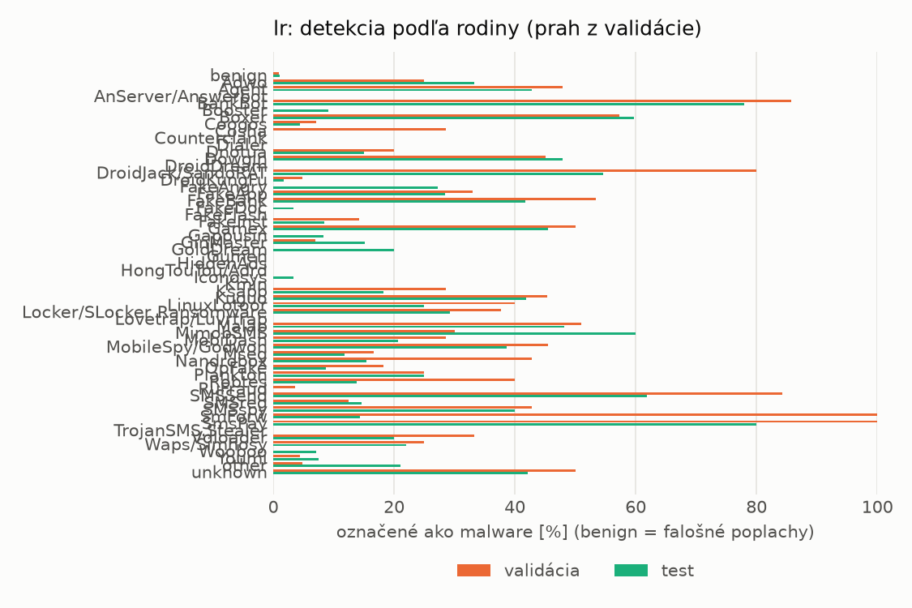
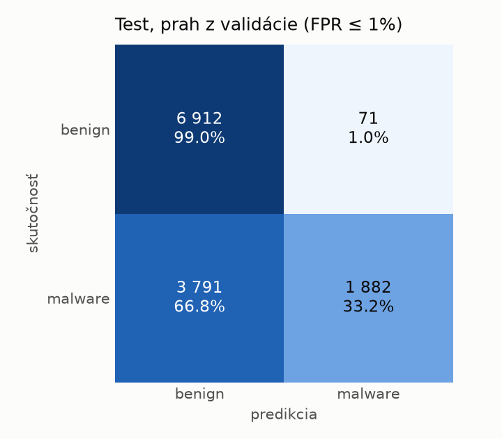
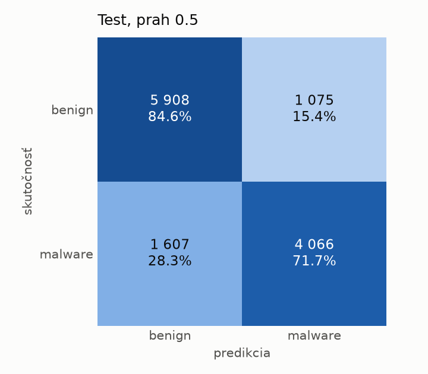

# dynamic/lr – beh `20261123-211544`

> Automaticky generované (`src/training/run_tabular.py`). Konfigurácia: `config.yaml`, protokol: `protocol.yaml`.

- **Model:** `logreg` – logistická regresia s L2 regularizáciou (vstup signed log1p + štandardizácia)
- **Ladenie:** bez ladenia – hyperparametre prevzaté z `runs_v4/emu_p/full/dynamic/lr/20261123-191800`
- **Finálne modely:** seedy [0, 1, 2]; hodnoty sú priemer ± smerodajná odchýlka cez seedy
- **Najlepšie hyperparametre:** `{"max_iter": 2000, "C": 7.504621081078761}`

## Detekčná kvalita (bez prahu)
| metrika | train (podvzorka) | validácia | test |
|---|---|---|---|
| ROC-AUC | 0.8755 ± 0.0000 | 0.8715 ± 0.0000 | 0.8602 ± 0.0000 |
| PR-AUC | 0.8440 ± 0.0000 | 0.8407 ± 0.0000 | 0.8560 ± 0.0000 |
| TPR pri FPR 1 % | 0.3608 ± 0.0000 | 0.3744 ± 0.0000 | 0.3261 ± 0.0000 |
| TPR pri FPR 0,1 % | 0.1037 ± 0.0000 | 0.1136 ± 0.0000 | 0.0888 ± 0.0000 |
| log loss | 0.4321 ± 0.0000 | 0.4400 ± 0.0000 | 0.4565 ± 0.0000 |
| Brier skóre | 0.1365 ± 0.0000 | 0.1398 ± 0.0000 | 0.1474 ± 0.0000 |

Rozdiel ROC-AUC train − validácia: **0.0040** (veľký rozdiel = preučenie).

## Pri prahu z validácie (FPR ≤ 1% na validácii)
| metrika | train (podvzorka) | validácia | test |
|---|---|---|---|
| accuracy | 0.7578 ± 0.0000 | 0.7520 ± 0.0000 | 0.6948 ± 0.0000 |
| balanced accuracy | 0.6840 ± 0.0000 | 0.6823 ± 0.0000 | 0.6608 ± 0.0000 |
| precision | 0.9536 ± 0.0000 | 0.9604 ± 0.0000 | 0.9636 ± 0.0000 |
| recall (TPR) | 0.3793 ± 0.0000 | 0.3744 ± 0.0000 | 0.3317 ± 0.0000 |
| FPR | 0.0113 ± 0.0000 | 0.0097 ± 0.0000 | 0.0102 ± 0.0000 |
| F1 | 0.5427 ± 0.0000 | 0.5387 ± 0.0000 | 0.4936 ± 0.0000 |
| MCC | 0.4990 ± 0.0000 | 0.4963 ± 0.0000 | 0.4427 ± 0.0000 |

## Pri pevnom prahu 0.5
| metrika | train (podvzorka) | validácia | test |
|---|---|---|---|
| accuracy | 0.8127 ± 0.0000 | 0.8093 ± 0.0000 | 0.7881 ± 0.0000 |
| balanced accuracy | 0.7985 ± 0.0000 | 0.7957 ± 0.0000 | 0.7814 ± 0.0000 |
| precision | 0.7595 ± 0.0000 | 0.7630 ± 0.0000 | 0.7909 ± 0.0000 |
| recall (TPR) | 0.7400 ± 0.0000 | 0.7356 ± 0.0000 | 0.7167 ± 0.0000 |
| FPR | 0.1430 ± 0.0000 | 0.1442 ± 0.0000 | 0.1539 ± 0.0000 |
| F1 | 0.7496 ± 0.0000 | 0.7490 ± 0.0000 | 0.7520 ± 0.0000 |
| MCC | 0.6002 ± 0.0000 | 0.5956 ± 0.0000 | 0.5699 ± 0.0000 |

## Výpočtové nároky (seed 0, testovacia množina)
| meranie | hodnota |
|---|---|
| tréning finálneho modelu | 0.4 s (priemer cez seedy) |
| ladenie spolu | 0 s |
| počet parametrov / uzlov | 124 |
| veľkosť modelu na disku | 0.01 MB |
| transformácia vstupu – latencia (1 vlákno) | 0.005 ms |
| transformácia vstupu – priepustnosť | 1 422 374 vzoriek/s |
| CPU latencia modelu (batch 1, 1 vlákno) | 0.004 ms (p95 0.005) |
| CPU priepustnosť (24 vlákien) | 4 397 193 vzoriek/s |

## Grafy
| | |
|---|---|
|  |  |
|  |  |
|  |  |
|  |  |

## Súbory
`metrics.json` (všetky metriky po seedoch vrátane rodín), `timing.json`, `hpo_trials.csv`,
`predictions/<časť>_seed<N>.parquet` (sha256, family, label, score), `model/seed_<N>/`, `log.txt`.
