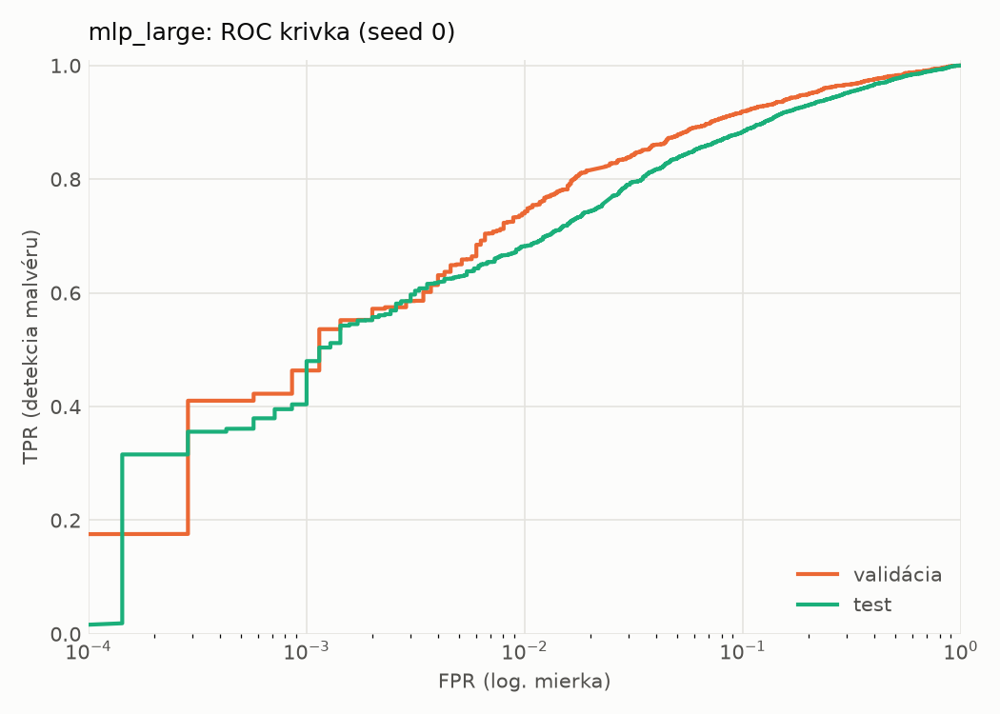
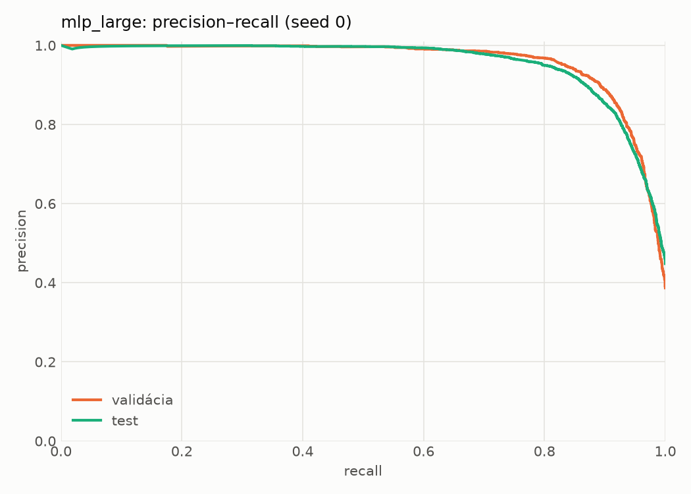
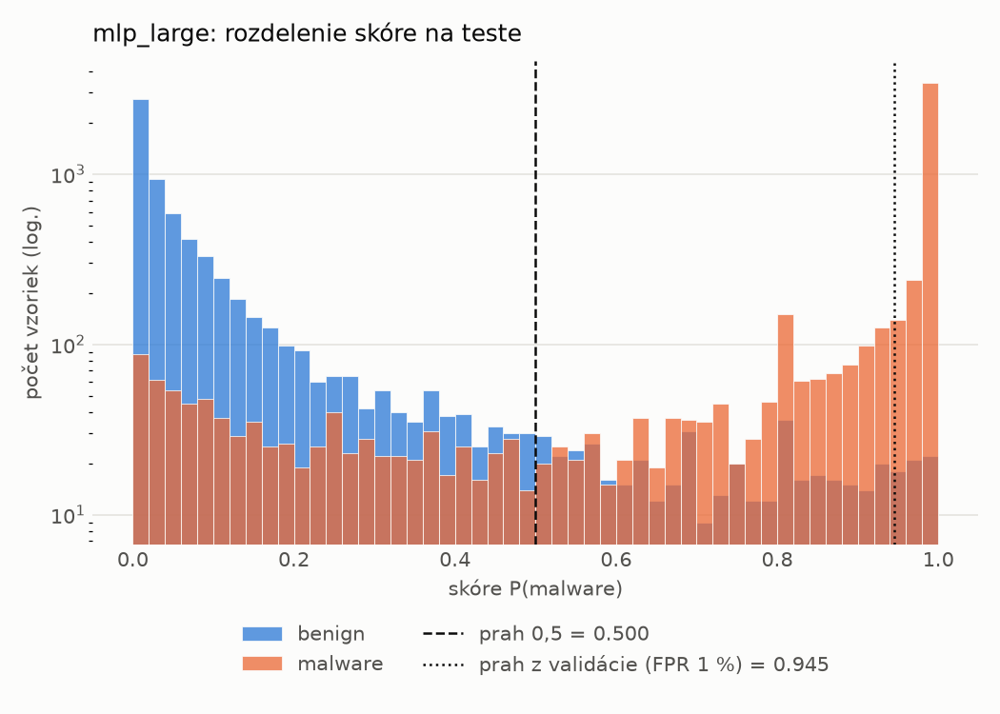
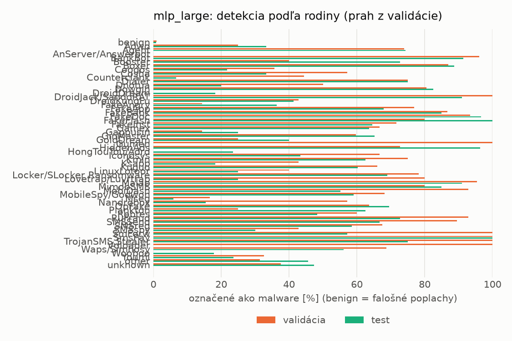
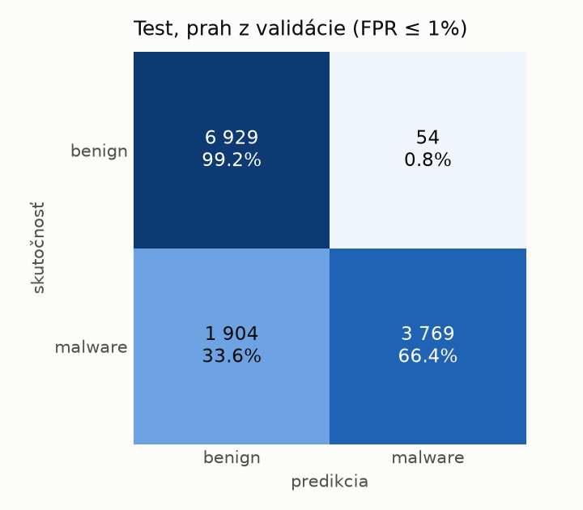
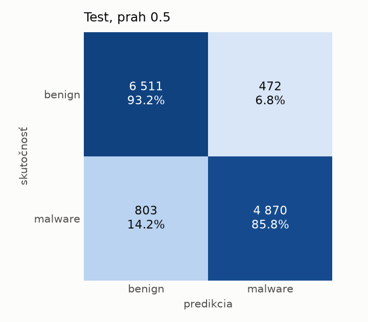
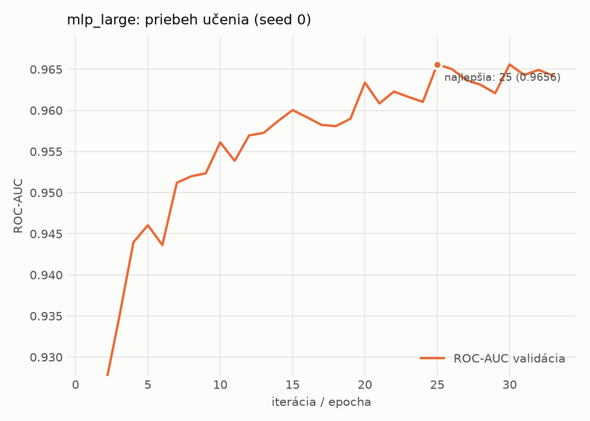

# dynamic/mlp_large – beh `20261123-211827`

> Automaticky generované (`src/training/run_tabular.py`). Konfigurácia: `config.yaml`, protokol: `protocol.yaml`.

- **Model:** `mlp` – veľká neurónová sieť (3–5 skrytých vrstiev, 512–2048 neurónov), kandidát na učiteľa
- **Ladenie:** bez ladenia – hyperparametre prevzaté z `runs_v4/emu_p/full/dynamic/mlp_large/20261123-194626`
- **Finálne modely:** seedy [0, 1, 2]; hodnoty sú priemer ± smerodajná odchýlka cez seedy
- **Najlepšie hyperparametre:** `{"max_epochs": 100, "patience": 8, "hidden_layers": 3, "hidden_width": 1024, "width_decay": 0.5, "dropout": 0.11628417924821868, "lr": 0.0004582958225587737, "weight_decay": 0.0007705605519981878, "batch_size": 512}`

## Detekčná kvalita (bez prahu)
| metrika | train (podvzorka) | validácia | test |
|---|---|---|---|
| ROC-AUC | 0.9932 ± 0.0037 | 0.9669 ± 0.0011 | 0.9516 ± 0.0025 |
| PR-AUC | 0.9909 ± 0.0046 | 0.9617 ± 0.0013 | 0.9542 ± 0.0019 |
| TPR pri FPR 1 % | 0.9126 ± 0.0316 | 0.7509 ± 0.0130 | 0.6845 ± 0.0048 |
| TPR pri FPR 0,1 % | 0.8235 ± 0.0416 | 0.4383 ± 0.0408 | 0.4555 ± 0.0458 |
| log loss | 0.1015 ± 0.0263 | 0.2345 ± 0.0070 | 0.3013 ± 0.0266 |
| Brier skóre | 0.0285 ± 0.0078 | 0.0614 ± 0.0018 | 0.0798 ± 0.0037 |

Rozdiel ROC-AUC train − validácia: **0.0264** (veľký rozdiel = preučenie).

## Pri prahu z validácie (FPR ≤ 1% na validácii)
| metrika | train (podvzorka) | validácia | test |
|---|---|---|---|
| accuracy | 0.9215 ± 0.0075 | 0.8977 ± 0.0050 | 0.8480 ± 0.0025 |
| balanced accuracy | 0.8966 ± 0.0099 | 0.8706 ± 0.0065 | 0.8314 ± 0.0028 |
| precision | 0.9987 ± 0.0009 | 0.9798 ± 0.0003 | 0.9847 ± 0.0014 |
| recall (TPR) | 0.7938 ± 0.0198 | 0.7509 ± 0.0130 | 0.6713 ± 0.0065 |
| FPR | 0.0006 ± 0.0004 | 0.0097 ± 0.0000 | 0.0085 ± 0.0009 |
| F1 | 0.8844 ± 0.0124 | 0.8502 ± 0.0084 | 0.7983 ± 0.0042 |
| MCC | 0.8387 ± 0.0151 | 0.7904 ± 0.0100 | 0.7156 ± 0.0039 |

## Pri pevnom prahu 0.5
| metrika | train (podvzorka) | validácia | test |
|---|---|---|---|
| accuracy | 0.9630 ± 0.0098 | 0.9201 ± 0.0027 | 0.8974 ± 0.0046 |
| balanced accuracy | 0.9613 ± 0.0102 | 0.9165 ± 0.0025 | 0.8932 ± 0.0047 |
| precision | 0.9482 ± 0.0141 | 0.8935 ± 0.0070 | 0.9119 ± 0.0051 |
| recall (TPR) | 0.9545 ± 0.0124 | 0.9008 ± 0.0049 | 0.8535 ± 0.0064 |
| FPR | 0.0318 ± 0.0087 | 0.0677 ± 0.0051 | 0.0670 ± 0.0039 |
| F1 | 0.9513 ± 0.0128 | 0.8971 ± 0.0033 | 0.8817 ± 0.0054 |
| MCC | 0.9215 ± 0.0207 | 0.8319 ± 0.0056 | 0.7926 ± 0.0093 |

## Výpočtové nároky (seed 0, testovacia množina)
| meranie | hodnota |
|---|---|
| tréning finálneho modelu | 8.2 s (priemer cez seedy) |
| ladenie spolu | 0 s |
| počet parametrov / uzlov | 786 945 |
| veľkosť modelu na disku | 3.17 MB |
| transformácia vstupu – latencia (1 vlákno) | 0.015 ms |
| transformácia vstupu – priepustnosť | 783 130 vzoriek/s |
| CPU latencia modelu (batch 1, 1 vlákno) | 0.181 ms (p95 0.378) |
| CPU priepustnosť (24 vlákien) | 417 121 vzoriek/s |
| GPU latencia (batch 1) | 0.452 ms (p95 0.954) |
| GPU priepustnosť | 1 431 075 vzoriek/s |
| GPU špičková pamäť | 141 MB |

## Grafy
| | |
|---|---|
|  |  |
|  |  |
|  |  |
|  |  |

## Súbory
`metrics.json` (všetky metriky po seedoch vrátane rodín), `timing.json`, `hpo_trials.csv`,
`predictions/<časť>_seed<N>.parquet` (sha256, family, label, score), `model/seed_<N>/`, `log.txt`.
