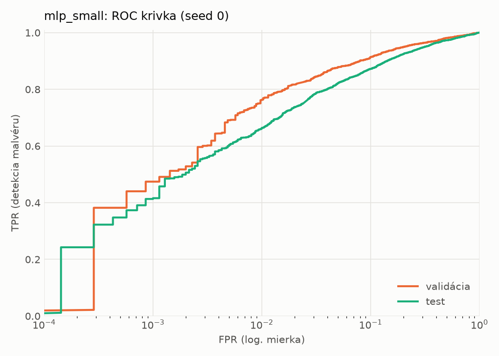
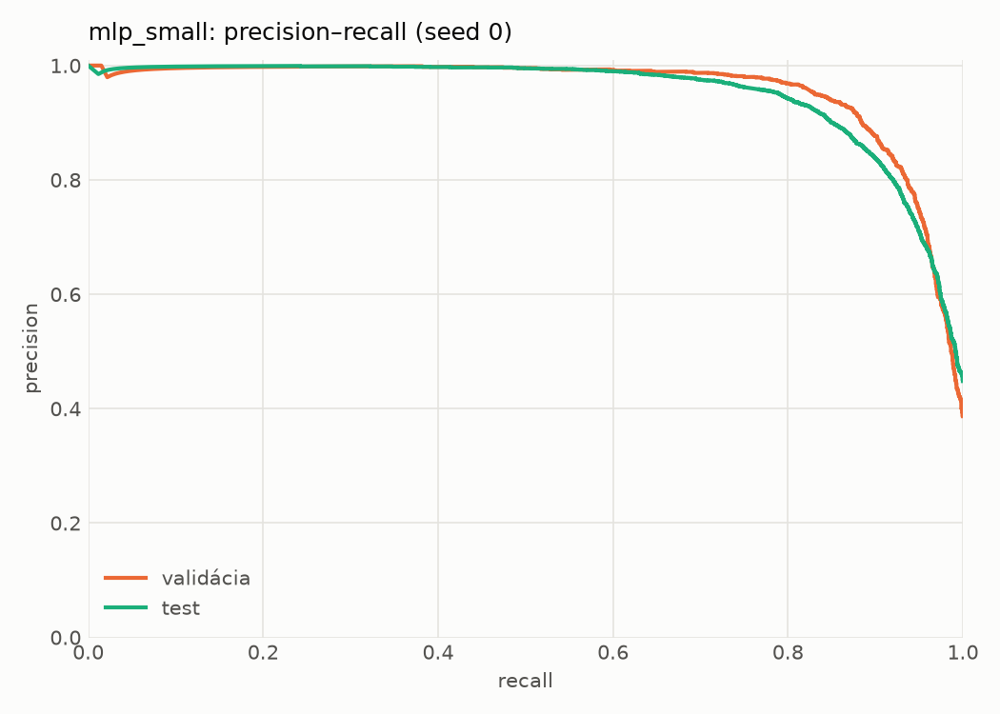
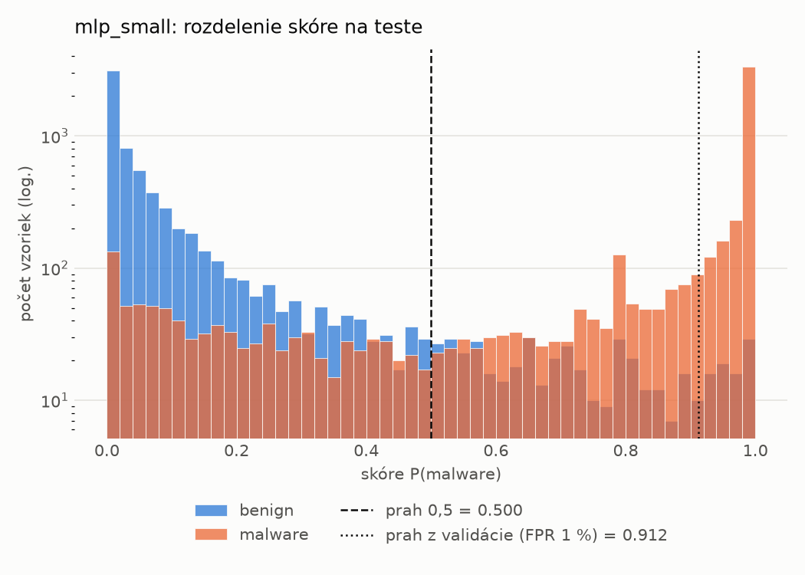
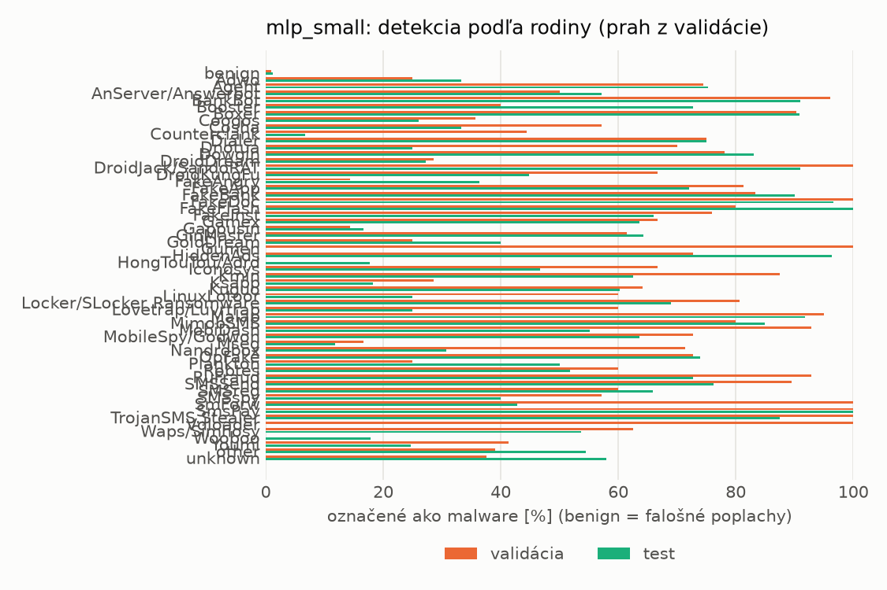
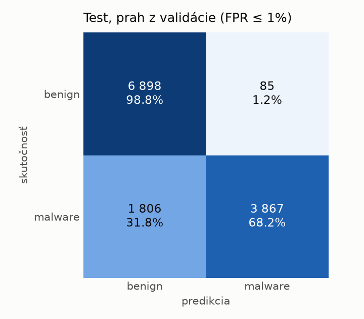
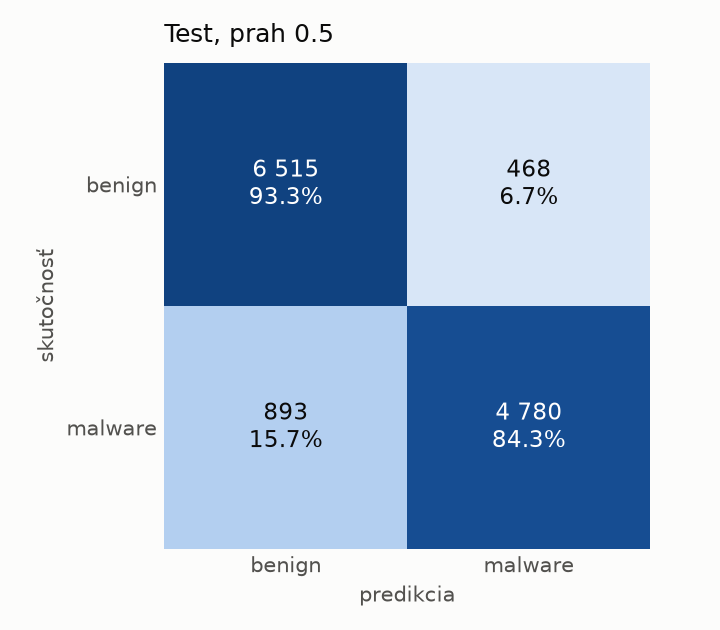
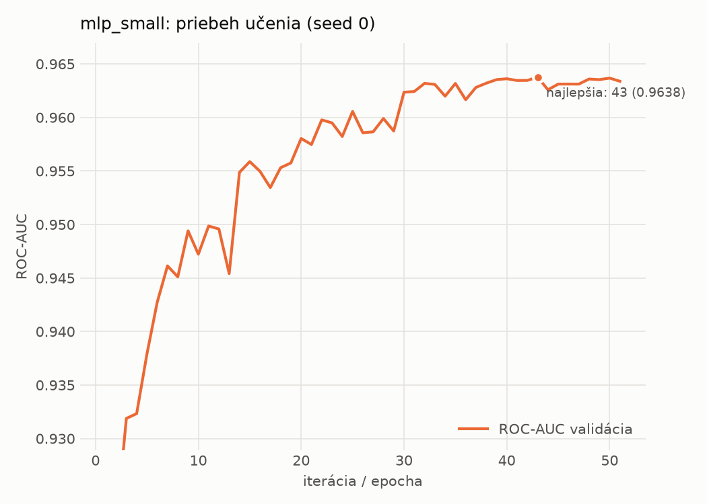

# dynamic/mlp_small – beh `20261123-211736`

> Automaticky generované (`src/training/run_tabular.py`). Konfigurácia: `config.yaml`, protokol: `protocol.yaml`.

- **Model:** `mlp` – malá neurónová sieť (1–2 skryté vrstvy), kandidát na ľahkého študenta
- **Ladenie:** bez ladenia – hyperparametre prevzaté z `runs_v4/emu_p/full/dynamic/mlp_small/20261123-193925`
- **Finálne modely:** seedy [0, 1, 2]; hodnoty sú priemer ± smerodajná odchýlka cez seedy
- **Najlepšie hyperparametre:** `{"width_decay": 0.5, "max_epochs": 100, "patience": 8, "hidden_layers": 2, "hidden_width": 256, "dropout": 0.06125761383416514, "lr": 0.0018225597913134257, "weight_decay": 9.759441755448828e-06, "batch_size": 256}`

## Detekčná kvalita (bez prahu)
| metrika | train (podvzorka) | validácia | test |
|---|---|---|---|
| ROC-AUC | 0.9907 ± 0.0011 | 0.9649 ± 0.0011 | 0.9509 ± 0.0017 |
| PR-AUC | 0.9875 ± 0.0014 | 0.9590 ± 0.0016 | 0.9523 ± 0.0010 |
| TPR pri FPR 1 % | 0.8872 ± 0.0068 | 0.7521 ± 0.0148 | 0.6655 ± 0.0038 |
| TPR pri FPR 0,1 % | 0.7775 ± 0.0132 | 0.4531 ± 0.0684 | 0.3726 ± 0.0376 |
| log loss | 0.1224 ± 0.0057 | 0.2340 ± 0.0010 | 0.2904 ± 0.0074 |
| Brier skóre | 0.0346 ± 0.0018 | 0.0633 ± 0.0007 | 0.0803 ± 0.0012 |

Rozdiel ROC-AUC train − validácia: **0.0258** (veľký rozdiel = preučenie).

## Pri prahu z validácie (FPR ≤ 1% na validácii)
| metrika | train (podvzorka) | validácia | test |
|---|---|---|---|
| accuracy | 0.9195 ± 0.0032 | 0.8981 ± 0.0057 | 0.8488 ± 0.0033 |
| balanced accuracy | 0.8942 ± 0.0043 | 0.8712 ± 0.0074 | 0.8327 ± 0.0038 |
| precision | 0.9970 ± 0.0012 | 0.9799 ± 0.0004 | 0.9791 ± 0.0027 |
| recall (TPR) | 0.7898 ± 0.0090 | 0.7521 ± 0.0148 | 0.6772 ± 0.0093 |
| FPR | 0.0014 ± 0.0006 | 0.0097 ± 0.0000 | 0.0117 ± 0.0017 |
| F1 | 0.8814 ± 0.0053 | 0.8509 ± 0.0096 | 0.8006 ± 0.0057 |
| MCC | 0.8345 ± 0.0062 | 0.7913 ± 0.0113 | 0.7155 ± 0.0050 |

## Pri pevnom prahu 0.5
| metrika | train (podvzorka) | validácia | test |
|---|---|---|---|
| accuracy | 0.9548 ± 0.0028 | 0.9162 ± 0.0014 | 0.8945 ± 0.0018 |
| balanced accuracy | 0.9526 ± 0.0035 | 0.9125 ± 0.0014 | 0.8904 ± 0.0023 |
| precision | 0.9372 ± 0.0038 | 0.8880 ± 0.0047 | 0.9087 ± 0.0042 |
| recall (TPR) | 0.9439 ± 0.0071 | 0.8964 ± 0.0046 | 0.8502 ± 0.0080 |
| FPR | 0.0386 ± 0.0025 | 0.0714 ± 0.0037 | 0.0695 ± 0.0041 |
| F1 | 0.9405 ± 0.0039 | 0.8922 ± 0.0017 | 0.8784 ± 0.0027 |
| MCC | 0.9041 ± 0.0061 | 0.8236 ± 0.0028 | 0.7868 ± 0.0034 |

## Výpočtové nároky (seed 0, testovacia množina)
| meranie | hodnota |
|---|---|
| tréning finálneho modelu | 16.4 s (priemer cez seedy) |
| ladenie spolu | 0 s |
| počet parametrov / uzlov | 65 537 |
| veľkosť modelu na disku | 0.27 MB |
| transformácia vstupu – latencia (1 vlákno) | 0.014 ms |
| transformácia vstupu – priepustnosť | 771 533 vzoriek/s |
| CPU latencia modelu (batch 1, 1 vlákno) | 0.084 ms (p95 0.097) |
| CPU priepustnosť (24 vlákien) | 3 076 400 vzoriek/s |
| GPU latencia (batch 1) | 0.380 ms (p95 0.409) |
| GPU priepustnosť | 2 130 855 vzoriek/s |
| GPU špičková pamäť | 63 MB |

## Grafy
| | |
|---|---|
|  |  |
|  |  |
|  |  |
|  |  |

## Súbory
`metrics.json` (všetky metriky po seedoch vrátane rodín), `timing.json`, `hpo_trials.csv`,
`predictions/<časť>_seed<N>.parquet` (sha256, family, label, score), `model/seed_<N>/`, `log.txt`.
