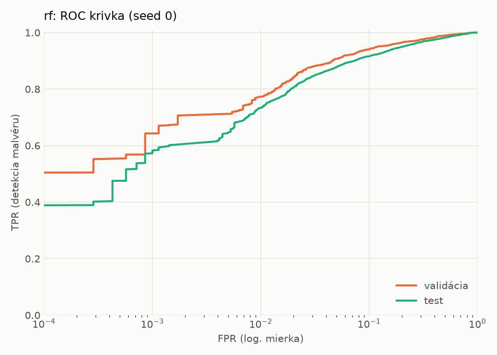
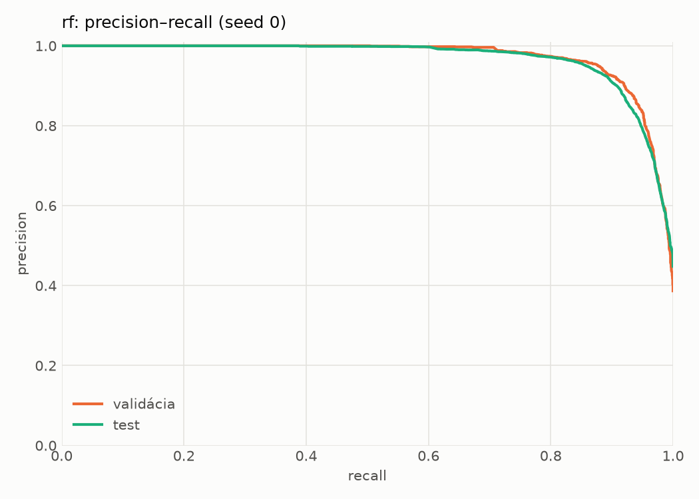
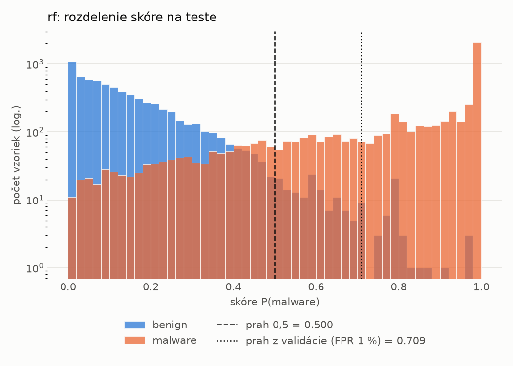
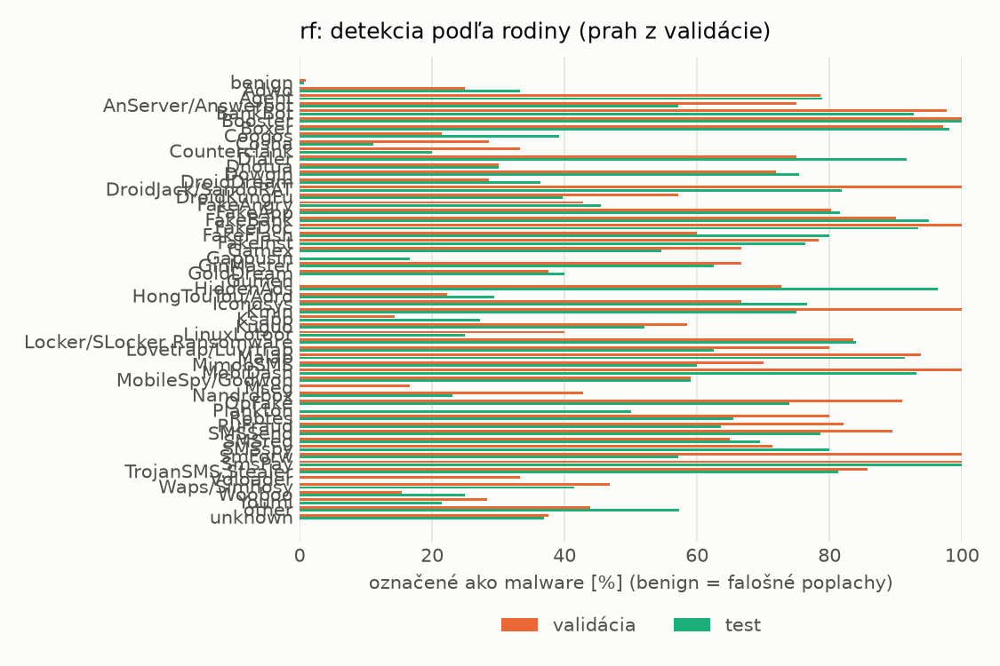
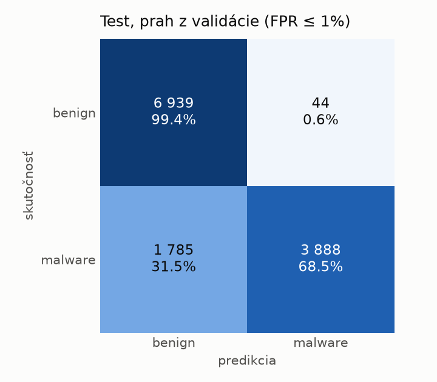
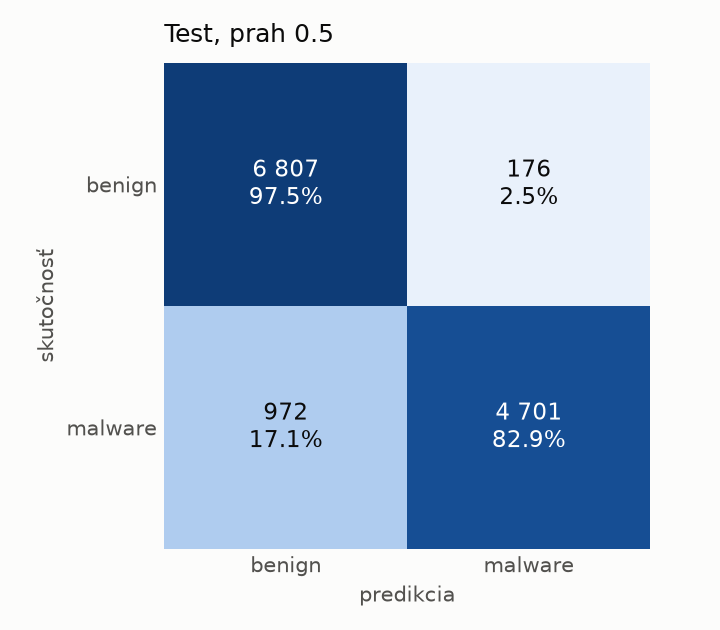

# dynamic/rf – beh `20261123-211547`

> Automaticky generované (`src/training/run_tabular.py`). Konfigurácia: `config.yaml`, protokol: `protocol.yaml`.

- **Model:** `random_forest` – Random Forest (pôvodné hodnoty príznakov)
- **Ladenie:** bez ladenia – hyperparametre prevzaté z `runs_v4/emu_p/full/dynamic/rf/20261123-191811`
- **Finálne modely:** seedy [0, 1, 2]; hodnoty sú priemer ± smerodajná odchýlka cez seedy
- **Najlepšie hyperparametre:** `{"n_estimators": 450, "max_depth": null, "min_samples_leaf": 1, "max_features": "sqrt"}`

## Detekčná kvalita (bez prahu)
| metrika | train (podvzorka) | validácia | test |
|---|---|---|---|
| ROC-AUC | 0.9998 ± 0.0000 | 0.9753 ± 0.0001 | 0.9655 ± 0.0002 |
| PR-AUC | 0.9996 ± 0.0000 | 0.9710 ± 0.0002 | 0.9670 ± 0.0002 |
| TPR pri FPR 1 % | 0.9997 ± 0.0000 | 0.7719 ± 0.0034 | 0.7337 ± 0.0008 |
| TPR pri FPR 0,1 % | 0.9414 ± 0.0018 | 0.6426 ± 0.0014 | 0.5730 ± 0.0093 |
| log loss | 0.0641 ± 0.0002 | 0.2082 ± 0.0002 | 0.2538 ± 0.0008 |
| Brier skóre | 0.0089 ± 0.0000 | 0.0578 ± 0.0001 | 0.0736 ± 0.0003 |

Rozdiel ROC-AUC train − validácia: **0.0245** (veľký rozdiel = preučenie).

## Pri prahu z validácie (FPR ≤ 1% na validácii)
| metrika | train (podvzorka) | validácia | test |
|---|---|---|---|
| accuracy | 0.9971 ± 0.0005 | 0.9059 ± 0.0012 | 0.8559 ± 0.0014 |
| balanced accuracy | 0.9972 ± 0.0006 | 0.8811 ± 0.0016 | 0.8400 ± 0.0016 |
| precision | 0.9947 ± 0.0000 | 0.9806 ± 0.0003 | 0.9883 ± 0.0008 |
| recall (TPR) | 0.9977 ± 0.0012 | 0.7719 ± 0.0034 | 0.6865 ± 0.0037 |
| FPR | 0.0032 ± 0.0000 | 0.0096 ± 0.0002 | 0.0066 ± 0.0005 |
| F1 | 0.9962 ± 0.0006 | 0.8638 ± 0.0021 | 0.8102 ± 0.0023 |
| MCC | 0.9939 ± 0.0010 | 0.8067 ± 0.0024 | 0.7303 ± 0.0022 |

## Pri pevnom prahu 0.5
| metrika | train (podvzorka) | validácia | test |
|---|---|---|---|
| accuracy | 0.9973 ± 0.0000 | 0.9340 ± 0.0012 | 0.9091 ± 0.0003 |
| balanced accuracy | 0.9977 ± 0.0000 | 0.9237 ± 0.0012 | 0.9015 ± 0.0003 |
| precision | 0.9934 ± 0.0000 | 0.9474 ± 0.0031 | 0.9633 ± 0.0006 |
| recall (TPR) | 0.9995 ± 0.0000 | 0.8782 ± 0.0018 | 0.8287 ± 0.0007 |
| FPR | 0.0040 ± 0.0000 | 0.0308 ± 0.0020 | 0.0256 ± 0.0004 |
| F1 | 0.9964 ± 0.0000 | 0.9115 ± 0.0016 | 0.8909 ± 0.0004 |
| MCC | 0.9943 ± 0.0000 | 0.8606 ± 0.0027 | 0.8205 ± 0.0006 |

## Výpočtové nároky (seed 0, testovacia množina)
| meranie | hodnota |
|---|---|
| tréning finálneho modelu | 2.2 s (priemer cez seedy) |
| ladenie spolu | 0 s |
| počet parametrov / uzlov | 3 805 038 |
| veľkosť modelu na disku | 304.74 MB |
| CPU latencia modelu (batch 1, 1 vlákno) | 13.317 ms (p95 13.966) |
| CPU priepustnosť (24 vlákien) | 108 964 vzoriek/s |

## Grafy
| | |
|---|---|
|  |  |
|  |  |
|  |  |
|  |  |

## Súbory
`metrics.json` (všetky metriky po seedoch vrátane rodín), `timing.json`, `hpo_trials.csv`,
`predictions/<časť>_seed<N>.parquet` (sha256, family, label, score), `model/seed_<N>/`, `log.txt`.
