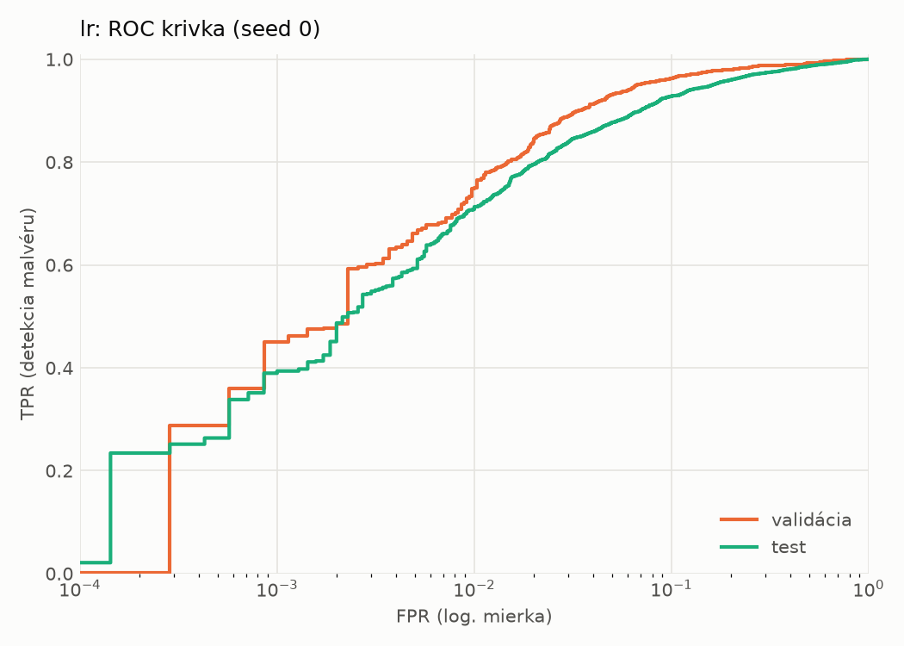
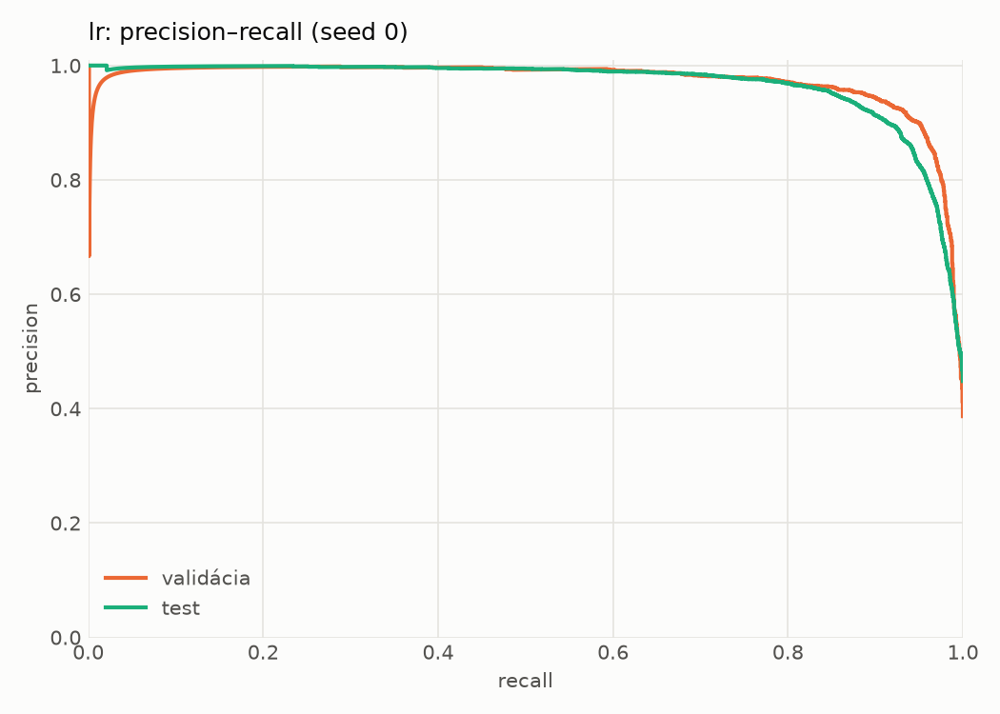
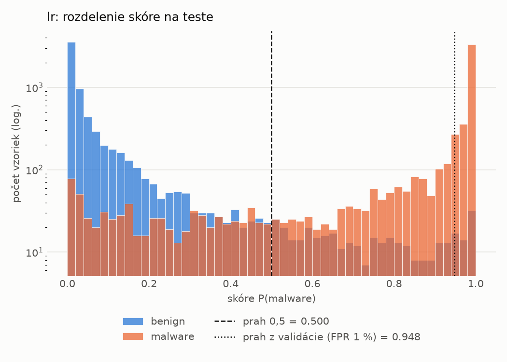
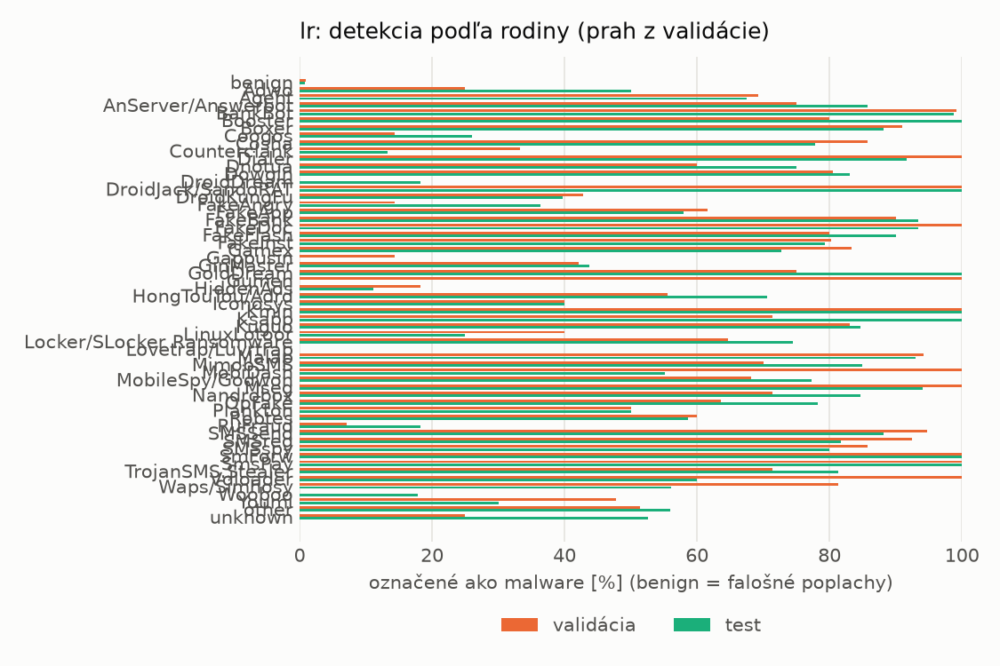
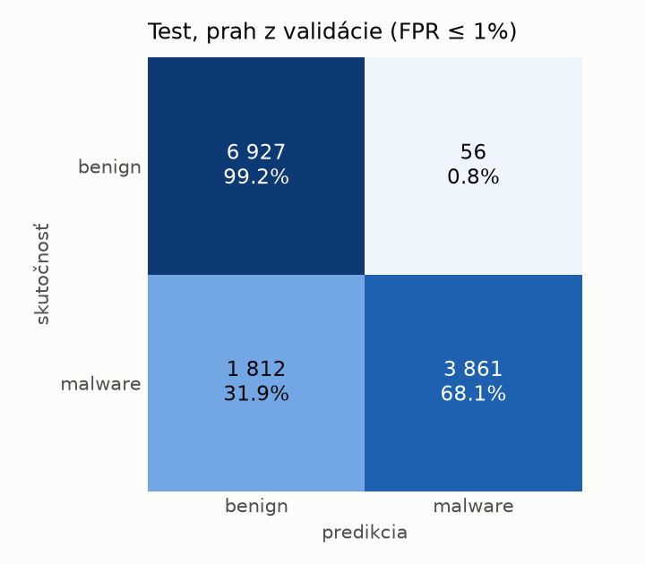
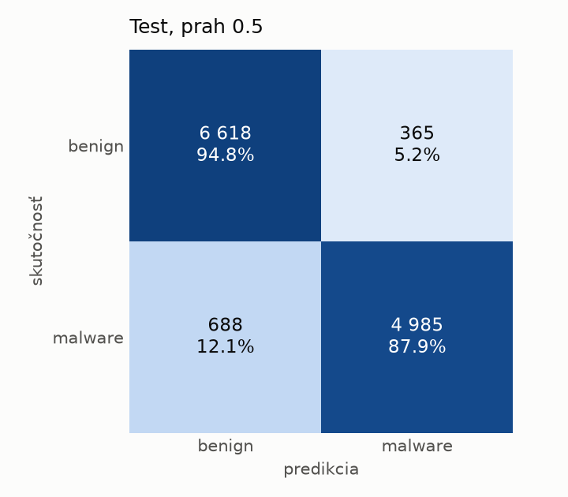

# hybrid/lr – beh `20261123-211858`

> Automaticky generované (`src/training/run_tabular.py`). Konfigurácia: `config.yaml`, protokol: `protocol.yaml`.

- **Model:** `logreg` – logistická regresia s L2 regularizáciou (vstup signed log1p + štandardizácia)
- **Ladenie:** bez ladenia – hyperparametre prevzaté z `runs_v4/emu_p/full/hybrid/lr/20261123-195300`
- **Finálne modely:** seedy [0, 1, 2]; hodnoty sú priemer ± smerodajná odchýlka cez seedy
- **Najlepšie hyperparametre:** `{"max_iter": 2000, "C": 7.106361724509844}`

## Detekčná kvalita (bez prahu)
| metrika | train (podvzorka) | validácia | test |
|---|---|---|---|
| ROC-AUC | 0.9835 ± 0.0000 | 0.9810 ± 0.0000 | 0.9687 ± 0.0000 |
| PR-AUC | 0.9777 ± 0.0000 | 0.9732 ± 0.0000 | 0.9677 ± 0.0000 |
| TPR pri FPR 1 % | 0.8002 ± 0.0000 | 0.7483 ± 0.0000 | 0.7081 ± 0.0000 |
| TPR pri FPR 0,1 % | 0.4693 ± 0.0000 | 0.4507 ± 0.0000 | 0.3896 ± 0.0000 |
| log loss | 0.1572 ± 0.0000 | 0.1704 ± 0.0000 | 0.2220 ± 0.0000 |
| Brier skóre | 0.0430 ± 0.0000 | 0.0458 ± 0.0000 | 0.0621 ± 0.0000 |

Rozdiel ROC-AUC train − validácia: **0.0025** (veľký rozdiel = preučenie).

## Pri prahu z validácie (FPR ≤ 1% na validácii)
| metrika | train (podvzorka) | validácia | test |
|---|---|---|---|
| accuracy | 0.8995 ± 0.0000 | 0.8967 ± 0.0000 | 0.8524 ± 0.0000 |
| balanced accuracy | 0.8697 ± 0.0000 | 0.8693 ± 0.0000 | 0.8363 ± 0.0000 |
| precision | 0.9840 ± 0.0000 | 0.9798 ± 0.0000 | 0.9857 ± 0.0000 |
| recall (TPR) | 0.7469 ± 0.0000 | 0.7483 ± 0.0000 | 0.6806 ± 0.0000 |
| FPR | 0.0074 ± 0.0000 | 0.0097 ± 0.0000 | 0.0080 ± 0.0000 |
| F1 | 0.8492 ± 0.0000 | 0.8485 ± 0.0000 | 0.8052 ± 0.0000 |
| MCC | 0.7925 ± 0.0000 | 0.7884 ± 0.0000 | 0.7235 ± 0.0000 |

## Pri pevnom prahu 0.5
| metrika | train (podvzorka) | validácia | test |
|---|---|---|---|
| accuracy | 0.9448 ± 0.0000 | 0.9425 ± 0.0000 | 0.9168 ± 0.0000 |
| balanced accuracy | 0.9432 ± 0.0000 | 0.9411 ± 0.0000 | 0.9132 ± 0.0000 |
| precision | 0.9194 ± 0.0000 | 0.9183 ± 0.0000 | 0.9318 ± 0.0000 |
| recall (TPR) | 0.9364 ± 0.0000 | 0.9346 ± 0.0000 | 0.8787 ± 0.0000 |
| FPR | 0.0501 ± 0.0000 | 0.0525 ± 0.0000 | 0.0523 ± 0.0000 |
| F1 | 0.9278 ± 0.0000 | 0.9264 ± 0.0000 | 0.9045 ± 0.0000 |
| MCC | 0.8832 ± 0.0000 | 0.8793 ± 0.0000 | 0.8320 ± 0.0000 |

## Výpočtové nároky (seed 0, testovacia množina)
| meranie | hodnota |
|---|---|
| tréning finálneho modelu | 0.4 s (priemer cez seedy) |
| ladenie spolu | 0 s |
| počet parametrov / uzlov | 287 |
| veľkosť modelu na disku | 0.01 MB |
| transformácia vstupu – latencia (1 vlákno) | 0.006 ms |
| transformácia vstupu – priepustnosť | 511 331 vzoriek/s |
| CPU latencia modelu (batch 1, 1 vlákno) | 0.004 ms (p95 0.004) |
| CPU priepustnosť (24 vlákien) | 2 291 342 vzoriek/s |

## Grafy
| | |
|---|---|
|  |  |
|  |  |
|  |  |
|  |  |

## Súbory
`metrics.json` (všetky metriky po seedoch vrátane rodín), `timing.json`, `hpo_trials.csv`,
`predictions/<časť>_seed<N>.parquet` (sha256, family, label, score), `model/seed_<N>/`, `log.txt`.
