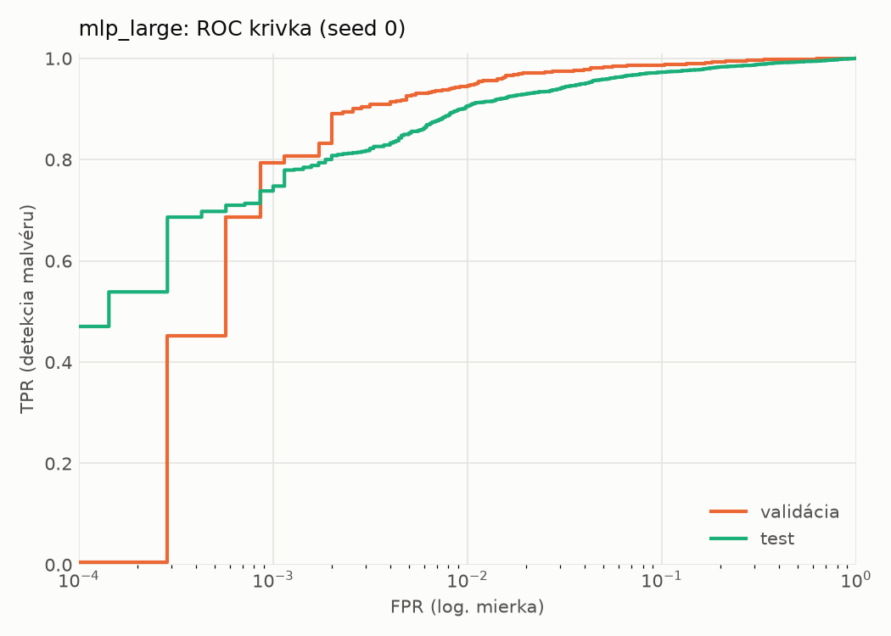
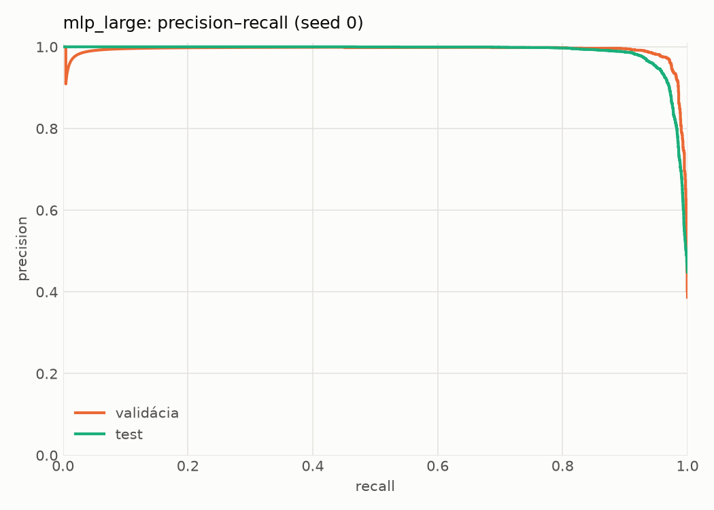
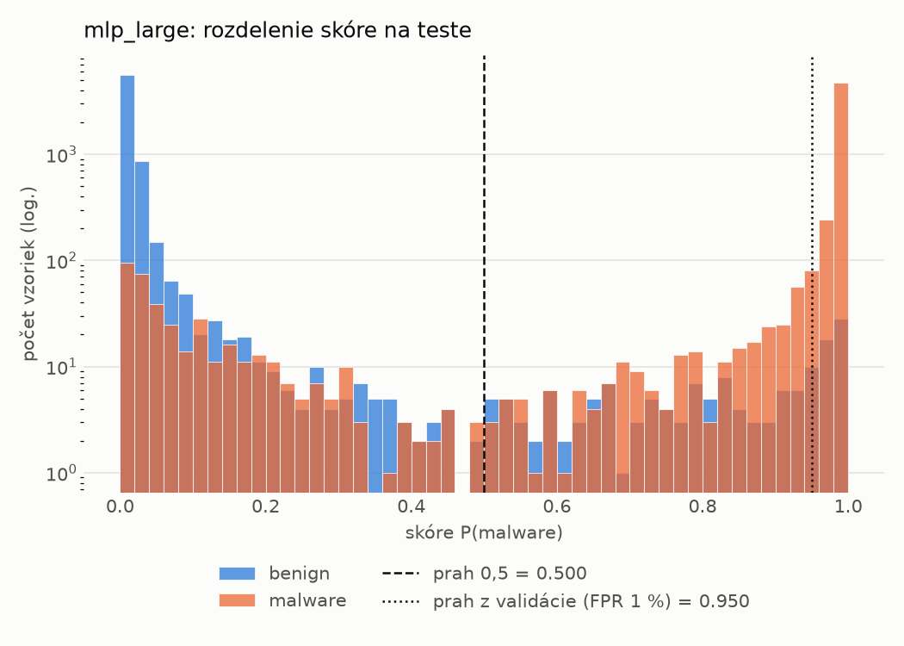
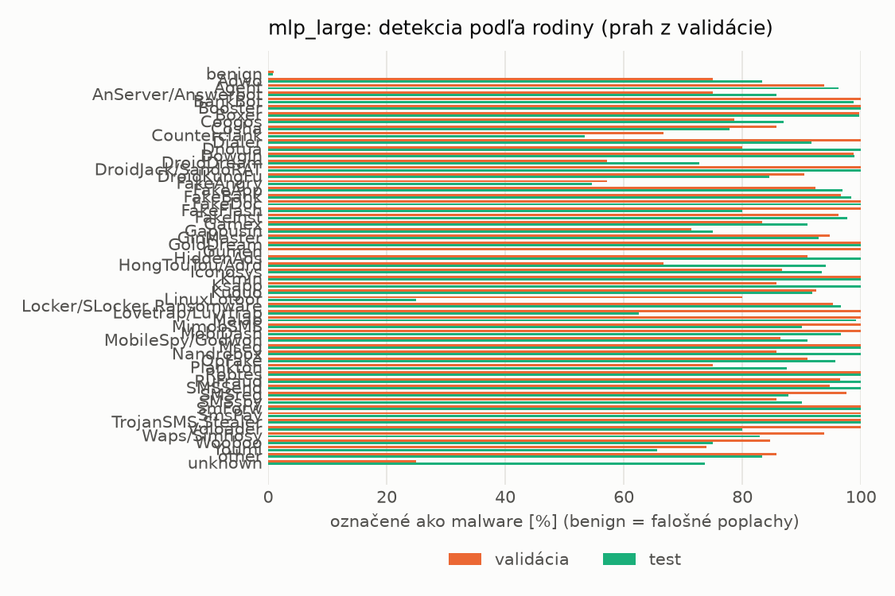
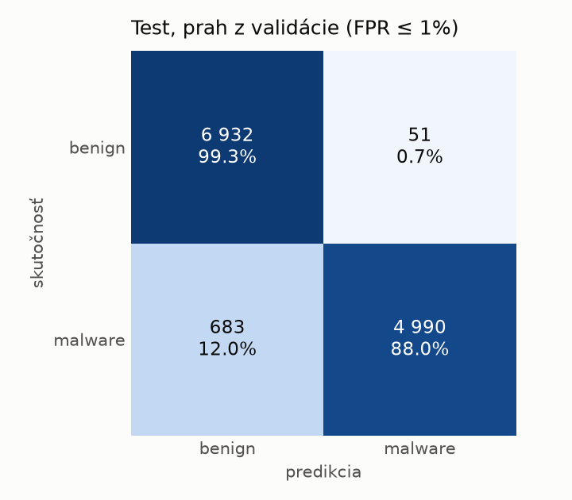
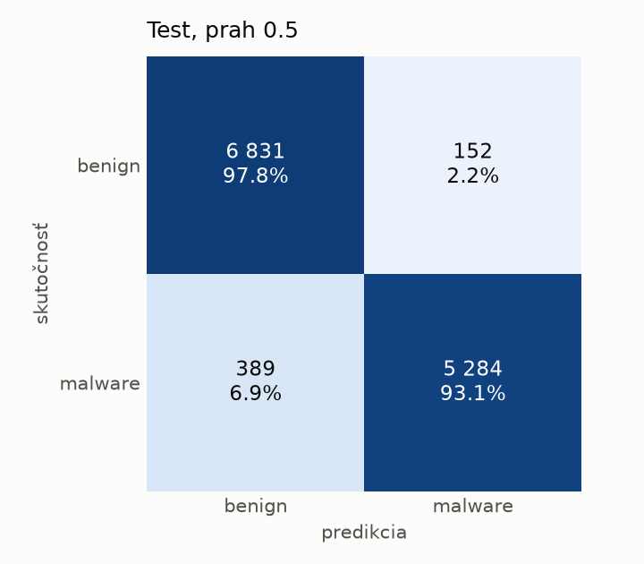
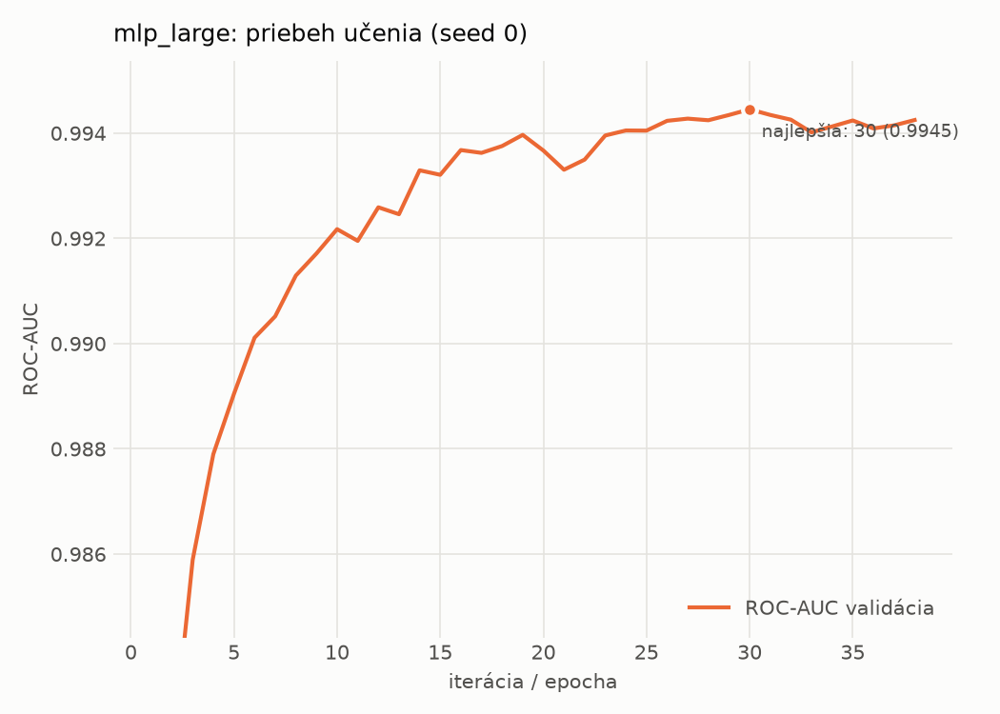

# hybrid/mlp_large – beh `20261123-212010`

> Automaticky generované (`src/training/run_tabular.py`). Konfigurácia: `config.yaml`, protokol: `protocol.yaml`.

- **Model:** `mlp` – veľká neurónová sieť (3–5 skrytých vrstiev, 512–2048 neurónov), kandidát na učiteľa
- **Ladenie:** bez ladenia – hyperparametre prevzaté z `runs_v4/emu_p/full/hybrid/mlp_large/20261123-200933`
- **Finálne modely:** seedy [0, 1, 2]; hodnoty sú priemer ± smerodajná odchýlka cez seedy
- **Najlepšie hyperparametre:** `{"max_epochs": 100, "patience": 8, "hidden_layers": 5, "hidden_width": 512, "width_decay": 0.5, "dropout": 0.18561035972653261, "lr": 0.00013117672209273214, "weight_decay": 3.948210593203141e-06, "batch_size": 512}`

## Detekčná kvalita (bez prahu)
| metrika | train (podvzorka) | validácia | test |
|---|---|---|---|
| ROC-AUC | 0.9990 ± 0.0003 | 0.9947 ± 0.0004 | 0.9852 ± 0.0020 |
| PR-AUC | 0.9988 ± 0.0004 | 0.9927 ± 0.0014 | 0.9866 ± 0.0018 |
| TPR pri FPR 1 % | 0.9923 ± 0.0026 | 0.9487 ± 0.0036 | 0.8996 ± 0.0065 |
| TPR pri FPR 0,1 % | 0.9777 ± 0.0081 | 0.8019 ± 0.0190 | 0.7038 ± 0.0336 |
| log loss | 0.0298 ± 0.0086 | 0.0882 ± 0.0023 | 0.1504 ± 0.0145 |
| Brier skóre | 0.0059 ± 0.0016 | 0.0216 ± 0.0010 | 0.0379 ± 0.0020 |

Rozdiel ROC-AUC train − validácia: **0.0043** (veľký rozdiel = preučenie).

## Pri prahu z validácie (FPR ≤ 1% na validácii)
| metrika | train (podvzorka) | validácia | test |
|---|---|---|---|
| accuracy | 0.9897 ± 0.0017 | 0.9742 ± 0.0014 | 0.9408 ± 0.0017 |
| balanced accuracy | 0.9866 ± 0.0022 | 0.9695 ± 0.0018 | 0.9347 ± 0.0020 |
| precision | 0.9987 ± 0.0006 | 0.9841 ± 0.0003 | 0.9904 ± 0.0010 |
| recall (TPR) | 0.9740 ± 0.0042 | 0.9487 ± 0.0036 | 0.8764 ± 0.0047 |
| FPR | 0.0008 ± 0.0003 | 0.0096 ± 0.0002 | 0.0069 ± 0.0007 |
| F1 | 0.9862 ± 0.0024 | 0.9661 ± 0.0019 | 0.9299 ± 0.0022 |
| MCC | 0.9782 ± 0.0037 | 0.9457 ± 0.0030 | 0.8839 ± 0.0031 |

## Pri pevnom prahu 0.5
| metrika | train (podvzorka) | validácia | test |
|---|---|---|---|
| accuracy | 0.9930 ± 0.0021 | 0.9744 ± 0.0013 | 0.9553 ± 0.0025 |
| balanced accuracy | 0.9926 ± 0.0022 | 0.9743 ± 0.0011 | 0.9524 ± 0.0029 |
| precision | 0.9903 ± 0.0029 | 0.9604 ± 0.0031 | 0.9748 ± 0.0024 |
| recall (TPR) | 0.9911 ± 0.0028 | 0.9740 ± 0.0007 | 0.9241 ± 0.0075 |
| FPR | 0.0059 ± 0.0018 | 0.0253 ± 0.0020 | 0.0194 ± 0.0021 |
| F1 | 0.9907 ± 0.0028 | 0.9671 ± 0.0016 | 0.9488 ± 0.0031 |
| MCC | 0.9851 ± 0.0045 | 0.9462 ± 0.0027 | 0.9102 ± 0.0047 |

## Výpočtové nároky (seed 0, testovacia množina)
| meranie | hodnota |
|---|---|
| tréning finálneho modelu | 10.1 s (priemer cez seedy) |
| ladenie spolu | 0 s |
| počet parametrov / uzlov | 323 521 |
| veľkosť modelu na disku | 1.32 MB |
| transformácia vstupu – latencia (1 vlákno) | 0.017 ms |
| transformácia vstupu – priepustnosť | 283 738 vzoriek/s |
| CPU latencia modelu (batch 1, 1 vlákno) | 0.166 ms (p95 0.457) |
| CPU priepustnosť (24 vlákien) | 728 994 vzoriek/s |
| GPU latencia (batch 1) | 0.574 ms (p95 1.361) |
| GPU priepustnosť | 1 154 839 vzoriek/s |
| GPU špičková pamäť | 173 MB |

## Grafy
| | |
|---|---|
|  |  |
|  |  |
|  |  |
|  |  |

## Súbory
`metrics.json` (všetky metriky po seedoch vrátane rodín), `timing.json`, `hpo_trials.csv`,
`predictions/<časť>_seed<N>.parquet` (sha256, family, label, score), `model/seed_<N>/`, `log.txt`.
