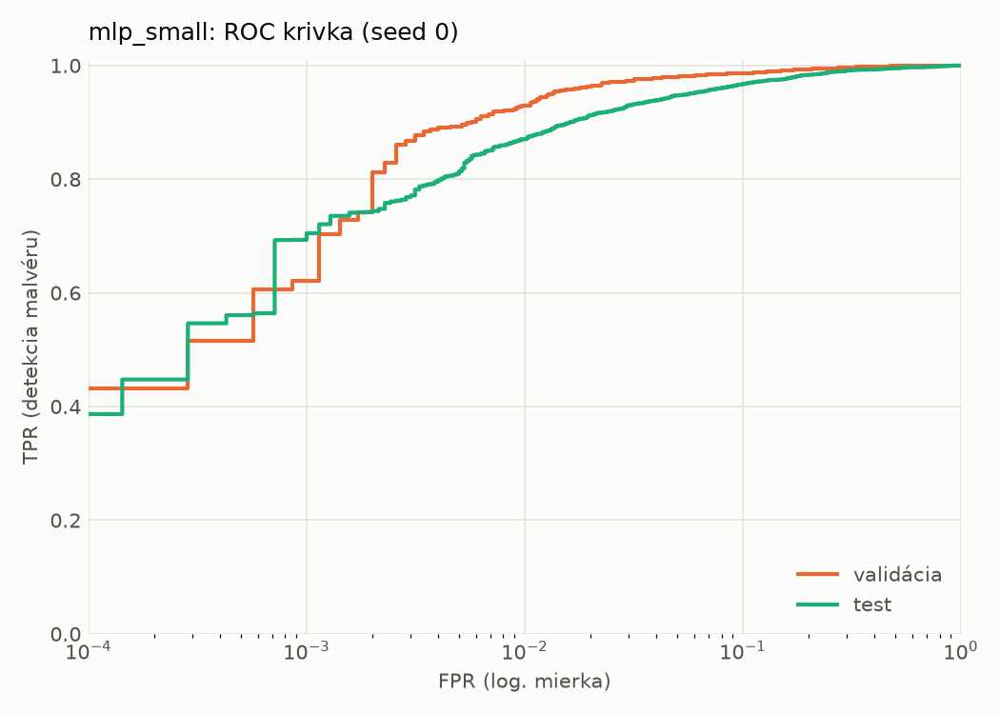
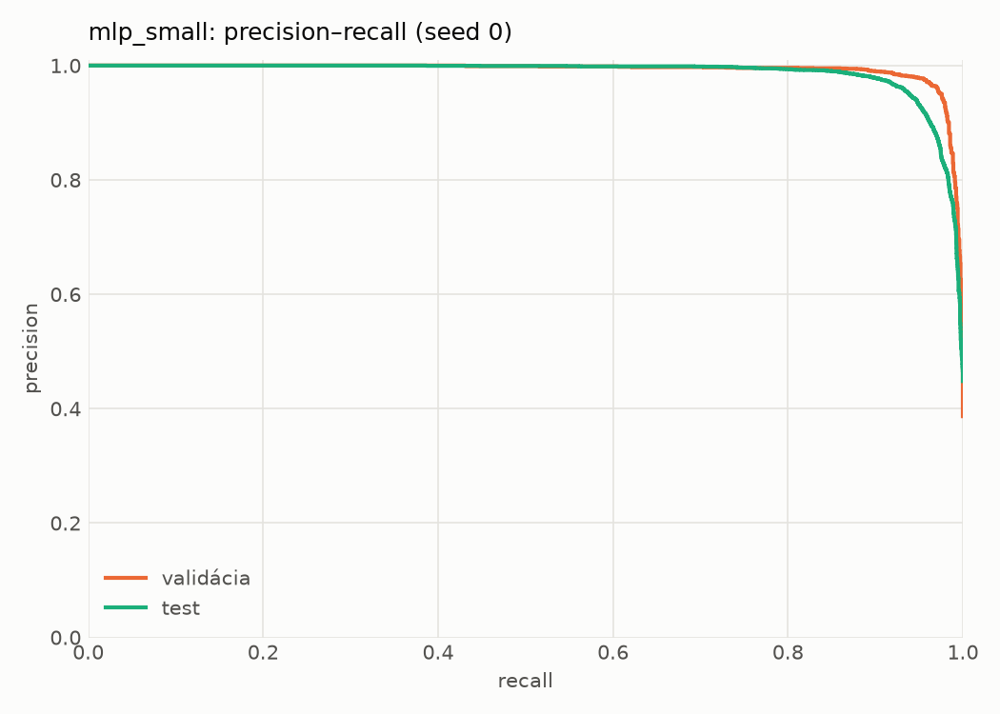
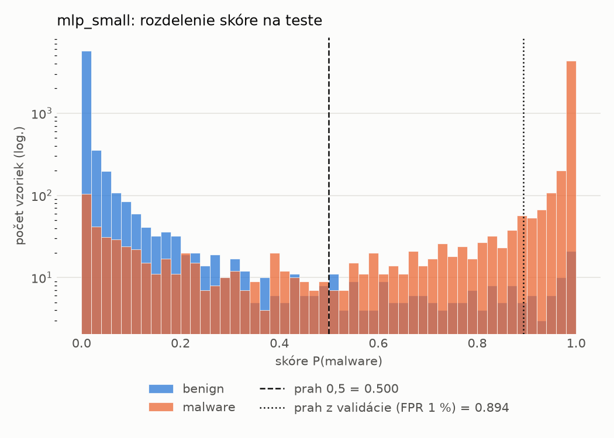
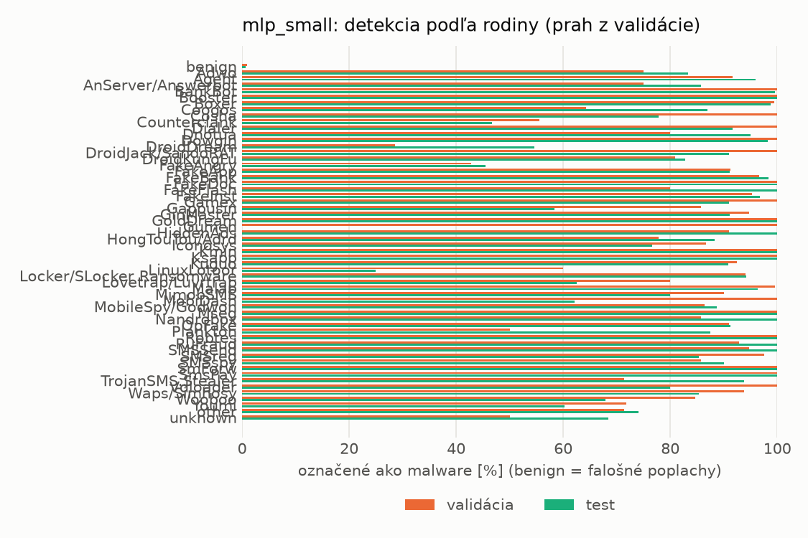
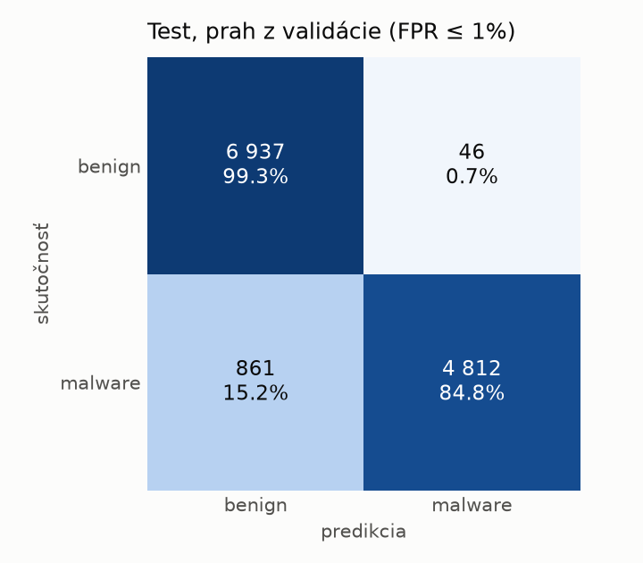
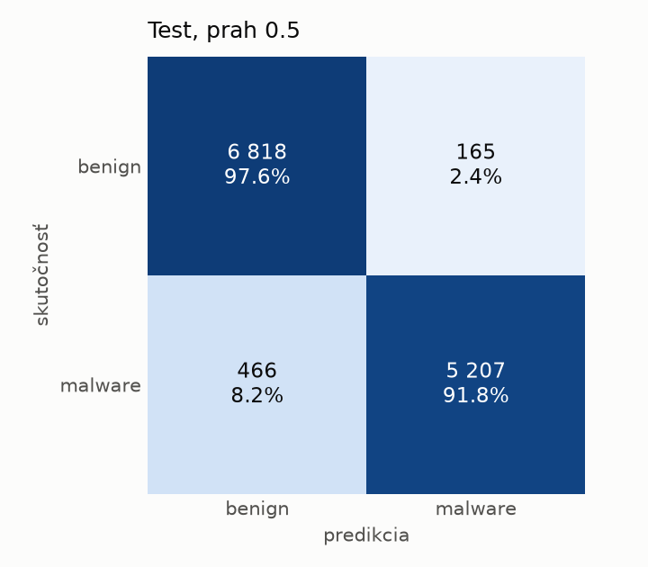
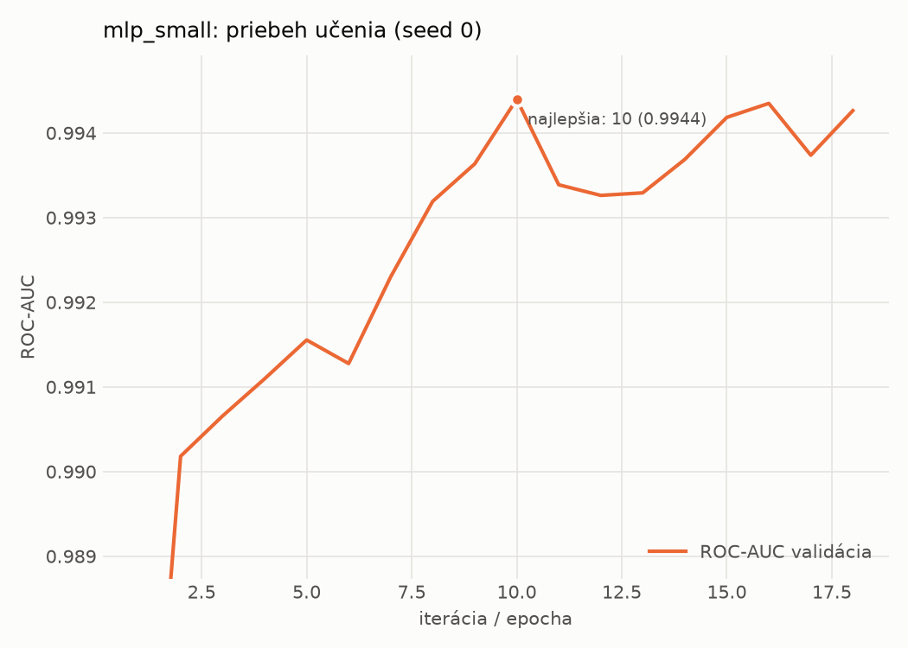

# hybrid/mlp_small – beh `20261123-211956`

> Automaticky generované (`src/training/run_tabular.py`). Konfigurácia: `config.yaml`, protokol: `protocol.yaml`.

- **Model:** `mlp` – malá neurónová sieť (1–2 skryté vrstvy), kandidát na ľahkého študenta
- **Ladenie:** bez ladenia – hyperparametre prevzaté z `runs_v4/emu_p/full/hybrid/mlp_small/20261123-200627`
- **Finálne modely:** seedy [0, 1, 2]; hodnoty sú priemer ± smerodajná odchýlka cez seedy
- **Najlepšie hyperparametre:** `{"width_decay": 0.5, "max_epochs": 100, "patience": 8, "hidden_layers": 2, "hidden_width": 256, "dropout": 0.2736594475747717, "lr": 0.0019631646658614973, "weight_decay": 0.0007425190310675283, "batch_size": 512}`

## Detekčná kvalita (bez prahu)
| metrika | train (podvzorka) | validácia | test |
|---|---|---|---|
| ROC-AUC | 0.9990 ± 0.0007 | 0.9945 ± 0.0001 | 0.9860 ± 0.0006 |
| PR-AUC | 0.9986 ± 0.0010 | 0.9926 ± 0.0003 | 0.9863 ± 0.0006 |
| TPR pri FPR 1 % | 0.9850 ± 0.0096 | 0.9428 ± 0.0135 | 0.8841 ± 0.0147 |
| TPR pri FPR 0,1 % | 0.9594 ± 0.0223 | 0.6517 ± 0.0300 | 0.6145 ± 0.0682 |
| log loss | 0.0338 ± 0.0126 | 0.0908 ± 0.0050 | 0.1669 ± 0.0132 |
| Brier skóre | 0.0090 ± 0.0036 | 0.0212 ± 0.0010 | 0.0390 ± 0.0021 |

Rozdiel ROC-AUC train − validácia: **0.0045** (veľký rozdiel = preučenie).

## Pri prahu z validácie (FPR ≤ 1% na validácii)
| metrika | train (podvzorka) | validácia | test |
|---|---|---|---|
| accuracy | 0.9832 ± 0.0063 | 0.9719 ± 0.0052 | 0.9354 ± 0.0070 |
| balanced accuracy | 0.9783 ± 0.0081 | 0.9665 ± 0.0067 | 0.9288 ± 0.0078 |
| precision | 0.9979 ± 0.0010 | 0.9839 ± 0.0002 | 0.9906 ± 0.0003 |
| recall (TPR) | 0.9578 ± 0.0156 | 0.9428 ± 0.0135 | 0.8642 ± 0.0158 |
| FPR | 0.0012 ± 0.0006 | 0.0097 ± 0.0000 | 0.0067 ± 0.0003 |
| F1 | 0.9774 ± 0.0086 | 0.9628 ± 0.0071 | 0.9230 ± 0.0090 |
| MCC | 0.9646 ± 0.0131 | 0.9408 ± 0.0108 | 0.8740 ± 0.0130 |

## Pri pevnom prahu 0.5
| metrika | train (podvzorka) | validácia | test |
|---|---|---|---|
| accuracy | 0.9886 ± 0.0046 | 0.9733 ± 0.0009 | 0.9524 ± 0.0033 |
| balanced accuracy | 0.9880 ± 0.0046 | 0.9730 ± 0.0008 | 0.9492 ± 0.0035 |
| precision | 0.9846 ± 0.0072 | 0.9595 ± 0.0022 | 0.9744 ± 0.0046 |
| recall (TPR) | 0.9854 ± 0.0050 | 0.9720 ± 0.0011 | 0.9180 ± 0.0072 |
| FPR | 0.0094 ± 0.0044 | 0.0259 ± 0.0015 | 0.0196 ± 0.0037 |
| F1 | 0.9850 ± 0.0060 | 0.9657 ± 0.0012 | 0.9453 ± 0.0039 |
| MCC | 0.9759 ± 0.0097 | 0.9439 ± 0.0019 | 0.9045 ± 0.0065 |

## Výpočtové nároky (seed 0, testovacia množina)
| meranie | hodnota |
|---|---|
| tréning finálneho modelu | 3.8 s (priemer cez seedy) |
| ladenie spolu | 0 s |
| počet parametrov / uzlov | 107 265 |
| veľkosť modelu na disku | 0.45 MB |
| transformácia vstupu – latencia (1 vlákno) | 0.017 ms |
| transformácia vstupu – priepustnosť | 308 675 vzoriek/s |
| CPU latencia modelu (batch 1, 1 vlákno) | 0.081 ms (p95 0.096) |
| CPU priepustnosť (24 vlákien) | 1 291 376 vzoriek/s |
| GPU latencia (batch 1) | 0.654 ms (p95 0.719) |
| GPU priepustnosť | 822 801 vzoriek/s |
| GPU špičková pamäť | 102 MB |

## Grafy
| | |
|---|---|
|  |  |
|  |  |
|  |  |
|  |  |

## Súbory
`metrics.json` (všetky metriky po seedoch vrátane rodín), `timing.json`, `hpo_trials.csv`,
`predictions/<časť>_seed<N>.parquet` (sha256, family, label, score), `model/seed_<N>/`, `log.txt`.
