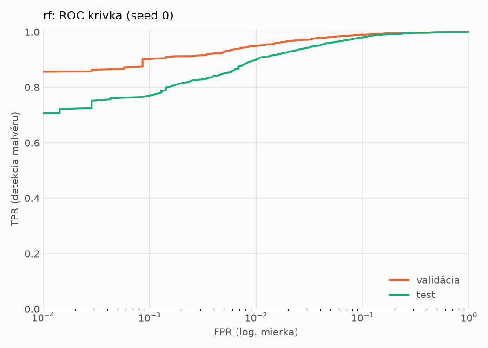
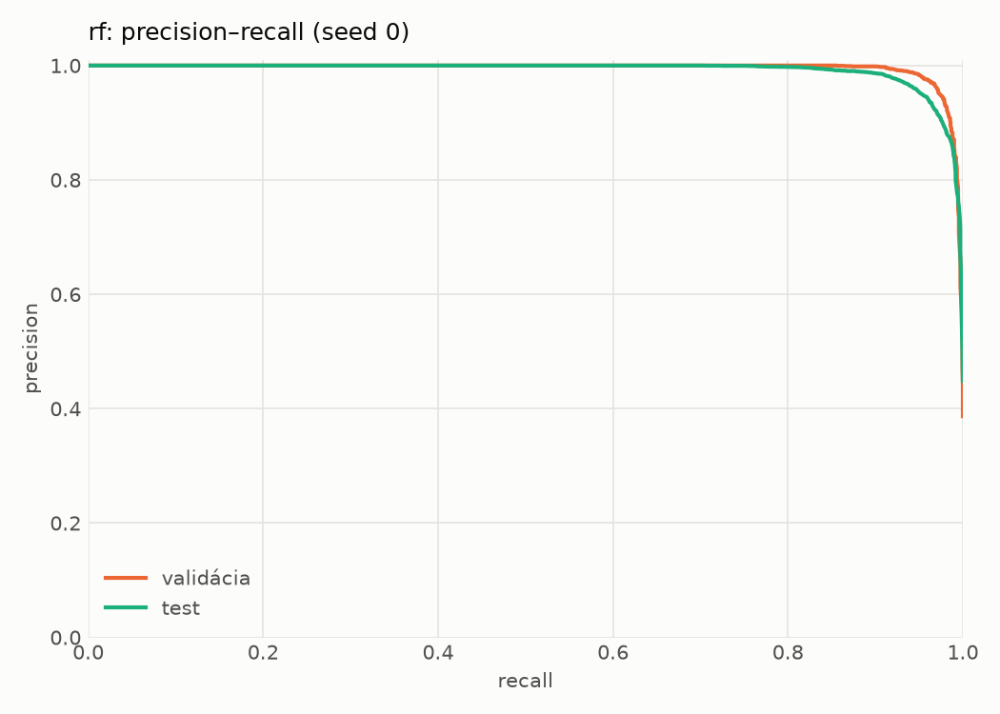
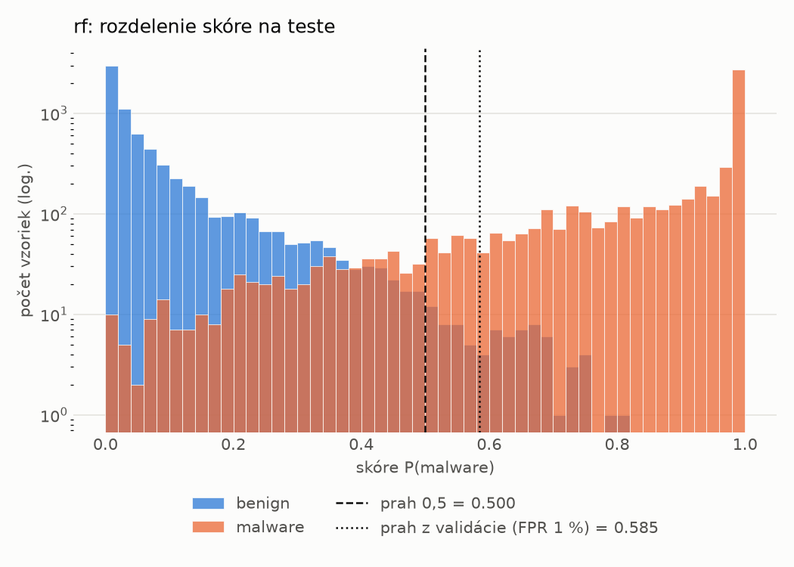
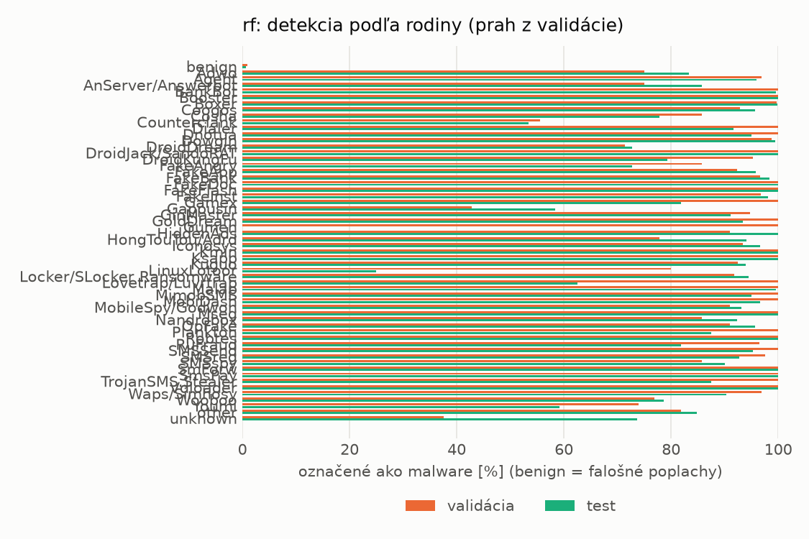
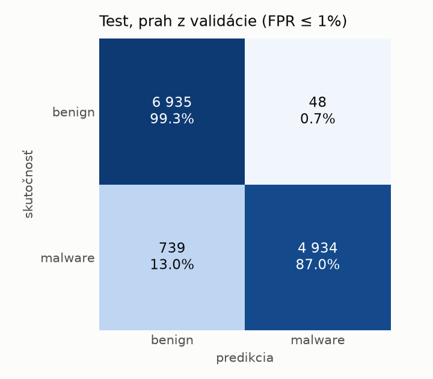
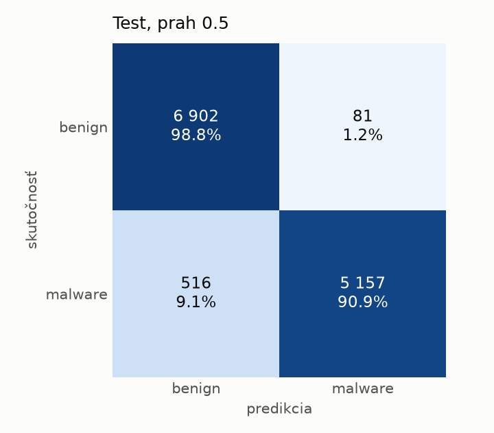

# hybrid/rf – beh `20261123-211900`

> Automaticky generované (`src/training/run_tabular.py`). Konfigurácia: `config.yaml`, protokol: `protocol.yaml`.

- **Model:** `random_forest` – Random Forest (pôvodné hodnoty príznakov)
- **Ladenie:** bez ladenia – hyperparametre prevzaté z `runs_v4/emu_p/full/hybrid/rf/20261123-195313`
- **Finálne modely:** seedy [0, 1, 2]; hodnoty sú priemer ± smerodajná odchýlka cez seedy
- **Najlepšie hyperparametre:** `{"n_estimators": 200, "max_depth": null, "min_samples_leaf": 1, "max_features": "sqrt"}`

## Detekčná kvalita (bez prahu)
| metrika | train (podvzorka) | validácia | test |
|---|---|---|---|
| ROC-AUC | 1.0000 ± 0.0000 | 0.9956 ± 0.0001 | 0.9920 ± 0.0001 |
| PR-AUC | 1.0000 ± 0.0000 | 0.9946 ± 0.0000 | 0.9916 ± 0.0001 |
| TPR pri FPR 1 % | 1.0000 ± 0.0000 | 0.9488 ± 0.0009 | 0.8989 ± 0.0028 |
| TPR pri FPR 0,1 % | 1.0000 ± 0.0000 | 0.8888 ± 0.0123 | 0.7763 ± 0.0160 |
| log loss | 0.0287 ± 0.0001 | 0.0969 ± 0.0010 | 0.1475 ± 0.0007 |
| Brier skóre | 0.0031 ± 0.0000 | 0.0235 ± 0.0001 | 0.0399 ± 0.0005 |

Rozdiel ROC-AUC train − validácia: **0.0044** (veľký rozdiel = preučenie).

## Pri prahu z validácie (FPR ≤ 1% na validácii)
| metrika | train (podvzorka) | validácia | test |
|---|---|---|---|
| accuracy | 1.0000 ± 0.0000 | 0.9744 ± 0.0005 | 0.9395 ± 0.0017 |
| balanced accuracy | 1.0000 ± 0.0000 | 0.9697 ± 0.0006 | 0.9333 ± 0.0019 |
| precision | 1.0000 ± 0.0000 | 0.9844 ± 0.0005 | 0.9902 ± 0.0005 |
| recall (TPR) | 1.0000 ± 0.0000 | 0.9488 ± 0.0009 | 0.8737 ± 0.0041 |
| FPR | 0.0000 ± 0.0000 | 0.0095 ± 0.0003 | 0.0070 ± 0.0004 |
| F1 | 1.0000 ± 0.0000 | 0.9663 ± 0.0007 | 0.9283 ± 0.0021 |
| MCC | 1.0000 ± 0.0000 | 0.9461 ± 0.0011 | 0.8815 ± 0.0031 |

## Pri pevnom prahu 0.5
| metrika | train (podvzorka) | validácia | test |
|---|---|---|---|
| accuracy | 1.0000 ± 0.0000 | 0.9750 ± 0.0009 | 0.9534 ± 0.0009 |
| balanced accuracy | 1.0000 ± 0.0000 | 0.9728 ± 0.0010 | 0.9494 ± 0.0011 |
| precision | 1.0000 ± 0.0000 | 0.9720 ± 0.0016 | 0.9841 ± 0.0005 |
| recall (TPR) | 1.0000 ± 0.0000 | 0.9630 ± 0.0018 | 0.9109 ± 0.0026 |
| FPR | 0.0000 ± 0.0000 | 0.0175 ± 0.0010 | 0.0120 ± 0.0004 |
| F1 | 1.0000 ± 0.0000 | 0.9675 ± 0.0012 | 0.9461 ± 0.0011 |
| MCC | 1.0000 ± 0.0000 | 0.9472 ± 0.0019 | 0.9073 ± 0.0017 |

## Výpočtové nároky (seed 0, testovacia množina)
| meranie | hodnota |
|---|---|
| tréning finálneho modelu | 1.2 s (priemer cez seedy) |
| ladenie spolu | 0 s |
| počet parametrov / uzlov | 885 870 |
| veľkosť modelu na disku | 71.11 MB |
| CPU latencia modelu (batch 1, 1 vlákno) | 5.892 ms (p95 6.247) |
| CPU priepustnosť (24 vlákien) | 202 092 vzoriek/s |

## Grafy
| | |
|---|---|
|  |  |
|  |  |
|  |  |
|  |  |

## Súbory
`metrics.json` (všetky metriky po seedoch vrátane rodín), `timing.json`, `hpo_trials.csv`,
`predictions/<časť>_seed<N>.parquet` (sha256, family, label, score), `model/seed_<N>/`, `log.txt`.
