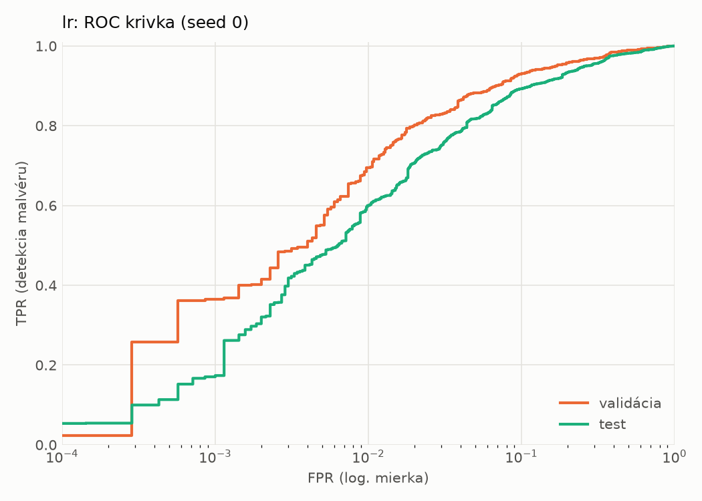
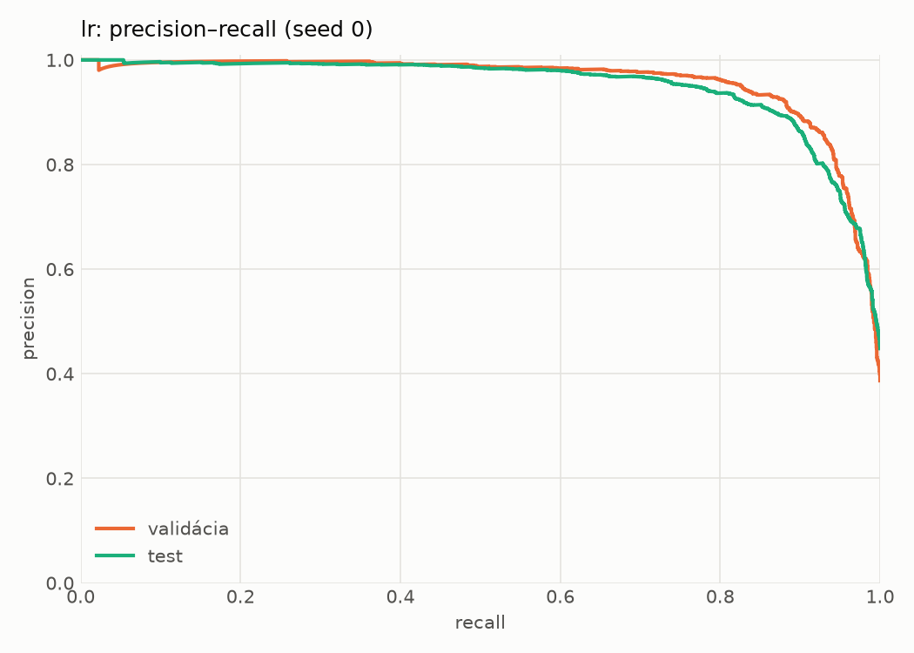
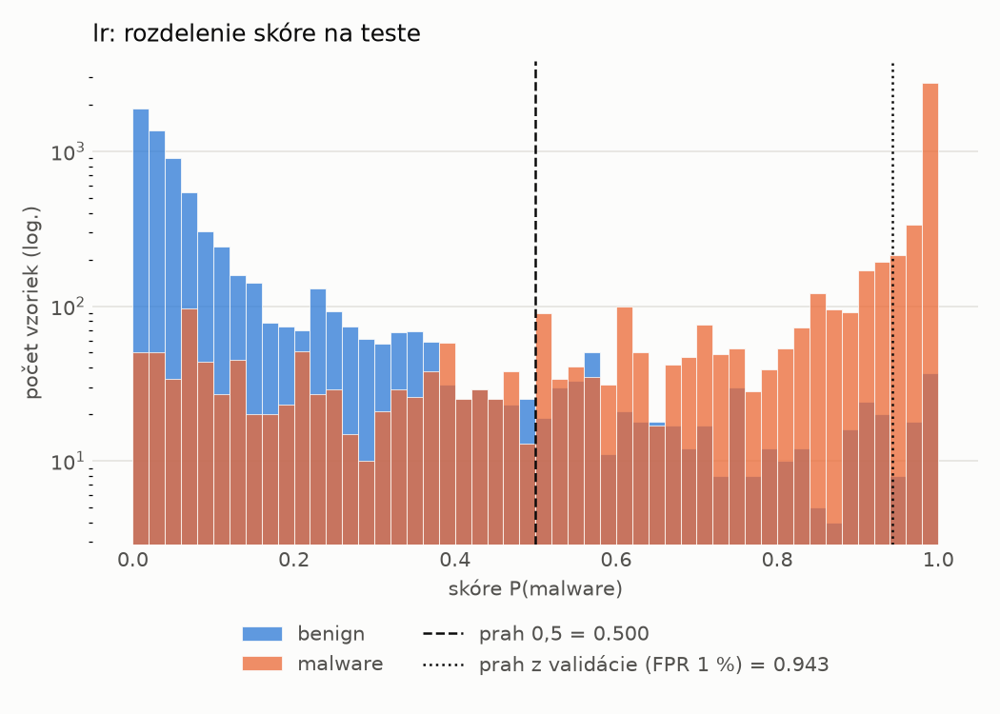
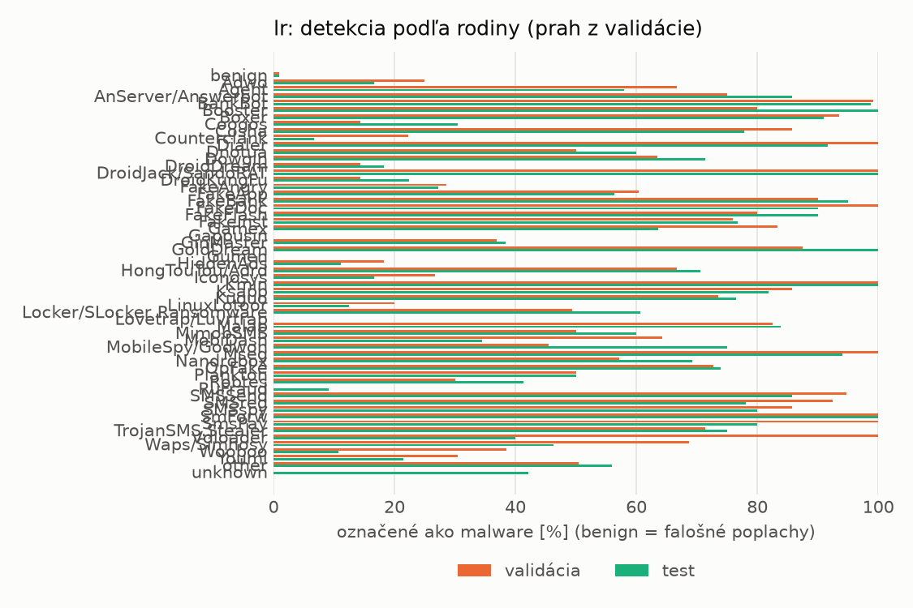
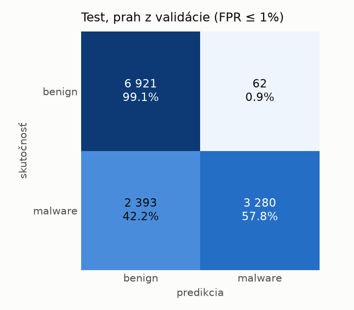
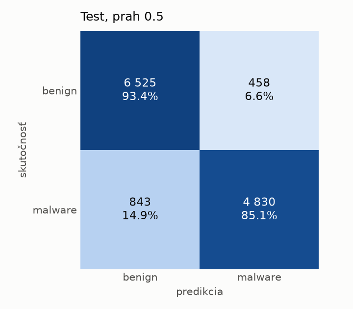

# static/lr – beh `20261123-010320`

> Automaticky generované (`src/training/run_tabular.py`). Konfigurácia: `config.yaml`, protokol: `protocol.yaml`.

- **Model:** `logreg` – logistická regresia s L2 regularizáciou (vstup signed log1p + štandardizácia)
- **Ladenie:** bez ladenia – hyperparametre prevzaté z `runs_v4/real_p/full/static/lr/20261122-230905`
- **Finálne modely:** seedy [0, 1, 2]; hodnoty sú priemer ± smerodajná odchýlka cez seedy
- **Najlepšie hyperparametre:** `{"max_iter": 2000, "C": 5.669849511478847}`

## Detekčná kvalita (bez prahu)
| metrika | train (podvzorka) | validácia | test |
|---|---|---|---|
| ROC-AUC | 0.9717 ± 0.0000 | 0.9682 ± 0.0000 | 0.9532 ± 0.0000 |
| PR-AUC | 0.9613 ± 0.0000 | 0.9589 ± 0.0000 | 0.9501 ± 0.0000 |
| TPR pri FPR 1 % | 0.6854 ± 0.0000 | 0.6951 ± 0.0000 | 0.5999 ± 0.0000 |
| TPR pri FPR 0,1 % | 0.3225 ± 0.0000 | 0.3653 ± 0.0000 | 0.1705 ± 0.0000 |
| log loss | 0.2092 ± 0.0000 | 0.2185 ± 0.0000 | 0.2746 ± 0.0000 |
| Brier skóre | 0.0584 ± 0.0000 | 0.0611 ± 0.0000 | 0.0795 ± 0.0000 |

Rozdiel ROC-AUC train − validácia: **0.0035** (veľký rozdiel = preučenie).

## Pri prahu z validácie (FPR ≤ 1% na validácii)
| metrika | train (podvzorka) | validácia | test |
|---|---|---|---|
| accuracy | 0.8754 ± 0.0000 | 0.8761 ± 0.0000 | 0.8060 ± 0.0000 |
| balanced accuracy | 0.8388 ± 0.0000 | 0.8427 ± 0.0000 | 0.7846 ± 0.0000 |
| precision | 0.9764 ± 0.0000 | 0.9783 ± 0.0000 | 0.9814 ± 0.0000 |
| recall (TPR) | 0.6878 ± 0.0000 | 0.6951 ± 0.0000 | 0.5782 ± 0.0000 |
| FPR | 0.0101 ± 0.0000 | 0.0097 ± 0.0000 | 0.0089 ± 0.0000 |
| F1 | 0.8071 ± 0.0000 | 0.8127 ± 0.0000 | 0.7277 ± 0.0000 |
| MCC | 0.7432 ± 0.0000 | 0.7477 ± 0.0000 | 0.6422 ± 0.0000 |

## Pri pevnom prahu 0.5
| metrika | train (podvzorka) | validácia | test |
|---|---|---|---|
| accuracy | 0.9266 ± 0.0000 | 0.9204 ± 0.0000 | 0.8972 ± 0.0000 |
| balanced accuracy | 0.9243 ± 0.0000 | 0.9162 ± 0.0000 | 0.8929 ± 0.0000 |
| precision | 0.8940 ± 0.0000 | 0.8966 ± 0.0000 | 0.9134 ± 0.0000 |
| recall (TPR) | 0.9148 ± 0.0000 | 0.8978 ± 0.0000 | 0.8514 ± 0.0000 |
| FPR | 0.0662 ± 0.0000 | 0.0653 ± 0.0000 | 0.0656 ± 0.0000 |
| F1 | 0.9043 ± 0.0000 | 0.8972 ± 0.0000 | 0.8813 ± 0.0000 |
| MCC | 0.8449 ± 0.0000 | 0.8322 ± 0.0000 | 0.7924 ± 0.0000 |

## Výpočtové nároky (seed 0, testovacia množina)
| meranie | hodnota |
|---|---|
| tréning finálneho modelu | 0.1 s (priemer cez seedy) |
| ladenie spolu | 0 s |
| počet parametrov / uzlov | 164 |
| veľkosť modelu na disku | 0.01 MB |
| transformácia vstupu – latencia (1 vlákno) | 0.005 ms |
| transformácia vstupu – priepustnosť | 1 277 764 vzoriek/s |
| CPU latencia modelu (batch 1, 1 vlákno) | 0.004 ms (p95 0.004) |
| CPU priepustnosť (24 vlákien) | 2 829 801 vzoriek/s |

## Grafy
| | |
|---|---|
|  |  |
|  |  |
|  |  |
|  |  |

## Súbory
`metrics.json` (všetky metriky po seedoch vrátane rodín), `timing.json`, `hpo_trials.csv`,
`predictions/<časť>_seed<N>.parquet` (sha256, family, label, score), `model/seed_<N>/`, `log.txt`.
