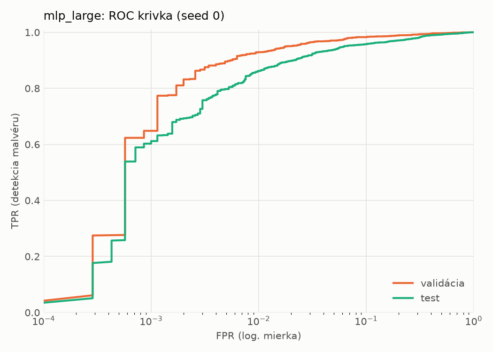
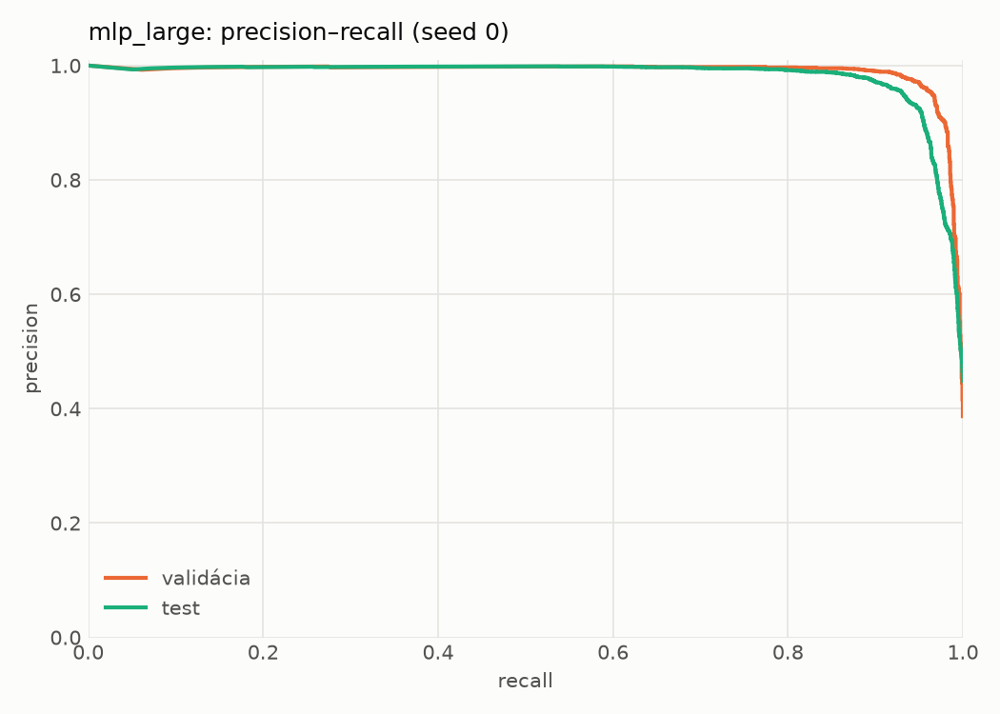
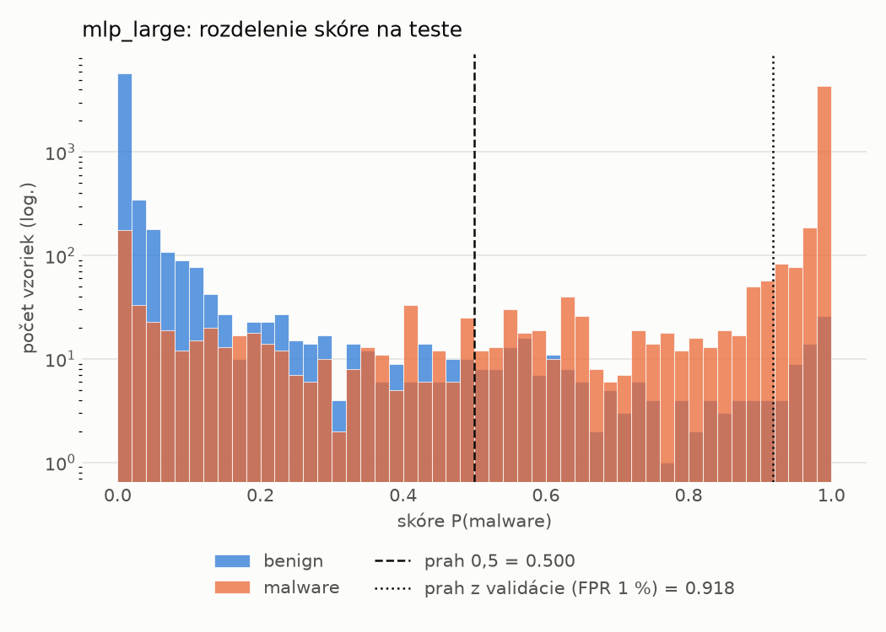
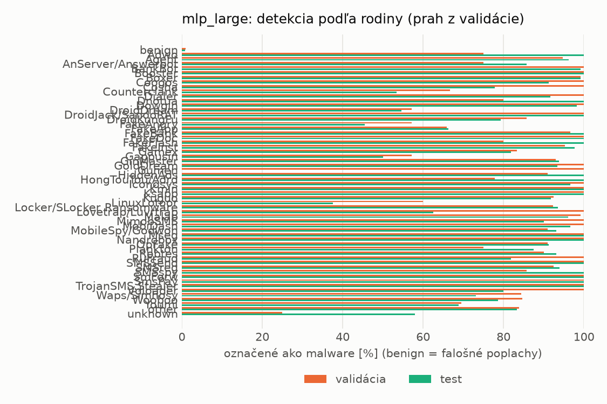
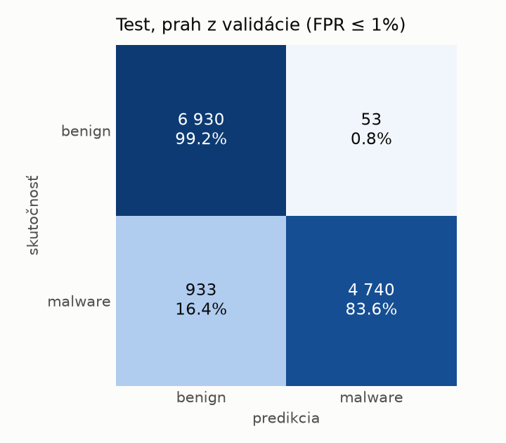
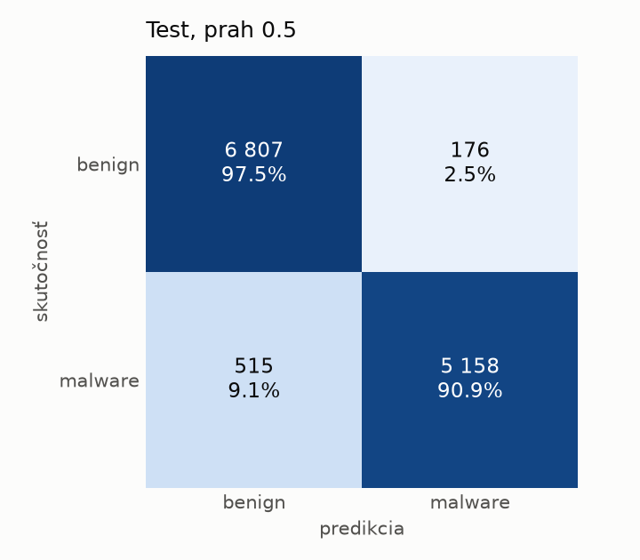
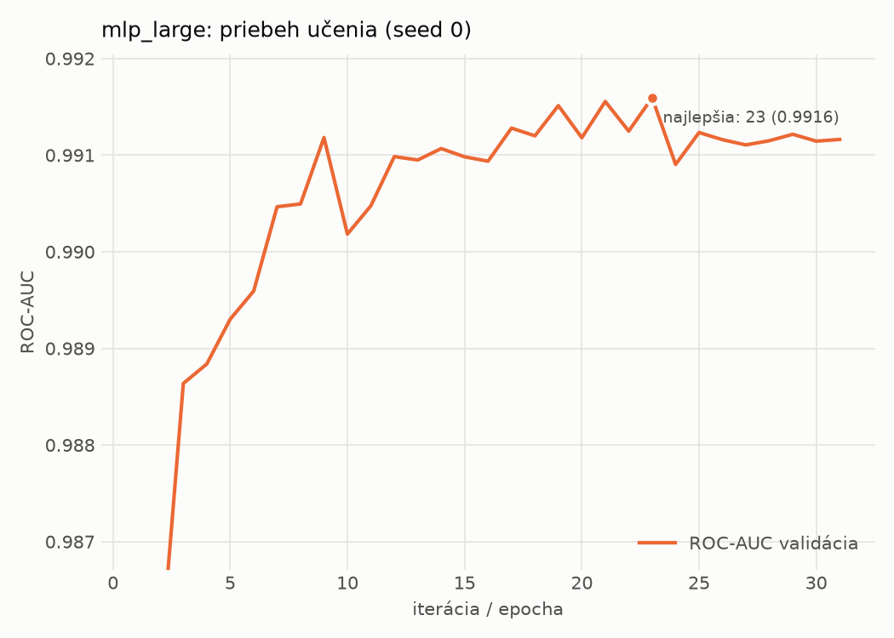

# static/mlp_large – beh `20261123-010447`

> Automaticky generované (`src/training/run_tabular.py`). Konfigurácia: `config.yaml`, protokol: `protocol.yaml`.

- **Model:** `mlp` – veľká neurónová sieť (3–5 skrytých vrstiev, 512–2048 neurónov), kandidát na učiteľa
- **Ladenie:** bez ladenia – hyperparametre prevzaté z `runs_v4/real_p/full/static/mlp_large/20261122-232356`
- **Finálne modely:** seedy [0, 1, 2]; hodnoty sú priemer ± smerodajná odchýlka cez seedy
- **Najlepšie hyperparametre:** `{"max_epochs": 100, "patience": 8, "hidden_layers": 3, "hidden_width": 2048, "width_decay": 0.5, "dropout": 0.24592095800405475, "lr": 0.0002046278772560144, "weight_decay": 0.007038560648637635, "batch_size": 256}`

## Detekčná kvalita (bez prahu)
| metrika | train (podvzorka) | validácia | test |
|---|---|---|---|
| ROC-AUC | 0.9987 ± 0.0003 | 0.9918 ± 0.0003 | 0.9806 ± 0.0009 |
| PR-AUC | 0.9982 ± 0.0004 | 0.9901 ± 0.0011 | 0.9812 ± 0.0004 |
| TPR pri FPR 1 % | 0.9778 ± 0.0043 | 0.9291 ± 0.0039 | 0.8657 ± 0.0042 |
| TPR pri FPR 0,1 % | 0.9452 ± 0.0132 | 0.7053 ± 0.0504 | 0.5903 ± 0.0493 |
| log loss | 0.0414 ± 0.0043 | 0.1076 ± 0.0037 | 0.1916 ± 0.0043 |
| Brier skóre | 0.0112 ± 0.0011 | 0.0260 ± 0.0004 | 0.0444 ± 0.0011 |

Rozdiel ROC-AUC train − validácia: **0.0069** (veľký rozdiel = preučenie).

## Pri prahu z validácie (FPR ≤ 1% na validácii)
| metrika | train (podvzorka) | validácia | test |
|---|---|---|---|
| accuracy | 0.9805 ± 0.0020 | 0.9667 ± 0.0015 | 0.9236 ± 0.0014 |
| balanced accuracy | 0.9747 ± 0.0025 | 0.9597 ± 0.0019 | 0.9156 ± 0.0015 |
| precision | 0.9975 ± 0.0008 | 0.9838 ± 0.0003 | 0.9897 ± 0.0009 |
| recall (TPR) | 0.9509 ± 0.0044 | 0.9291 ± 0.0039 | 0.8384 ± 0.0026 |
| FPR | 0.0014 ± 0.0005 | 0.0096 ± 0.0002 | 0.0071 ± 0.0006 |
| F1 | 0.9736 ± 0.0027 | 0.9557 ± 0.0021 | 0.9078 ± 0.0017 |
| MCC | 0.9589 ± 0.0041 | 0.9300 ± 0.0031 | 0.8519 ± 0.0026 |

## Pri pevnom prahu 0.5
| metrika | train (podvzorka) | validácia | test |
|---|---|---|---|
| accuracy | 0.9852 ± 0.0017 | 0.9671 ± 0.0010 | 0.9452 ± 0.0004 |
| balanced accuracy | 0.9842 ± 0.0026 | 0.9657 ± 0.0020 | 0.9416 ± 0.0008 |
| precision | 0.9810 ± 0.0015 | 0.9553 ± 0.0036 | 0.9685 ± 0.0040 |
| recall (TPR) | 0.9799 ± 0.0060 | 0.9599 ± 0.0066 | 0.9073 ± 0.0048 |
| FPR | 0.0116 ± 0.0010 | 0.0284 ± 0.0025 | 0.0240 ± 0.0032 |
| F1 | 0.9805 ± 0.0024 | 0.9575 ± 0.0015 | 0.9369 ± 0.0007 |
| MCC | 0.9686 ± 0.0037 | 0.9307 ± 0.0023 | 0.8900 ± 0.0004 |

## Výpočtové nároky (seed 0, testovacia množina)
| meranie | hodnota |
|---|---|
| tréning finálneho modelu | 11.2 s (priemer cez seedy) |
| ladenie spolu | 0 s |
| počet parametrov / uzlov | 2 966 529 |
| veľkosť modelu na disku | 11.91 MB |
| transformácia vstupu – latencia (1 vlákno) | 0.015 ms |
| transformácia vstupu – priepustnosť | 620 818 vzoriek/s |
| CPU latencia modelu (batch 1, 1 vlákno) | 0.423 ms (p95 0.809) |
| CPU priepustnosť (24 vlákien) | 119 338 vzoriek/s |
| GPU latencia (batch 1) | 0.430 ms (p95 0.919) |
| GPU priepustnosť | 792 248 vzoriek/s |
| GPU špičková pamäť | 243 MB |

## Grafy
| | |
|---|---|
|  |  |
|  |  |
|  |  |
|  |  |

## Súbory
`metrics.json` (všetky metriky po seedoch vrátane rodín), `timing.json`, `hpo_trials.csv`,
`predictions/<časť>_seed<N>.parquet` (sha256, family, label, score), `model/seed_<N>/`, `log.txt`.
