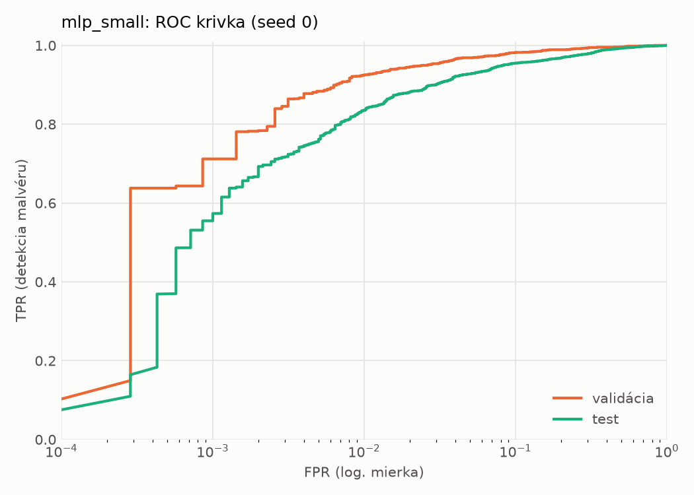
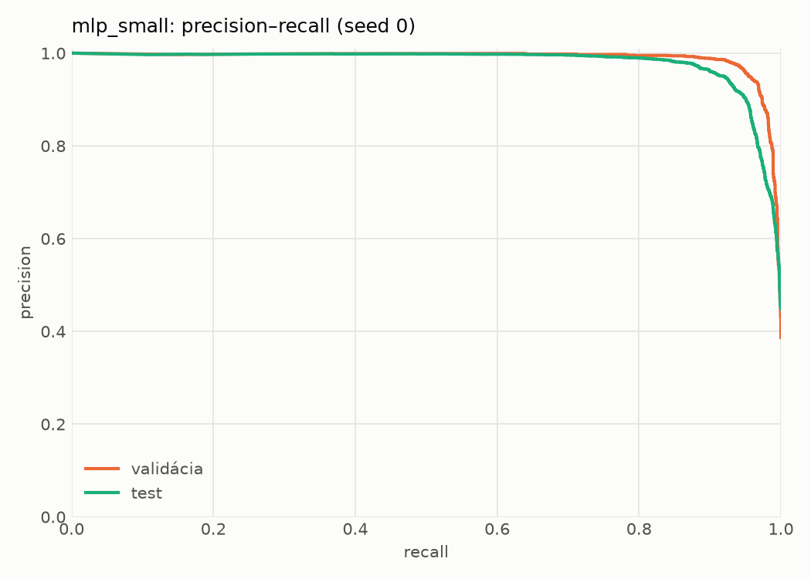
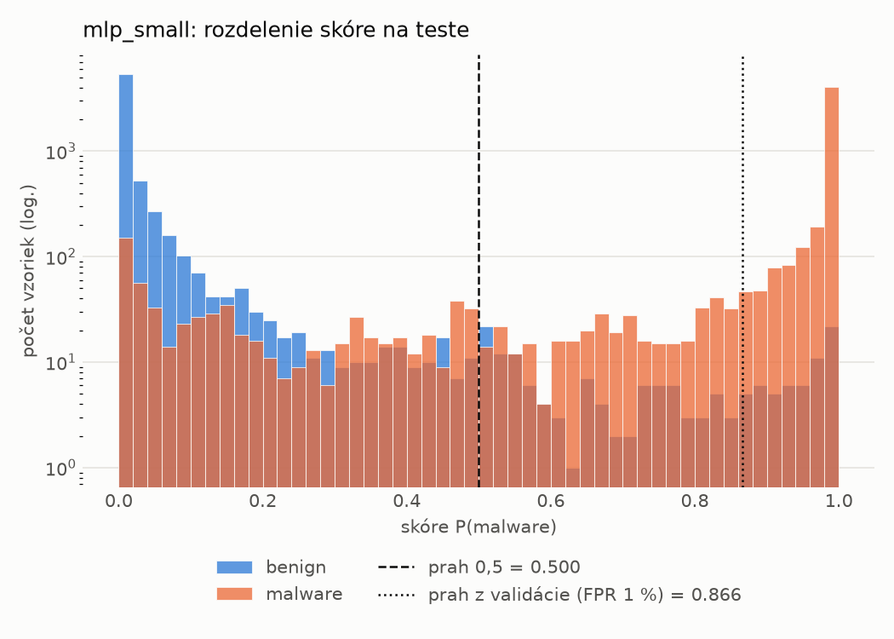
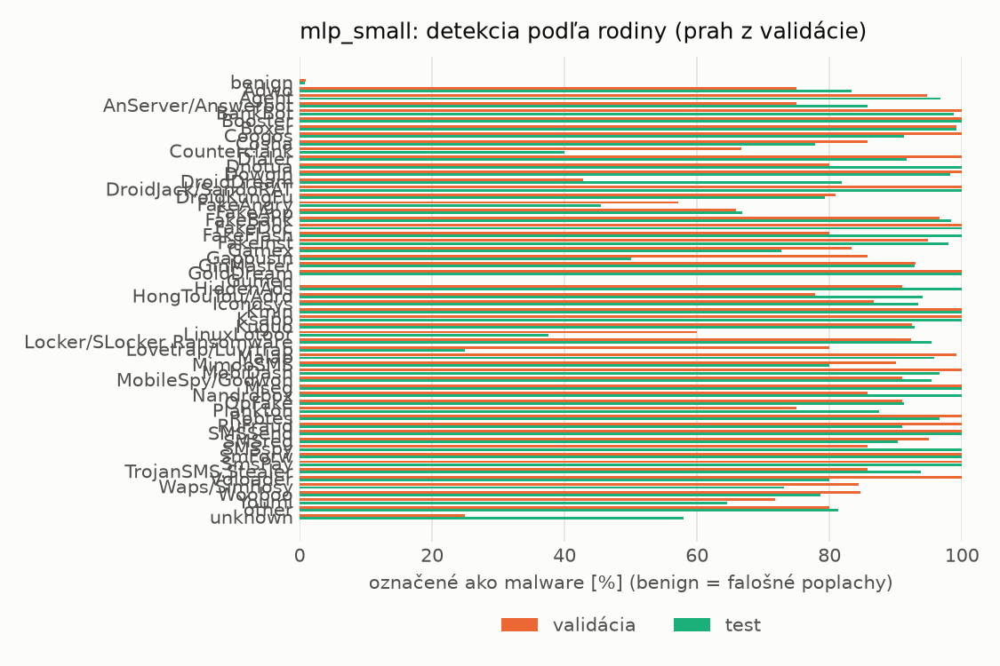
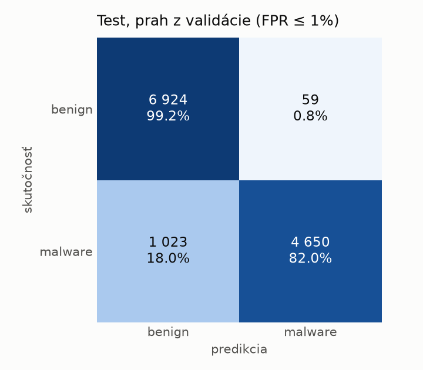
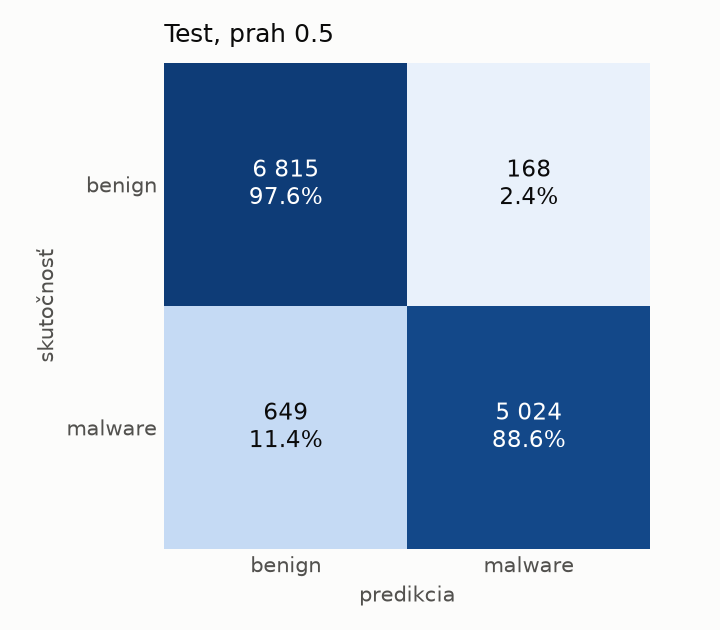
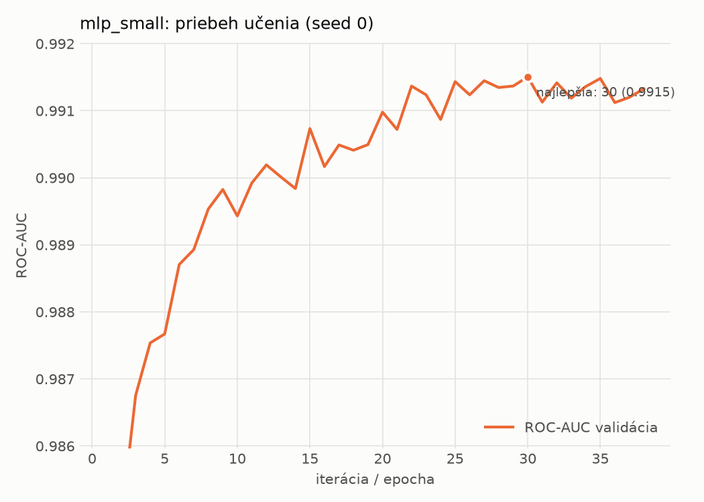

# static/mlp_small – beh `20261123-010412`

> Automaticky generované (`src/training/run_tabular.py`). Konfigurácia: `config.yaml`, protokol: `protocol.yaml`.

- **Model:** `mlp` – malá neurónová sieť (1–2 skryté vrstvy), kandidát na ľahkého študenta
- **Ladenie:** bez ladenia – hyperparametre prevzaté z `runs_v4/real_p/full/static/mlp_small/20261122-231849`
- **Finálne modely:** seedy [0, 1, 2]; hodnoty sú priemer ± smerodajná odchýlka cez seedy
- **Najlepšie hyperparametre:** `{"width_decay": 0.5, "max_epochs": 100, "patience": 8, "hidden_layers": 2, "hidden_width": 256, "dropout": 0.2770731649287669, "lr": 0.0010447758392925718, "weight_decay": 0.0006745378680415608, "batch_size": 256}`

## Detekčná kvalita (bez prahu)
| metrika | train (podvzorka) | validácia | test |
|---|---|---|---|
| ROC-AUC | 0.9980 ± 0.0002 | 0.9914 ± 0.0003 | 0.9810 ± 0.0009 |
| PR-AUC | 0.9974 ± 0.0002 | 0.9891 ± 0.0005 | 0.9810 ± 0.0010 |
| TPR pri FPR 1 % | 0.9696 ± 0.0019 | 0.9209 ± 0.0051 | 0.8417 ± 0.0058 |
| TPR pri FPR 0,1 % | 0.9316 ± 0.0015 | 0.6779 ± 0.0551 | 0.5841 ± 0.0253 |
| log loss | 0.0501 ± 0.0018 | 0.1099 ± 0.0024 | 0.1883 ± 0.0071 |
| Brier skóre | 0.0136 ± 0.0005 | 0.0276 ± 0.0004 | 0.0475 ± 0.0013 |

Rozdiel ROC-AUC train − validácia: **0.0067** (veľký rozdiel = preučenie).

## Pri prahu z validácie (FPR ≤ 1% na validácii)
| metrika | train (podvzorka) | validácia | test |
|---|---|---|---|
| accuracy | 0.9751 ± 0.0022 | 0.9636 ± 0.0018 | 0.9145 ± 0.0070 |
| balanced accuracy | 0.9675 ± 0.0031 | 0.9557 ± 0.0024 | 0.9054 ± 0.0080 |
| precision | 0.9979 ± 0.0006 | 0.9838 ± 0.0005 | 0.9894 ± 0.0020 |
| recall (TPR) | 0.9361 ± 0.0064 | 0.9209 ± 0.0051 | 0.8180 ± 0.0169 |
| FPR | 0.0012 ± 0.0003 | 0.0096 ± 0.0003 | 0.0072 ± 0.0015 |
| F1 | 0.9660 ± 0.0032 | 0.9513 ± 0.0025 | 0.8955 ± 0.0096 |
| MCC | 0.9476 ± 0.0046 | 0.9236 ± 0.0036 | 0.8349 ± 0.0126 |

## Pri pevnom prahu 0.5
| metrika | train (podvzorka) | validácia | test |
|---|---|---|---|
| accuracy | 0.9807 ± 0.0012 | 0.9630 ± 0.0016 | 0.9377 ± 0.0020 |
| balanced accuracy | 0.9794 ± 0.0013 | 0.9615 ± 0.0015 | 0.9334 ± 0.0024 |
| precision | 0.9748 ± 0.0016 | 0.9498 ± 0.0030 | 0.9667 ± 0.0010 |
| recall (TPR) | 0.9741 ± 0.0016 | 0.9547 ± 0.0015 | 0.8917 ± 0.0056 |
| FPR | 0.0153 ± 0.0010 | 0.0318 ± 0.0020 | 0.0250 ± 0.0009 |
| F1 | 0.9745 ± 0.0016 | 0.9523 ± 0.0020 | 0.9277 ± 0.0026 |
| MCC | 0.9589 ± 0.0025 | 0.9220 ± 0.0033 | 0.8753 ± 0.0038 |

## Výpočtové nároky (seed 0, testovacia množina)
| meranie | hodnota |
|---|---|
| tréning finálneho modelu | 10.9 s (priemer cez seedy) |
| ladenie spolu | 0 s |
| počet parametrov / uzlov | 75 777 |
| veľkosť modelu na disku | 0.32 MB |
| transformácia vstupu – latencia (1 vlákno) | 0.007 ms |
| transformácia vstupu – priepustnosť | 958 744 vzoriek/s |
| CPU latencia modelu (batch 1, 1 vlákno) | 0.231 ms (p95 0.242) |
| CPU priepustnosť (24 vlákien) | 2 593 602 vzoriek/s |
| GPU latencia (batch 1) | 0.391 ms (p95 0.677) |
| GPU priepustnosť | 1 256 366 vzoriek/s |
| GPU špičková pamäť | 73 MB |

## Grafy
| | |
|---|---|
|  |  |
|  |  |
|  |  |
|  |  |

## Súbory
`metrics.json` (všetky metriky po seedoch vrátane rodín), `timing.json`, `hpo_trials.csv`,
`predictions/<časť>_seed<N>.parquet` (sha256, family, label, score), `model/seed_<N>/`, `log.txt`.
