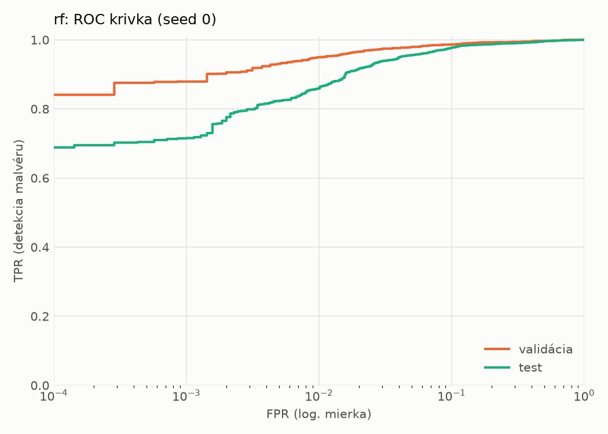
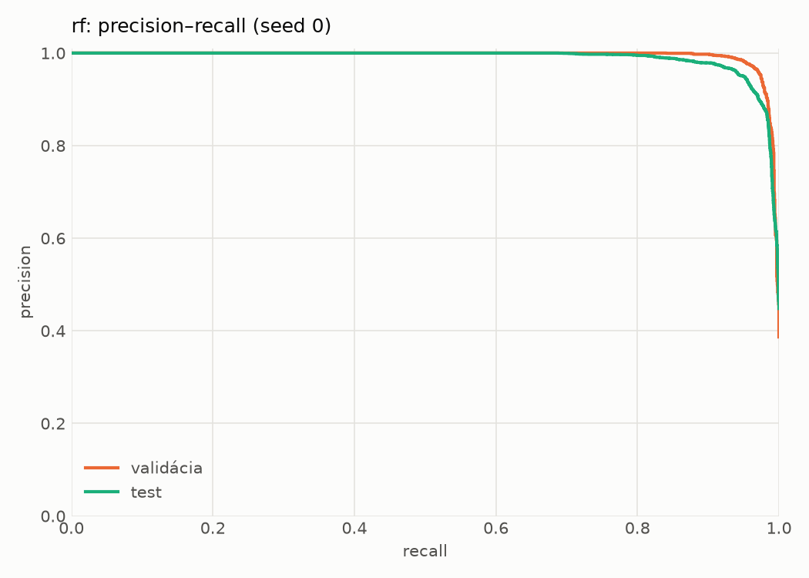
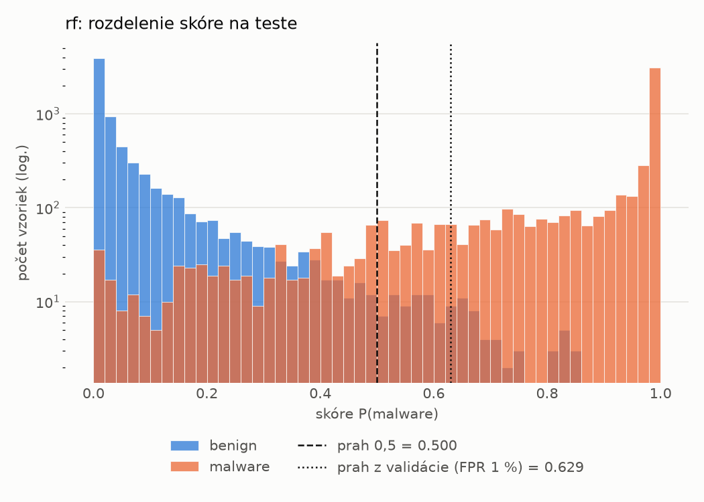
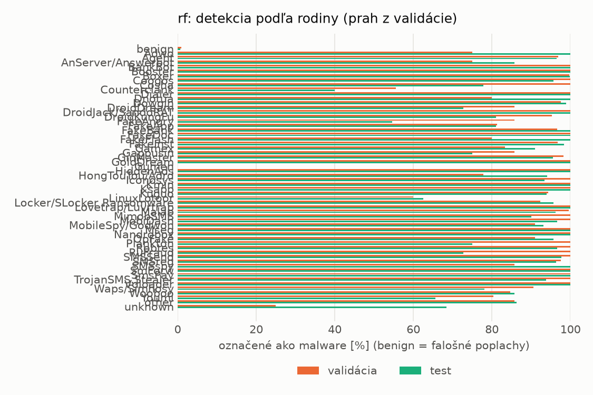
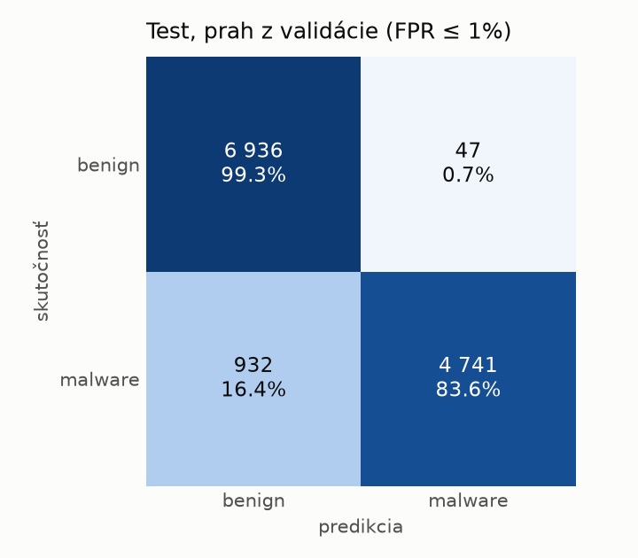
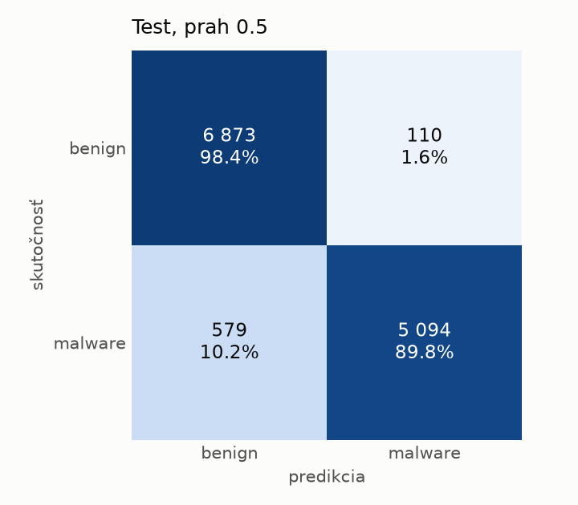

# static/rf – beh `20261123-010321`

> Automaticky generované (`src/training/run_tabular.py`). Konfigurácia: `config.yaml`, protokol: `protocol.yaml`.

- **Model:** `random_forest` – Random Forest (pôvodné hodnoty príznakov)
- **Ladenie:** bez ladenia – hyperparametre prevzaté z `runs_v4/real_p/full/static/rf/20261122-230914`
- **Finálne modely:** seedy [0, 1, 2]; hodnoty sú priemer ± smerodajná odchýlka cez seedy
- **Najlepšie hyperparametre:** `{"n_estimators": 500, "max_depth": 32, "min_samples_leaf": 1, "max_features": "log2"}`

## Detekčná kvalita (bez prahu)
| metrika | train (podvzorka) | validácia | test |
|---|---|---|---|
| ROC-AUC | 1.0000 ± 0.0000 | 0.9941 ± 0.0001 | 0.9885 ± 0.0001 |
| PR-AUC | 1.0000 ± 0.0000 | 0.9936 ± 0.0000 | 0.9887 ± 0.0001 |
| TPR pri FPR 1 % | 1.0000 ± 0.0000 | 0.9487 ± 0.0009 | 0.8588 ± 0.0064 |
| TPR pri FPR 0,1 % | 0.9991 ± 0.0002 | 0.8775 ± 0.0067 | 0.7115 ± 0.0028 |
| log loss | 0.0312 ± 0.0002 | 0.0885 ± 0.0001 | 0.1493 ± 0.0001 |
| Brier skóre | 0.0042 ± 0.0000 | 0.0223 ± 0.0000 | 0.0424 ± 0.0001 |

Rozdiel ROC-AUC train − validácia: **0.0059** (veľký rozdiel = preučenie).

## Pri prahu z validácie (FPR ≤ 1% na validácii)
| metrika | train (podvzorka) | validácia | test |
|---|---|---|---|
| accuracy | 0.9975 ± 0.0001 | 0.9743 ± 0.0002 | 0.9212 ± 0.0014 |
| balanced accuracy | 0.9967 ± 0.0001 | 0.9696 ± 0.0003 | 0.9129 ± 0.0015 |
| precision | 1.0000 ± 0.0000 | 0.9844 ± 0.0008 | 0.9903 ± 0.0002 |
| recall (TPR) | 0.9933 ± 0.0002 | 0.9487 ± 0.0009 | 0.8324 ± 0.0031 |
| FPR | 0.0000 ± 0.0000 | 0.0095 ± 0.0005 | 0.0066 ± 0.0002 |
| F1 | 0.9966 ± 0.0001 | 0.9662 ± 0.0002 | 0.9045 ± 0.0018 |
| MCC | 0.9946 ± 0.0001 | 0.9460 ± 0.0004 | 0.8475 ± 0.0026 |

## Pri pevnom prahu 0.5
| metrika | train (podvzorka) | validácia | test |
|---|---|---|---|
| accuracy | 0.9994 ± 0.0001 | 0.9738 ± 0.0001 | 0.9462 ± 0.0014 |
| balanced accuracy | 0.9993 ± 0.0001 | 0.9724 ± 0.0001 | 0.9419 ± 0.0016 |
| precision | 0.9992 ± 0.0000 | 0.9657 ± 0.0002 | 0.9785 ± 0.0005 |
| recall (TPR) | 0.9991 ± 0.0002 | 0.9665 ± 0.0003 | 0.8998 ± 0.0030 |
| FPR | 0.0005 ± 0.0000 | 0.0217 ± 0.0002 | 0.0160 ± 0.0004 |
| F1 | 0.9992 ± 0.0001 | 0.9661 ± 0.0001 | 0.9375 ± 0.0017 |
| MCC | 0.9987 ± 0.0001 | 0.9447 ± 0.0002 | 0.8929 ± 0.0028 |

## Výpočtové nároky (seed 0, testovacia množina)
| meranie | hodnota |
|---|---|
| tréning finálneho modelu | 1.4 s (priemer cez seedy) |
| ladenie spolu | 0 s |
| počet parametrov / uzlov | 2 572 218 |
| veľkosť modelu na disku | 206.14 MB |
| CPU latencia modelu (batch 1, 1 vlákno) | 15.161 ms (p95 15.590) |
| CPU priepustnosť (24 vlákien) | 111 333 vzoriek/s |

## Grafy
| | |
|---|---|
|  |  |
|  |  |
|  |  |
|  |  |

## Súbory
`metrics.json` (všetky metriky po seedoch vrátane rodín), `timing.json`, `hpo_trials.csv`,
`predictions/<časť>_seed<N>.parquet` (sha256, family, label, score), `model/seed_<N>/`, `log.txt`.
