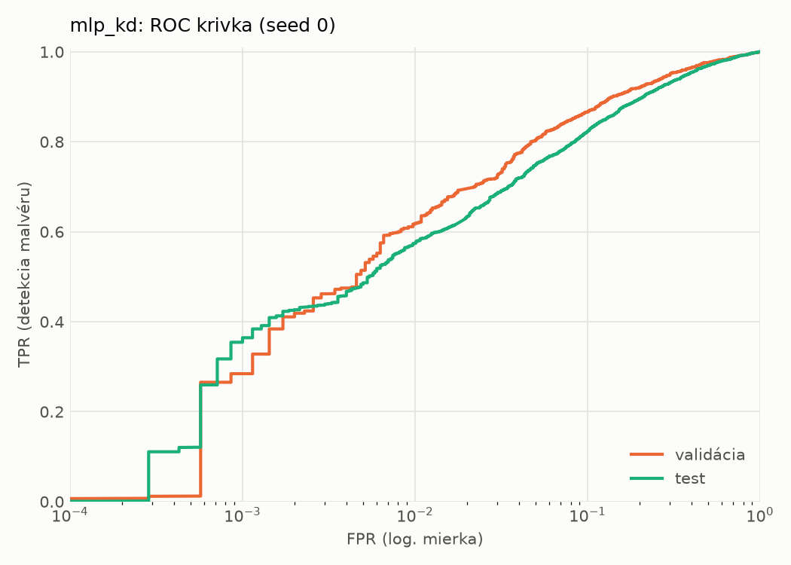
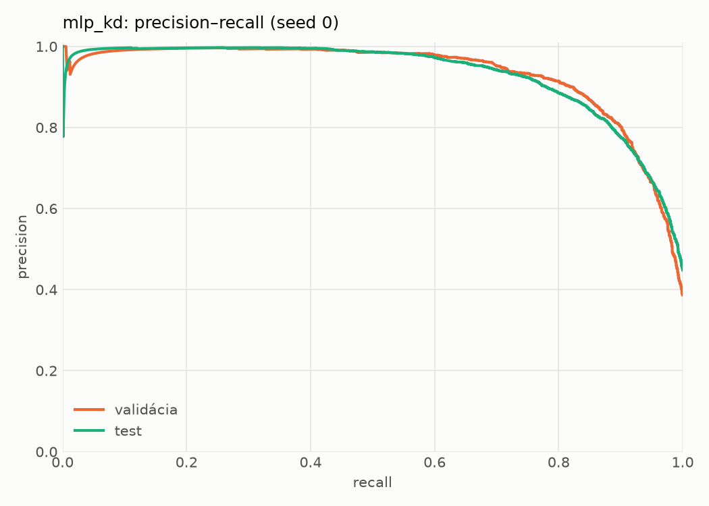
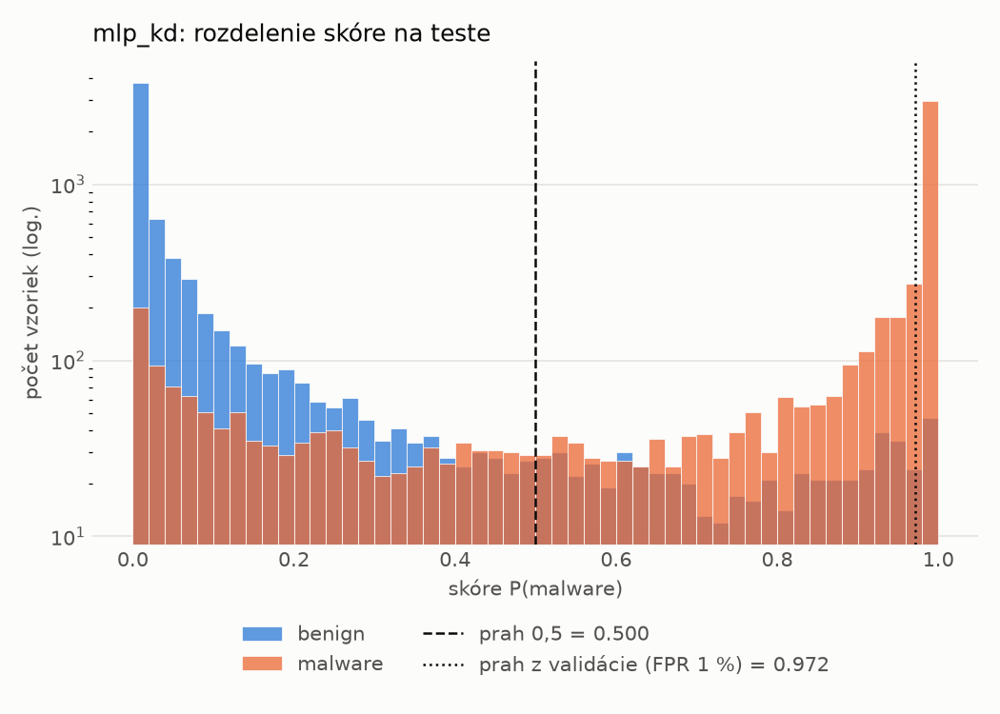
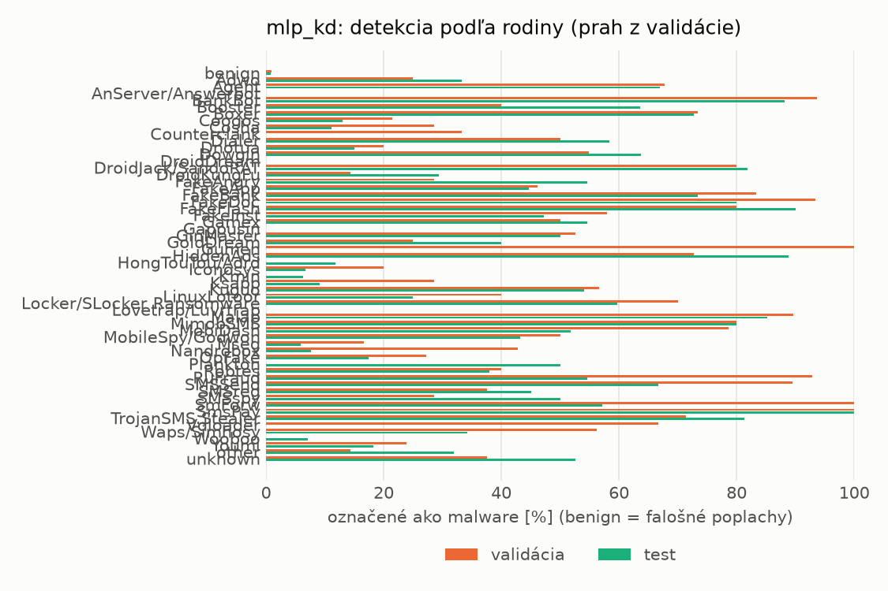
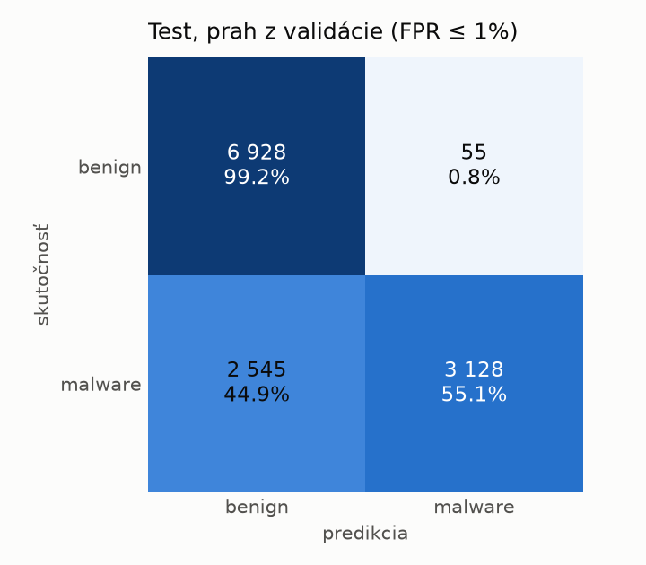
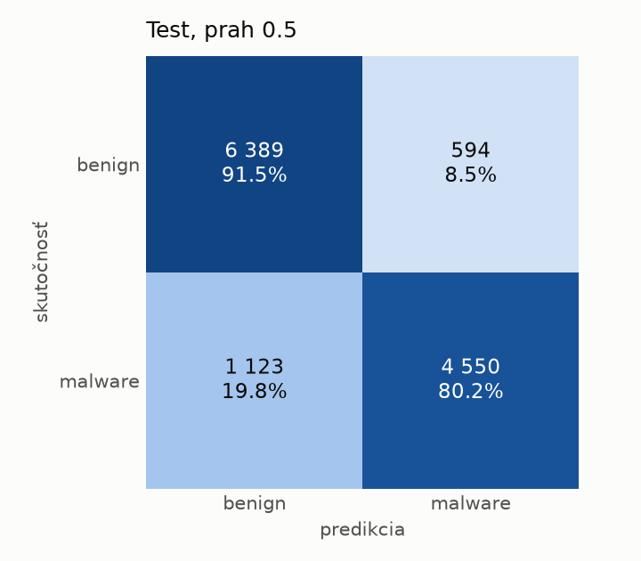
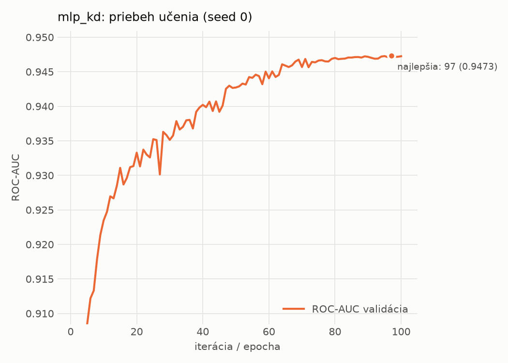

# dynamic/mlp_kd – beh `20261123-212644`

> Automaticky generované (`src/training/run_tabular.py`). Konfigurácia: `config.yaml`, protokol: `protocol.yaml`.

- **Model:** `mlp` – študent – malé MLP učené destiláciou z hybridného učiteľa
- **Ladenie:** bez ladenia – hyperparametre prevzaté z `runs_v4/emu_p/full/students_dynamic/mlp_kd/20261123-204643`
- **Finálne modely:** seedy [0, 1, 2]; hodnoty sú priemer ± smerodajná odchýlka cez seedy
- **Najlepšie hyperparametre:** `{"hidden_layers": 1, "max_epochs": 100, "patience": 8, "hidden_width": 64, "dropout": 0.18336599346560475, "lr": 0.002029071520651615, "weight_decay": 5.085344324013556e-05, "batch_size": 1024, "kd_alpha": 0.6628106947860043, "kd_temperature": 3.3639590927520047}`

## Detekčná kvalita (bez prahu)
| metrika | train (podvzorka) | validácia | test |
|---|---|---|---|
| ROC-AUC | 0.9552 ± 0.0031 | 0.9443 ± 0.0032 | 0.9311 ± 0.0024 |
| PR-AUC | 0.9435 ± 0.0042 | 0.9302 ± 0.0035 | 0.9295 ± 0.0021 |
| TPR pri FPR 1 % | 0.6592 ± 0.0187 | 0.5950 ± 0.0220 | 0.5651 ± 0.0138 |
| TPR pri FPR 0,1 % | 0.4781 ± 0.0180 | 0.2737 ± 0.0307 | 0.3483 ± 0.0236 |
| log loss | 0.2707 ± 0.0099 | 0.3184 ± 0.0068 | 0.3769 ± 0.0031 |
| Brier skóre | 0.0767 ± 0.0033 | 0.0862 ± 0.0027 | 0.1047 ± 0.0021 |

Rozdiel ROC-AUC train − validácia: **0.0109** (veľký rozdiel = preučenie).

## Pri prahu z validácie (FPR ≤ 1% na validácii)
| metrika | train (podvzorka) | validácia | test |
|---|---|---|---|
| accuracy | 0.8485 ± 0.0082 | 0.8374 ± 0.0085 | 0.7891 ± 0.0059 |
| balanced accuracy | 0.8022 ± 0.0107 | 0.7926 ± 0.0110 | 0.7657 ± 0.0066 |
| precision | 0.9817 ± 0.0017 | 0.9747 ± 0.0009 | 0.9825 ± 0.0012 |
| recall (TPR) | 0.6114 ± 0.0212 | 0.5950 ± 0.0220 | 0.5392 ± 0.0129 |
| FPR | 0.0069 ± 0.0005 | 0.0097 ± 0.0000 | 0.0078 ± 0.0004 |
| F1 | 0.7534 ± 0.0164 | 0.7388 ± 0.0173 | 0.6962 ± 0.0110 |
| MCC | 0.6906 ± 0.0166 | 0.6711 ± 0.0169 | 0.6136 ± 0.0104 |

## Pri pevnom prahu 0.5
| metrika | train (podvzorka) | validácia | test |
|---|---|---|---|
| accuracy | 0.9004 ± 0.0052 | 0.8882 ± 0.0038 | 0.8621 ± 0.0030 |
| balanced accuracy | 0.8925 ± 0.0053 | 0.8815 ± 0.0039 | 0.8562 ± 0.0032 |
| precision | 0.8751 ± 0.0079 | 0.8580 ± 0.0055 | 0.8825 ± 0.0031 |
| recall (TPR) | 0.8598 ± 0.0057 | 0.8520 ± 0.0049 | 0.7987 ± 0.0042 |
| FPR | 0.0749 ± 0.0049 | 0.0889 ± 0.0036 | 0.0864 ± 0.0021 |
| F1 | 0.8674 ± 0.0068 | 0.8550 ± 0.0049 | 0.8385 ± 0.0037 |
| MCC | 0.7877 ± 0.0110 | 0.7641 ± 0.0080 | 0.7215 ± 0.0062 |

## Výpočtové nároky (seed 0, testovacia množina)
| meranie | hodnota |
|---|---|
| tréning finálneho modelu | 6.5 s (priemer cez seedy) |
| ladenie spolu | 0 s |
| počet parametrov / uzlov | 8 129 |
| veľkosť modelu na disku | 0.04 MB |
| transformácia vstupu – latencia (1 vlákno) | 0.006 ms |
| transformácia vstupu – priepustnosť | 1 156 105 vzoriek/s |
| CPU latencia modelu (batch 1, 1 vlákno) | 0.053 ms (p95 0.063) |
| CPU priepustnosť (24 vlákien) | 5 175 643 vzoriek/s |
| GPU latencia (batch 1) | 0.444 ms (p95 0.474) |
| GPU priepustnosť | 2 476 615 vzoriek/s |
| GPU špičková pamäť | 50 MB |

## Grafy
| | |
|---|---|
|  |  |
|  |  |
|  |  |
|  |  |

## Súbory
`metrics.json` (všetky metriky po seedoch vrátane rodín), `timing.json`, `hpo_trials.csv`,
`predictions/<časť>_seed<N>.parquet` (sha256, family, label, score), `model/seed_<N>/`, `log.txt`.
