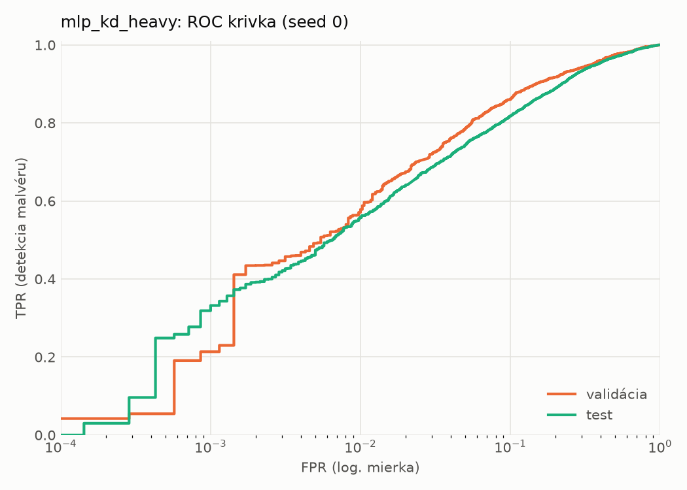
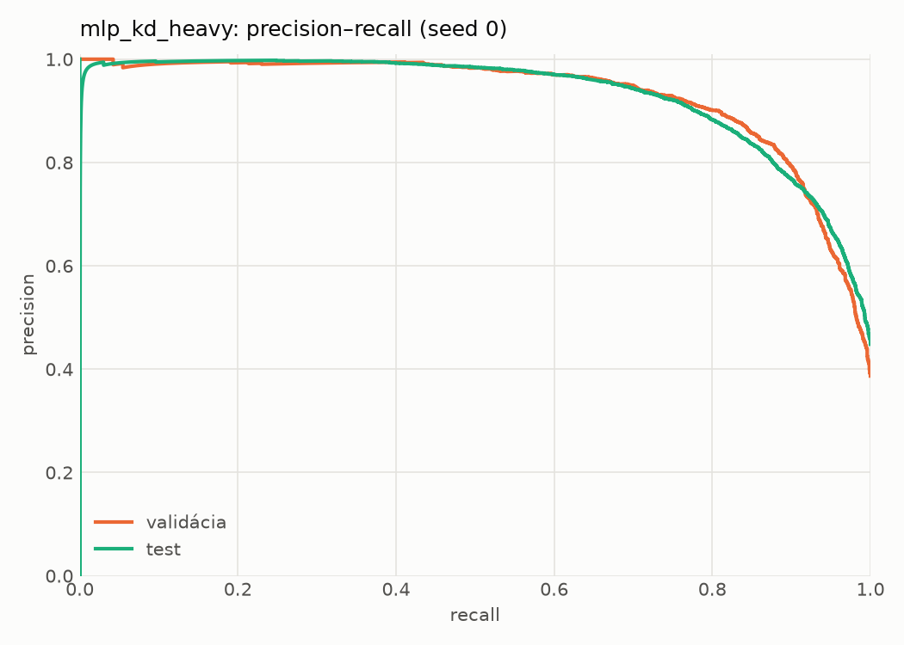
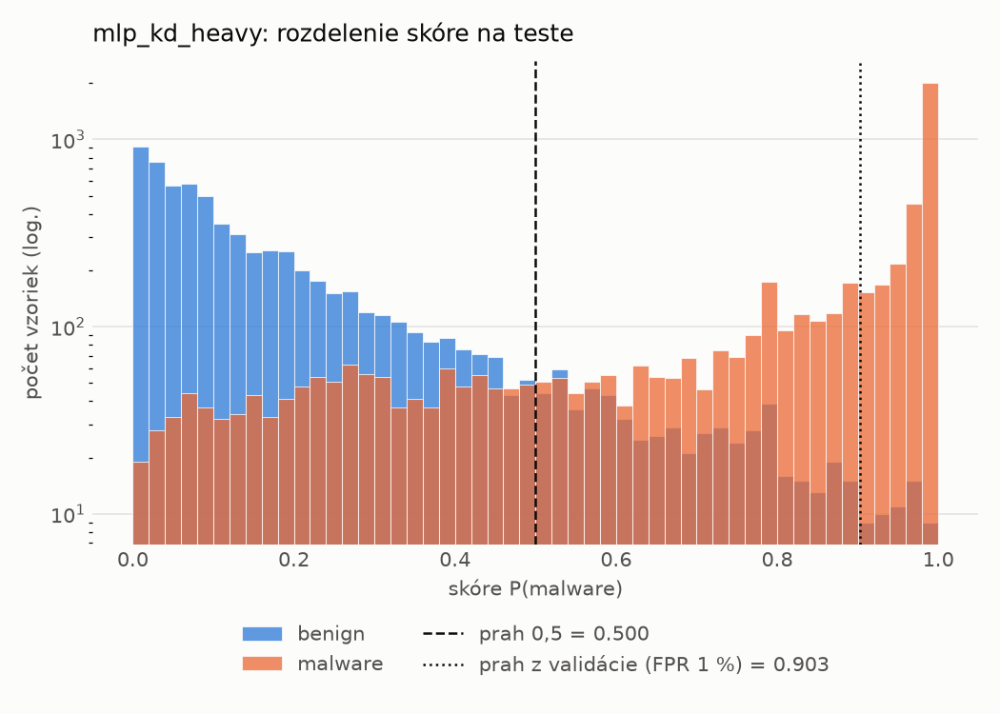
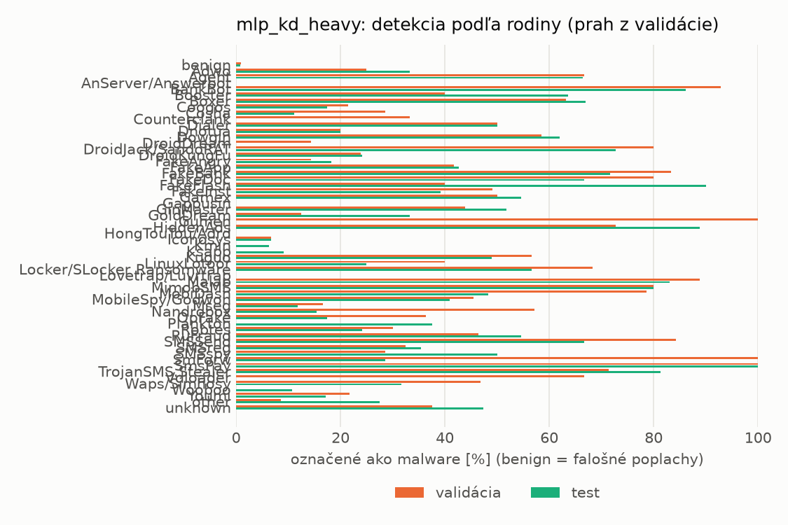
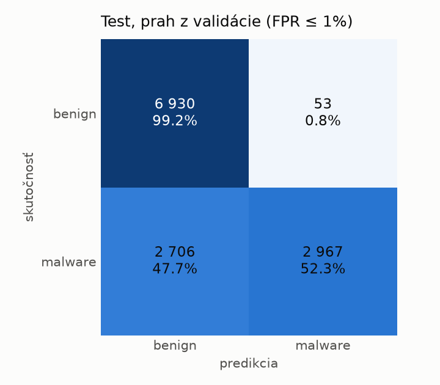
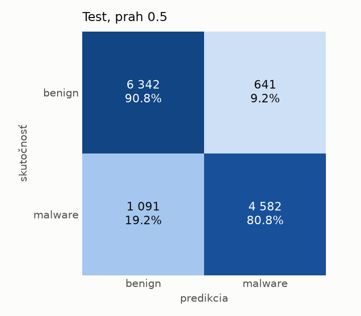
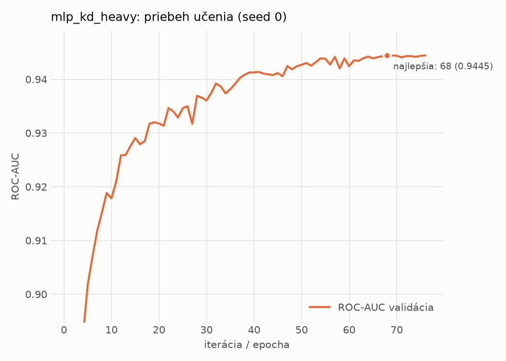

# dynamic/mlp_kd_heavy – beh `20261123-212806`

> Automaticky generované (`src/training/run_tabular.py`). Konfigurácia: `config.yaml`, protokol: `protocol.yaml`.

- **Model:** `mlp` – študent – malé MLP učené destiláciou z mlp_large hybridu (V4)
- **Ladenie:** bez ladenia – hyperparametre prevzaté z `runs_v4/emu_p/full/students_dynamic/mlp_kd_heavy/20261123-210504`
- **Finálne modely:** seedy [0, 1, 2]; hodnoty sú priemer ± smerodajná odchýlka cez seedy
- **Najlepšie hyperparametre:** `{"hidden_layers": 1, "max_epochs": 100, "patience": 8, "hidden_width": 64, "dropout": 0.11940169496551375, "lr": 0.0010131280233016235, "weight_decay": 6.964554367863767e-06, "batch_size": 1024, "kd_alpha": 0.5527208987397508, "kd_temperature": 1.1661827551200896}`

## Detekčná kvalita (bez prahu)
| metrika | train (podvzorka) | validácia | test |
|---|---|---|---|
| ROC-AUC | 0.9571 ± 0.0007 | 0.9442 ± 0.0002 | 0.9328 ± 0.0004 |
| PR-AUC | 0.9457 ± 0.0008 | 0.9305 ± 0.0004 | 0.9310 ± 0.0007 |
| TPR pri FPR 1 % | 0.6606 ± 0.0204 | 0.5808 ± 0.0192 | 0.5634 ± 0.0131 |
| TPR pri FPR 0,1 % | 0.4660 ± 0.0183 | 0.2064 ± 0.0242 | 0.2917 ± 0.0242 |
| log loss | 0.2577 ± 0.0023 | 0.2910 ± 0.0007 | 0.3213 ± 0.0010 |
| Brier skóre | 0.0765 ± 0.0008 | 0.0862 ± 0.0003 | 0.0984 ± 0.0005 |

Rozdiel ROC-AUC train − validácia: **0.0129** (veľký rozdiel = preučenie).

## Pri prahu z validácie (FPR ≤ 1% na validácii)
| metrika | train (podvzorka) | validácia | test |
|---|---|---|---|
| accuracy | 0.8454 ± 0.0063 | 0.8319 ± 0.0074 | 0.7865 ± 0.0065 |
| balanced accuracy | 0.7981 ± 0.0086 | 0.7855 ± 0.0096 | 0.7628 ± 0.0073 |
| precision | 0.9825 ± 0.0020 | 0.9741 ± 0.0008 | 0.9821 ± 0.0005 |
| recall (TPR) | 0.6028 ± 0.0181 | 0.5808 ± 0.0192 | 0.5335 ± 0.0150 |
| FPR | 0.0065 ± 0.0010 | 0.0097 ± 0.0000 | 0.0079 ± 0.0005 |
| F1 | 0.7471 ± 0.0132 | 0.7276 ± 0.0152 | 0.6913 ± 0.0124 |
| MCC | 0.6848 ± 0.0121 | 0.6602 ± 0.0147 | 0.6090 ± 0.0110 |

## Pri pevnom prahu 0.5
| metrika | train (podvzorka) | validácia | test |
|---|---|---|---|
| accuracy | 0.9002 ± 0.0019 | 0.8880 ± 0.0019 | 0.8648 ± 0.0017 |
| balanced accuracy | 0.8932 ± 0.0020 | 0.8826 ± 0.0012 | 0.8596 ± 0.0016 |
| precision | 0.8711 ± 0.0027 | 0.8526 ± 0.0057 | 0.8790 ± 0.0036 |
| recall (TPR) | 0.8644 ± 0.0023 | 0.8590 ± 0.0025 | 0.8098 ± 0.0025 |
| FPR | 0.0780 ± 0.0017 | 0.0937 ± 0.0045 | 0.0906 ± 0.0032 |
| F1 | 0.8678 ± 0.0025 | 0.8558 ± 0.0018 | 0.8430 ± 0.0018 |
| MCC | 0.7876 ± 0.0040 | 0.7642 ± 0.0036 | 0.7265 ± 0.0035 |

## Výpočtové nároky (seed 0, testovacia množina)
| meranie | hodnota |
|---|---|
| tréning finálneho modelu | 6.0 s (priemer cez seedy) |
| ladenie spolu | 0 s |
| počet parametrov / uzlov | 8 129 |
| veľkosť modelu na disku | 0.04 MB |
| transformácia vstupu – latencia (1 vlákno) | 0.015 ms |
| transformácia vstupu – priepustnosť | 746 878 vzoriek/s |
| CPU latencia modelu (batch 1, 1 vlákno) | 0.153 ms (p95 0.162) |
| CPU priepustnosť (24 vlákien) | 6 459 779 vzoriek/s |
| GPU latencia (batch 1) | 0.440 ms (p95 0.468) |
| GPU priepustnosť | 3 761 070 vzoriek/s |
| GPU špičková pamäť | 72 MB |

## Grafy
| | |
|---|---|
|  |  |
|  |  |
|  |  |
|  |  |

## Súbory
`metrics.json` (všetky metriky po seedoch vrátane rodín), `timing.json`, `hpo_trials.csv`,
`predictions/<časť>_seed<N>.parquet` (sha256, family, label, score), `model/seed_<N>/`, `log.txt`.
