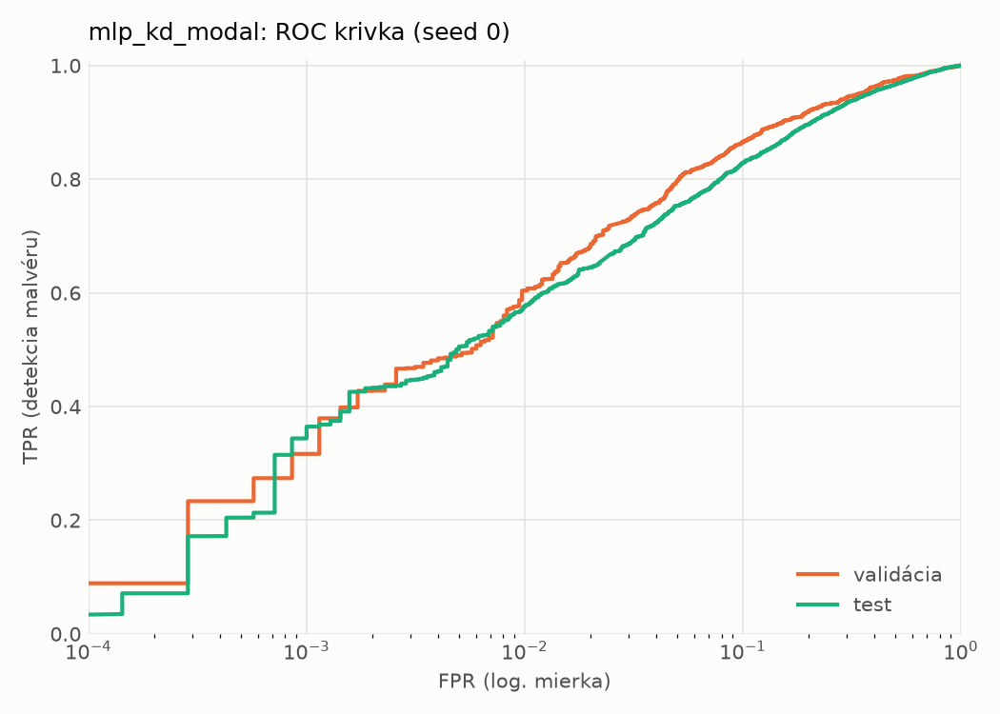
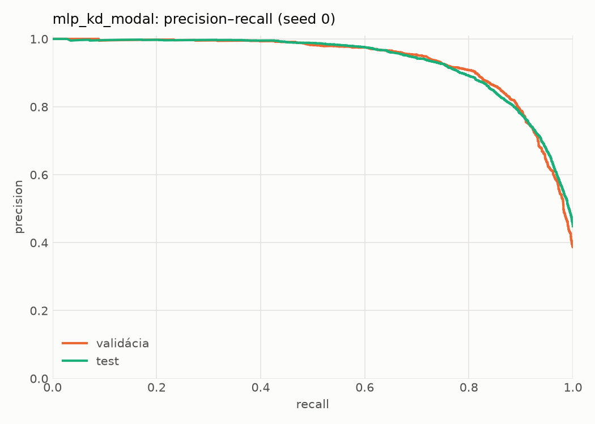
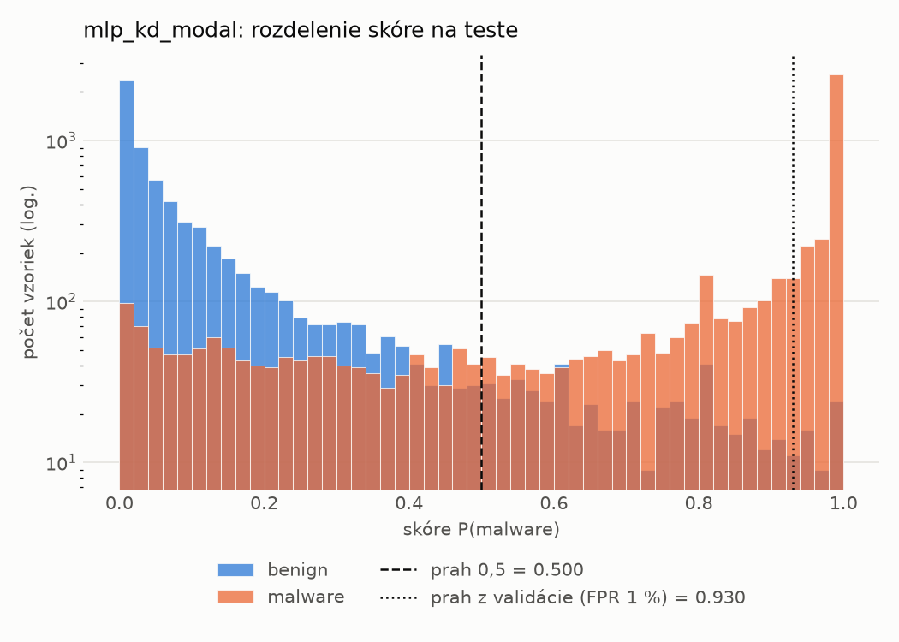
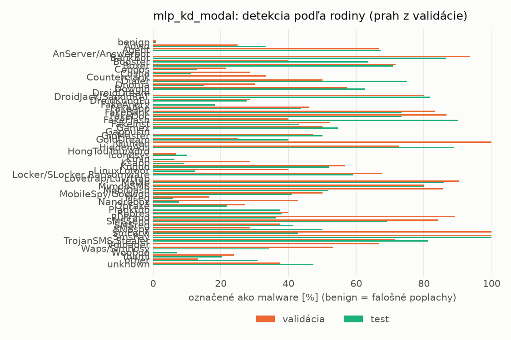
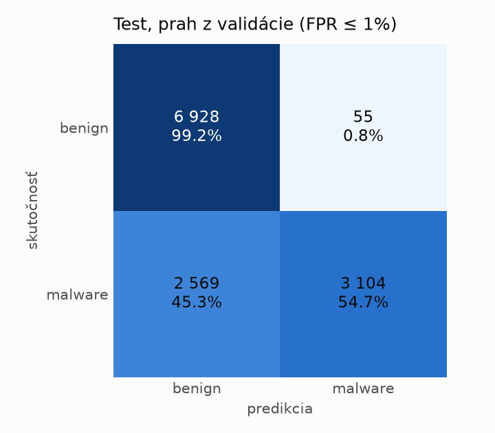
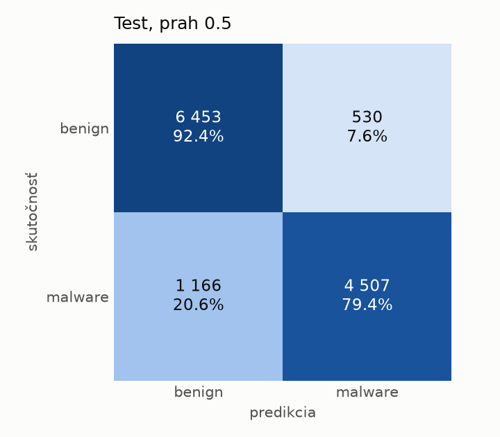
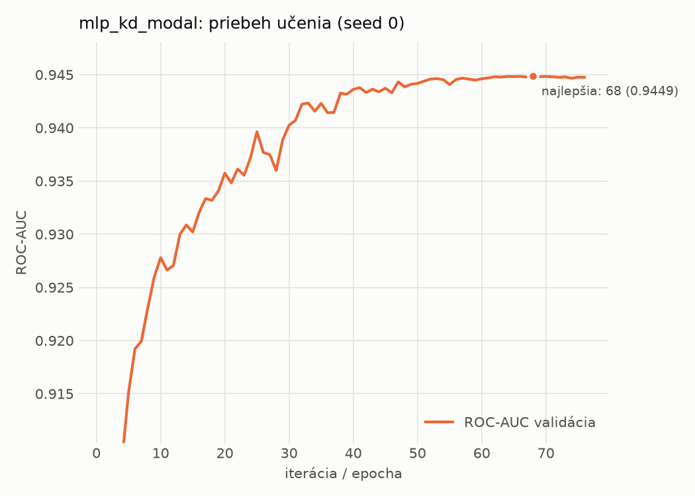

# dynamic/mlp_kd_modal – beh `20261123-212749`

> Automaticky generované (`src/training/run_tabular.py`). Konfigurácia: `config.yaml`, protokol: `protocol.yaml`.

- **Model:** `mlp` – študent – malé MLP učené destiláciou z učiteľa rovnakej modality (variant A)
- **Ladenie:** bez ladenia – hyperparametre prevzaté z `runs_v4/emu_p/full/students_dynamic/mlp_kd_modal/20261123-210004`
- **Finálne modely:** seedy [0, 1, 2]; hodnoty sú priemer ± smerodajná odchýlka cez seedy
- **Najlepšie hyperparametre:** `{"hidden_layers": 1, "max_epochs": 100, "patience": 8, "hidden_width": 64, "dropout": 0.17256398759806554, "lr": 0.00273877224500614, "weight_decay": 0.00015336049950880602, "batch_size": 1024, "kd_alpha": 0.5720540077101433, "kd_temperature": 1.5970216771892711}`

## Detekčná kvalita (bez prahu)
| metrika | train (podvzorka) | validácia | test |
|---|---|---|---|
| ROC-AUC | 0.9578 ± 0.0014 | 0.9467 ± 0.0017 | 0.9343 ± 0.0005 |
| PR-AUC | 0.9472 ± 0.0019 | 0.9356 ± 0.0020 | 0.9344 ± 0.0007 |
| TPR pri FPR 1 % | 0.6684 ± 0.0119 | 0.6146 ± 0.0120 | 0.5797 ± 0.0045 |
| TPR pri FPR 0,1 % | 0.4753 ± 0.0213 | 0.3030 ± 0.0576 | 0.3448 ± 0.0118 |
| log loss | 0.2440 ± 0.0042 | 0.2826 ± 0.0058 | 0.3295 ± 0.0017 |
| Brier skóre | 0.0724 ± 0.0012 | 0.0811 ± 0.0018 | 0.0976 ± 0.0006 |

Rozdiel ROC-AUC train − validácia: **0.0111** (veľký rozdiel = preučenie).

## Pri prahu z validácie (FPR ≤ 1% na validácii)
| metrika | train (podvzorka) | validácia | test |
|---|---|---|---|
| accuracy | 0.8542 ± 0.0040 | 0.8449 ± 0.0046 | 0.7969 ± 0.0040 |
| balanced accuracy | 0.8097 ± 0.0052 | 0.8024 ± 0.0060 | 0.7744 ± 0.0044 |
| precision | 0.9825 ± 0.0007 | 0.9755 ± 0.0005 | 0.9829 ± 0.0003 |
| recall (TPR) | 0.6263 ± 0.0102 | 0.6146 ± 0.0120 | 0.5566 ± 0.0089 |
| FPR | 0.0068 ± 0.0002 | 0.0097 ± 0.0000 | 0.0079 ± 0.0000 |
| F1 | 0.7649 ± 0.0078 | 0.7540 ± 0.0091 | 0.7107 ± 0.0073 |
| MCC | 0.7021 ± 0.0080 | 0.6861 ± 0.0091 | 0.6270 ± 0.0069 |

## Pri pevnom prahu 0.5
| metrika | train (podvzorka) | validácia | test |
|---|---|---|---|
| accuracy | 0.9046 ± 0.0011 | 0.8934 ± 0.0038 | 0.8680 ± 0.0021 |
| balanced accuracy | 0.8949 ± 0.0018 | 0.8853 ± 0.0043 | 0.8615 ± 0.0021 |
| precision | 0.8891 ± 0.0009 | 0.8717 ± 0.0043 | 0.8961 ± 0.0022 |
| recall (TPR) | 0.8548 ± 0.0045 | 0.8496 ± 0.0068 | 0.7981 ± 0.0032 |
| FPR | 0.0650 ± 0.0010 | 0.0789 ± 0.0026 | 0.0752 ± 0.0016 |
| F1 | 0.8716 ± 0.0019 | 0.8605 ± 0.0052 | 0.8443 ± 0.0025 |
| MCC | 0.7961 ± 0.0025 | 0.7745 ± 0.0082 | 0.7341 ± 0.0042 |

## Výpočtové nároky (seed 0, testovacia množina)
| meranie | hodnota |
|---|---|
| tréning finálneho modelu | 5.0 s (priemer cez seedy) |
| ladenie spolu | 0 s |
| počet parametrov / uzlov | 8 129 |
| veľkosť modelu na disku | 0.04 MB |
| transformácia vstupu – latencia (1 vlákno) | 0.015 ms |
| transformácia vstupu – priepustnosť | 770 702 vzoriek/s |
| CPU latencia modelu (batch 1, 1 vlákno) | 0.152 ms (p95 0.162) |
| CPU priepustnosť (24 vlákien) | 7 514 101 vzoriek/s |
| GPU latencia (batch 1) | 0.286 ms (p95 0.382) |
| GPU priepustnosť | 1 833 140 vzoriek/s |
| GPU špičková pamäť | 50 MB |

## Grafy
| | |
|---|---|
|  |  |
|  |  |
|  |  |
|  |  |

## Súbory
`metrics.json` (všetky metriky po seedoch vrátane rodín), `timing.json`, `hpo_trials.csv`,
`predictions/<časť>_seed<N>.parquet` (sha256, family, label, score), `model/seed_<N>/`, `log.txt`.
