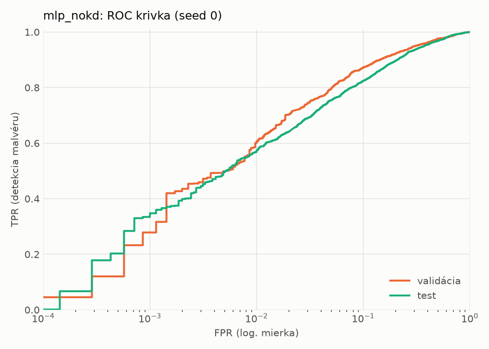
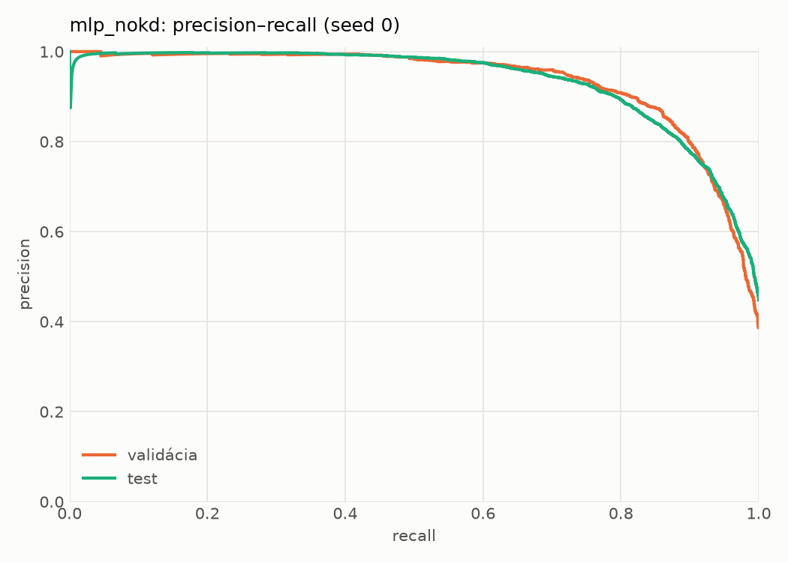
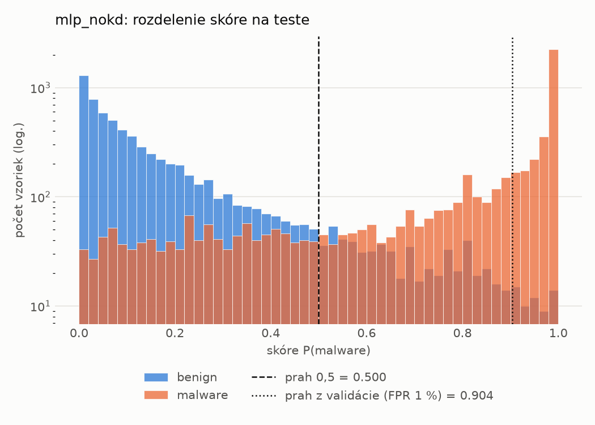
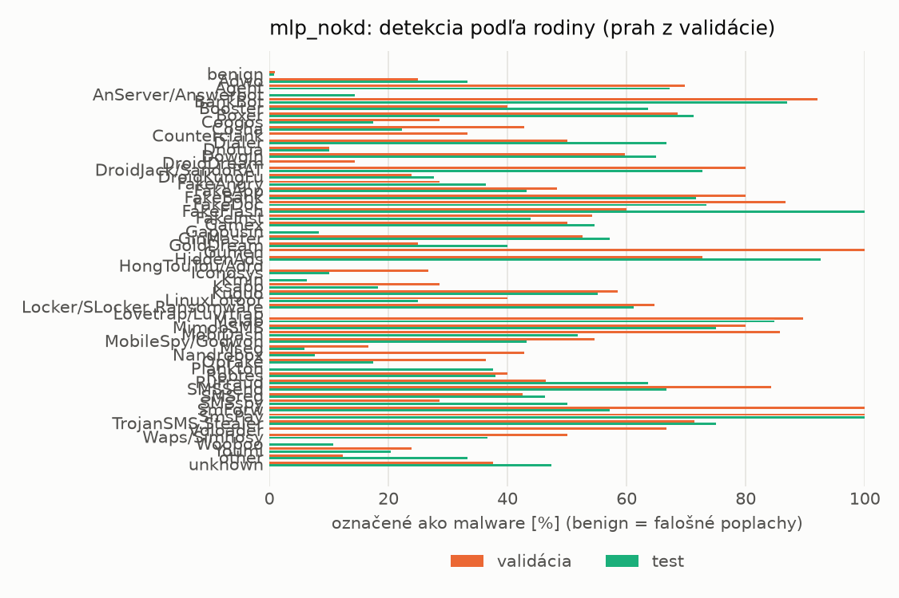
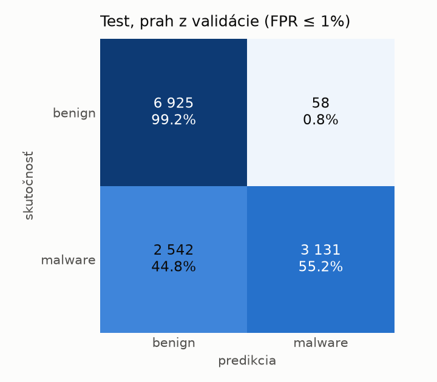
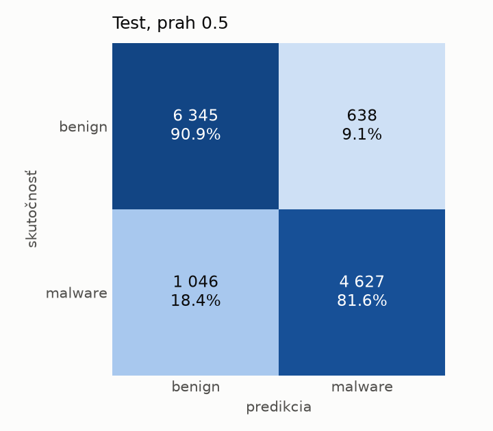
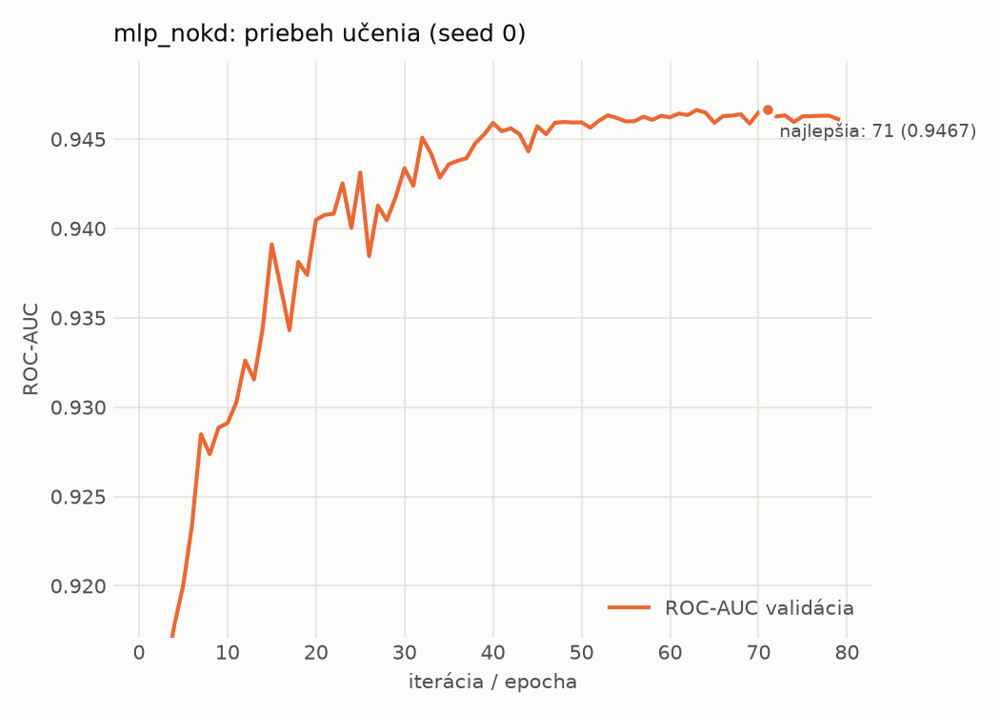

# dynamic/mlp_nokd – beh `20261123-212706`

> Automaticky generované (`src/training/run_tabular.py`). Konfigurácia: `config.yaml`, protokol: `protocol.yaml`.

- **Model:** `mlp` – kontrola – rovnaké malé MLP bez destilácie (iba skutočné označenia)
- **Ladenie:** bez ladenia – hyperparametre prevzaté z `runs_v4/emu_p/full/students_dynamic/mlp_nokd/20261123-205230`
- **Finálne modely:** seedy [0, 1, 2]; hodnoty sú priemer ± smerodajná odchýlka cez seedy
- **Najlepšie hyperparametre:** `{"hidden_layers": 1, "max_epochs": 100, "patience": 8, "hidden_width": 64, "dropout": 0.039782849658421375, "lr": 0.0018574312606020214, "weight_decay": 6.674701047165933e-06, "batch_size": 256}`

## Detekčná kvalita (bez prahu)
| metrika | train (podvzorka) | validácia | test |
|---|---|---|---|
| ROC-AUC | 0.9643 ± 0.0017 | 0.9478 ± 0.0010 | 0.9354 ± 0.0004 |
| PR-AUC | 0.9544 ± 0.0025 | 0.9363 ± 0.0012 | 0.9349 ± 0.0011 |
| TPR pri FPR 1 % | 0.6956 ± 0.0171 | 0.6100 ± 0.0159 | 0.5795 ± 0.0099 |
| TPR pri FPR 0,1 % | 0.5008 ± 0.0317 | 0.2310 ± 0.0412 | 0.3099 ± 0.0521 |
| log loss | 0.2349 ± 0.0071 | 0.2801 ± 0.0054 | 0.3158 ± 0.0006 |
| Brier skóre | 0.0695 ± 0.0023 | 0.0818 ± 0.0021 | 0.0956 ± 0.0010 |

Rozdiel ROC-AUC train − validácia: **0.0166** (veľký rozdiel = preučenie).

## Pri prahu z validácie (FPR ≤ 1% na validácii)
| metrika | train (podvzorka) | validácia | test |
|---|---|---|---|
| accuracy | 0.8592 ± 0.0060 | 0.8432 ± 0.0061 | 0.7969 ± 0.0045 |
| balanced accuracy | 0.8160 ± 0.0078 | 0.8001 ± 0.0079 | 0.7744 ± 0.0051 |
| precision | 0.9862 ± 0.0013 | 0.9753 ± 0.0006 | 0.9825 ± 0.0024 |
| recall (TPR) | 0.6374 ± 0.0155 | 0.6100 ± 0.0159 | 0.5569 ± 0.0112 |
| FPR | 0.0054 ± 0.0005 | 0.0097 ± 0.0000 | 0.0081 ± 0.0012 |
| F1 | 0.7743 ± 0.0116 | 0.7505 ± 0.0121 | 0.7108 ± 0.0086 |
| MCC | 0.7129 ± 0.0120 | 0.6826 ± 0.0121 | 0.6270 ± 0.0071 |

## Pri pevnom prahu 0.5
| metrika | train (podvzorka) | validácia | test |
|---|---|---|---|
| accuracy | 0.9090 ± 0.0025 | 0.8930 ± 0.0030 | 0.8688 ± 0.0020 |
| balanced accuracy | 0.9032 ± 0.0018 | 0.8881 ± 0.0022 | 0.8635 ± 0.0020 |
| precision | 0.8807 ± 0.0080 | 0.8586 ± 0.0093 | 0.8854 ± 0.0060 |
| recall (TPR) | 0.8790 ± 0.0045 | 0.8663 ± 0.0064 | 0.8124 ± 0.0060 |
| FPR | 0.0727 ± 0.0058 | 0.0901 ± 0.0074 | 0.0854 ± 0.0055 |
| F1 | 0.8799 ± 0.0027 | 0.8624 ± 0.0031 | 0.8473 ± 0.0024 |
| MCC | 0.8067 ± 0.0050 | 0.7750 ± 0.0057 | 0.7348 ± 0.0042 |

## Výpočtové nároky (seed 0, testovacia množina)
| meranie | hodnota |
|---|---|
| tréning finálneho modelu | 14.0 s (priemer cez seedy) |
| ladenie spolu | 0 s |
| počet parametrov / uzlov | 8 129 |
| veľkosť modelu na disku | 0.04 MB |
| transformácia vstupu – latencia (1 vlákno) | 0.015 ms |
| transformácia vstupu – priepustnosť | 773 745 vzoriek/s |
| CPU latencia modelu (batch 1, 1 vlákno) | 0.153 ms (p95 0.162) |
| CPU priepustnosť (24 vlákien) | 5 898 858 vzoriek/s |
| GPU latencia (batch 1) | 0.445 ms (p95 0.476) |
| GPU priepustnosť | 3 345 935 vzoriek/s |
| GPU špičková pamäť | 72 MB |

## Grafy
| | |
|---|---|
|  |  |
|  |  |
|  |  |
|  |  |

## Súbory
`metrics.json` (všetky metriky po seedoch vrátane rodín), `timing.json`, `hpo_trials.csv`,
`predictions/<časť>_seed<N>.parquet` (sha256, family, label, score), `model/seed_<N>/`, `log.txt`.
