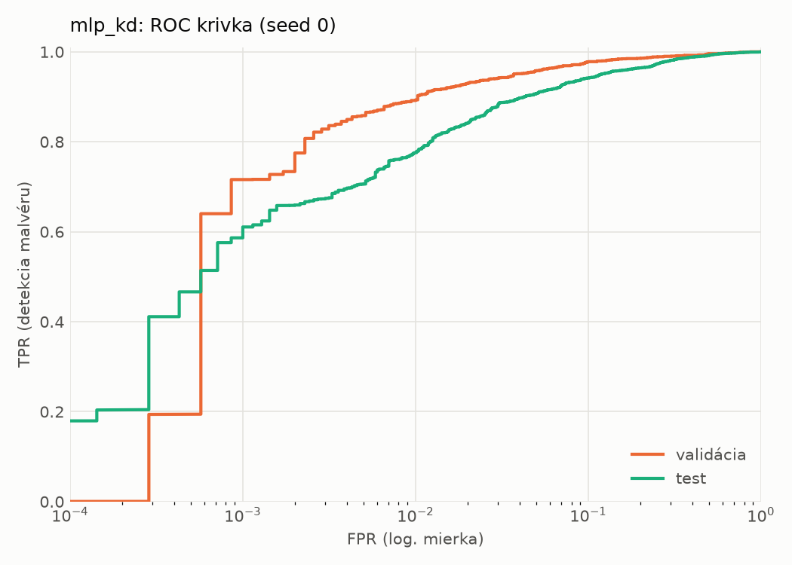
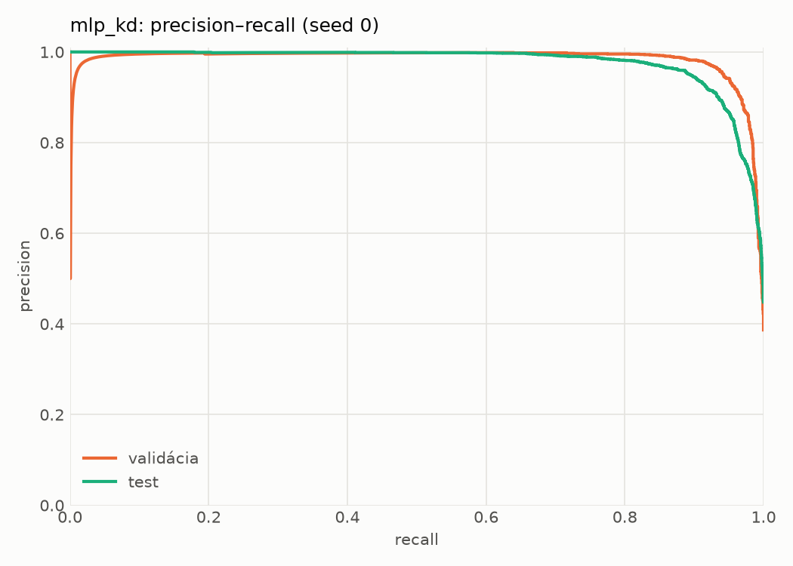
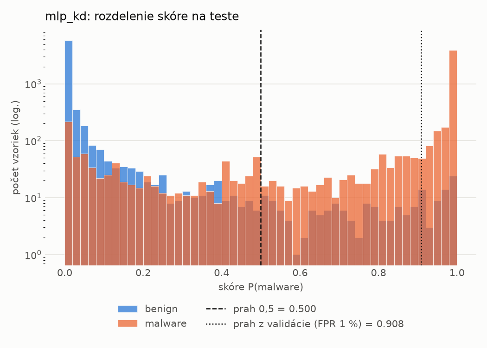
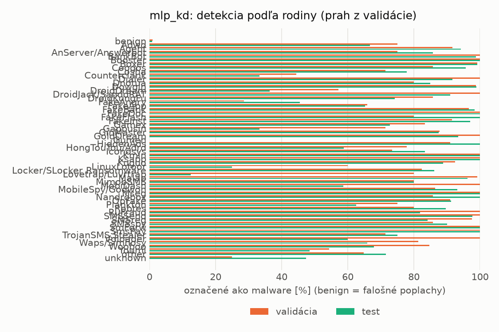
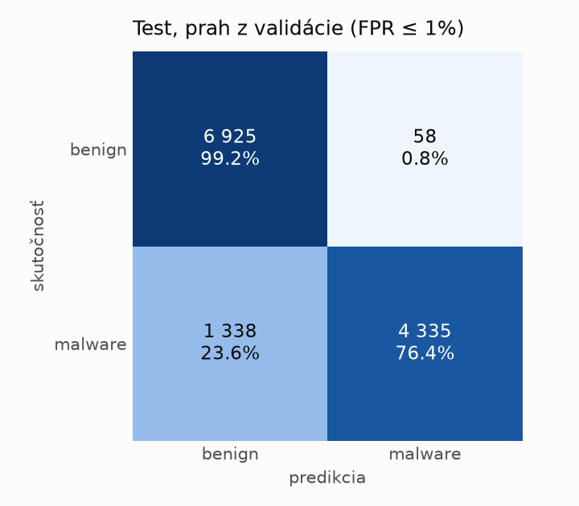
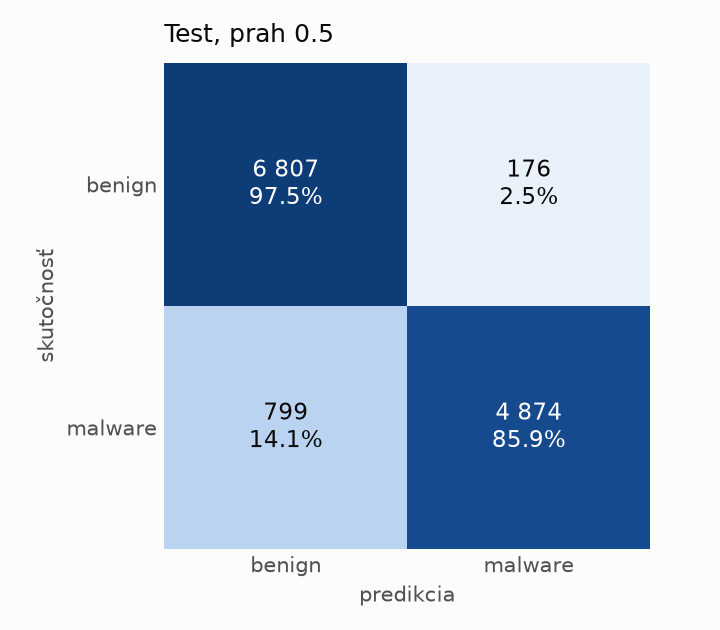
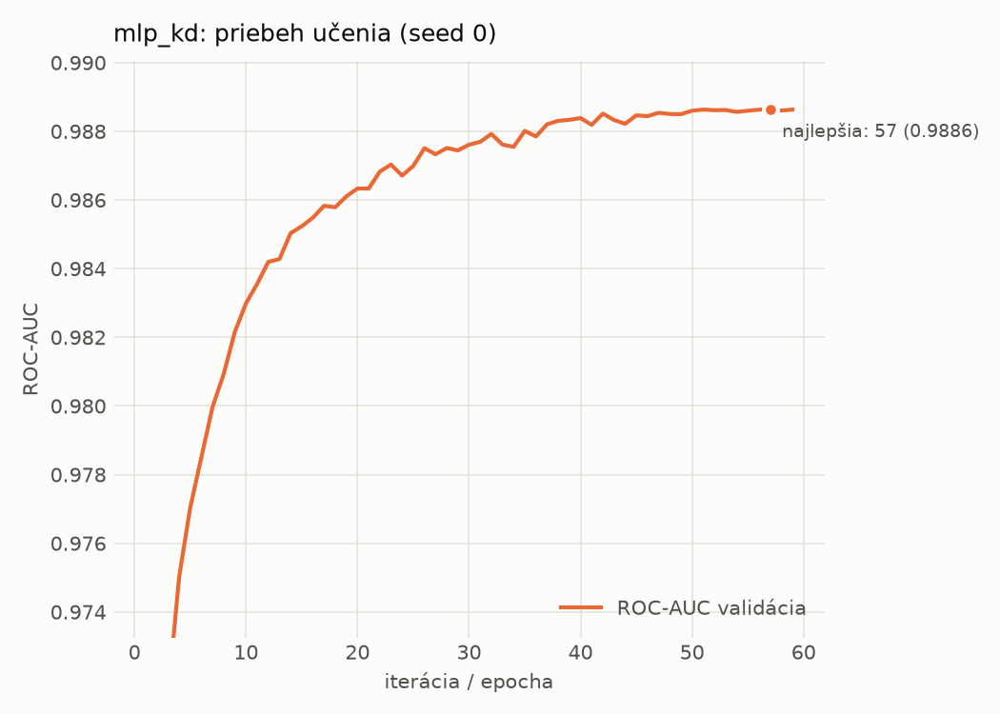

# static/mlp_kd – beh `20261123-212524`

> Automaticky generované (`src/training/run_tabular.py`). Konfigurácia: `config.yaml`, protokol: `protocol.yaml`.

- **Model:** `mlp` – študent – malé MLP učené destiláciou z hybridného učiteľa
- **Ladenie:** bez ladenia – hyperparametre prevzaté z `runs_v4/emu_p/full/students_static/mlp_kd/20261123-203204`
- **Finálne modely:** seedy [0, 1, 2]; hodnoty sú priemer ± smerodajná odchýlka cez seedy
- **Najlepšie hyperparametre:** `{"hidden_layers": 1, "max_epochs": 100, "patience": 8, "hidden_width": 64, "dropout": 0.0038513032258879476, "lr": 0.0011339137585789736, "weight_decay": 0.00026533084929296607, "batch_size": 1024, "kd_alpha": 0.3835611341536954, "kd_temperature": 1.7047486853284286}`

## Detekčná kvalita (bez prahu)
| metrika | train (podvzorka) | validácia | test |
|---|---|---|---|
| ROC-AUC | 0.9941 ± 0.0002 | 0.9888 ± 0.0003 | 0.9780 ± 0.0008 |
| PR-AUC | 0.9926 ± 0.0003 | 0.9842 ± 0.0005 | 0.9773 ± 0.0006 |
| TPR pri FPR 1 % | 0.9296 ± 0.0028 | 0.8958 ± 0.0037 | 0.7846 ± 0.0080 |
| TPR pri FPR 0,1 % | 0.8539 ± 0.0098 | 0.6974 ± 0.0493 | 0.5802 ± 0.0257 |
| log loss | 0.0868 ± 0.0024 | 0.1283 ± 0.0020 | 0.2315 ± 0.0050 |
| Brier skóre | 0.0241 ± 0.0006 | 0.0324 ± 0.0006 | 0.0579 ± 0.0016 |

Rozdiel ROC-AUC train − validácia: **0.0053** (veľký rozdiel = preučenie).

## Pri prahu z validácie (FPR ≤ 1% na validácii)
| metrika | train (podvzorka) | validácia | test |
|---|---|---|---|
| accuracy | 0.9609 ± 0.0002 | 0.9539 ± 0.0014 | 0.8909 ± 0.0011 |
| balanced accuracy | 0.9499 ± 0.0002 | 0.9432 ± 0.0018 | 0.8793 ± 0.0013 |
| precision | 0.9916 ± 0.0008 | 0.9835 ± 0.0001 | 0.9863 ± 0.0005 |
| recall (TPR) | 0.9044 ± 0.0003 | 0.8958 ± 0.0037 | 0.7672 ± 0.0029 |
| FPR | 0.0047 ± 0.0004 | 0.0095 ± 0.0000 | 0.0086 ± 0.0004 |
| F1 | 0.9460 ± 0.0003 | 0.9376 ± 0.0020 | 0.8631 ± 0.0017 |
| MCC | 0.9178 ± 0.0005 | 0.9037 ± 0.0029 | 0.7916 ± 0.0019 |

## Pri pevnom prahu 0.5
| metrika | train (podvzorka) | validácia | test |
|---|---|---|---|
| accuracy | 0.9681 ± 0.0005 | 0.9588 ± 0.0015 | 0.9270 ± 0.0037 |
| balanced accuracy | 0.9645 ± 0.0005 | 0.9560 ± 0.0013 | 0.9214 ± 0.0041 |
| precision | 0.9653 ± 0.0008 | 0.9496 ± 0.0030 | 0.9656 ± 0.0004 |
| recall (TPR) | 0.9499 ± 0.0007 | 0.9437 ± 0.0009 | 0.8680 ± 0.0081 |
| FPR | 0.0208 ± 0.0005 | 0.0316 ± 0.0020 | 0.0251 ± 0.0002 |
| F1 | 0.9575 ± 0.0006 | 0.9466 ± 0.0018 | 0.9142 ± 0.0047 |
| MCC | 0.9320 ± 0.0010 | 0.9131 ± 0.0031 | 0.8546 ± 0.0070 |

## Výpočtové nároky (seed 0, testovacia množina)
| meranie | hodnota |
|---|---|
| tréning finálneho modelu | 4.1 s (priemer cez seedy) |
| ladenie spolu | 0 s |
| počet parametrov / uzlov | 10 689 |
| veľkosť modelu na disku | 0.05 MB |
| transformácia vstupu – latencia (1 vlákno) | 0.007 ms |
| transformácia vstupu – priepustnosť | 872 100 vzoriek/s |
| CPU latencia modelu (batch 1, 1 vlákno) | 0.150 ms (p95 0.161) |
| CPU priepustnosť (24 vlákien) | 4 224 440 vzoriek/s |
| GPU latencia (batch 1) | 0.441 ms (p95 0.464) |
| GPU priepustnosť | 1 925 101 vzoriek/s |
| GPU špičková pamäť | 59 MB |

## Grafy
| | |
|---|---|
|  |  |
|  |  |
|  |  |
|  |  |

## Súbory
`metrics.json` (všetky metriky po seedoch vrátane rodín), `timing.json`, `hpo_trials.csv`,
`predictions/<časť>_seed<N>.parquet` (sha256, family, label, score), `model/seed_<N>/`, `log.txt`.
