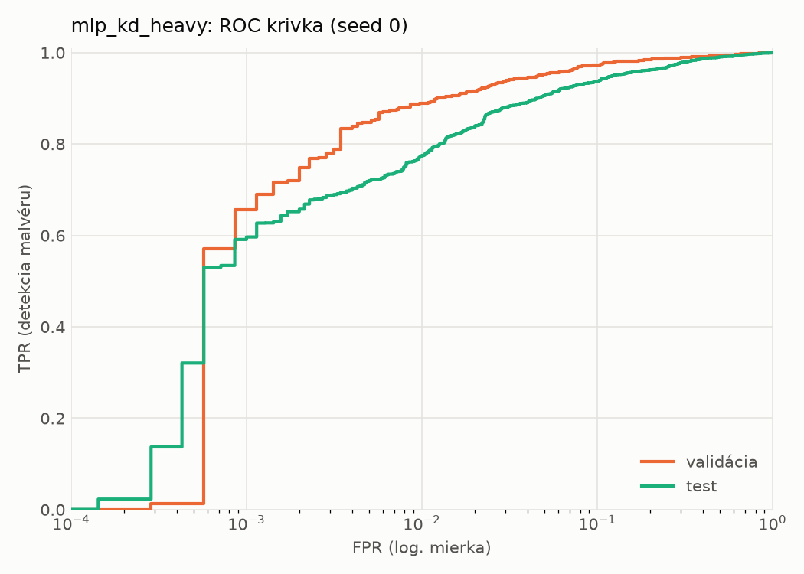
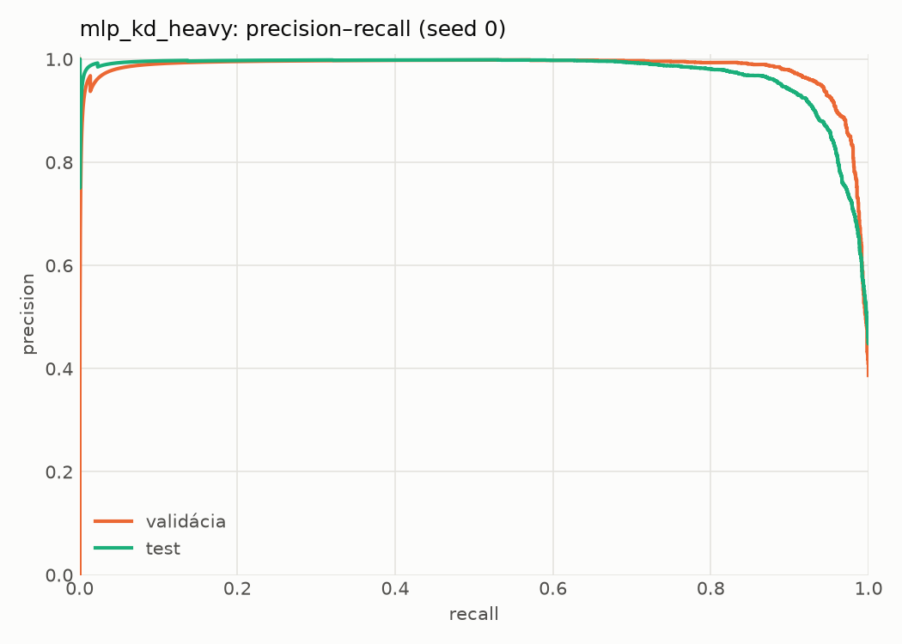
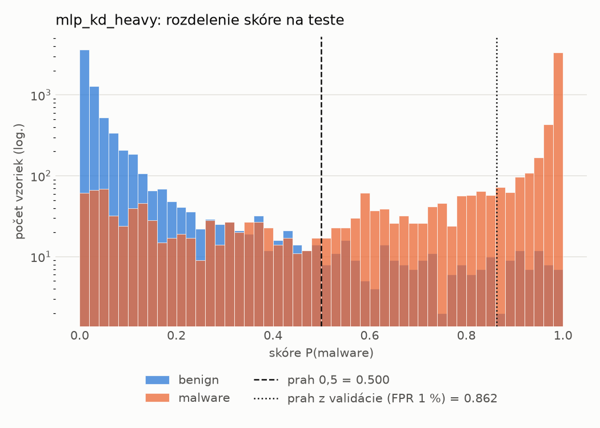
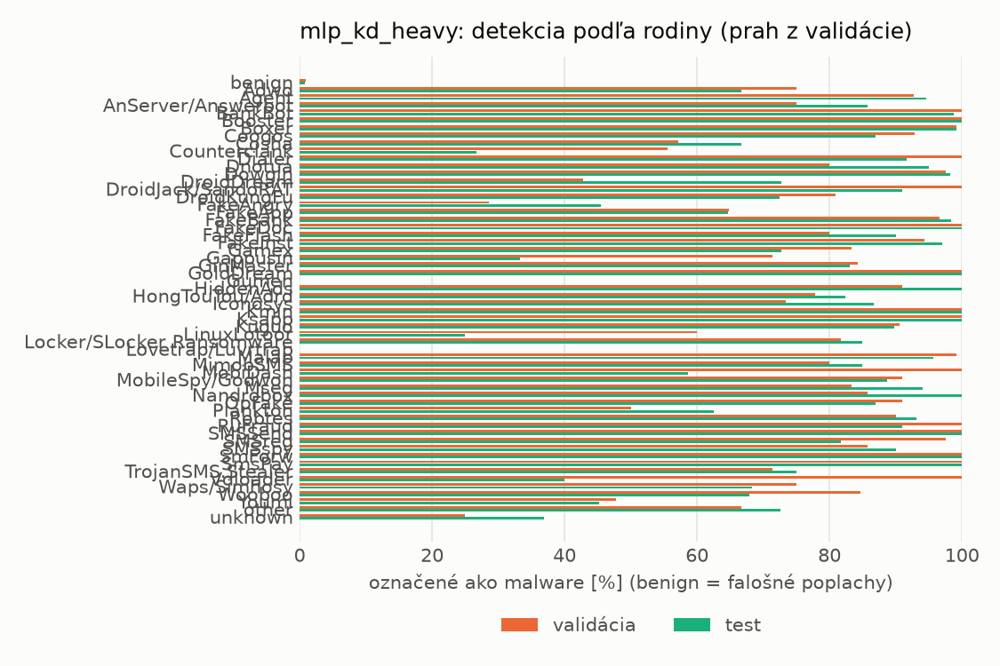
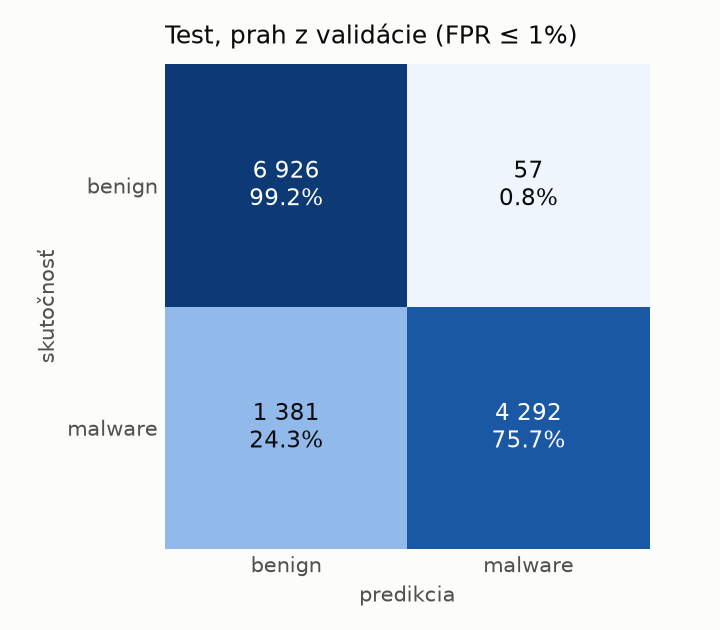
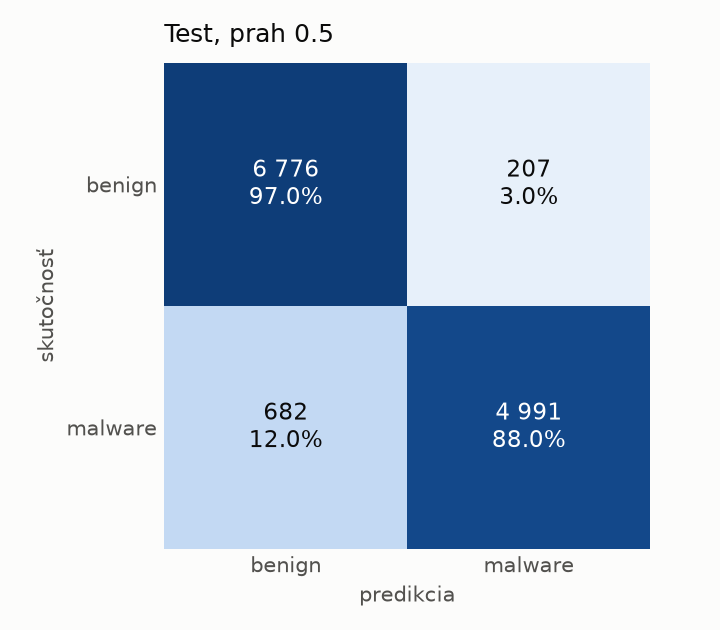
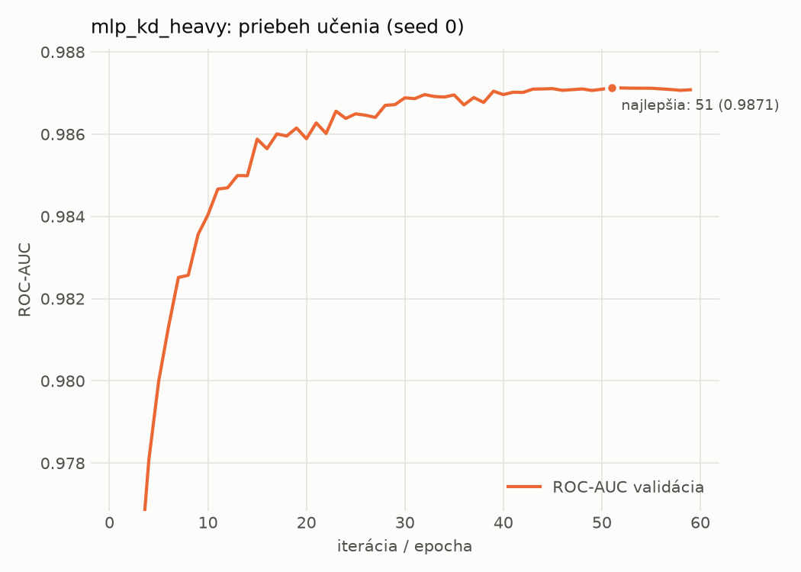

# static/mlp_kd_heavy – beh `20261123-212630`

> Automaticky generované (`src/training/run_tabular.py`). Konfigurácia: `config.yaml`, protokol: `protocol.yaml`.

- **Model:** `mlp` – študent – malé MLP učené destiláciou z mlp_large hybridu (V4)
- **Ladenie:** bez ladenia – hyperparametre prevzaté z `runs_v4/emu_p/full/students_static/mlp_kd_heavy/20261123-204329`
- **Finálne modely:** seedy [0, 1, 2]; hodnoty sú priemer ± smerodajná odchýlka cez seedy
- **Najlepšie hyperparametre:** `{"hidden_layers": 1, "max_epochs": 100, "patience": 8, "hidden_width": 64, "dropout": 0.1254973730751401, "lr": 0.0014439667191275393, "weight_decay": 1.2808340108243318e-06, "batch_size": 1024, "kd_alpha": 0.5142654341824873, "kd_temperature": 1.3883261824077338}`

## Detekčná kvalita (bez prahu)
| metrika | train (podvzorka) | validácia | test |
|---|---|---|---|
| ROC-AUC | 0.9931 ± 0.0005 | 0.9873 ± 0.0005 | 0.9759 ± 0.0008 |
| PR-AUC | 0.9902 ± 0.0024 | 0.9810 ± 0.0005 | 0.9750 ± 0.0011 |
| TPR pri FPR 1 % | 0.9187 ± 0.0017 | 0.8911 ± 0.0064 | 0.7847 ± 0.0122 |
| TPR pri FPR 0,1 % | 0.8147 ± 0.0148 | 0.6550 ± 0.0030 | 0.5742 ± 0.0230 |
| log loss | 0.0994 ± 0.0029 | 0.1283 ± 0.0024 | 0.1923 ± 0.0050 |
| Brier skóre | 0.0265 ± 0.0006 | 0.0343 ± 0.0006 | 0.0546 ± 0.0012 |

Rozdiel ROC-AUC train − validácia: **0.0058** (veľký rozdiel = preučenie).

## Pri prahu z validácie (FPR ≤ 1% na validácii)
| metrika | train (podvzorka) | validácia | test |
|---|---|---|---|
| accuracy | 0.9586 ± 0.0012 | 0.9520 ± 0.0023 | 0.8897 ± 0.0043 |
| balanced accuracy | 0.9471 ± 0.0015 | 0.9408 ± 0.0031 | 0.8779 ± 0.0049 |
| precision | 0.9903 ± 0.0005 | 0.9833 ± 0.0005 | 0.9864 ± 0.0005 |
| recall (TPR) | 0.8995 ± 0.0029 | 0.8911 ± 0.0064 | 0.7644 ± 0.0101 |
| FPR | 0.0054 ± 0.0002 | 0.0096 ± 0.0003 | 0.0086 ± 0.0004 |
| F1 | 0.9427 ± 0.0017 | 0.9349 ± 0.0034 | 0.8613 ± 0.0063 |
| MCC | 0.9130 ± 0.0025 | 0.8998 ± 0.0047 | 0.7895 ± 0.0077 |

## Pri pevnom prahu 0.5
| metrika | train (podvzorka) | validácia | test |
|---|---|---|---|
| accuracy | 0.9657 ± 0.0010 | 0.9561 ± 0.0005 | 0.9300 ± 0.0003 |
| balanced accuracy | 0.9634 ± 0.0011 | 0.9537 ± 0.0005 | 0.9254 ± 0.0004 |
| precision | 0.9559 ± 0.0010 | 0.9433 ± 0.0005 | 0.9594 ± 0.0008 |
| recall (TPR) | 0.9535 ± 0.0016 | 0.9431 ± 0.0007 | 0.8812 ± 0.0012 |
| FPR | 0.0268 ± 0.0006 | 0.0357 ± 0.0003 | 0.0303 ± 0.0006 |
| F1 | 0.9547 ± 0.0013 | 0.9432 ± 0.0006 | 0.9186 ± 0.0004 |
| MCC | 0.9272 ± 0.0020 | 0.9074 ± 0.0010 | 0.8598 ± 0.0005 |

## Výpočtové nároky (seed 0, testovacia množina)
| meranie | hodnota |
|---|---|
| tréning finálneho modelu | 3.1 s (priemer cez seedy) |
| ladenie spolu | 0 s |
| počet parametrov / uzlov | 10 689 |
| veľkosť modelu na disku | 0.05 MB |
| transformácia vstupu – latencia (1 vlákno) | 0.015 ms |
| transformácia vstupu – priepustnosť | 730 961 vzoriek/s |
| CPU latencia modelu (batch 1, 1 vlákno) | 0.152 ms (p95 0.161) |
| CPU priepustnosť (24 vlákien) | 5 037 214 vzoriek/s |
| GPU latencia (batch 1) | 0.446 ms (p95 0.476) |
| GPU priepustnosť | 2 589 198 vzoriek/s |
| GPU špičková pamäť | 89 MB |

## Grafy
| | |
|---|---|
|  |  |
|  |  |
|  |  |
|  |  |

## Súbory
`metrics.json` (všetky metriky po seedoch vrátane rodín), `timing.json`, `hpo_trials.csv`,
`predictions/<časť>_seed<N>.parquet` (sha256, family, label, score), `model/seed_<N>/`, `log.txt`.
