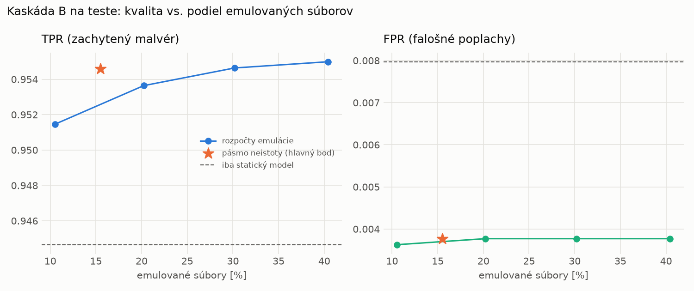

# Kaskáda B `b_baselines` – beh `20261123-222943`

> Generované `src/cascade/evaluate_b.py` (2026-11-23T22:29:44+01:00). Seedy: [0, 1, 2]; hodnoty = priemer ± sm. odchýlka.
> Všetky prahy a pásmo neistoty sú z validácie; test sa na nič nenastavuje. Postup: `docs/09_plan_v2.md`.

| rola | beh |
|---|---|
| static | `runs_v4/emu_p/lofo/BankBot/static/lightgbm/20261123-190600` |
| dynamic | `runs_v4/emu_p/lofo/BankBot/dynamic/lightgbm/20261123-221537` |
| hybrid | `runs_v4/emu_p/lofo/BankBot/hybrid/lightgbm/20261123-221915` |

Druhý stupeň: **dynamic**. Pásmo neistoty statického modelu: FPR ≤ 0.1% nad `hi`,
najviac 1% malvéru validácie pod `lo` (seed 0: lo = 0.0025, hi = 0.9997, seed 1: lo = 0.0065, hi = 0.9988, seed 2: lo = 0.0028, hi = 0.9994).

## Test
| prístup | accuracy | balanced_accuracy | precision | recall_tpr | fpr | f1 | mcc |
|---|---|---|---|---|---|---|---|
| kaskáda B | 0.9776 ± 0.0005 | 0.9754 ± 0.0005 | 0.9952 ± 0.0003 | 0.9546 ± 0.0008 | 0.0038 ± 0.0002 | 0.9744 ± 0.0005 | 0.9551 ± 0.0009 |
| statický | 0.9708 ± 0.0013 | 0.9683 ± 0.0015 | 0.9897 ± 0.0007 | 0.9447 ± 0.0033 | 0.0080 ± 0.0006 | 0.9667 ± 0.0016 | 0.9415 ± 0.0026 |
| dynamický | 0.9222 ± 0.0015 | 0.9143 ± 0.0019 | 0.9861 ± 0.0015 | 0.8382 ± 0.0048 | 0.0096 ± 0.0011 | 0.9062 ± 0.0022 | 0.8486 ± 0.0026 |
| hybrid (každá vzorka) | 0.9788 ± 0.0009 | 0.9771 ± 0.0009 | 0.9916 ± 0.0005 | 0.9608 ± 0.0016 | 0.0066 ± 0.0004 | 0.9759 ± 0.0010 | 0.9573 ± 0.0017 |

- **emulované súbory: 15.51%** (ostatné rozhodne iba statický model); na hybrid ide 3.38% súborov
- chyby pri istom rozhodnutí statického modelu (seed 0): 52
- validácia: emulované 15.15%, na hybrid 3.47%

## Validácia
| prístup | accuracy | balanced_accuracy | precision | recall_tpr | fpr | f1 | mcc |
|---|---|---|---|---|---|---|---|
| kaskáda B | 0.9755 ± 0.0002 | 0.9730 ± 0.0003 | 0.9907 ± 0.0006 | 0.9530 ± 0.0009 | 0.0070 ± 0.0004 | 0.9715 ± 0.0003 | 0.9506 ± 0.0005 |
| statický | 0.9699 ± 0.0018 | 0.9669 ± 0.0021 | 0.9870 ± 0.0002 | 0.9435 ± 0.0041 | 0.0096 ± 0.0002 | 0.9648 ± 0.0022 | 0.9392 ± 0.0036 |
| dynamický | 0.9270 ± 0.0032 | 0.9179 ± 0.0036 | 0.9854 ± 0.0001 | 0.8455 ± 0.0072 | 0.0097 ± 0.0000 | 0.9101 ± 0.0042 | 0.8563 ± 0.0060 |
| hybrid (každá vzorka) | 0.9759 ± 0.0005 | 0.9737 ± 0.0006 | 0.9874 ± 0.0004 | 0.9569 ± 0.0009 | 0.0095 ± 0.0003 | 0.9719 ± 0.0006 | 0.9511 ± 0.0010 |

## Januárové vzorky vynechanej rodiny (iba malvér → TPR)
| prístup | TPR |
|---|---|
| kaskáda B | 0.9919 ± 0.0000 |
| statický | 0.9851 ± 0.0006 |
| dynamický | 0.8562 ± 0.0016 |
| hybrid (každá vzorka) | 0.9915 ± 0.0006 |

Podiel emulovaných: 8.56%

## Krivka rozpočtu emulácie (test, priemer cez seedy)
| budget_val | emulation_rate | hybrid_rate | recall_tpr | fpr | f1 |
|---|---|---|---|---|---|
| 0.1000 | 0.1054 | 0.0322 | 0.9515 | 0.0036 | 0.9729 |
| 0.2000 | 0.2023 | 0.0457 | 0.9536 | 0.0038 | 0.9740 |
| 0.3000 | 0.3018 | 0.0540 | 0.9546 | 0.0038 | 0.9745 |
| 0.4000 | 0.4043 | 0.0603 | 0.9550 | 0.0038 | 0.9747 |

## Výpočtové nároky
Čas dynamickej analýzy (beh v emulátore alebo na zariadení) dataset neuvádza, preto sa neodhaduje. Úspora kaskády B = podiel súborov s dynamickou analýzou: **15.51%** (ostatné prístupy 100 %).

_Chýba benchmark niektorého komponentu (v zero-day behoch sa nemeria)._

