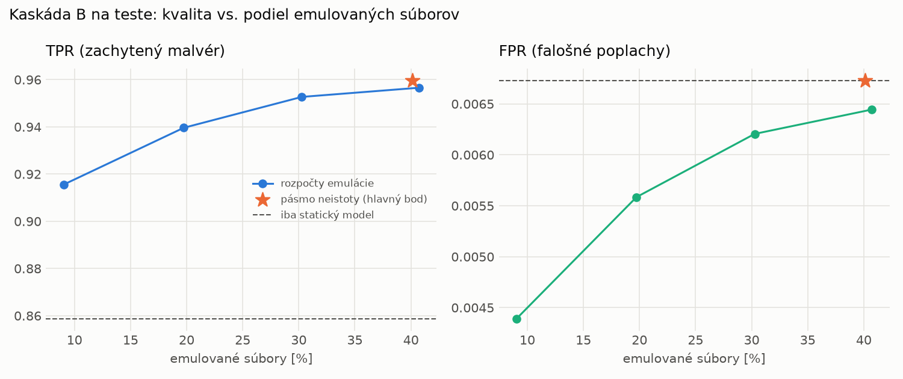

# Kaskáda B `b_direct` – beh `20261123-222940`

> Generované `src/cascade/evaluate_b.py` (2026-11-23T22:29:40+01:00). Seedy: [0, 1, 2]; hodnoty = priemer ± sm. odchýlka.
> Všetky prahy a pásmo neistoty sú z validácie; test sa na nič nenastavuje. Postup: `docs/09_plan_v2.md`.

| rola | beh |
|---|---|
| static | `runs_v4/emu_p/lofo/BankBot/students_static/mlp_kd/20261123-222615` |
| hybrid | `runs_v4/emu_p/lofo/BankBot/hybrid/lightgbm/20261123-221915` |

Druhý stupeň: **hybrid**. Pásmo neistoty statického modelu: FPR ≤ 0.1% nad `hi`,
najviac 1% malvéru validácie pod `lo` (seed 0: lo = 0.0075, hi = 0.9995, seed 1: lo = 0.0112, hi = 0.9997, seed 2: lo = 0.0081, hi = 0.9999).

## Test
| prístup | accuracy | balanced_accuracy | precision | recall_tpr | fpr | f1 | mcc |
|---|---|---|---|---|---|---|---|
| kaskáda B | 0.9782 ± 0.0010 | 0.9765 ± 0.0011 | 0.9914 ± 0.0007 | 0.9597 ± 0.0018 | 0.0067 ± 0.0006 | 0.9753 ± 0.0012 | 0.9562 ± 0.0020 |
| statický | 0.9330 ± 0.0016 | 0.9260 ± 0.0018 | 0.9904 ± 0.0009 | 0.8587 ± 0.0032 | 0.0067 ± 0.0006 | 0.9199 ± 0.0021 | 0.8693 ± 0.0031 |
| hybrid (každá vzorka) | 0.9788 ± 0.0009 | 0.9771 ± 0.0009 | 0.9916 ± 0.0005 | 0.9608 ± 0.0016 | 0.0066 ± 0.0004 | 0.9759 ± 0.0010 | 0.9573 ± 0.0017 |

- **emulované súbory: 40.10%** (ostatné rozhodne iba statický model); na hybrid ide 40.10% súborov
- chyby pri istom rozhodnutí statického modelu (seed 0): 48
- validácia: emulované 39.86%, na hybrid 39.86%

## Validácia
| prístup | accuracy | balanced_accuracy | precision | recall_tpr | fpr | f1 | mcc |
|---|---|---|---|---|---|---|---|
| kaskáda B | 0.9753 ± 0.0007 | 0.9732 ± 0.0008 | 0.9868 ± 0.0006 | 0.9563 ± 0.0013 | 0.0099 ± 0.0004 | 0.9713 ± 0.0009 | 0.9500 ± 0.0015 |
| statický | 0.9283 ± 0.0008 | 0.9194 ± 0.0009 | 0.9856 ± 0.0002 | 0.8484 ± 0.0019 | 0.0096 ± 0.0002 | 0.9119 ± 0.0010 | 0.8588 ± 0.0014 |
| hybrid (každá vzorka) | 0.9759 ± 0.0005 | 0.9737 ± 0.0006 | 0.9874 ± 0.0004 | 0.9569 ± 0.0009 | 0.0095 ± 0.0003 | 0.9719 ± 0.0006 | 0.9511 ± 0.0010 |

## Januárové vzorky vynechanej rodiny (iba malvér → TPR)
| prístup | TPR |
|---|---|
| kaskáda B | 0.9915 ± 0.0006 |
| statický | 0.9621 ± 0.0175 |
| hybrid (každá vzorka) | 0.9915 ± 0.0006 |

Podiel emulovaných: 52.93%

## Krivka rozpočtu emulácie (test, priemer cez seedy)
| budget_val | emulation_rate | hybrid_rate | recall_tpr | fpr | f1 |
|---|---|---|---|---|---|
| 0.1000 | 0.0904 | 0.0904 | 0.9156 | 0.0044 | 0.9532 |
| 0.2000 | 0.1973 | 0.1973 | 0.9396 | 0.0056 | 0.9654 |
| 0.3000 | 0.3027 | 0.3027 | 0.9527 | 0.0062 | 0.9720 |
| 0.4000 | 0.4070 | 0.4070 | 0.9566 | 0.0064 | 0.9739 |

## Výpočtové nároky
Čas dynamickej analýzy (beh v emulátore alebo na zariadení) dataset neuvádza, preto sa neodhaduje. Úspora kaskády B = podiel súborov s dynamickou analýzou: **40.10%** (ostatné prístupy 100 %).

_Chýba benchmark niektorého komponentu (v zero-day behoch sa nemeria)._

