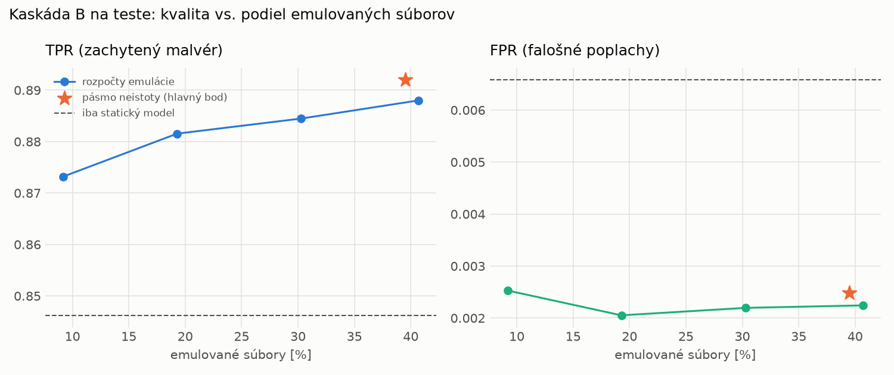

# Kaskáda B `b_heavyteacher` – beh `20261123-222947`

> Generované `src/cascade/evaluate_b.py` (2026-11-23T22:29:47+01:00). Seedy: [0, 1, 2]; hodnoty = priemer ± sm. odchýlka.
> Všetky prahy a pásmo neistoty sú z validácie; test sa na nič nenastavuje. Postup: `docs/09_plan_v2.md`.

| rola | beh |
|---|---|
| static | `runs_v4/emu_p/lofo/BankBot/students_static/mlp_kd_heavy/20261123-222720` |
| dynamic | `runs_v4/emu_p/lofo/BankBot/students_dynamic/mlp_kd_heavy/20261123-222902` |
| hybrid | `runs_v4/emu_p/lofo/BankBot/hybrid/lightgbm/20261123-221915` |

Druhý stupeň: **dynamic**. Pásmo neistoty statického modelu: FPR ≤ 0.1% nad `hi`,
najviac 1% malvéru validácie pod `lo` (seed 0: lo = 0.0395, hi = 0.9966, seed 1: lo = 0.0338, hi = 0.9951, seed 2: lo = 0.0341, hi = 0.9945).

## Test
| prístup | accuracy | balanced_accuracy | precision | recall_tpr | fpr | f1 | mcc |
|---|---|---|---|---|---|---|---|
| kaskáda B | 0.9502 ± 0.0009 | 0.9448 ± 0.0011 | 0.9966 ± 0.0001 | 0.8921 ± 0.0022 | 0.0025 ± 0.0001 | 0.9414 ± 0.0012 | 0.9026 ± 0.0018 |
| statický | 0.9274 ± 0.0017 | 0.9198 ± 0.0020 | 0.9905 ± 0.0009 | 0.8462 ± 0.0046 | 0.0066 ± 0.0007 | 0.9127 ± 0.0023 | 0.8590 ± 0.0030 |
| dynamický | 0.8137 ± 0.0046 | 0.7932 ± 0.0050 | 0.9836 ± 0.0024 | 0.5943 ± 0.0090 | 0.0080 ± 0.0011 | 0.7409 ± 0.0077 | 0.6561 ± 0.0086 |
| hybrid (každá vzorka) | 0.9788 ± 0.0009 | 0.9771 ± 0.0009 | 0.9916 ± 0.0005 | 0.9608 ± 0.0016 | 0.0066 ± 0.0004 | 0.9759 ± 0.0010 | 0.9573 ± 0.0017 |

- **emulované súbory: 39.49%** (ostatné rozhodne iba statický model); na hybrid ide 9.18% súborov
- chyby pri istom rozhodnutí statického modelu (seed 0): 47
- validácia: emulované 39.16%, na hybrid 9.91%

## Validácia
| prístup | accuracy | balanced_accuracy | precision | recall_tpr | fpr | f1 | mcc |
|---|---|---|---|---|---|---|---|
| kaskáda B | 0.9477 ± 0.0022 | 0.9407 ± 0.0026 | 0.9942 ± 0.0008 | 0.8854 ± 0.0057 | 0.0040 ± 0.0006 | 0.9367 ± 0.0029 | 0.8967 ± 0.0041 |
| statický | 0.9217 ± 0.0038 | 0.9119 ± 0.0043 | 0.9853 ± 0.0003 | 0.8334 ± 0.0086 | 0.0096 ± 0.0002 | 0.9030 ± 0.0051 | 0.8465 ± 0.0071 |
| dynamický | 0.8136 ± 0.0037 | 0.7882 ± 0.0043 | 0.9790 ± 0.0003 | 0.5861 ± 0.0085 | 0.0097 ± 0.0000 | 0.7332 ± 0.0067 | 0.6504 ± 0.0066 |
| hybrid (každá vzorka) | 0.9759 ± 0.0005 | 0.9737 ± 0.0006 | 0.9874 ± 0.0004 | 0.9569 ± 0.0009 | 0.0095 ± 0.0003 | 0.9719 ± 0.0006 | 0.9511 ± 0.0010 |

## Januárové vzorky vynechanej rodiny (iba malvér → TPR)
| prístup | TPR |
|---|---|
| kaskáda B | 0.9746 ± 0.0220 |
| statický | 0.9591 ± 0.0375 |
| dynamický | 0.7949 ± 0.0371 |
| hybrid (každá vzorka) | 0.9915 ± 0.0006 |

Podiel emulovaných: 45.92%

## Krivka rozpočtu emulácie (test, priemer cez seedy)
| budget_val | emulation_rate | hybrid_rate | recall_tpr | fpr | f1 |
|---|---|---|---|---|---|
| 0.1000 | 0.0918 | 0.0430 | 0.8732 | 0.0025 | 0.9308 |
| 0.2000 | 0.1928 | 0.0790 | 0.8815 | 0.0021 | 0.9358 |
| 0.3000 | 0.3029 | 0.1077 | 0.8845 | 0.0022 | 0.9374 |
| 0.4000 | 0.4068 | 0.1322 | 0.8880 | 0.0022 | 0.9393 |

## Výpočtové nároky
Čas dynamickej analýzy (beh v emulátore alebo na zariadení) dataset neuvádza, preto sa neodhaduje. Úspora kaskády B = podiel súborov s dynamickou analýzou: **39.49%** (ostatné prístupy 100 %).

_Chýba benchmark niektorého komponentu (v zero-day behoch sa nemeria)._

