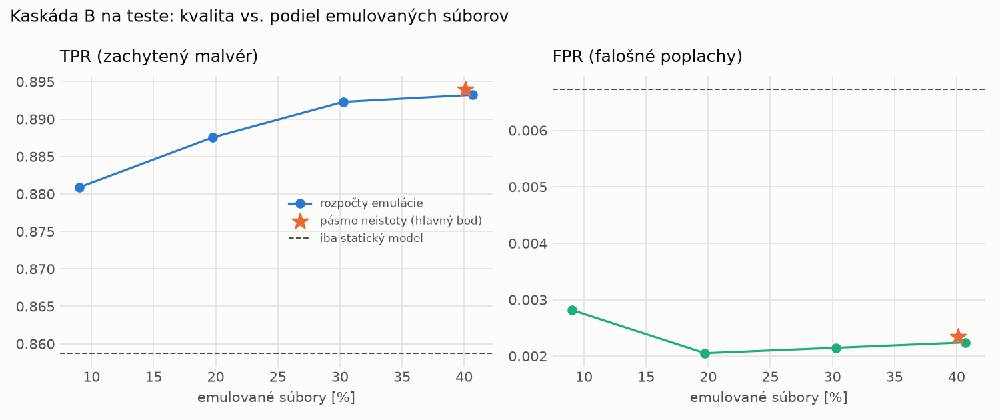

# Kaskáda B `b_main` – beh `20261123-222938`

> Generované `src/cascade/evaluate_b.py` (2026-11-23T22:29:38+01:00). Seedy: [0, 1, 2]; hodnoty = priemer ± sm. odchýlka.
> Všetky prahy a pásmo neistoty sú z validácie; test sa na nič nenastavuje. Postup: `docs/09_plan_v2.md`.

| rola | beh |
|---|---|
| static | `runs_v4/emu_p/lofo/BankBot/students_static/mlp_kd/20261123-222615` |
| dynamic | `runs_v4/emu_p/lofo/BankBot/students_dynamic/mlp_kd/20261123-222733` |
| hybrid | `runs_v4/emu_p/lofo/BankBot/hybrid/lightgbm/20261123-221915` |

Druhý stupeň: **dynamic**. Pásmo neistoty statického modelu: FPR ≤ 0.1% nad `hi`,
najviac 1% malvéru validácie pod `lo` (seed 0: lo = 0.0075, hi = 0.9995, seed 1: lo = 0.0112, hi = 0.9997, seed 2: lo = 0.0081, hi = 0.9999).

## Test
| prístup | accuracy | balanced_accuracy | precision | recall_tpr | fpr | f1 | mcc |
|---|---|---|---|---|---|---|---|
| kaskáda B | 0.9512 ± 0.0006 | 0.9458 ± 0.0006 | 0.9968 ± 0.0003 | 0.8940 ± 0.0015 | 0.0023 ± 0.0002 | 0.9426 ± 0.0007 | 0.9044 ± 0.0010 |
| statický | 0.9330 ± 0.0016 | 0.9260 ± 0.0018 | 0.9904 ± 0.0009 | 0.8587 ± 0.0032 | 0.0067 ± 0.0006 | 0.9199 ± 0.0021 | 0.8693 ± 0.0031 |
| dynamický | 0.8148 ± 0.0040 | 0.7943 ± 0.0044 | 0.9832 ± 0.0026 | 0.5970 ± 0.0090 | 0.0083 ± 0.0013 | 0.7429 ± 0.0069 | 0.6578 ± 0.0069 |
| hybrid (každá vzorka) | 0.9788 ± 0.0009 | 0.9771 ± 0.0009 | 0.9916 ± 0.0005 | 0.9608 ± 0.0016 | 0.0066 ± 0.0004 | 0.9759 ± 0.0010 | 0.9573 ± 0.0017 |

- **emulované súbory: 40.10%** (ostatné rozhodne iba statický model); na hybrid ide 10.27% súborov
- chyby pri istom rozhodnutí statického modelu (seed 0): 48
- validácia: emulované 39.86%, na hybrid 10.80%

## Validácia
| prístup | accuracy | balanced_accuracy | precision | recall_tpr | fpr | f1 | mcc |
|---|---|---|---|---|---|---|---|
| kaskáda B | 0.9489 ± 0.0008 | 0.9423 ± 0.0010 | 0.9926 ± 0.0004 | 0.8898 ± 0.0021 | 0.0052 ± 0.0003 | 0.9384 ± 0.0011 | 0.8989 ± 0.0015 |
| statický | 0.9283 ± 0.0008 | 0.9194 ± 0.0009 | 0.9856 ± 0.0002 | 0.8484 ± 0.0019 | 0.0096 ± 0.0002 | 0.9119 ± 0.0010 | 0.8588 ± 0.0014 |
| dynamický | 0.8178 ± 0.0054 | 0.7930 ± 0.0062 | 0.9794 ± 0.0004 | 0.5958 ± 0.0124 | 0.0097 ± 0.0000 | 0.7408 ± 0.0097 | 0.6580 ± 0.0097 |
| hybrid (každá vzorka) | 0.9759 ± 0.0005 | 0.9737 ± 0.0006 | 0.9874 ± 0.0004 | 0.9569 ± 0.0009 | 0.0095 ± 0.0003 | 0.9719 ± 0.0006 | 0.9511 ± 0.0010 |

## Januárové vzorky vynechanej rodiny (iba malvér → TPR)
| prístup | TPR |
|---|---|
| kaskáda B | 0.9834 ± 0.0036 |
| statický | 0.9621 ± 0.0175 |
| dynamický | 0.7807 ± 0.0067 |
| hybrid (každá vzorka) | 0.9915 ± 0.0006 |

Podiel emulovaných: 52.93%

## Krivka rozpočtu emulácie (test, priemer cez seedy)
| budget_val | emulation_rate | hybrid_rate | recall_tpr | fpr | f1 |
|---|---|---|---|---|---|
| 0.1000 | 0.0904 | 0.0432 | 0.8809 | 0.0028 | 0.9350 |
| 0.2000 | 0.1973 | 0.0746 | 0.8875 | 0.0021 | 0.9392 |
| 0.3000 | 0.3027 | 0.1085 | 0.8923 | 0.0021 | 0.9418 |
| 0.4000 | 0.4070 | 0.1293 | 0.8932 | 0.0022 | 0.9422 |

## Výpočtové nároky
Čas dynamickej analýzy (beh v emulátore alebo na zariadení) dataset neuvádza, preto sa neodhaduje. Úspora kaskády B = podiel súborov s dynamickou analýzou: **40.10%** (ostatné prístupy 100 %).

_Chýba benchmark niektorého komponentu (v zero-day behoch sa nemeria)._

