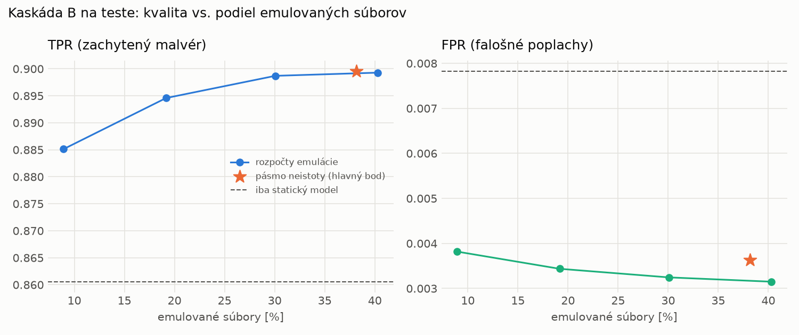

# Kaskáda B `b_nokd` – beh `20261123-222945`

> Generované `src/cascade/evaluate_b.py` (2026-11-23T22:29:45+01:00). Seedy: [0, 1, 2]; hodnoty = priemer ± sm. odchýlka.
> Všetky prahy a pásmo neistoty sú z validácie; test sa na nič nenastavuje. Postup: `docs/09_plan_v2.md`.

| rola | beh |
|---|---|
| static | `runs_v4/emu_p/lofo/BankBot/students_static/mlp_nokd/20261123-222631` |
| dynamic | `runs_v4/emu_p/lofo/BankBot/students_dynamic/mlp_nokd/20261123-222754` |
| hybrid | `runs_v4/emu_p/lofo/BankBot/hybrid/lightgbm/20261123-221915` |

Druhý stupeň: **dynamic**. Pásmo neistoty statického modelu: FPR ≤ 0.1% nad `hi`,
najviac 1% malvéru validácie pod `lo` (seed 0: lo = 0.0352, hi = 0.9998, seed 1: lo = 0.0249, hi = 0.9956, seed 2: lo = 0.0434, hi = 0.9982).

## Test
| prístup | accuracy | balanced_accuracy | precision | recall_tpr | fpr | f1 | mcc |
|---|---|---|---|---|---|---|---|
| kaskáda B | 0.9530 ± 0.0024 | 0.9480 ± 0.0026 | 0.9951 ± 0.0011 | 0.8996 ± 0.0053 | 0.0036 ± 0.0008 | 0.9449 ± 0.0029 | 0.9076 ± 0.0045 |
| statický | 0.9332 ± 0.0035 | 0.9264 ± 0.0039 | 0.9889 ± 0.0012 | 0.8606 ± 0.0082 | 0.0078 ± 0.0009 | 0.9203 ± 0.0045 | 0.8694 ± 0.0064 |
| dynamický | 0.8154 ± 0.0055 | 0.7949 ± 0.0063 | 0.9857 ± 0.0019 | 0.5968 ± 0.0134 | 0.0071 ± 0.0011 | 0.7434 ± 0.0101 | 0.6595 ± 0.0091 |
| hybrid (každá vzorka) | 0.9788 ± 0.0009 | 0.9771 ± 0.0009 | 0.9916 ± 0.0005 | 0.9608 ± 0.0016 | 0.0066 ± 0.0004 | 0.9759 ± 0.0010 | 0.9573 ± 0.0017 |

- **emulované súbory: 38.15%** (ostatné rozhodne iba statický model); na hybrid ide 8.58% súborov
- chyby pri istom rozhodnutí statického modelu (seed 0): 50
- validácia: emulované 38.45%, na hybrid 9.00%

## Validácia
| prístup | accuracy | balanced_accuracy | precision | recall_tpr | fpr | f1 | mcc |
|---|---|---|---|---|---|---|---|
| kaskáda B | 0.9506 ± 0.0037 | 0.9442 ± 0.0043 | 0.9934 ± 0.0003 | 0.8929 ± 0.0088 | 0.0046 ± 0.0003 | 0.9405 ± 0.0047 | 0.9023 ± 0.0070 |
| statický | 0.9290 ± 0.0070 | 0.9202 ± 0.0080 | 0.9859 ± 0.0005 | 0.8498 ± 0.0161 | 0.0095 ± 0.0003 | 0.9127 ± 0.0094 | 0.8602 ± 0.0132 |
| dynamický | 0.8173 ± 0.0066 | 0.7924 ± 0.0075 | 0.9795 ± 0.0008 | 0.5944 ± 0.0150 | 0.0096 ± 0.0002 | 0.7398 ± 0.0118 | 0.6571 ± 0.0118 |
| hybrid (každá vzorka) | 0.9759 ± 0.0005 | 0.9737 ± 0.0006 | 0.9874 ± 0.0004 | 0.9569 ± 0.0009 | 0.0095 ± 0.0003 | 0.9719 ± 0.0006 | 0.9511 ± 0.0010 |

## Januárové vzorky vynechanej rodiny (iba malvér → TPR)
| prístup | TPR |
|---|---|
| kaskáda B | 0.9875 ± 0.0023 |
| statický | 0.9834 ± 0.0036 |
| dynamický | 0.7201 ± 0.0287 |
| hybrid (každá vzorka) | 0.9915 ± 0.0006 |

Podiel emulovaných: 24.57%

## Krivka rozpočtu emulácie (test, priemer cez seedy)
| budget_val | emulation_rate | hybrid_rate | recall_tpr | fpr | f1 |
|---|---|---|---|---|---|
| 0.1000 | 0.0892 | 0.0418 | 0.8851 | 0.0038 | 0.9367 |
| 0.2000 | 0.1916 | 0.0694 | 0.8946 | 0.0034 | 0.9423 |
| 0.3000 | 0.3006 | 0.0905 | 0.8987 | 0.0032 | 0.9447 |
| 0.4000 | 0.4029 | 0.1039 | 0.8993 | 0.0032 | 0.9450 |

## Výpočtové nároky
Čas dynamickej analýzy (beh v emulátore alebo na zariadení) dataset neuvádza, preto sa neodhaduje. Úspora kaskády B = podiel súborov s dynamickou analýzou: **38.15%** (ostatné prístupy 100 %).

_Chýba benchmark niektorého komponentu (v zero-day behoch sa nemeria)._

