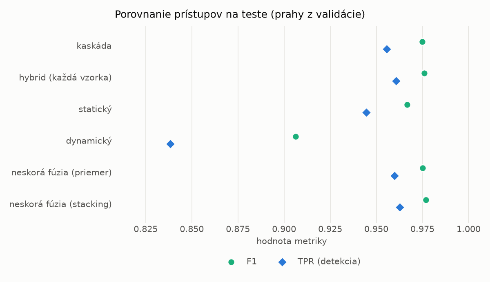
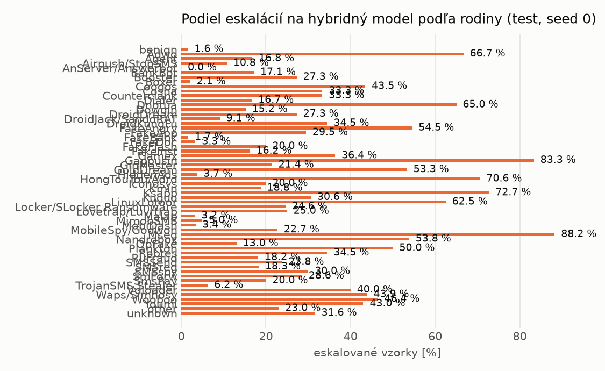

# Kaskáda `baselines` – beh `20261123-222934`

> Generované `src/cascade/evaluate.py` (2026-11-23T22:29:34+01:00). Seedy: [0, 1, 2]; hodnoty = priemer ± sm. odchýlka.
> Všetky prahy sú určené na validácii (FPR ≤ 1 %); test sa na nič nenastavuje.

| rola | beh |
|---|---|
| static | `runs_v4/emu_p/lofo/BankBot/static/lightgbm/20261123-190600` |
| dynamic | `runs_v4/emu_p/lofo/BankBot/dynamic/lightgbm/20261123-221537` |
| hybrid | `runs_v4/emu_p/lofo/BankBot/hybrid/lightgbm/20261123-221915` |

## Test
| prístup | accuracy | balanced_accuracy | precision | recall_tpr | fpr | f1 | mcc |
|---|---|---|---|---|---|---|---|
| kaskáda | 0.9780 ± 0.0005 | 0.9759 ± 0.0005 | 0.9952 ± 0.0003 | 0.9555 ± 0.0008 | 0.0038 ± 0.0002 | 0.9749 ± 0.0005 | 0.9559 ± 0.0009 |
| hybrid (každá vzorka) | 0.9788 ± 0.0009 | 0.9771 ± 0.0009 | 0.9916 ± 0.0005 | 0.9608 ± 0.0016 | 0.0066 ± 0.0004 | 0.9759 ± 0.0010 | 0.9573 ± 0.0017 |
| statický | 0.9708 ± 0.0013 | 0.9683 ± 0.0015 | 0.9897 ± 0.0007 | 0.9447 ± 0.0033 | 0.0080 ± 0.0006 | 0.9667 ± 0.0016 | 0.9415 ± 0.0026 |
| dynamický | 0.9222 ± 0.0015 | 0.9143 ± 0.0019 | 0.9861 ± 0.0015 | 0.8382 ± 0.0048 | 0.0096 ± 0.0011 | 0.9062 ± 0.0022 | 0.8486 ± 0.0026 |
| neskorá fúzia (priemer) | 0.9781 ± 0.0007 | 0.9764 ± 0.0007 | 0.9910 ± 0.0013 | 0.9599 ± 0.0009 | 0.0071 ± 0.0011 | 0.9752 ± 0.0008 | 0.9560 ± 0.0015 |
| neskorá fúzia (stacking) | 0.9796 ± 0.0002 | 0.9780 ± 0.0002 | 0.9915 ± 0.0005 | 0.9627 ± 0.0004 | 0.0067 ± 0.0004 | 0.9769 ± 0.0002 | 0.9590 ± 0.0003 |

## Validácia
| prístup | accuracy | balanced_accuracy | precision | recall_tpr | fpr | f1 | mcc |
|---|---|---|---|---|---|---|---|
| kaskáda | 0.9759 ± 0.0002 | 0.9733 ± 0.0003 | 0.9910 ± 0.0006 | 0.9534 ± 0.0009 | 0.0067 ± 0.0004 | 0.9718 ± 0.0003 | 0.9513 ± 0.0005 |
| hybrid (každá vzorka) | 0.9759 ± 0.0005 | 0.9737 ± 0.0006 | 0.9874 ± 0.0004 | 0.9569 ± 0.0009 | 0.0095 ± 0.0003 | 0.9719 ± 0.0006 | 0.9511 ± 0.0010 |
| statický | 0.9699 ± 0.0018 | 0.9669 ± 0.0021 | 0.9870 ± 0.0002 | 0.9435 ± 0.0041 | 0.0096 ± 0.0002 | 0.9648 ± 0.0022 | 0.9392 ± 0.0036 |
| dynamický | 0.9270 ± 0.0032 | 0.9179 ± 0.0036 | 0.9854 ± 0.0001 | 0.8455 ± 0.0072 | 0.0097 ± 0.0000 | 0.9101 ± 0.0042 | 0.8563 ± 0.0060 |
| neskorá fúzia (priemer) | 0.9794 ± 0.0015 | 0.9778 ± 0.0017 | 0.9872 ± 0.0000 | 0.9654 ± 0.0035 | 0.0097 ± 0.0000 | 0.9762 ± 0.0018 | 0.9582 ± 0.0031 |
| neskorá fúzia (stacking) | 0.9806 ± 0.0004 | 0.9792 ± 0.0004 | 0.9872 ± 0.0000 | 0.9681 ± 0.0009 | 0.0097 ± 0.0000 | 0.9776 ± 0.0004 | 0.9606 ± 0.0008 |

## Správanie kaskády (test, seed 0)
- podiel eskalácií na hybrid: **8.05%** (1019 vzoriek)
- chyby pri zhode študentov (kaskáda ich nemôže opraviť): **167**
  (1.435% zo zhôd; FP 3, FN 164)
- úspešnosť na eskalovaných vzorkách: hybrid 0.888125613346418, statický 0.8184494602551521,
  dynamický 0.1815505397448479  → prínos hybridu pri nezhode

## Výpočtové nároky (odhad z benchmarkov komponentov)
_Chýba benchmark niektorého komponentu (`python -m src.evaluation.benchmark`)._

