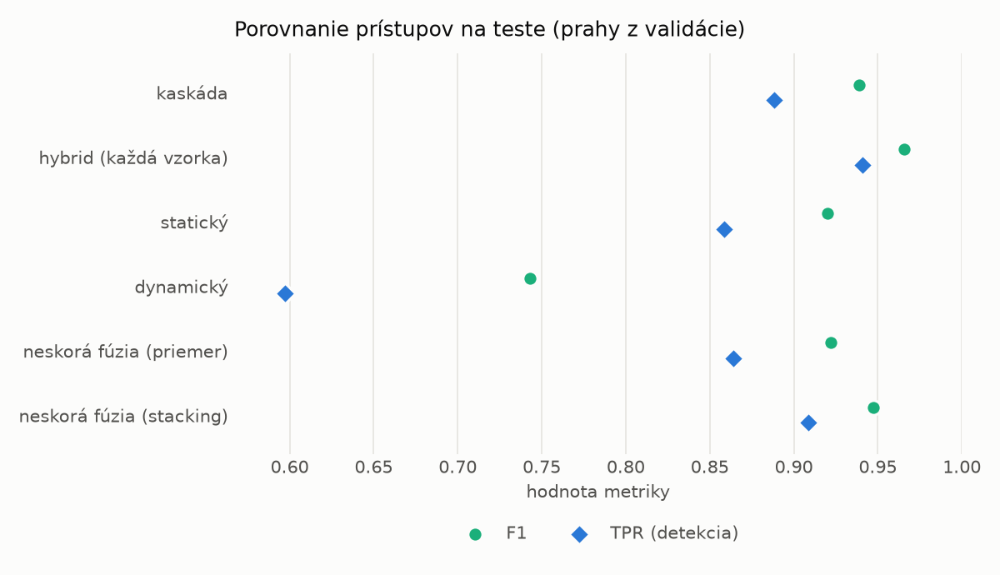
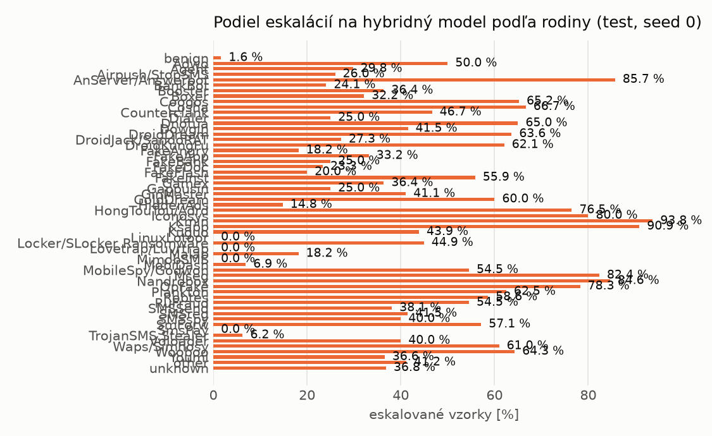

# Kaskáda `heavy` – beh `20261123-222931`

> Generované `src/cascade/evaluate.py` (2026-11-23T22:29:32+01:00). Seedy: [0, 1, 2]; hodnoty = priemer ± sm. odchýlka.
> Všetky prahy sú určené na validácii (FPR ≤ 1 %); test sa na nič nenastavuje.

| rola | beh |
|---|---|
| static | `runs_v4/emu_p/lofo/BankBot/students_static/mlp_kd/20261123-222615` |
| dynamic | `runs_v4/emu_p/lofo/BankBot/students_dynamic/mlp_kd/20261123-222733` |
| hybrid | `runs_v4/emu_p/lofo/BankBot/hybrid/mlp_large/20261123-222020` |

## Test
| prístup | accuracy | balanced_accuracy | precision | recall_tpr | fpr | f1 | mcc |
|---|---|---|---|---|---|---|---|
| kaskáda | 0.9483 ± 0.0003 | 0.9427 ± 0.0004 | 0.9959 ± 0.0014 | 0.8884 ± 0.0016 | 0.0030 ± 0.0010 | 0.9391 ± 0.0004 | 0.8989 ± 0.0005 |
| hybrid (každá vzorka) | 0.9699 ± 0.0008 | 0.9672 ± 0.0010 | 0.9916 ± 0.0018 | 0.9408 ± 0.0029 | 0.0064 ± 0.0014 | 0.9656 ± 0.0010 | 0.9399 ± 0.0015 |
| statický | 0.9330 ± 0.0016 | 0.9260 ± 0.0018 | 0.9904 ± 0.0009 | 0.8587 ± 0.0032 | 0.0067 ± 0.0006 | 0.9199 ± 0.0021 | 0.8693 ± 0.0031 |
| dynamický | 0.8148 ± 0.0040 | 0.7943 ± 0.0044 | 0.9832 ± 0.0026 | 0.5970 ± 0.0090 | 0.0083 ± 0.0013 | 0.7429 ± 0.0069 | 0.6578 ± 0.0069 |
| neskorá fúzia (priemer) | 0.9343 ± 0.0032 | 0.9277 ± 0.0037 | 0.9880 ± 0.0005 | 0.8640 ± 0.0078 | 0.0085 ± 0.0004 | 0.9218 ± 0.0042 | 0.8715 ± 0.0060 |
| neskorá fúzia (stacking) | 0.9545 ± 0.0024 | 0.9502 ± 0.0027 | 0.9891 ± 0.0009 | 0.9086 ± 0.0054 | 0.0082 ± 0.0007 | 0.9471 ± 0.0030 | 0.9099 ± 0.0047 |

## Validácia
| prístup | accuracy | balanced_accuracy | precision | recall_tpr | fpr | f1 | mcc |
|---|---|---|---|---|---|---|---|
| kaskáda | 0.9463 ± 0.0015 | 0.9394 ± 0.0016 | 0.9920 ± 0.0013 | 0.8843 ± 0.0024 | 0.0055 ± 0.0009 | 0.9351 ± 0.0019 | 0.8939 ± 0.0030 |
| hybrid (každá vzorka) | 0.9684 ± 0.0011 | 0.9652 ± 0.0012 | 0.9872 ± 0.0007 | 0.9398 ± 0.0026 | 0.0095 ± 0.0005 | 0.9629 ± 0.0013 | 0.9363 ± 0.0021 |
| statický | 0.9283 ± 0.0008 | 0.9194 ± 0.0009 | 0.9856 ± 0.0002 | 0.8484 ± 0.0019 | 0.0096 ± 0.0002 | 0.9119 ± 0.0010 | 0.8588 ± 0.0014 |
| dynamický | 0.8178 ± 0.0054 | 0.7930 ± 0.0062 | 0.9794 ± 0.0004 | 0.5958 ± 0.0124 | 0.0097 ± 0.0000 | 0.7408 ± 0.0097 | 0.6580 ± 0.0097 |
| neskorá fúzia (priemer) | 0.9365 ± 0.0037 | 0.9288 ± 0.0042 | 0.9857 ± 0.0001 | 0.8674 ± 0.0084 | 0.0097 ± 0.0000 | 0.9228 ± 0.0048 | 0.8744 ± 0.0070 |
| neskorá fúzia (stacking) | 0.9534 ± 0.0035 | 0.9481 ± 0.0040 | 0.9867 ± 0.0003 | 0.9056 ± 0.0083 | 0.0095 ± 0.0003 | 0.9444 ± 0.0044 | 0.9070 ± 0.0067 |

## Správanie kaskády (test, seed 0)
- podiel eskalácií na hybrid: **16.55%** (2094 vzoriek)
- chyby pri zhode študentov (kaskáda ich nemôže opraviť): **553**
  (5.236% zo zhôd; FP 1, FN 552)
- úspešnosť na eskalovaných vzorkách: hybrid 0.9527220630372493, statický 0.8634192932187201,
  dynamický 0.13658070678127984  → prínos hybridu pri nezhode

## Výpočtové nároky (odhad z benchmarkov komponentov)
_Chýba benchmark niektorého komponentu (`python -m src.evaluation.benchmark`)._

