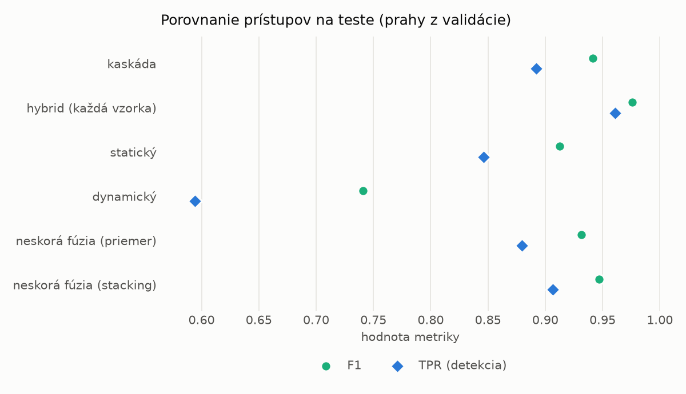
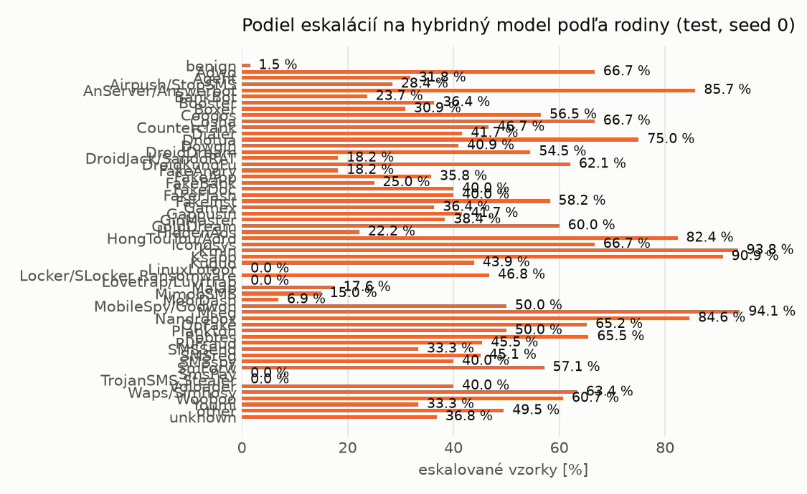

# Kaskáda `heavyteacher` – beh `20261123-222936`

> Generované `src/cascade/evaluate.py` (2026-11-23T22:29:36+01:00). Seedy: [0, 1, 2]; hodnoty = priemer ± sm. odchýlka.
> Všetky prahy sú určené na validácii (FPR ≤ 1 %); test sa na nič nenastavuje.

| rola | beh |
|---|---|
| static | `runs_v4/emu_p/lofo/BankBot/students_static/mlp_kd_heavy/20261123-222720` |
| dynamic | `runs_v4/emu_p/lofo/BankBot/students_dynamic/mlp_kd_heavy/20261123-222902` |
| hybrid | `runs_v4/emu_p/lofo/BankBot/hybrid/lightgbm/20261123-221915` |

## Test
| prístup | accuracy | balanced_accuracy | precision | recall_tpr | fpr | f1 | mcc |
|---|---|---|---|---|---|---|---|
| kaskáda | 0.9504 ± 0.0010 | 0.9450 ± 0.0011 | 0.9968 ± 0.0002 | 0.8922 ± 0.0024 | 0.0023 ± 0.0001 | 0.9416 ± 0.0013 | 0.9030 ± 0.0019 |
| hybrid (každá vzorka) | 0.9788 ± 0.0009 | 0.9771 ± 0.0009 | 0.9916 ± 0.0005 | 0.9608 ± 0.0016 | 0.0066 ± 0.0004 | 0.9759 ± 0.0010 | 0.9573 ± 0.0017 |
| statický | 0.9274 ± 0.0017 | 0.9198 ± 0.0020 | 0.9905 ± 0.0009 | 0.8462 ± 0.0046 | 0.0066 ± 0.0007 | 0.9127 ± 0.0023 | 0.8590 ± 0.0030 |
| dynamický | 0.8137 ± 0.0046 | 0.7932 ± 0.0050 | 0.9836 ± 0.0024 | 0.5943 ± 0.0090 | 0.0080 ± 0.0011 | 0.7409 ± 0.0077 | 0.6561 ± 0.0086 |
| neskorá fúzia (priemer) | 0.9420 ± 0.0032 | 0.9361 ± 0.0036 | 0.9898 ± 0.0006 | 0.8796 ± 0.0077 | 0.0074 ± 0.0005 | 0.9315 ± 0.0041 | 0.8861 ± 0.0060 |
| neskorá fúzia (stacking) | 0.9543 ± 0.0009 | 0.9498 ± 0.0009 | 0.9908 ± 0.0017 | 0.9065 ± 0.0015 | 0.0069 ± 0.0013 | 0.9468 ± 0.0011 | 0.9096 ± 0.0019 |

## Validácia
| prístup | accuracy | balanced_accuracy | precision | recall_tpr | fpr | f1 | mcc |
|---|---|---|---|---|---|---|---|
| kaskáda | 0.9478 ± 0.0023 | 0.9409 ± 0.0027 | 0.9946 ± 0.0007 | 0.8854 ± 0.0057 | 0.0037 ± 0.0005 | 0.9369 ± 0.0030 | 0.8971 ± 0.0044 |
| hybrid (každá vzorka) | 0.9759 ± 0.0005 | 0.9737 ± 0.0006 | 0.9874 ± 0.0004 | 0.9569 ± 0.0009 | 0.0095 ± 0.0003 | 0.9719 ± 0.0006 | 0.9511 ± 0.0010 |
| statický | 0.9217 ± 0.0038 | 0.9119 ± 0.0043 | 0.9853 ± 0.0003 | 0.8334 ± 0.0086 | 0.0096 ± 0.0002 | 0.9030 ± 0.0051 | 0.8465 ± 0.0071 |
| dynamický | 0.8136 ± 0.0037 | 0.7882 ± 0.0043 | 0.9790 ± 0.0003 | 0.5861 ± 0.0085 | 0.0097 ± 0.0000 | 0.7332 ± 0.0067 | 0.6504 ± 0.0066 |
| neskorá fúzia (priemer) | 0.9399 ± 0.0032 | 0.9326 ± 0.0037 | 0.9859 ± 0.0001 | 0.8750 ± 0.0074 | 0.0097 ± 0.0000 | 0.9271 ± 0.0042 | 0.8808 ± 0.0062 |
| neskorá fúzia (stacking) | 0.9499 ± 0.0008 | 0.9441 ± 0.0009 | 0.9863 ± 0.0003 | 0.8979 ± 0.0017 | 0.0096 ± 0.0002 | 0.9400 ± 0.0010 | 0.9001 ± 0.0016 |

## Správanie kaskády (test, seed 0)
- podiel eskalácií na hybrid: **17.02%** (2154 vzoriek)
- chyby pri zhode študentov (kaskáda ich nemôže opraviť): **582**
  (5.542% zo zhôd; FP 1, FN 581)
- úspešnosť na eskalovaných vzorkách: hybrid 0.9744661095636026, statický 0.8463324048282266,
  dynamický 0.15366759517177345  → prínos hybridu pri nezhode

## Výpočtové nároky (odhad z benchmarkov komponentov)
_Chýba benchmark niektorého komponentu (`python -m src.evaluation.benchmark`)._

