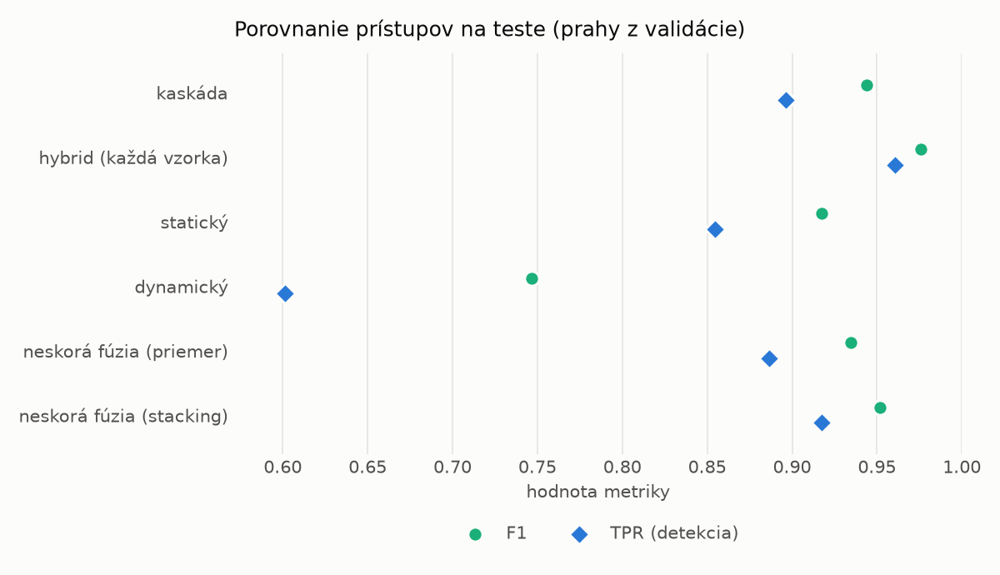
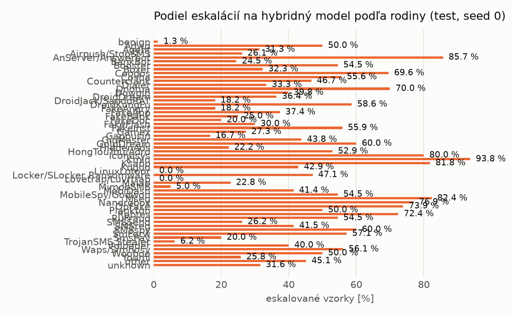

# Kaskáda `modal` – beh `20261123-222929`

> Generované `src/cascade/evaluate.py` (2026-11-23T22:29:30+01:00). Seedy: [0, 1, 2]; hodnoty = priemer ± sm. odchýlka.
> Všetky prahy sú určené na validácii (FPR ≤ 1 %); test sa na nič nenastavuje.

| rola | beh |
|---|---|
| static | `runs_v4/emu_p/lofo/BankBot/students_static/mlp_kd_modal/20261123-222656` |
| dynamic | `runs_v4/emu_p/lofo/BankBot/students_dynamic/mlp_kd_modal/20261123-222843` |
| hybrid | `runs_v4/emu_p/lofo/BankBot/hybrid/lightgbm/20261123-221915` |

## Test
| prístup | accuracy | balanced_accuracy | precision | recall_tpr | fpr | f1 | mcc |
|---|---|---|---|---|---|---|---|
| kaskáda | 0.9522 ± 0.0033 | 0.9470 ± 0.0037 | 0.9970 ± 0.0005 | 0.8961 ± 0.0072 | 0.0022 ± 0.0003 | 0.9439 ± 0.0041 | 0.9064 ± 0.0064 |
| hybrid (každá vzorka) | 0.9788 ± 0.0009 | 0.9771 ± 0.0009 | 0.9916 ± 0.0005 | 0.9608 ± 0.0016 | 0.0066 ± 0.0004 | 0.9759 ± 0.0010 | 0.9573 ± 0.0017 |
| statický | 0.9312 ± 0.0044 | 0.9240 ± 0.0051 | 0.9905 ± 0.0016 | 0.8546 ± 0.0112 | 0.0066 ± 0.0012 | 0.9176 ± 0.0058 | 0.8660 ± 0.0080 |
| dynamický | 0.8171 ± 0.0041 | 0.7969 ± 0.0047 | 0.9846 ± 0.0013 | 0.6014 ± 0.0100 | 0.0076 ± 0.0008 | 0.7467 ± 0.0074 | 0.6622 ± 0.0067 |
| neskorá fúzia (priemer) | 0.9443 ± 0.0036 | 0.9389 ± 0.0041 | 0.9880 ± 0.0006 | 0.8865 ± 0.0086 | 0.0087 ± 0.0005 | 0.9345 ± 0.0046 | 0.8903 ± 0.0067 |
| neskorá fúzia (stacking) | 0.9583 ± 0.0016 | 0.9544 ± 0.0019 | 0.9887 ± 0.0017 | 0.9174 ± 0.0051 | 0.0085 ± 0.0014 | 0.9517 ± 0.0020 | 0.9170 ± 0.0029 |

## Validácia
| prístup | accuracy | balanced_accuracy | precision | recall_tpr | fpr | f1 | mcc |
|---|---|---|---|---|---|---|---|
| kaskáda | 0.9491 ± 0.0031 | 0.9425 ± 0.0035 | 0.9934 ± 0.0011 | 0.8895 ± 0.0068 | 0.0046 ± 0.0008 | 0.9386 ± 0.0039 | 0.8994 ± 0.0060 |
| hybrid (každá vzorka) | 0.9759 ± 0.0005 | 0.9737 ± 0.0006 | 0.9874 ± 0.0004 | 0.9569 ± 0.0009 | 0.0095 ± 0.0003 | 0.9719 ± 0.0006 | 0.9511 ± 0.0010 |
| statický | 0.9263 ± 0.0057 | 0.9171 ± 0.0065 | 0.9853 ± 0.0002 | 0.8440 ± 0.0130 | 0.0097 ± 0.0000 | 0.9092 ± 0.0076 | 0.8551 ± 0.0108 |
| dynamický | 0.8189 ± 0.0059 | 0.7943 ± 0.0068 | 0.9794 ± 0.0005 | 0.5983 ± 0.0136 | 0.0097 ± 0.0000 | 0.7427 ± 0.0107 | 0.6599 ± 0.0106 |
| neskorá fúzia (priemer) | 0.9431 ± 0.0027 | 0.9363 ± 0.0030 | 0.9860 ± 0.0001 | 0.8824 ± 0.0061 | 0.0097 ± 0.0000 | 0.9313 ± 0.0034 | 0.8870 ± 0.0051 |
| neskorá fúzia (stacking) | 0.9565 ± 0.0023 | 0.9516 ± 0.0026 | 0.9867 ± 0.0005 | 0.9128 ± 0.0052 | 0.0096 ± 0.0003 | 0.9483 ± 0.0029 | 0.9129 ± 0.0045 |

## Správanie kaskády (test, seed 0)
- podiel eskalácií na hybrid: **16.66%** (2108 vzoriek)
- chyby pri zhode študentov (kaskáda ich nemôže opraviť): **573**
  (5.432% zo zhôd; FP 0, FN 573)
- úspešnosť na eskalovaných vzorkách: hybrid 0.9777039848197343, statický 0.8543643263757116,
  dynamický 0.14563567362428842  → prínos hybridu pri nezhode

## Výpočtové nároky (odhad z benchmarkov komponentov)
_Chýba benchmark niektorého komponentu (`python -m src.evaluation.benchmark`)._

