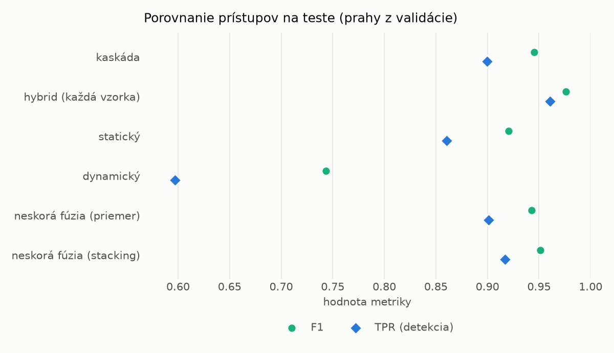
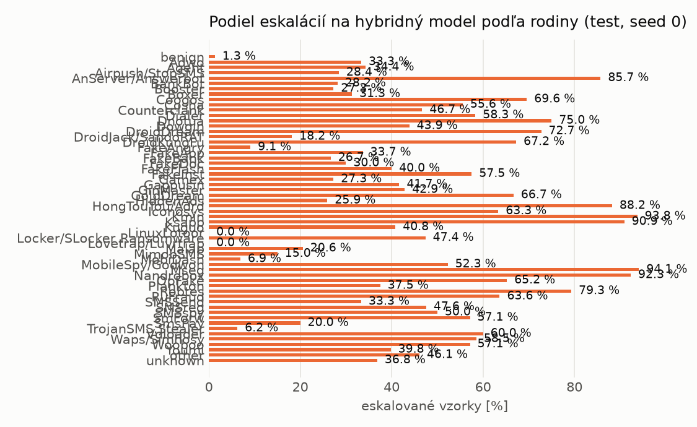

# Kaskáda `nokd` – beh `20261123-222927`

> Generované `src/cascade/evaluate.py` (2026-11-23T22:29:27+01:00). Seedy: [0, 1, 2]; hodnoty = priemer ± sm. odchýlka.
> Všetky prahy sú určené na validácii (FPR ≤ 1 %); test sa na nič nenastavuje.

| rola | beh |
|---|---|
| static | `runs_v4/emu_p/lofo/BankBot/students_static/mlp_nokd/20261123-222631` |
| dynamic | `runs_v4/emu_p/lofo/BankBot/students_dynamic/mlp_nokd/20261123-222754` |
| hybrid | `runs_v4/emu_p/lofo/BankBot/hybrid/lightgbm/20261123-221915` |

## Test
| prístup | accuracy | balanced_accuracy | precision | recall_tpr | fpr | f1 | mcc |
|---|---|---|---|---|---|---|---|
| kaskáda | 0.9535 ± 0.0022 | 0.9485 ± 0.0025 | 0.9960 ± 0.0004 | 0.8999 ± 0.0051 | 0.0030 ± 0.0003 | 0.9455 ± 0.0027 | 0.9087 ± 0.0042 |
| hybrid (každá vzorka) | 0.9788 ± 0.0009 | 0.9771 ± 0.0009 | 0.9916 ± 0.0005 | 0.9608 ± 0.0016 | 0.0066 ± 0.0004 | 0.9759 ± 0.0010 | 0.9573 ± 0.0017 |
| statický | 0.9332 ± 0.0035 | 0.9264 ± 0.0039 | 0.9889 ± 0.0012 | 0.8606 ± 0.0082 | 0.0078 ± 0.0009 | 0.9203 ± 0.0045 | 0.8694 ± 0.0064 |
| dynamický | 0.8154 ± 0.0055 | 0.7949 ± 0.0063 | 0.9857 ± 0.0019 | 0.5968 ± 0.0134 | 0.0071 ± 0.0011 | 0.7434 ± 0.0101 | 0.6595 ± 0.0091 |
| neskorá fúzia (priemer) | 0.9509 ± 0.0025 | 0.9462 ± 0.0029 | 0.9880 ± 0.0011 | 0.9013 ± 0.0064 | 0.0089 ± 0.0008 | 0.9427 ± 0.0032 | 0.9027 ± 0.0048 |
| neskorá fúzia (stacking) | 0.9580 ± 0.0024 | 0.9542 ± 0.0028 | 0.9887 ± 0.0028 | 0.9168 ± 0.0069 | 0.0085 ± 0.0022 | 0.9514 ± 0.0030 | 0.9166 ± 0.0046 |

## Validácia
| prístup | accuracy | balanced_accuracy | precision | recall_tpr | fpr | f1 | mcc |
|---|---|---|---|---|---|---|---|
| kaskáda | 0.9508 ± 0.0037 | 0.9444 ± 0.0043 | 0.9940 ± 0.0002 | 0.8929 ± 0.0087 | 0.0042 ± 0.0002 | 0.9407 ± 0.0048 | 0.9027 ± 0.0071 |
| hybrid (každá vzorka) | 0.9759 ± 0.0005 | 0.9737 ± 0.0006 | 0.9874 ± 0.0004 | 0.9569 ± 0.0009 | 0.0095 ± 0.0003 | 0.9719 ± 0.0006 | 0.9511 ± 0.0010 |
| statický | 0.9290 ± 0.0070 | 0.9202 ± 0.0080 | 0.9859 ± 0.0005 | 0.8498 ± 0.0161 | 0.0095 ± 0.0003 | 0.9127 ± 0.0094 | 0.8602 ± 0.0132 |
| dynamický | 0.8173 ± 0.0066 | 0.7924 ± 0.0075 | 0.9795 ± 0.0008 | 0.5944 ± 0.0150 | 0.0096 ± 0.0002 | 0.7398 ± 0.0118 | 0.6571 ± 0.0118 |
| neskorá fúzia (priemer) | 0.9512 ± 0.0038 | 0.9456 ± 0.0043 | 0.9864 ± 0.0003 | 0.9008 ± 0.0086 | 0.0096 ± 0.0002 | 0.9417 ± 0.0048 | 0.9026 ± 0.0073 |
| neskorá fúzia (stacking) | 0.9575 ± 0.0026 | 0.9528 ± 0.0030 | 0.9865 ± 0.0001 | 0.9153 ± 0.0060 | 0.0097 ± 0.0000 | 0.9496 ± 0.0033 | 0.9149 ± 0.0051 |

## Správanie kaskády (test, seed 0)
- podiel eskalácií na hybrid: **17.32%** (2192 vzoriek)
- chyby pri zhode študentov (kaskáda ich nemôže opraviť): **517**
  (4.941% zo zhôd; FP 1, FN 516)
- úspešnosť na eskalovaných vzorkách: hybrid 0.9698905109489051, statický 0.8667883211678832,
  dynamický 0.1332116788321168  → prínos hybridu pri nezhode

## Výpočtové nároky (odhad z benchmarkov komponentov)
_Chýba benchmark niektorého komponentu (`python -m src.evaluation.benchmark`)._

