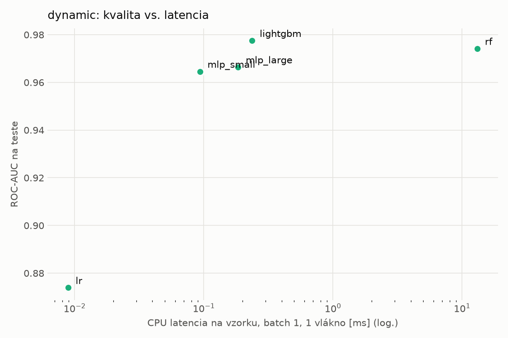
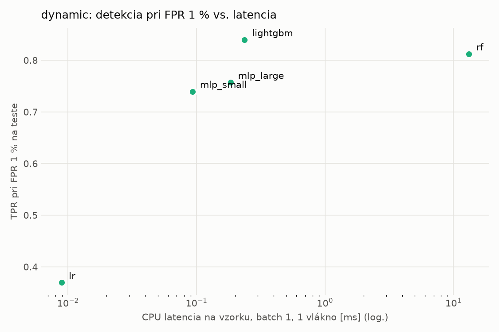
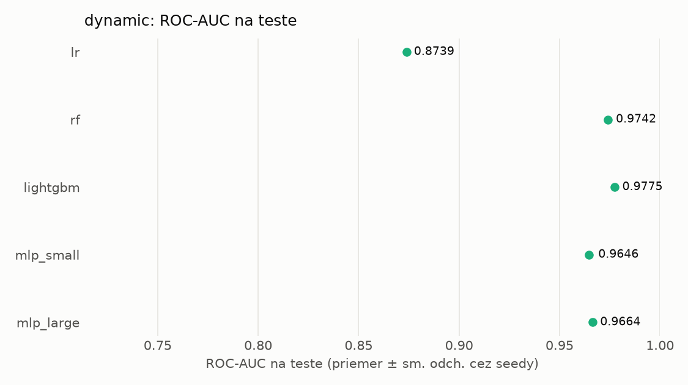
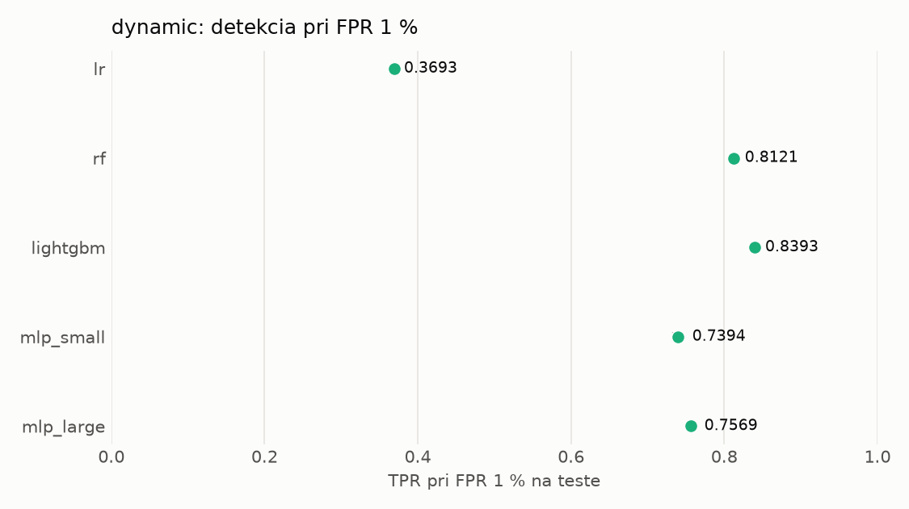

# Porovnanie modelov – dynamic

> Generované `src/evaluation/compare.py` (2026-11-23T22:19:00+01:00); použitý je posledný beh každého modelu.
> Metriky sú priemer cez seedy. \* = pri prahu určenom na validácii (FPR ≤ 1 %).
> CPU ms/vz. = medián latencie jednej vzorky na 1 vlákne vrátane transformácie vstupu (meranie hneď po tréningu,
> orientačné). Oficiálne merania spotreby sú v časti „Spotreba zdrojov pri inferencii“.

## Detekčná kvalita a orientačné časy
| model | ROC-AUC val | ROC-AUC test | TPR@FPR 1 % test | TPR@FPR 0,1 % test | F1 test* | FPR test* | gap train−val | CPU ms/vz. | CPU vz./s | GPU ms/vz. | parametre | MB | tréning s | ladenie min |
|---|---|---|---|---|---|---|---|---|---|---|---|---|---|---|
| [lr](../../dynamic/lr/20261123-221517/README.md) | 0.8716 | 0.8739 ± 0.0000 | 0.3693 | 0.1195 | 0.5397 | 0.0103 | -0.0003 | 0.009 | 4 742 917 | – | 124 | 0.01 | 0.4 | 0.0 |
| [rf](../../dynamic/rf/20261123-221520/README.md) | 0.9751 | 0.9742 ± 0.0002 | 0.8121 | 0.6691 | 0.8743 | 0.0069 | 0.0246 | 13.120 | 108 777 | – | 4 202 834 | 336.58 | 2.7 | 0.0 |
| [lightgbm](../../dynamic/lightgbm/20261123-221537/README.md) | 0.9800 | 0.9775 ± 0.0001 | 0.8393 | 0.7182 | 0.9062 | 0.0096 | 0.0199 | 0.237 | 52 523 | – | 655 525 | 36.28 | 28.6 | 0.0 |
| [mlp_small](../../dynamic/mlp_small/20261123-221731/README.md) | 0.9644 | 0.9646 ± 0.0010 | 0.7394 | 0.3861 | 0.8340 | 0.0089 | 0.0249 | 0.093 | 2 875 318 | 0.373 | 65 537 | 0.27 | 18.9 | 0.0 |
| [mlp_large](../../dynamic/mlp_large/20261123-221829/README.md) | 0.9675 | 0.9664 ± 0.0001 | 0.7569 | 0.4605 | 0.8528 | 0.0093 | 0.0263 | 0.185 | 460 036 | 0.454 | 786 945 | 3.17 | 9.5 | 0.0 |

## Nízka prevalencia malvéru (test, prah z validácie)
| model | TPR | FPR | precision @ 1 % | falošné na 1 skutočný poplach @ 1 % | precision @ 0.1 % | falošné na 1 skutočný poplach @ 0.1 % |
|---|---|---|---|---|---|---|
| lr | 0.3742 | 0.0103 | 0.268 | 2.73 | 0.035 | 27.52 |
| rf | 0.7833 | 0.0069 | 0.535 | 0.87 | 0.102 | 8.77 |
| lightgbm | 0.8382 | 0.0096 | 0.469 | 1.13 | 0.080 | 11.43 |
| mlp_small | 0.7232 | 0.0089 | 0.451 | 1.22 | 0.075 | 12.26 |
| mlp_large | 0.7519 | 0.0093 | 0.449 | 1.23 | 0.075 | 12.37 |

Prepočet: TPR a FPR nezávisia od podielu malvéru, preto sa dajú preniesť na nízku prevalenciu (v reálnej prevádzke je malvéru ~1 % alebo menej; v teste 54 %). „Falošné na 1 skutočný poplach“ = koľko neškodných súborov je označených na každý zachytený malvér.

## Spotreba zdrojov pri inferencii (benchmark, testovacia množina)
_Benchmark zatiaľ nebol spustený (`python -m src.evaluation.benchmark --approach dynamic`)._

## Grafy

