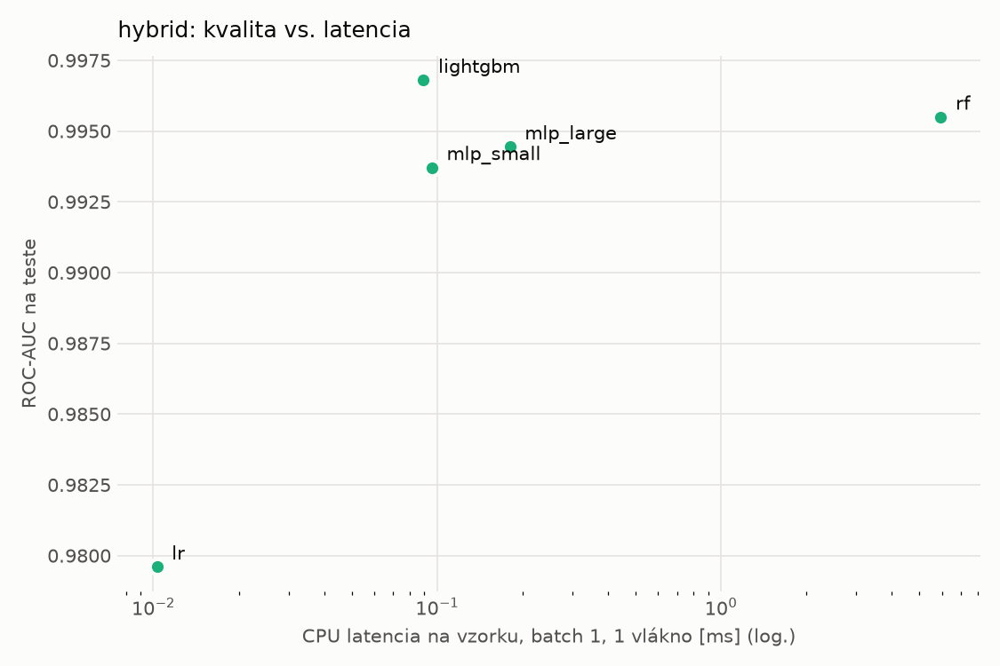
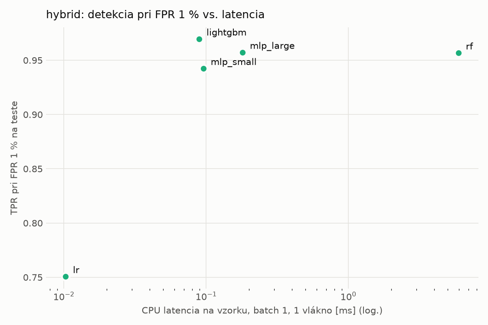
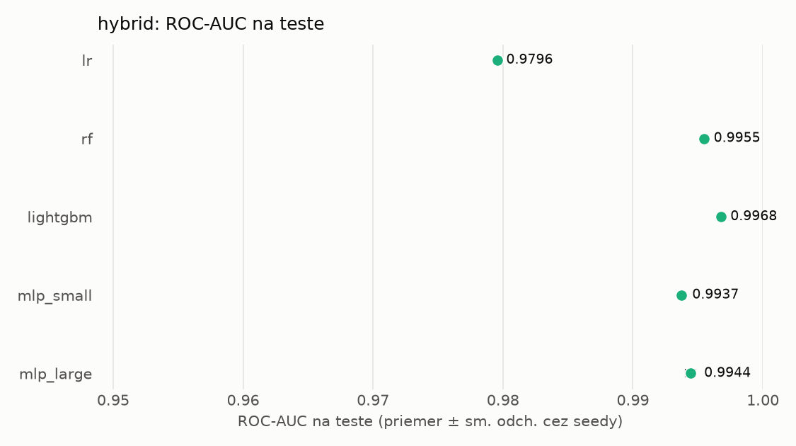
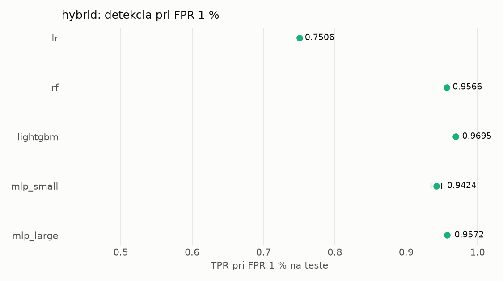

# Porovnanie modelov – hybrid

> Generované `src/evaluation/compare.py` (2026-11-23T22:20:58+01:00); použitý je posledný beh každého modelu.
> Metriky sú priemer cez seedy. \* = pri prahu určenom na validácii (FPR ≤ 1 %).
> CPU ms/vz. = medián latencie jednej vzorky na 1 vlákne vrátane transformácie vstupu (meranie hneď po tréningu,
> orientačné). Oficiálne merania spotreby sú v časti „Spotreba zdrojov pri inferencii“.

## Detekčná kvalita a orientačné časy
| model | ROC-AUC val | ROC-AUC test | TPR@FPR 1 % test | TPR@FPR 0,1 % test | F1 test* | FPR test* | gap train−val | CPU ms/vz. | CPU vz./s | GPU ms/vz. | parametre | MB | tréning s | ladenie min |
|---|---|---|---|---|---|---|---|---|---|---|---|---|---|---|
| [lr](../../hybrid/lr/20261123-221903/README.md) | 0.9773 | 0.9796 ± 0.0000 | 0.7506 | 0.4313 | 0.8386 | 0.0090 | 0.0038 | 0.010 | 2 281 635 | – | 286 | 0.01 | 0.5 | 0.0 |
| [rf](../../hybrid/rf/20261123-221906/README.md) | 0.9943 | 0.9955 ± 0.0001 | 0.9566 | 0.8897 | 0.9683 | 0.0071 | 0.0057 | 5.947 | 169 600 | – | 1 024 300 | 82.20 | 1.4 | 0.0 |
| [lightgbm](../../hybrid/lightgbm/20261123-221915/README.md) | 0.9958 | 0.9968 ± 0.0001 | 0.9695 | 0.9102 | 0.9759 | 0.0066 | 0.0042 | 0.090 | 148 078 | – | 224 175 | 12.43 | 14.5 | 0.0 |
| [mlp_small](../../hybrid/mlp_small/20261123-222008/README.md) | 0.9920 | 0.9937 ± 0.0002 | 0.9424 | 0.7841 | 0.9561 | 0.0053 | 0.0059 | 0.096 | 1 387 430 | 0.391 | 107 009 | 0.44 | 3.4 | 0.0 |
| [mlp_large](../../hybrid/mlp_large/20261123-222020/README.md) | 0.9927 | 0.9944 ± 0.0004 | 0.9572 | 0.7917 | 0.9656 | 0.0064 | 0.0058 | 0.181 | 722 271 | 0.567 | 323 009 | 1.32 | 11.7 | 0.0 |

## Nízka prevalencia malvéru (test, prah z validácie)
| model | TPR | FPR | precision @ 1 % | falošné na 1 skutočný poplach @ 1 % | precision @ 0.1 % | falošné na 1 skutočný poplach @ 0.1 % |
|---|---|---|---|---|---|---|
| lr | 0.7301 | 0.0090 | 0.450 | 1.22 | 0.075 | 12.34 |
| rf | 0.9467 | 0.0071 | 0.575 | 0.74 | 0.118 | 7.46 |
| lightgbm | 0.9608 | 0.0066 | 0.594 | 0.68 | 0.127 | 6.90 |
| mlp_small | 0.9219 | 0.0053 | 0.637 | 0.57 | 0.148 | 5.74 |
| mlp_large | 0.9408 | 0.0064 | 0.596 | 0.68 | 0.128 | 6.84 |

Prepočet: TPR a FPR nezávisia od podielu malvéru, preto sa dajú preniesť na nízku prevalenciu (v reálnej prevádzke je malvéru ~1 % alebo menej; v teste 54 %). „Falošné na 1 skutočný poplach“ = koľko neškodných súborov je označených na každý zachytený malvér.

## Spotreba zdrojov pri inferencii (benchmark, testovacia množina)
_Benchmark zatiaľ nebol spustený (`python -m src.evaluation.benchmark --approach hybrid`)._

## Grafy

