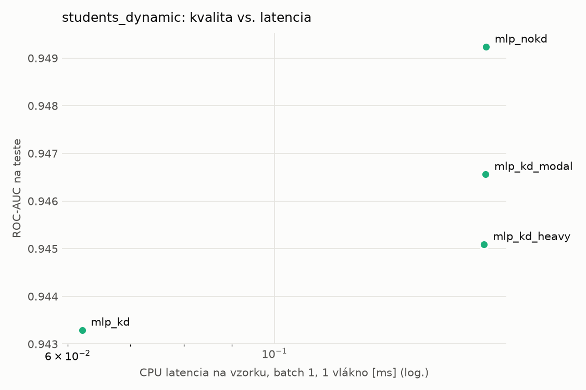
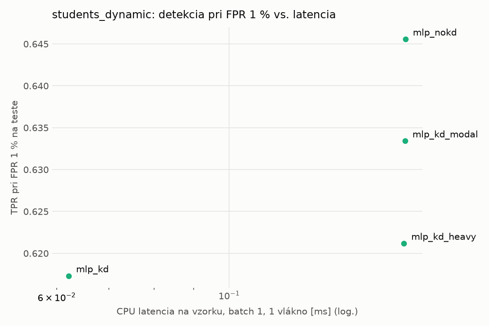
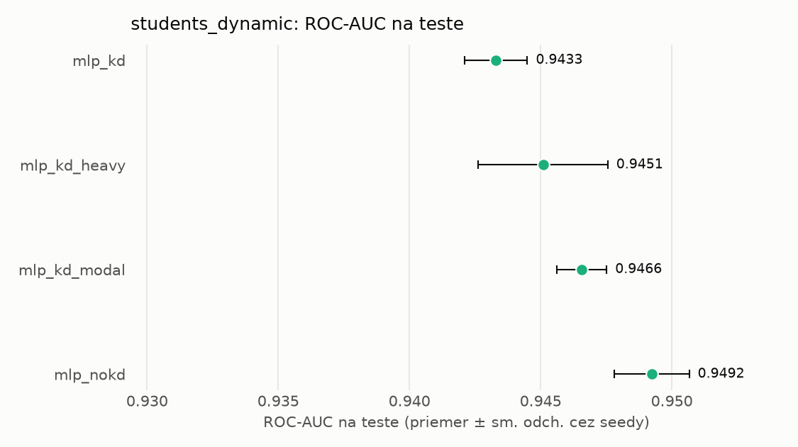
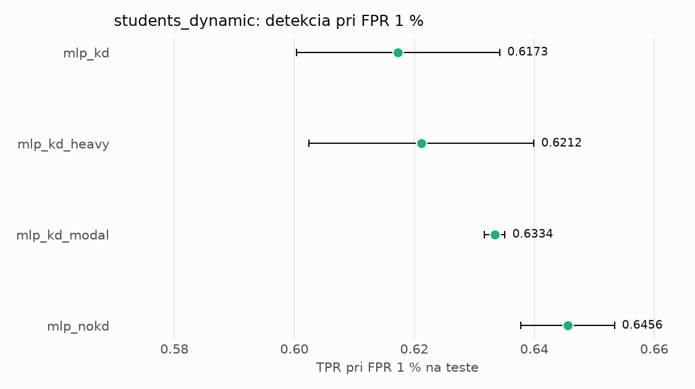

# Porovnanie modelov – students_dynamic

> Generované `src/evaluation/compare.py` (2026-11-23T22:29:22+01:00); použitý je posledný beh každého modelu.
> Metriky sú priemer cez seedy. \* = pri prahu určenom na validácii (FPR ≤ 1 %).
> CPU ms/vz. = medián latencie jednej vzorky na 1 vlákne vrátane transformácie vstupu (meranie hneď po tréningu,
> orientačné). Oficiálne merania spotreby sú v časti „Spotreba zdrojov pri inferencii“.

## Detekčná kvalita a orientačné časy
| model | ROC-AUC val | ROC-AUC test | TPR@FPR 1 % test | TPR@FPR 0,1 % test | F1 test* | FPR test* | gap train−val | CPU ms/vz. | CPU vz./s | GPU ms/vz. | parametre | MB | tréning s | ladenie min |
|---|---|---|---|---|---|---|---|---|---|---|---|---|---|---|
| [mlp_kd](../../students_dynamic/mlp_kd/20261123-222733/README.md) | 0.9447 | 0.9433 ± 0.0012 | 0.6173 | 0.3525 | 0.7429 | 0.0083 | 0.0073 | 0.062 | 7 744 462 | 0.267 | 8 129 | 0.04 | 6.4 | 0.0 |
| [mlp_kd_heavy](../../students_dynamic/mlp_kd_heavy/20261123-222902/README.md) | 0.9451 | 0.9451 ± 0.0025 | 0.6212 | 0.2693 | 0.7409 | 0.0080 | 0.0089 | 0.168 | 9 239 979 | 0.442 | 8 129 | 0.04 | 6.2 | 0.0 |
| [mlp_kd_modal](../../students_dynamic/mlp_kd_modal/20261123-222843/README.md) | 0.9475 | 0.9466 ± 0.0010 | 0.6334 | 0.3225 | 0.7467 | 0.0076 | 0.0075 | 0.169 | 5 203 733 | 0.454 | 8 129 | 0.04 | 5.6 | 0.0 |
| [mlp_nokd](../../students_dynamic/mlp_nokd/20261123-222754/README.md) | 0.9489 | 0.9492 ± 0.0014 | 0.6456 | 0.2494 | 0.7434 | 0.0071 | 0.0135 | 0.169 | 6 034 425 | 0.445 | 8 129 | 0.04 | 15.6 | 0.0 |

## Nízka prevalencia malvéru (test, prah z validácie)
| model | TPR | FPR | precision @ 1 % | falošné na 1 skutočný poplach @ 1 % | precision @ 0.1 % | falošné na 1 skutočný poplach @ 0.1 % |
|---|---|---|---|---|---|---|
| mlp_kd | 0.5970 | 0.0083 | 0.421 | 1.38 | 0.067 | 13.90 |
| mlp_kd_heavy | 0.5943 | 0.0080 | 0.428 | 1.34 | 0.069 | 13.48 |
| mlp_kd_modal | 0.6014 | 0.0076 | 0.443 | 1.26 | 0.073 | 12.69 |
| mlp_nokd | 0.5968 | 0.0071 | 0.460 | 1.17 | 0.078 | 11.83 |

Prepočet: TPR a FPR nezávisia od podielu malvéru, preto sa dajú preniesť na nízku prevalenciu (v reálnej prevádzke je malvéru ~1 % alebo menej; v teste 54 %). „Falošné na 1 skutočný poplach“ = koľko neškodných súborov je označených na každý zachytený malvér.

## Spotreba zdrojov pri inferencii (benchmark, testovacia množina)
_Benchmark zatiaľ nebol spustený (`python -m src.evaluation.benchmark --approach students_dynamic`)._

## Grafy

