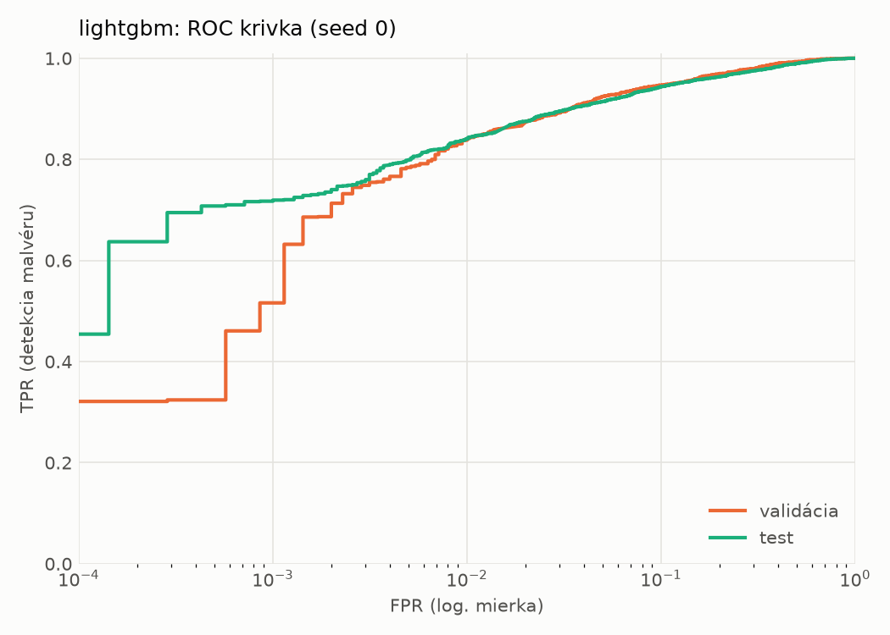
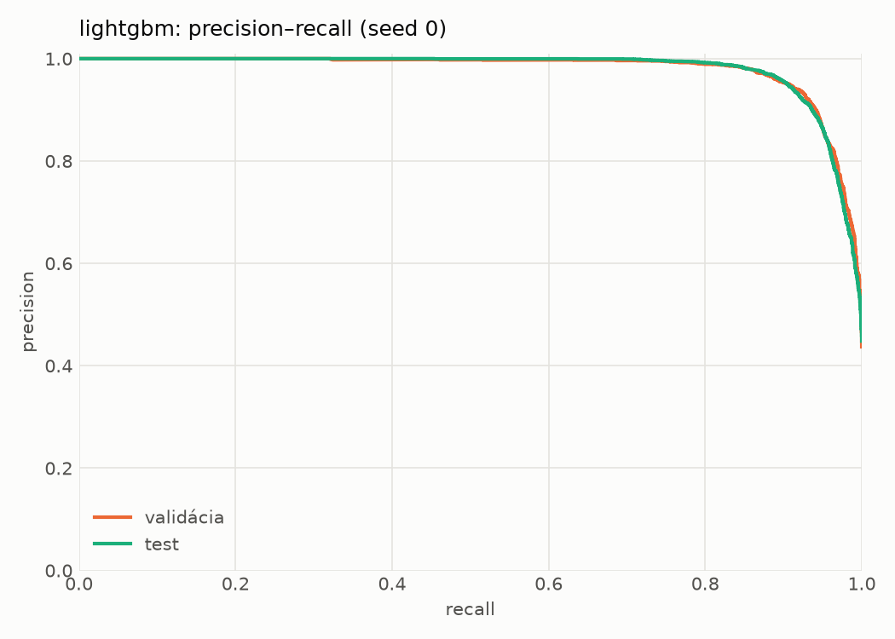
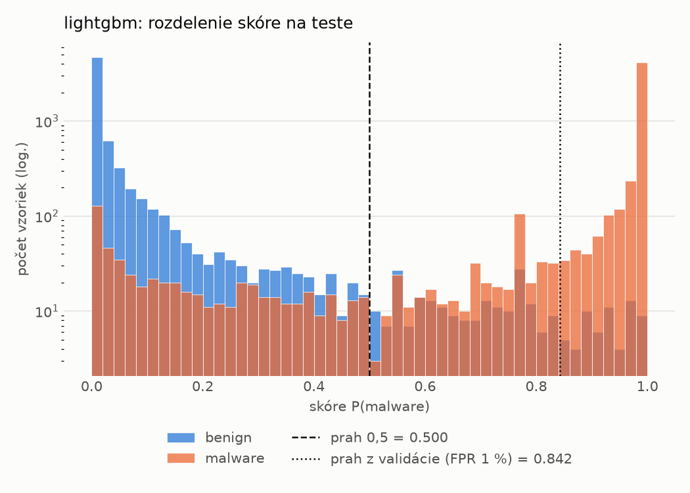
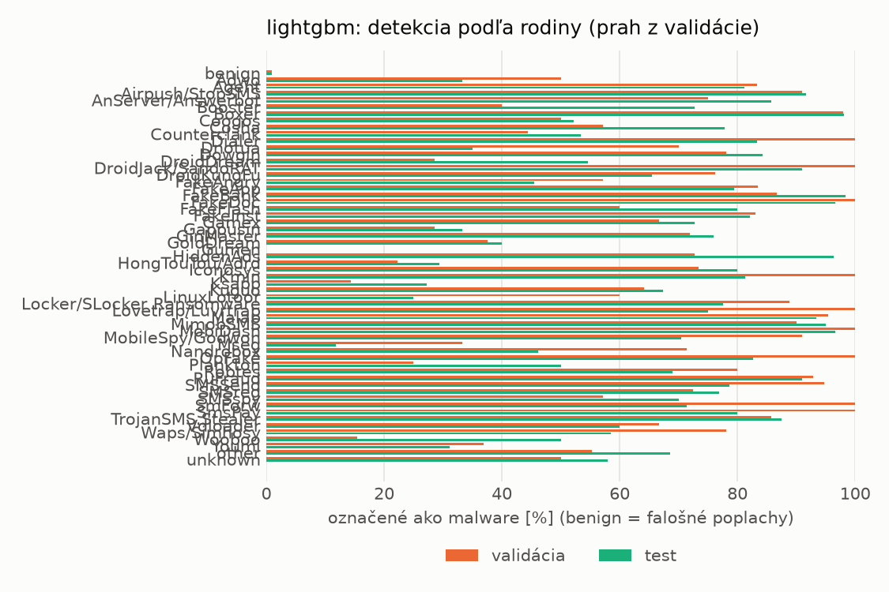
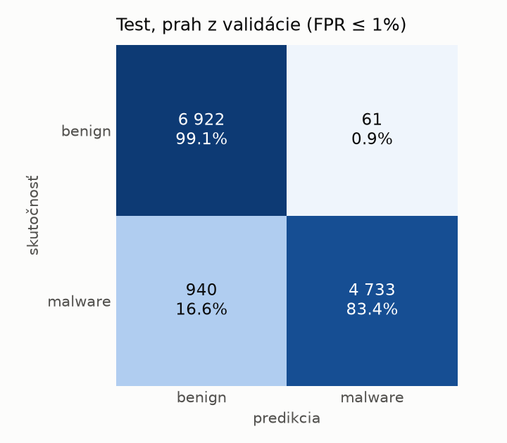
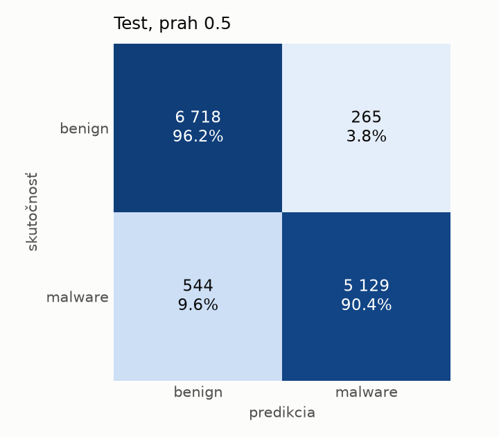
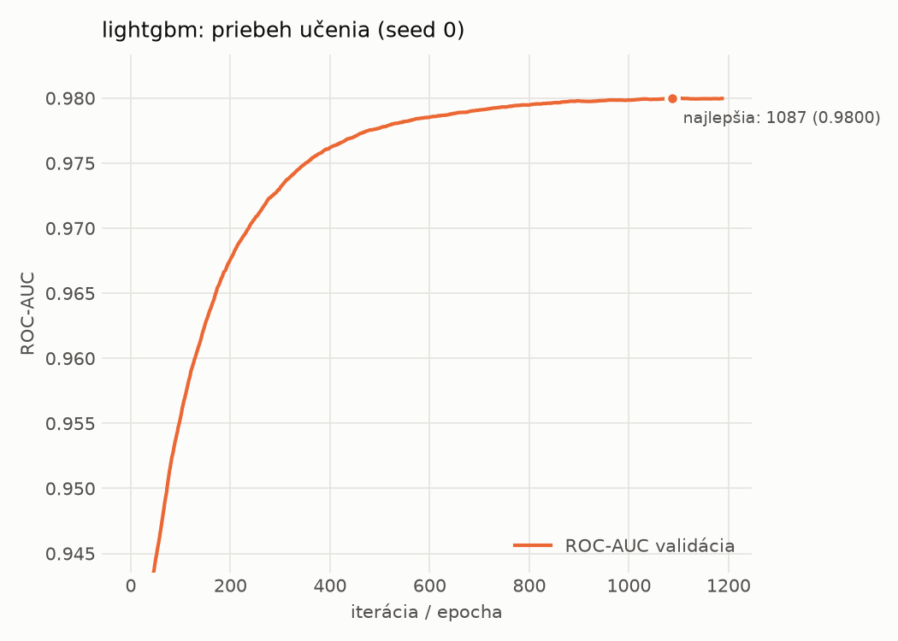

# dynamic/lightgbm – beh `20261123-221537`

> Automaticky generované (`src/training/run_tabular.py`). Konfigurácia: `config.yaml`, protokol: `protocol.yaml`.

- **Model:** `lightgbm` – LightGBM, gradient boosting stromov s early stopping na validácii (pôvodné hodnoty príznakov)
- **Ladenie:** bez ladenia – hyperparametre prevzaté z `runs_v4/emu_p/full/dynamic/lightgbm/20261123-191933`
- **Finálne modely:** seedy [0, 1, 2]; hodnoty sú priemer ± smerodajná odchýlka cez seedy
- **Najlepšie hyperparametre:** `{"num_boost_round": 5000, "early_stopping_rounds": 100, "learning_rate": 0.020757076290036595, "num_leaves": 469, "min_child_samples": 116, "feature_fraction": 0.9578728497385997, "bagging_fraction": 0.9870779948179744, "lambda_l1": 0.002495609179699052, "lambda_l2": 0.0024900497451761272}`

## Detekčná kvalita (bez prahu)
| metrika | train (podvzorka) | validácia | test |
|---|---|---|---|
| ROC-AUC | 0.9999 ± 0.0000 | 0.9800 ± 0.0001 | 0.9775 ± 0.0001 |
| PR-AUC | 0.9999 ± 0.0000 | 0.9795 ± 0.0002 | 0.9791 ± 0.0001 |
| TPR pri FPR 1 % | 0.9994 ± 0.0003 | 0.8455 ± 0.0072 | 0.8393 ± 0.0014 |
| TPR pri FPR 0,1 % | 0.9790 ± 0.0029 | 0.5042 ± 0.0292 | 0.7182 ± 0.0010 |
| log loss | 0.0172 ± 0.0054 | 0.1852 ± 0.0089 | 0.1971 ± 0.0112 |
| Brier skóre | 0.0037 ± 0.0007 | 0.0479 ± 0.0001 | 0.0505 ± 0.0006 |

Rozdiel ROC-AUC train − validácia: **0.0199** (veľký rozdiel = preučenie).

## Pri prahu z validácie (FPR ≤ 1% na validácii)
| metrika | train (podvzorka) | validácia | test |
|---|---|---|---|
| accuracy | 0.9881 ± 0.0027 | 0.9270 ± 0.0032 | 0.9222 ± 0.0015 |
| balanced accuracy | 0.9862 ± 0.0031 | 0.9179 ± 0.0036 | 0.9143 ± 0.0019 |
| precision | 0.9998 ± 0.0000 | 0.9854 ± 0.0001 | 0.9861 ± 0.0015 |
| recall (TPR) | 0.9727 ± 0.0062 | 0.8455 ± 0.0072 | 0.8382 ± 0.0048 |
| FPR | 0.0002 ± 0.0000 | 0.0097 ± 0.0000 | 0.0096 ± 0.0011 |
| F1 | 0.9860 ± 0.0032 | 0.9101 ± 0.0042 | 0.9062 ± 0.0022 |
| MCC | 0.9760 ± 0.0054 | 0.8563 ± 0.0060 | 0.8486 ± 0.0026 |

## Pri pevnom prahu 0.5
| metrika | train (podvzorka) | validácia | test |
|---|---|---|---|
| accuracy | 0.9955 ± 0.0007 | 0.9392 ± 0.0011 | 0.9362 ± 0.0002 |
| balanced accuracy | 0.9958 ± 0.0007 | 0.9361 ± 0.0011 | 0.9332 ± 0.0001 |
| precision | 0.9917 ± 0.0008 | 0.9476 ± 0.0012 | 0.9520 ± 0.0010 |
| recall (TPR) | 0.9979 ± 0.0008 | 0.9114 ± 0.0013 | 0.9033 ± 0.0007 |
| FPR | 0.0063 ± 0.0006 | 0.0392 ± 0.0009 | 0.0370 ± 0.0009 |
| F1 | 0.9948 ± 0.0008 | 0.9291 ± 0.0013 | 0.9270 ± 0.0002 |
| MCC | 0.9909 ± 0.0014 | 0.8765 ± 0.0022 | 0.8714 ± 0.0005 |

## Výpočtové nároky (seed 0, testovacia množina)
| meranie | hodnota |
|---|---|
| tréning finálneho modelu | 28.6 s (priemer cez seedy) |
| ladenie spolu | 0 s |
| počet parametrov / uzlov | 655 525 |
| veľkosť modelu na disku | 36.28 MB |
| CPU latencia modelu (batch 1, 1 vlákno) | 0.237 ms (p95 0.305) |
| CPU priepustnosť (24 vlákien) | 52 523 vzoriek/s |

## Grafy
| | |
|---|---|
|  |  |
|  |  |
|  |  |
|  |  |

## Súbory
`metrics.json` (všetky metriky po seedoch vrátane rodín), `timing.json`, `hpo_trials.csv`,
`predictions/<časť>_seed<N>.parquet` (sha256, family, label, score), `model/seed_<N>/`, `log.txt`.
