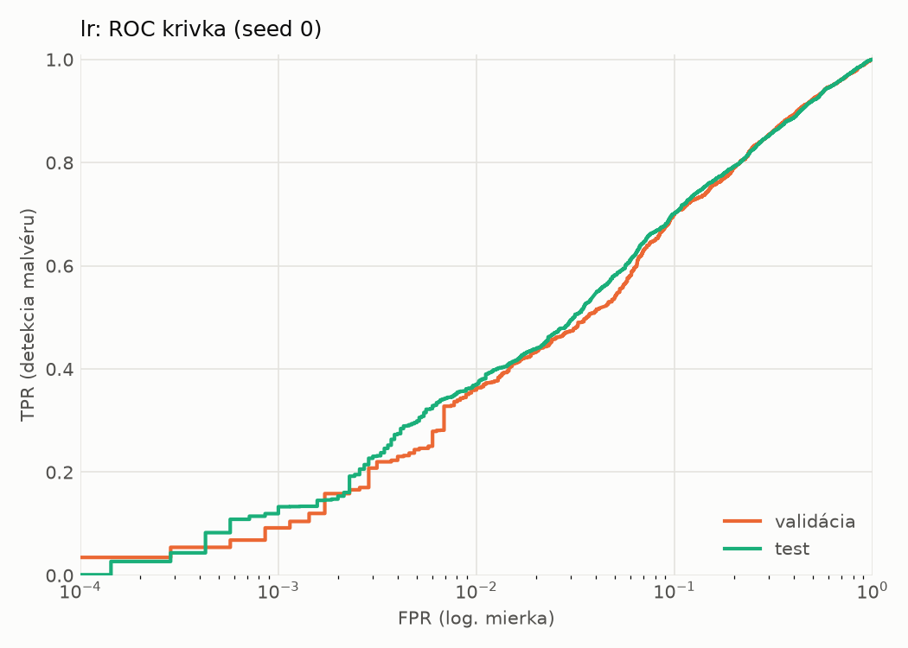
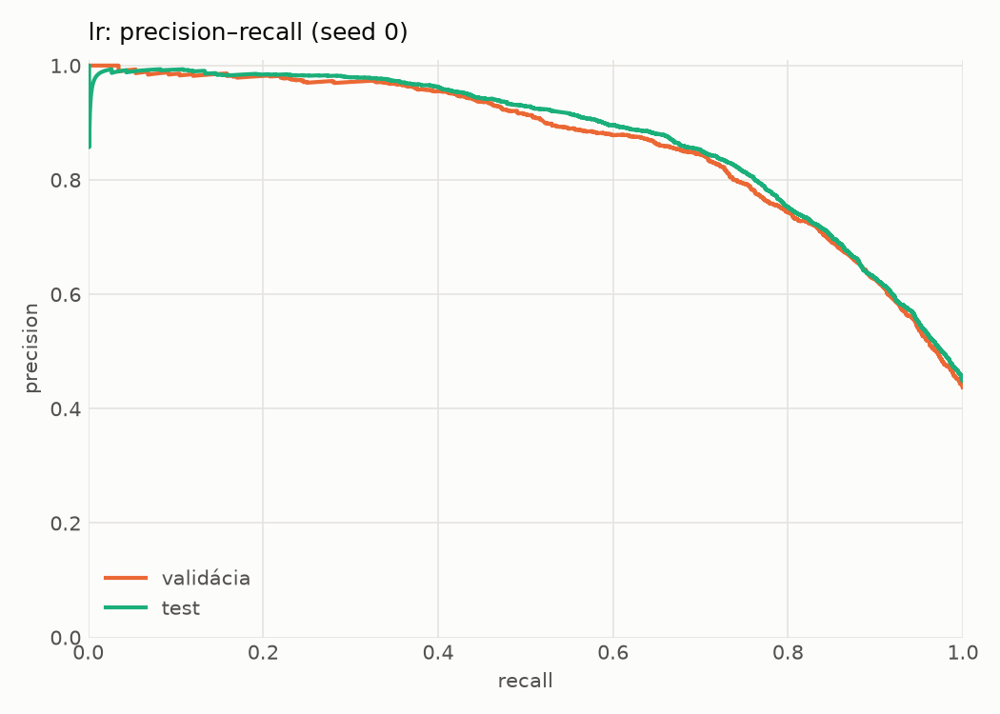
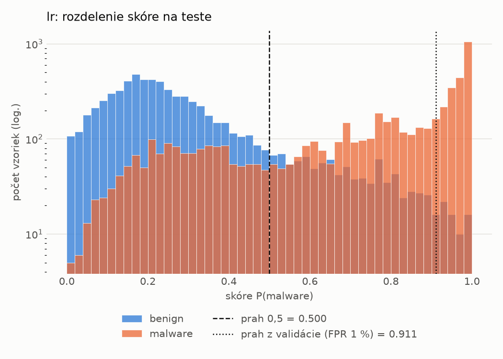
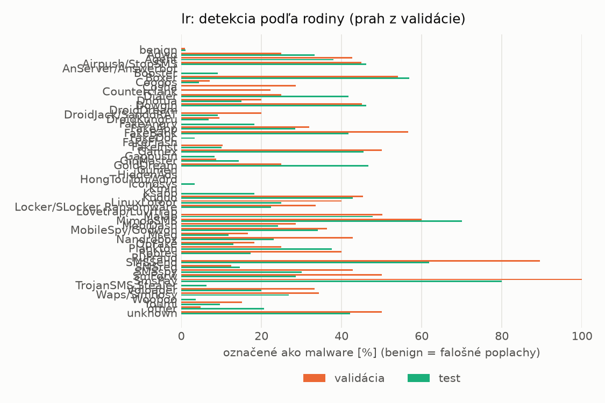
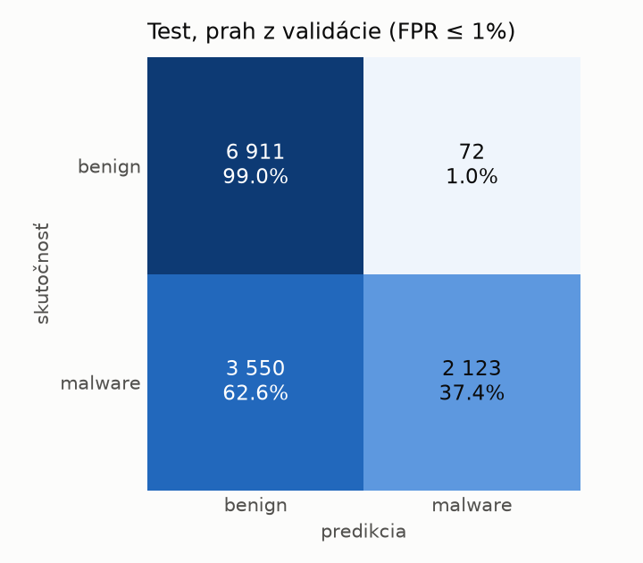
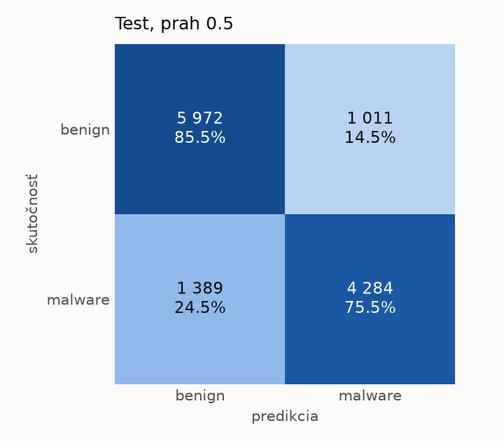

# dynamic/lr – beh `20261123-221517`

> Automaticky generované (`src/training/run_tabular.py`). Konfigurácia: `config.yaml`, protokol: `protocol.yaml`.

- **Model:** `logreg` – logistická regresia s L2 regularizáciou (vstup signed log1p + štandardizácia)
- **Ladenie:** bez ladenia – hyperparametre prevzaté z `runs_v4/emu_p/full/dynamic/lr/20261123-191800`
- **Finálne modely:** seedy [0, 1, 2]; hodnoty sú priemer ± smerodajná odchýlka cez seedy
- **Najlepšie hyperparametre:** `{"max_iter": 2000, "C": 7.504621081078761}`

## Detekčná kvalita (bez prahu)
| metrika | train (podvzorka) | validácia | test |
|---|---|---|---|
| ROC-AUC | 0.8713 ± 0.0000 | 0.8716 ± 0.0000 | 0.8739 ± 0.0000 |
| PR-AUC | 0.8607 ± 0.0000 | 0.8628 ± 0.0000 | 0.8718 ± 0.0000 |
| TPR pri FPR 1 % | 0.3514 ± 0.0000 | 0.3592 ± 0.0000 | 0.3693 ± 0.0000 |
| TPR pri FPR 0,1 % | 0.1103 ± 0.0000 | 0.0919 ± 0.0000 | 0.1195 ± 0.0000 |
| log loss | 0.4421 ± 0.0000 | 0.4417 ± 0.0000 | 0.4359 ± 0.0000 |
| Brier skóre | 0.1404 ± 0.0000 | 0.1406 ± 0.0000 | 0.1390 ± 0.0000 |

Rozdiel ROC-AUC train − validácia: **-0.0003** (veľký rozdiel = preučenie).

## Pri prahu z validácie (FPR ≤ 1% na validácii)
| metrika | train (podvzorka) | validácia | test |
|---|---|---|---|
| accuracy | 0.7212 ± 0.0000 | 0.7144 ± 0.0000 | 0.7138 ± 0.0000 |
| balanced accuracy | 0.6791 ± 0.0000 | 0.6747 ± 0.0000 | 0.6820 ± 0.0000 |
| precision | 0.9570 ± 0.0000 | 0.9662 ± 0.0000 | 0.9672 ± 0.0000 |
| recall (TPR) | 0.3709 ± 0.0000 | 0.3592 ± 0.0000 | 0.3742 ± 0.0000 |
| FPR | 0.0127 ± 0.0000 | 0.0097 ± 0.0000 | 0.0103 ± 0.0000 |
| F1 | 0.5346 ± 0.0000 | 0.5237 ± 0.0000 | 0.5397 ± 0.0000 |
| MCC | 0.4753 ± 0.0000 | 0.4699 ± 0.0000 | 0.4780 ± 0.0000 |

## Pri pevnom prahu 0.5
| metrika | train (podvzorka) | validácia | test |
|---|---|---|---|
| accuracy | 0.8053 ± 0.0000 | 0.8051 ± 0.0000 | 0.8104 ± 0.0000 |
| balanced accuracy | 0.7987 ± 0.0000 | 0.7985 ± 0.0000 | 0.8052 ± 0.0000 |
| precision | 0.7882 ± 0.0000 | 0.7954 ± 0.0000 | 0.8091 ± 0.0000 |
| recall (TPR) | 0.7508 ± 0.0000 | 0.7460 ± 0.0000 | 0.7552 ± 0.0000 |
| FPR | 0.1533 ± 0.0000 | 0.1490 ± 0.0000 | 0.1448 ± 0.0000 |
| F1 | 0.7690 ± 0.0000 | 0.7699 ± 0.0000 | 0.7812 ± 0.0000 |
| MCC | 0.6014 ± 0.0000 | 0.6021 ± 0.0000 | 0.6154 ± 0.0000 |

## Výpočtové nároky (seed 0, testovacia množina)
| meranie | hodnota |
|---|---|
| tréning finálneho modelu | 0.4 s (priemer cez seedy) |
| ladenie spolu | 0 s |
| počet parametrov / uzlov | 124 |
| veľkosť modelu na disku | 0.01 MB |
| transformácia vstupu – latencia (1 vlákno) | 0.005 ms |
| transformácia vstupu – priepustnosť | 1 385 607 vzoriek/s |
| CPU latencia modelu (batch 1, 1 vlákno) | 0.004 ms (p95 0.004) |
| CPU priepustnosť (24 vlákien) | 4 742 917 vzoriek/s |

## Grafy
| | |
|---|---|
|  |  |
|  |  |
|  |  |
|  |  |

## Súbory
`metrics.json` (všetky metriky po seedoch vrátane rodín), `timing.json`, `hpo_trials.csv`,
`predictions/<časť>_seed<N>.parquet` (sha256, family, label, score), `model/seed_<N>/`, `log.txt`.
